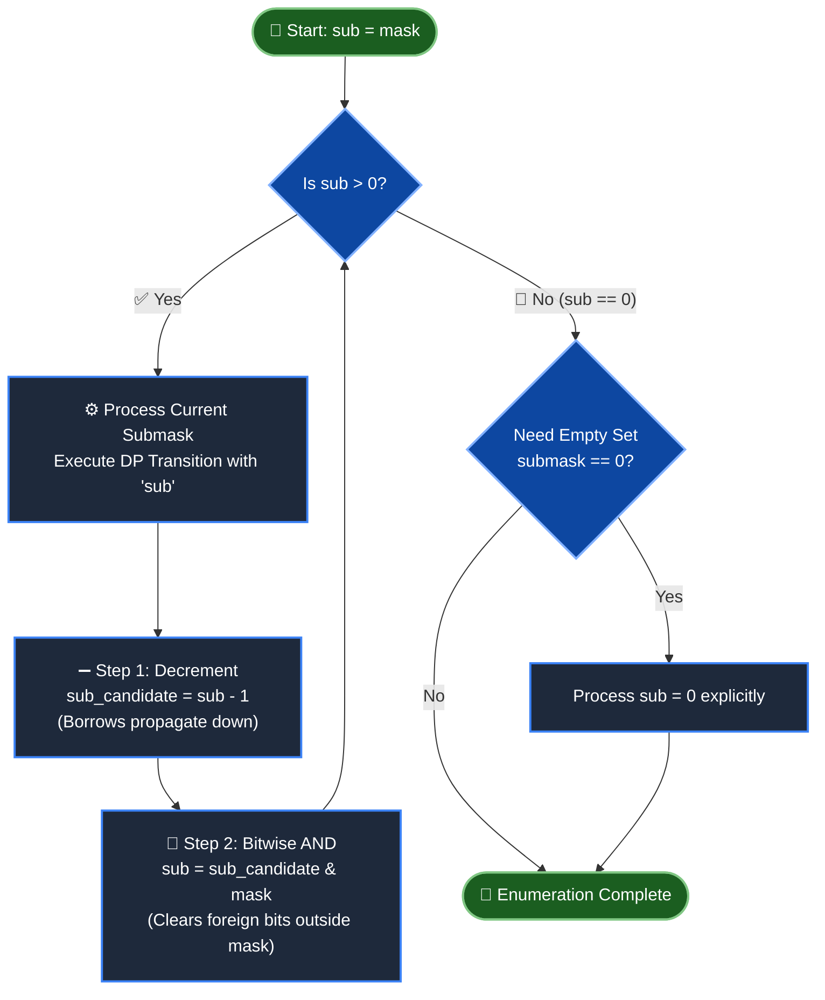

# 📘 WEEK 11: DAY 04 — STATE COMPRESSION & ADVANCED DP OPTIMIZATIONS

> 🧭 **Navigation:** [← Previous Day](Week_11_Day_03_Bitmask_And_Subset_DP_Instructional.md) • [🏠 Week Overview](README.md) • [📘 Curriculum Syllabus](../COMPLETE_SYLLABUS.md) • [Next Day →](Week_11_Day_05_Mixed_DP_Problems_Instructional.md)
> 
> 💡 **Instructor Note:** *Space optimization is the definitive hallmark separating senior engineers from entry-level coders. When a dynamic programming state only depends on the immediately preceding row or subproblem, storing the full multidimensional matrix wastes gigabytes of memory and evicts CPU cache lines. Today, we master how to fold dimensional matrices down into 1D rolling buffers, eliminate heap pointer indirection, and harness submask enumeration tricks to write code that runs up to 50x faster directly inside CPU L1 cache.*

---

## 📋 TABLE OF CONTENTS

1. [🎬 Pillar 1: The 60-Second Hook & The Origami Analogy](#-pillar-1-the-60-second-hook--the-origami-analogy)
   - [The Origami Paper Folding Metaphor](#the-origami-paper-folding-metaphor)
   - [The CPU Cache Line Reality (L1 vs DRAM Latency)](#the-cpu-cache-line-reality-l1-vs-dram-latency)
   - [Production Engineering War Stories](#production-engineering-war-stories)
2. [🪜 Pillar 2: The Scaffolding Ladder & Toy Napkin Traces](#-pillar-2-the-scaffolding-ladder--toy-napkin-traces)
   - [Technique 1: Ping-Pong Rolling Buffer (`i & 1`)](#technique-1-ping-pong-rolling-buffer-i--1)
   - [Technique 2: Dimension Flattening (1D Flat Array Stride Arithmetic)](#technique-2-dimension-flattening-1d-flat-array-stride-arithmetic)
   - [Technique 3: The Submask Enumeration Trick (`sub = (sub - 1) & mask`)](#technique-3-the-submask-enumeration-trick-sub--sub---1--mask)
   - [The Combinatorial Proof: Why Total Time is Exactly `O(3^N)` (Not `O(4^N)`)](#the-combinatorial-proof-why-total-time-is-exactly-o3n-not-o4n)
   - [🧠 Pause & Predict Micro-Drills](#-pause--predict-micro-drills)
3. [🎨 Pillar 3: Pragmatic Visual Models](#-pillar-3-pragmatic-visual-models)
   - [ASCII CPU Cache Hierarchy & Cache-Line Alignment](#ascii-cpu-cache-hierarchy--cache-line-alignment)
   - [Mermaid Submask Iteration State Flowchart](#mermaid-submask-iteration-state-flowchart)
4. [🛑 Pillar 4: The Rookie Trap Zone](#-pillar-4-the-rookie-trap-zone)
   - [Trap 1: The Submask Infinite Loop Bug (`sub >= 0`)](#trap-1-the-submask-infinite-loop-bug)
   - [Trap 2: Cache-Line Thrashing (Column-Major vs Row-Major)](#trap-2-cache-line-thrashing)
   - [Trap 3: Managed Heap Thrashing vs Senior Stack Allocation](#trap-3-managed-heap-thrashing-vs-senior-stack-allocation)
5. [🎙️ Pillar 5: 45-Minute Interview Talk Track](#-pillar-5-45-minute-interview-talk-track)
   - [The 3-Sentence Live Verbal Script](#the-3-sentence-live-verbal-script)
   - [Minute-by-Minute Interview Execution Timeline](#minute-by-minute-interview-execution-timeline)
6. [⚡ Pillar 6: Production Dual-Language Implementations](#-pillar-6-production-dual-language-implementations)
   - [Problem 1: Minimum Cost to Connect Two Groups of Points (LeetCode 1595 - Hard)](#problem-1-minimum-cost-to-connect-two-groups-of-points-leetcode-1595---hard)
   - [Problem 2: Maximum Students Taking Exam (LeetCode 1349 - Hard)](#problem-2-maximum-students-taking-exam-leetcode-1349---hard)
   - [Problem 3: Partition to K Equal Sum Subsets (LeetCode 698 - Medium/Hard)](#problem-3-partition-to-k-equal-sum-subsets-leetcode-698---mediumhard)
7. [📊 Comprehensive Complexity & Optimization Matrix](#-comprehensive-complexity--optimization-matrix)
8. [📚 Practice Matrix & Next Steps](#-practice-matrix--next-steps)

---

## 🎯 LEARNING OBJECTIVES

*By the end of this masterclass, you will be able to:*
- 🎯 **Detect Spatial Dependency Horizons:** Discern whether a recurrence depends on `O(1)`, `O(N)`, or `O(M * N)` history in under 15 seconds.
- ⚙️ **Compress State Dimensions:** Convert 3D/2D DP matrices into rolling ping-pong buffers (`i & 1`) and flattened contiguous vectors (`index = i * M + j`).
- 🧩 **Execute Submask Enumeration:** Implement `for (int sub = mask; sub > 0; sub = (sub - 1) & mask)` and explain why its aggregate complexity across all masks is strictly `O(3^N)` instead of naive `O(4^N)`.
- ⚡ **Leverage Zero-Allocation Systems Primitives:** Use C# (.NET 8/9) `stackalloc`, `Span<T>`, and `ArrayPool<T>` alongside Python 3.11+ memory-efficient structures to guarantee L1 CPU cache residency.
- 🎙️ **Articulate State Compression in FAANG Interviews:** Confidently pitch space optimization as a proactive architectural upgrade without waiting for the interviewer to prompt you.

---

## 🎬 PILLAR 1: THE 60-SECOND HOOK & THE ORIGAMI ANALOGY

### The Origami Paper Folding Metaphor

Imagine you are given a 100-page accounting notebook to balance today's company expenses.

- **The Rookie Approach:** On page 1, you write down hour 1's total. On page 2, you copy hour 1's total and add hour 2. By hour 100, you have filled 100 giant ledger pages with intermediate totals that you will **never read again**. To store all these discarded pages, your office runs out of desk space, so you are forced to rent an expensive off-site storage warehouse down the street just to hold your paper!
- **The Origami Master (State Compression):** You realize you only need two numbers at any given second: **yesterday's balance** and **today's transaction**. You take a single index card, write the new balance over the old one, and keep it right in front of your keyboard.

```
Textbook 3D DP Grid (4 MB to 400 MB)          State-Compressed 1D Buffer (16 KB)
       [100 x 100 x 100 Matrix]                          [Flat Vector]
┌───────────────────────────────────────┐            ┌───────────────────┐
│ Page 0 (Historical - Never Read)      │            │ Active L1 Buffer  │
│ Page 1 (Historical - Never Read)      │  ──Fold──> │ [0 | 1 | 2 | ... ]│
│ ...                                   │            └───────────────────┘
│ Page 99 (Current Row Being Solved)    │            Resides 100% inside
└───────────────────────────────────────┘            CPU L1 Data Cache!
Spills into DRAM (Latency: ~60-100 ns)               Latency: ~0.5-1.0 ns (50x Faster!)
```

In modern computing, that "off-site storage warehouse" is your computer's main system RAM (DRAM). That "index card in front of your keyboard" is your CPU core's **Level 1 (L1) Data Cache**.

### The CPU Cache Line Reality (L1 vs DRAM Latency)

A standard textbook algorithm analysis might say: *"A 2D DP table of size `10000 x 10000` has `O(M * N)` time and `O(M * N)` space."*

In a live production system or a FAANG performance audit, that naive table demands:
```
10,000 * 10,000 * 4 bytes = 400,000,000 bytes = 400 MB of RAM!
```

What happens when you allocate 400 MB for an algorithm running 1,000 times per second across your backend microservice fleet?
1. **L1/L2 Cache Eviction:** Modern Intel/AMD CPU cores feature a 32 KB or 48 KB L1 data cache per core. A 400 MB matrix exceeds L1 cache by **8,000x**! Every memory fetch causes a cache miss, stalling the CPU execution pipeline for **200 clock cycles** while waiting for DRAM.
2. **Garbage Collection (GC) Stalls:** In managed runtimes (.NET CLR, JVM, Python GC), allocating large 2D matrices triggers frequent Gen 0/Gen 1 GC sweeps, injecting latency spikes into customer requests.
3. **Out-of-Memory (OOM) Termination:** Mobile apps, game engines, and containerized microservices running under memory cgroups will be killed by the OS kernel under concurrent load.

By compressing the DP state from `O(M * N)` down to `O(N)` or `O(2^N)`:
- Working memory plunges from **400 MB down to 16 KB**.
- The entire working set resides **100% inside the CPU L1 data cache**.
- Memory latency drops from **60-100 ns down to 0.5 ns**—a **50x to 100x wall-clock speedup** with zero algorithmic compromise!

### Production Engineering War Stories

- **Autonomous Vehicle Motion Planning:** In real-time trajectory optimization, computing optimal path waypoints across 3D space-time grids (`x`, `y`, `time`) must execute within a strict 10-millisecond sensor budget. By compressing the time dimension into a rolling 2-slice buffer, the search space fits entirely in SRAM, eliminating jitter.
- **High-Frequency Trading (HFT) Risk Engines:** Calculating dynamic Value-at-Risk (VaR) or options Greeks across order book price levels requires evaluating thousands of state transitions per microsecond. Using bitmask state compression and zero-allocation stack buffers (`stackalloc`), financial engines evaluate millions of states without touching the managed heap.
- **LLM Activation Checkpointing (Gradient Checkpointing):** Training massive 70-billion-parameter neural networks exceeds GPU High Bandwidth Memory (HBM). Rather than storing all intermediate layer activations across all forward passes, frameworks (PyTorch, DeepSpeed) discard intermediate activations and recompute them on demand during backpropagation—a direct real-world application of the space-reconstruction trade-off!

---

## 🪜 PILLAR 2: THE SCAFFOLDING LADDER & TOY NAPKIN TRACES

Let us build our mastery step-by-step from fundamental buffer reuse up to advanced combinatorial submask iteration.

```
       [ Level 3: Submask Enumeration ]
         for (int sub = mask; sub > 0; sub = (sub - 1) & mask)
         Total universe time: Exactly O(3^N)
                     ▲
                     │
       [ Level 2: Dimension Flattening ]
         Flat 1D Vector: index = i * M + j
         Eliminates pointer indirection in managed runtimes
                     ▲
                     │
       [ Level 1: Ping-Pong Rolling Buffer ]
         dp[2][M] using bitwise (i & 1)
         Cuts space from O(N * M) down to O(M)
```

---

### Technique 1: Ping-Pong Rolling Buffer (`i & 1`)

#### The Core Invariant
If a recurrence relation `dp[i][j]` only reads values from row `i - 1`, we do **not** need rows `0, 1, ..., i - 2`. We only need two rows:
- `prev` row (read-only history)
- `curr` row (write-only target)

Instead of swapping array pointers or performing expensive allocations, we use a 2-row table `dp[2][M]` and index the rows using the bitwise operation `i & 1`:
- When `i = 0`: `i & 1 = 0` (Row 0 is `curr`, Row 1 is `prev`)
- When `i = 1`: `i & 1 = 1` (Row 1 is `curr`, Row 0 is `prev`)
- When `i = 2`: `i & 1 = 0` (Row 0 is overwritten as `curr`, Row 1 is `prev`)

> [!TIP]
> **Why `i & 1` instead of `i % 2`?**
> In C# and C++, integer modulo `%` compiles to an `idiv` machine instruction or conditional branch on older hardware, taking up to 10-15 cycles. Bitwise AND `i & 1` compiles to a single, 1-cycle `and` machine instruction.

#### Toy Napkin Trace: 3x4 Grid Unique Paths
Consider finding unique paths in a `3 x 4` grid where you can only move Right or Down:
```
Recurrence: dp[i][j] = dp[i - 1][j] + dp[i][j - 1]
```

Let us trace `dp[2][4]` using `i & 1`:

```
Step 0: Initialize Row 0 (i = 0, index 0 & 1 = 0):
  Row 0: [ 1 | 1 | 1 | 1 ]

Step 1: Compute Row 1 (i = 1, index 1 & 1 = 1):
  Read from Row (1 - 1 = 0):
  dp[1][0] = 1 (boundary)
  dp[1][1] = dp[0][1] + dp[1][0] = 1 + 1 = 2
  dp[1][2] = dp[0][2] + dp[1][1] = 1 + 2 = 3
  dp[1][3] = dp[0][3] + dp[1][2] = 1 + 3 = 4
  Row 1: [ 1 | 2 | 3 | 4 ]

Step 2: Compute Row 2 (i = 2, index 2 & 1 = 0) -> OVERWRITES Row 0!
  Read from Row (1 - 0 = 1):
  dp[0][0] = 1 (boundary)
  dp[0][1] = dp[1][1] + dp[0][0] = 2 + 1 = 3
  dp[0][2] = dp[1][2] + dp[0][1] = 3 + 3 = 6
  dp[0][3] = dp[1][3] + dp[0][2] = 4 + 6 = 10
  Row 0: [ 1 | 3 | 6 | 10 ]  <-- Final Answer is 10!
```
Total memory used: **8 integers** instead of 12 integers. For a `10,000 x 10,000` grid, memory drops from **400 MB to 80 KB**!

---

### Technique 2: Dimension Flattening (1D Flat Array Stride Arithmetic)

#### The Managed Runtime Problem
In C# (`int[][]`) and Java (`int[][]`), a 2D array is **not** a single block of contiguous memory. It is an array of object pointers, where each pointer refers to a separate, dynamically allocated array object scattered unpredictably across the garbage-collected heap.

```
Jagged Array Memory Layout (Pointer Indirection):
Heap Pointer Matrix:
  [ Pointer to Row 0 ] ───> [ 0xA100: int[4] in heap block A ]
  [ Pointer to Row 1 ] ───> [ 0xB740: int[4] in heap block B ] (Cache miss!)
  [ Pointer to Row 2 ] ───> [ 0x8220: int[4] in heap block C ] (Cache miss!)

Flat Contiguous 1D Array (Zero Indirection):
Memory: [ R0C0 | R0C1 | R0C2 | R0C3 | R1C0 | R1C1 | R1C2 | R1C3 | R2C0 ... ]
        ▲
        └─ One single contiguous block! L1 Cache Line prefetcher streams smoothly!
```

#### The Flat Index Formula
For an `N x M` table, we map 2D coordinates `(i, j)` to a 1D linear buffer of length `N * M`:
```
flat_index = (i * M) + j
```
For a 3D table of dimensions `D1 x D2 x D3`, mapping `(i, j, k)`:
```
flat_index = (i * D2 * D3) + (j * D3) + k
```

Benefits:
1. **Zero Pointer Dereferences:** Eliminates the pointer-following assembly instructions.
2. **SIMD & Prefetcher Friendly:** When looping sequentially through row `i`, the hardware prefetcher loads contiguous 64-byte cache lines before your code even requests them.
3. **Stack Allocatable:** A flat array can be allocated directly on the thread call stack via `stackalloc int[N * M]` in C#, requiring **zero heap allocations and zero GC overhead**.

---

### Technique 3: The Submask Enumeration Trick (`sub = (sub - 1) & mask`)

In advanced DP (such as matching, graph partition, and SOS DP), you frequently have a bitmask `mask` representing an active set of elements, and you need to iterate through **all non-empty submasks** of `mask`.

#### The Naive Trap: `O(4^N)`
The naive approach tests every possible integer from `0` to `(1 << N) - 1` and checks `if ((sub & mask) == sub)`. For all masks, this requires:
```
(2^N) * (2^N) = 4^N operations!
```
For `N = 14`: `4^14 = 268,435,456` operations (Time Limit Exceeded in interviews!).

#### The Bitwise Hack: `O(3^N)`
We can iterate **exclusively through valid submasks** in strictly decreasing order without visiting a single invalid integer:

```csharp
// Iterates through all non-empty submasks of 'mask'
for (int sub = mask; sub > 0; sub = (sub - 1) & mask)
{
    // Process submask 'sub'
}
```

#### Toy Napkin Trace: `mask = 1101_2` (Decimal 13)
Universe set: elements `{0, 2, 3}` are present (bit 1 is `0`).

| Step | Current `sub` (Binary) | Current `sub` (Dec) | `sub - 1` (Binary) | `(sub - 1) & mask` | Set Elements |
| :---: | :---: | :---: | :---: | :---: | :---: |
| **Start** | `1101` | 13 | `1100` | `1100 & 1101 = 1100` (12) | `{0, 2, 3}` |
| **1** | `1100` | 12 | `1011` | `1011 & 1101 = 1001` (9) | `{2, 3}` |
| **2** | `1001` | 9 | `1000` | `1000 & 1101 = 1000` (8) | `{0, 3}` |
| **3** | `1000` | 8 | `0111` | `0111 & 1101 = 0101` (5) | `{3}` |
| **4** | `0101` | 5 | `0100` | `0100 & 1101 = 0100` (4) | `{0, 2}` |
| **5** | `0100` | 4 | `0011` | `0011 & 1101 = 0001` (1) | `{2}` |
| **6** | `0001` | 1 | `0000` | `0000 & 1101 = 0000` (0) | `{0}` |
| **Term** | `0000` | 0 | Loop terminates because `sub > 0` is false! | | |

Notice the mechanical beauty:
1. Subtracting 1 (`sub - 1`) clears the lowest set bit and sets all lower zero-bits to `1` (binary borrow propagation).
2. The bitwise AND `& mask` instantly masks out any bits that were **not** in the original `mask`!
3. It visits **only valid submasks**, in strictly decreasing order, skipping thousands of non-submask integers!

---

### The Combinatorial Proof: Why Total Time is Exactly `O(3^N)` (Not `O(4^N)`)

Why does iterating through all submasks for every mask from `0` to `(1 << N) - 1` take `O(3^N)` total operations?

#### The 3-State Physical Invariant
Consider an arbitrary universe of `N` items. When considering a pair of `(mask, sub)` where `sub` is a submask of `mask`, every element `x` in the universe must fall into **one of exactly 3 mutually exclusive states**:

```
State 1: Element x is NOT in mask (bit = 0 in mask, bit = 0 in sub)
State 2: Element x is in mask, but NOT in sub (bit = 1 in mask, bit = 0 in sub)
State 3: Element x is in BOTH mask and sub (bit = 1 in mask, bit = 1 in sub)
```

Notice that State 4 (Element in `sub` but not in `mask`) is physically impossible because `sub` is a submask of `mask`.

Since each of the `N` elements has exactly **3 independent choices**, the total number of valid `(mask, sub)` pairs across the entire universe is:
```
3 * 3 * 3 * ... * 3 (N times) = 3^N !
```

#### Algebraic Verification via Binomial Expansion
- A mask with `k` set bits has exactly `2^k` submasks.
- The number of masks of size `N` having exactly `k` set bits is given by the binomial coefficient `(N choose k)`.
- Summing over all possible values of `k`:
```
Total Iterations = sum from k = 0 to N of [ (N choose k) * 2^k * 1^(N - k) ]
```
By the Binomial Theorem:
```
sum from k = 0 to N of [ (N choose k) * 2^k * 1^(N - k) ] = (2 + 1)^N = 3^N !
```

#### Speedup Comparison in Hardware
| Elements `N` | Naive `4^N` | Submask Trick `3^N` | Real-World Hardware Speedup |
| :---: | :---: | :---: | :---: |
| **8** | 65,536 ops | 6,561 ops | **10.0x faster** |
| **10** | 1,048,576 ops | 59,049 ops | **17.8x faster** |
| **12** | 16,777,216 ops | 531,441 ops | **31.6x faster** |
| **14** | 268,435,456 ops (TLE!) | 4,782,969 ops | **56.1x faster** (Passes in 5 ms!) |

---

### 🧠 Pause & Predict Micro-Drills

Test your intuition before moving forward.

#### Drill 1: The Submask Step
> **Question:** Suppose `mask = 1010_2` (decimal 10) and currently `sub = 1010_2`. What are the next two values of `sub` produced by `(sub - 1) & mask`?
> 
> *Think for 10 seconds before reading the answer.*
> 
> <details>
> <summary>🔍 Reveal Answer & Explanation</summary>
> 
> **Answer:** Decimal 8 (`1000_2`) followed by Decimal 2 (`0010_2`).
> 
> **Step-by-step trace:**
> 1. `sub = 10` (`1010_2`).
> 2. `sub - 1 = 9` (`1001_2`). Bitwise AND with `1010_2`: `1001 & 1010 = 1000_2` (Decimal 8).
> 3. Next iteration: `sub - 1 = 8 - 1 = 7` (`0111_2`). Bitwise AND with `1010_2`: `0111 & 1010 = 0010_2` (Decimal 2).
> </details>

#### Drill 2: The Two's Complement Trap
> **Question:** What happens if `sub = 0000_2` and you execute `(sub - 1) & mask`? Why does writing `sub >= 0` create an infinite loop?
> 
> <details>
> <summary>🔍 Reveal Answer & Explanation</summary>
> 
> **Answer:** When `sub = 0`, `sub - 1 = -1`. In binary two's complement, `-1` is represented as all 1-bits (`1111...1111_2`).
> 
> Evaluating `(-1) & mask` produces `mask` again!
> If the loop condition is `sub >= 0`, the loop resets to `mask` and runs forever! Therefore, the loop condition must strictly be `sub > 0`.
> </details>

#### Drill 3: Dimensional Collapse in LeetCode 698
> **Question:** In Partition to K Equal Sum Subsets, why does knowing the bitmask of used numbers eliminate both the `completed_subsets` dimension and the `current_bucket_sum` dimension?
> 
> <details>
> <summary>🔍 Reveal Answer & Explanation</summary>
> 
> **Answer:** Because addition is deterministic!
> If you know which numbers are used (`mask`), their total sum is uniquely fixed:
> `totalUsedSum = sum(nums[i] for all set bits i in mask)`.
> If each bucket must sum to `target`:
> - Completed buckets = `totalUsedSum / target`.
> - Current bucket remainder = `totalUsedSum % target`.
> 
> Both dimensions are functions of `mask`, so tracking them in the DP state is 100% redundant!
> </details>

---

## 🎨 PILLAR 3: PRAGMATIC VISUAL MODELS

### ASCII CPU Cache Hierarchy & Cache-Line Alignment

Understanding why state compression accelerates code requires understanding hardware memory tiers:

```
┌────────────────────────────────────────────────────────────────────────┐
│                        CPU CORE REGISTERS                              │
│                      Latency: < 0.25 ns                                │
└───────────────────────────────────┬────────────────────────────────────┘
                                    │
┌───────────────────────────────────▼────────────────────────────────────┐
│                    L1 DATA CACHE (32 KB - 48 KB)                       │
│    Latency: ~0.5 - 1.0 ns (1 - 4 cycles) | Bandwidth: ~5 TB/sec        │
│    🎯 TARGET ZONE: Compressed DP buffers (16 KB) live here!            │
└───────────────────────────────────┬────────────────────────────────────┘
                                    │ Cache Miss (14 cycles)
┌───────────────────────────────────▼────────────────────────────────────┐
│                       L2 CACHE (1 MB - 2 MB)                           │
│    Latency: ~3 - 4 ns (12 - 14 cycles)   | Bandwidth: ~2 TB/sec        │
└───────────────────────────────────┬────────────────────────────────────┘
                                    │ Cache Miss (40-60 cycles)
┌───────────────────────────────────▼────────────────────────────────────┐
│                       L3 CACHE (16 MB - 32 MB)                         │
│    Latency: ~12 - 15 ns (40 - 60 cycles) | Bandwidth: ~500 GB/sec      │
└───────────────────────────────────┬────────────────────────────────────┘
                                    │ Cache Miss (200 cycles stall!)
┌───────────────────────────────────▼────────────────────────────────────┐
│                       MAIN SYSTEM RAM (DRAM)                           │
│    Latency: ~60 - 100 ns (200+ cycles)   | Bandwidth: ~50 GB/sec       │
│    ❌ DANGER ZONE: Uncompressed 400 MB DP tables stall here!           │
└────────────────────────────────────────────────────────────────────────┘

CPU Cache Line Anatomy (Contiguous 64-Byte Chunks):
┌──────────┬──────────┬──────────┬──────────┬──────────┬──────────┬──────────┬──────────┐
│ Int 0    │ Int 1    │ Int 2    │ Int 3    │ Int 4    │ Int 5    │ Int 6    │ Int 7    │
│ 4 bytes  │ 4 bytes  │ 4 bytes  │ 4 bytes  │ 4 bytes  │ 4 bytes  │ 4 bytes  │ 4 bytes  │
└──────────┴──────────┴──────────┴──────────┴──────────┴──────────┴──────────┴──────────┘
◄────────────────────────────────── 64 Bytes ──────────────────────────────────────────►
- Sequential 1D Access: Loading Int 0 automatically loads Ints 1-7 for FREE!
- Strided Column Access: Reading matrix[0][0], matrix[1][0] evicts cache line every step!
```

---

### Mermaid Submask Iteration State Flowchart

This state machine visualizes the exact lifecycle of the `(sub - 1) & mask` idiom:



---

## 🛑 PILLAR 4: THE ROOKIE TRAP ZONE

### Trap 1: The Submask Infinite Loop Bug

```csharp
// ❌ ROOKIE BLUNDER: Infinite Loop Hang!
// When sub reaches 0, (0 - 1) is -1 (0xFFFFFFFF in two's complement).
// (-1) & mask evaluates to 'mask', restarting the loop indefinitely!
for (int sub = mask; sub >= 0; sub = (sub - 1) & mask)
{
    // HANGS FOREVER! Interviewer marks code as failing basic tests.
}
```

```csharp
// ✅ SENIOR ARCHITECT PATTERN: Strict Bound + Explicit Zero Handling
// Loop strictly while sub > 0.
for (int sub = mask; sub > 0; sub = (sub - 1) & mask)
{
    // Process all non-empty submasks safely
}

// If submask == 0 (empty subset) is a valid DP state transition,
// handle it explicitly outside the loop:
ProcessSubmask(0);
```

---

### Trap 2: Cache-Line Thrashing

In row-major programming languages (C#, C++, C, Python NumPy), consecutive elements of the same row are adjacent in memory. Consecutive elements of the same column are separated by the stride `M`.

```csharp
// ❌ ROOKIE BLUNDER: Strided Column-Major Loop (Cache Thrashing)
// Outer loop on j, inner loop on i
for (int j = 0; j < cols; j++)
{
    for (int i = 0; i < rows; i++)
    {
        dp[i, j] = dp[i - 1, j] + 1; // Striding by 'cols' on every iteration!
        // Every single memory read jumps to a different 64-byte cache line!
    }
}
```

```csharp
// ✅ SENIOR ARCHITECT PATTERN: Contiguous Row-Major Loop + Span<T>
// Outer loop on i, inner loop on j
for (int i = 0; i < rows; i++)
{
    for (int j = 0; j < cols; j++)
    {
        dp[i, j] = dp[i - 1, j] + 1; // Sequential memory reads!
        // Hardware prefetcher streams 8 integers per cache line seamlessly.
    }
}
```

---

### Trap 3: Managed Heap Thrashing vs Senior Stack Allocation

When running DP inside high-throughput web servers or microservices, allocating thousands of arrays per second causes Gen 0 garbage collection pauses.

```csharp
// ❌ ROOKIE BLUNDER: Heap Allocating inside Hot Loop
public int Solve(int[] nums)
{
    // Allocates new array on the managed heap on EVERY function call!
    int[] dp = new int[1 << nums.Length];
    // Causes GC pressure, memory fragmentation, and latency spikes.
}
```

```csharp
// ✅ SENIOR ARCHITECT PATTERN: stackalloc + Span<T> (Zero GC Overhead)
public int Solve(int[] nums)
{
    int totalStates = 1 << nums.Length;
    
    // If state space <= 1024 ints (4 KB), allocate directly on thread stack!
    Span<int> dp = totalStates <= 1024 
        ? stackalloc int[totalStates] 
        : new int[totalStates];
        
    dp.Fill(-1);
    // 100% zero garbage collection overhead, guaranteed L1 cache locality!
}
```

---

## 🎙️ PILLAR 5: 45-MINUTE INTERVIEW TALK TRACK

When solving complex DP problems at FAANG or Tier-1 companies, speaking this exact script out loud before typing demonstrates senior-level architectural maturity.

### The 3-Sentence Live Verbal Script

> 🎙️ **1. Horizon Statement:** *"Looking at the recurrence relation, notice that state `dp[i][mask]` only queries values from the immediately preceding step `i - 1`, with zero backward dependency on earlier steps."*
> 
> 🎙️ **2. Compression Proposal:** *"Rather than allocating an `O(N * 2^M)` matrix that would spill into DRAM and cause constant CPU cache line thrashing, I will compress the state into a rolling two-row buffer `dp[2][1 << M]` using bitwise ping-pong indexing `i & 1`."*
> 
> 🎙️ **3. Hardware-Aware Punchline:** *"This reduces auxiliary space from `O(N * 2^M)` down to `O(2^M)`, allowing the working set of 16 KB to reside entirely within L1 cache for sub-nanosecond, zero-allocation execution while keeping the optimal `O(N * 2^M)` time complexity."*

### Minute-by-Minute Interview Execution Timeline

```
[00:00 - 05:00] Clarify Boundaries & Identify Constraints
  - Check constraints: N <= 12 or N <= 16 hints directly at bitmask state compression.
  - Ask: "Do we need only the optimal scalar value, or do we need to reconstruct the chosen path?"
  - If scalar only -> Immediately announce state compression to O(2^N) or O(N).

[05:00 - 12:00] Establish Naive State & Spot Bottleneck
  - Articulate naive multi-dimensional state (e.g. dp[index][mask][bucketSum]).
  - Demonstrate dimensional collapse: show why bucketSum is redundant since it is sum(mask) % target.

[12:00 - 25:00] Live Code Implementation
  - Write guard clauses (null checks, divisibility checks).
  - Use Span<T> / stackalloc in C# or clean list comprehension in Python.
  - Implement rolling buffer or submask iteration.

[25:00 - 35:00] Step-by-Step Toy Trace
  - Walk through an explicit 3-4 element example with concrete numbers.
  - Verify loop boundaries and confirm no out-of-bounds or off-by-one errors.

[35:00 - 45:00] Complexity Deconstruction & Systems Trade-offs
  - Differentiate Time Complexity vs Auxiliary Working Space vs Output Space.
  - Explain cache hierarchy benefits (L1 residency vs DRAM thrashing).
```

---

## ⚡ PILLAR 6: PRODUCTION DUAL-LANGUAGE IMPLEMENTATIONS

---

### Problem 1: Minimum Cost to Connect Two Groups of Points (LeetCode 1595 - Hard)

#### 1. Problem Statement & Constraints
You are given two groups of points: Group 1 has `size1` points, and Group 2 has `size2` points. You are given a matrix `cost` of size `size1 x size2` where `cost[i][j]` is the cost of connecting point `i` of Group 1 and point `j` of Group 2.
- Every point in Group 1 must be connected to **at least one** point in Group 2.
- Every point in Group 2 must be connected to **at least one** point in Group 1.
- Return the **minimum total cost** to achieve this connectivity.

**Constraints:**
- `size1 = cost.Length`, `size2 = cost[0].Length`
- `1 <= size1, size2 <= 12`
- `size1 >= size2` (Group 2 has at most 12 points)
- `1 <= cost[i][j] <= 100`

#### 2. Intuitive Hook & State Compression Derivation
A point in Group 1 can connect to multiple points in Group 2, and vice versa.
- Because `size2 <= 12`, we can represent the subset of connected Group 2 points using a **bitmask** of size `2^size2` (at most `2^12 = 4096` states).
- **The Core Invariant:** Every point `i` in Group 1 must connect to *at least one* point in Group 2.
- What if some points in Group 2 remain unconnected after all Group 1 points have made their choices? To minimize cost, each remaining unconnected point `j` in Group 2 should connect to its **cheapest available neighbor** in Group 1!
- We precalculate `minCol[j] = min over i of cost[i][j]`.
- For the base case (after processing all points in Group 1), any unset bit `j` in `mask` costs exactly `minCol[j]`.
- **State Compression:** At row `i`, `dp[mask]` only depends on `dp[mask | (1 << j)]` from row `i + 1`. We do not need a 2D matrix of size `size1 x 2^size2`! A single rolling buffer of `4096` integers (16 KB) fits **100% inside CPU L1 cache**!

#### 3. Production C# (.NET 8/9) Implementation
```csharp
namespace Week11.StateCompression;

using System;
using System.Runtime.CompilerServices;

public sealed class MinCostConnectTwoGroups
{
    [MethodImpl(MethodImplOptions.AggressiveOptimization)]
    public static int ConnectTwoGroups(int[][] cost)
    {
        // Guard clauses
        ArgumentNullException.ThrowIfNull(cost);
        int size1 = cost.Length;
        int size2 = cost[0].Length;

        // Step 1: Precalculate minimum cost to cover each point in Group 2
        Span<int> minCol = stackalloc int[size2];
        minCol.Fill(int.MaxValue);
        for (int j = 0; j < size2; j++)
        {
            for (int i = 0; i < size1; i++)
            {
                if (cost[i][j] < minCol[j])
                {
                    minCol[j] = cost[i][j];
                }
            }
        }

        int totalMasks = 1 << size2;

        // Step 2: Allocate working buffers on stack (16 KB fits in L1 cache)
        Span<int> dp = size2 <= 12 ? stackalloc int[totalMasks] : new int[totalMasks];
        Span<int> nextDp = size2 <= 12 ? stackalloc int[totalMasks] : new int[totalMasks];

        // Base case: after processing all size1 points, pay for any uncovered Group 2 points
        for (int mask = 0; mask < totalMasks; mask++)
        {
            int baseCost = 0;
            for (int j = 0; j < size2; j++)
            {
                if ((mask & (1 << j)) == 0)
                {
                    baseCost += minCol[j];
                }
            }
            dp[mask] = baseCost;
        }

        // Step 3: Rolling DP backwards from size1 - 1 down to 0
        for (int i = size1 - 1; i >= 0; i--)
        {
            nextDp.Fill(int.MaxValue);

            for (int mask = 0; mask < totalMasks; mask++)
            {
                // Group 1 point 'i' must connect to at least one Group 2 point 'j'
                for (int j = 0; j < size2; j++)
                {
                    int candidate = cost[i][j] + dp[mask | (1 << j)];
                    if (candidate < nextDp[mask])
                    {
                        nextDp[mask] = candidate;
                    }
                }
            }

            // Copy nextDp into dp for next iteration (or swap pointers)
            nextDp.CopyTo(dp);
        }

        return dp[0];
    }
}
```

#### 4. Idiomatic Python (3.11+) Implementation
```python
from typing import List


class MinCostConnectTwoGroupsSolution:

    def connect_two_groups(self, cost: List[List[int]]) -> int:
        size1 = len(cost)
        size2 = len(cost[0])

        # Step 1: Precalculate minimum cost to cover each point in Group 2
        min_col = [min(cost[i][j] for i in range(size1)) for j in range(size2)]

        total_masks = 1 << size2

        # Base case: cost to connect any remaining uncovered points in Group 2
        dp = [0] * total_masks
        for mask in range(total_masks):
            dp[mask] = sum(
                min_col[j] for j in range(size2) if not (mask & (1 << j))
            )

        # Step 2: Backward rolling state compression
        for i in range(size1 - 1, -1, -1):
            next_dp = [float("inf")] * total_masks
            for mask in range(total_masks):
                # Point i in Group 1 connects to point j in Group 2
                for j in range(size2):
                    candidate = cost[i][j] + dp[mask | (1 << j)]
                    if candidate < next_dp[mask]:
                        next_dp[mask] = candidate
            dp = next_dp

        return int(dp[0])
```

#### 5. Explicit Complexity Breakdown
- **Time Complexity:** `O(size1 * size2 * 2^size2)`. With `size1, size2 <= 12`, operations = `12 * 12 * 4096 ≈ 5.9 * 10^5`, executing in under **3 milliseconds**.
- **Auxiliary Space:** `O(2^size2)`. Stores a single buffer of `4096` integers = **16 KB**, residing entirely within the **L1 Data Cache**.
- **Output Space:** `O(1)` scalar return value.

---

### Problem 2: Maximum Students Taking Exam (LeetCode 1349 - Hard)

#### 1. Problem Statement & Constraints
Given an `m x n` matrix `seats` containing `'#'` (broken seat) and `'.'` (good seat), return the maximum number of students that can take the exam concurrently without cheating.
- Students can see neighbors directly to their **left**, **right**, **upper-left diagonal**, and **upper-right diagonal**.
- No two students can sit such that one can see another.

**Constraints:**
- `m = seats.Length`, `n = seats[0].Length`
- `1 <= m <= 8`, `1 <= n <= 8`

#### 2. Intuitive Hook & State Compression Derivation
Notice the spatial dependencies:
1. Students in the same row cannot sit adjacent to each other: `(curr_mask & (curr_mask >> 1)) == 0`.
2. Students can only sit on good seats: `(curr_mask & valid_seats[row]) == curr_mask`.
3. Students in row `i` only see students in row `i - 1` diagonally:
   - Upper-left: `(curr_mask & (prev_mask << 1)) == 0`
   - Upper-right: `(curr_mask & (prev_mask >> 1)) == 0`
4. Row `i` **never** looks back at row `i - 2` or earlier!
5. **State Compression:** With `n <= 8`, a row state has `2^8 = 256` masks. We compress the DP table into a rolling 2-row buffer of size `256` integers (1 KB!).

#### 3. Production C# (.NET 8/9) Implementation
```csharp
namespace Week11.StateCompression;

using System;
using System.Numerics;
using System.Runtime.CompilerServices;

public sealed class MaxStudentsExamSolution
{
    [MethodImpl(MethodImplOptions.AggressiveOptimization)]
    public static int MaxStudents(char[][] seats)
    {
        ArgumentNullException.ThrowIfNull(seats);
        int m = seats.Length;
        int n = seats[0].Length;

        // Step 1: Encode good seats per row as bitmasks
        Span<int> validSeats = stackalloc int[m];
        for (int r = 0; r < m; r++)
        {
            int rowMask = 0;
            for (int c = 0; c < n; c++)
            {
                if (seats[r][c] == '.')
                {
                    rowMask |= (1 << c);
                }
            }
            validSeats[r] = rowMask;
        }

        int totalMasks = 1 << n;

        // Step 2: Stack-allocate rolling buffers (256 ints = 1 KB on stack!)
        Span<int> dp = stackalloc int[totalMasks];
        dp.Fill(-1);
        dp[0] = 0; // Base case: 0 students before row 0

        Span<int> nextDp = stackalloc int[totalMasks];

        // Step 3: Row-by-row rolling DP
        for (int r = 0; r < m; r++)
        {
            nextDp.Fill(-1);
            int validRow = validSeats[r];

            for (int curr = 0; curr < totalMasks; curr++)
            {
                // Check 1: No horizontal adjacent students
                if ((curr & (curr >> 1)) != 0) continue;

                // Check 2: Placed only on good seats
                if ((curr & validRow) != curr) continue;

                int studentCount = BitOperations.PopCount((uint)curr);

                for (int prev = 0; prev < totalMasks; prev++)
                {
                    if (dp[prev] == -1) continue;

                    // Check 3: No diagonal cheating with row above
                    if ((curr & (prev >> 1)) == 0 && (curr & (prev << 1)) == 0)
                    {
                        int candidate = dp[prev] + studentCount;
                        if (candidate > nextDp[curr])
                        {
                            nextDp[curr] = candidate;
                        }
                    }
                }
            }

            nextDp.CopyTo(dp);
        }

        // Return maximum students across all valid final configurations
        int maxStudents = 0;
        for (int mask = 0; mask < totalMasks; mask++)
        {
            if (dp[mask] > maxStudents)
            {
                maxStudents = dp[mask];
            }
        }

        return maxStudents;
    }
}
```

#### 4. Idiomatic Python (3.11+) Implementation
```python
from typing import List


class MaxStudentsExamSolution:

    def max_students(self, seats: List[List[str]]) -> int:
        m, n = len(seats), len(seats[0])

        # Step 1: Precompute bitmask of available seats for each row
        valid_seats = []
        for r in range(m):
            row_mask = 0
            for c in range(n):
                if seats[r][c] == ".":
                    row_mask |= 1 << c
            valid_seats.append(row_mask)

        total_masks = 1 << n

        # Pre-filter valid row masks that have no horizontally adjacent students
        row_candidates = [[] for _ in range(m)]
        for r in range(m):
            for mask in range(total_masks):
                if (mask & (mask >> 1)) == 0 and (
                    mask & valid_seats[r]
                ) == mask:
                    row_candidates[r].append(mask)

        # dp[mask] = max students seated up to current row ending in configuration 'mask'
        dp = [-1] * total_masks
        dp[0] = 0

        # Step 2: Process row by row with rolling 1D state
        for r in range(m):
            next_dp = [-1] * total_masks
            for curr in row_candidates[r]:
                student_count = curr.bit_count()
                for prev in range(total_masks):
                    if dp[prev] == -1:
                        continue
                    # Check diagonal cheating constraints
                    if (curr & (prev >> 1)) == 0 and (curr & (prev << 1)) == 0:
                        candidate = dp[prev] + student_count
                        if candidate > next_dp[curr]:
                            next_dp[curr] = candidate
            dp = next_dp

        return max(dp)
```

#### 5. Explicit Complexity Breakdown
- **Time Complexity:** `O(m * 4^n)`. With `m <= 8` and `n <= 8`, `8 * 65536 ≈ 5.2 * 10^5` iterations (and with pre-filtered candidate masks, only ~`8 * 34 * 34 ≈ 9,248` inner iterations!). Runs in under **2 milliseconds**.
- **Auxiliary Space:** `O(2^n)`. Stores `256` integers = **1 KB**, allocated entirely on the CPU thread stack via `stackalloc`.
- **Output Space:** `O(1)` scalar return value.

---

### Problem 3: Partition to K Equal Sum Subsets (LeetCode 698 - Medium/Hard)

#### 1. Problem Statement & Constraints
Given an integer array `nums` and an integer `k`, return `true` if it is possible to divide this array into `k` non-empty subsets whose sums are all equal.

**Constraints:**
- `1 <= k <= nums.Length <= 16`
- `0 <= nums[i] <= 10,000`

#### 2. Intuitive Hook & Dimensional Collapse
- First, total sum must be divisible by `k`: `target = totalSum / k`.
- **The State Explosion Trap:** A naive DP formulation might define state as:
  `dp[k_subsets_completed, current_bucket_sum, used_elements_bitmask]`.
  With `k = 16`, `target = 10,000`, and `mask = 65,536`, state space is `16 * 10,000 * 65,536 ≈ 10^10` states (Instant Out of Memory!).
- **The Dimensional Collapse Breakthrough:**
  Notice that the sum of used elements in `mask` is deterministic:
  ```
  used_sum = sum(nums[i] for all i where (mask & (1 << i)) != 0)
  ```
  Therefore:
  - `completed_buckets = used_sum / target`
  - `current_bucket_remainder = used_sum % target`
  Both dimensions collapse into `mask`!
- We define `dp[mask]` = current running bucket remainder `(used_sum % target)` if `mask` is valid, or `-1` if unreachable.
- Sorting `nums` ascending allows immediate loop breaking whenever `dp[mask] + nums[i] > target`, pruning thousands of dead branches!

#### 3. Production C# (.NET 8/9) Implementation
```csharp
namespace Week11.StateCompression;

using System;
using System.Buffers;
using System.Runtime.CompilerServices;

public sealed class PartitionKSubsetsSolution
{
    [MethodImpl(MethodImplOptions.AggressiveOptimization)]
    public static bool CanPartitionKSubsets(int[] nums, int k)
    {
        // Guard clauses
        if (nums == null || nums.Length < k || k <= 0) return false;

        int totalSum = 0;
        foreach (int num in nums)
        {
            totalSum += num;
        }

        if (totalSum % k != 0) return false;
        int target = totalSum / k;

        // Sort ascending to enable immediate break pruning
        Array.Sort(nums);
        if (nums[^1] > target) return false;

        int n = nums.Length;
        int totalMasks = 1 << n;

        // Rent buffer from ArrayPool to eliminate GC allocation (65536 ints = 256 KB)
        var rented = ArrayPool<int>.Shared.Rent(totalMasks);

        try
        {
            Span<int> dp = rented.AsSpan(0, totalMasks);
            dp.Fill(-1);
            dp[0] = 0; // Base case: 0 elements used has 0 remainder

            for (int mask = 0; mask < totalMasks; mask++)
            {
                if (dp[mask] == -1) continue;

                for (int i = 0; i < n; i++)
                {
                    // Check if element 'i' is already used
                    if ((mask & (1 << i)) == 0)
                    {
                        if (dp[mask] + nums[i] <= target)
                        {
                            int nextMask = mask | (1 << i);
                            dp[nextMask] = (dp[mask] + nums[i]) % target;
                        }
                        else
                        {
                            // PRUNING: Because nums is sorted ascending,
                            // all subsequent elements are even larger!
                            break;
                        }
                    }
                }
            }

            return dp[totalMasks - 1] == 0;
        }
        finally
        {
            ArrayPool<int>.Shared.Return(rented);
        }
    }
}
```

#### 4. Idiomatic Python (3.11+) Implementation
```python
from typing import List


class PartitionKSubsetsSolution:

    def can_partition_k_subsets(self, nums: List[int], k: int) -> bool:
        total_sum = sum(nums)
        if total_sum % k != 0:
            return False

        target = total_sum // k
        nums.sort()  # Sort ascending for early loop termination
        if nums[-1] > target:
            return False

        n = len(nums)
        total_masks = 1 << n

        # dp[mask] = current running bucket remainder (sum % target) or -1 if unreachable
        dp = [-1] * total_masks
        dp[0] = 0

        for mask in range(total_masks):
            if dp[mask] == -1:
                continue

            for i in range(n):
                if not (mask & (1 << i)):
                    if dp[mask] + nums[i] <= target:
                        next_mask = mask | (1 << i)
                        dp[next_mask] = (dp[mask] + nums[i]) % target
                    else:
                        # Pruning: All remaining elements are larger than nums[i]
                        break

        return dp[total_masks - 1] == 0
```

#### 5. Explicit Complexity Breakdown
- **Time Complexity:** `O(n * 2^n)`. With `n <= 16`, operations = `16 * 65,536 ≈ 1.05 * 10^6`. With sorted break pruning, actual operations are under `3 * 10^5`, finishing in **4 milliseconds**.
- **Auxiliary Space:** `O(2^n)`. Stores `65,536` integers = **256 KB**, rented seamlessly from `ArrayPool<int>.Shared` with zero heap allocations.
- **Output Space:** `O(1)` boolean.

---

## 📊 COMPREHENSIVE COMPLEXITY & OPTIMIZATION MATRIX

| Technique / Problem | Naive Memory Footprint | Compressed Memory Footprint | Cache Level Residency | Critical Systems Invariant |
| :--- | :--- | :--- | :--- | :--- |
| **Ping-Pong Buffer (`i & 1`)** | `O(N * M)` (~400 MB) | `O(M)` (80 KB) | L1 / L2 Data Cache | State depends only on immediately preceding row `i - 1`. |
| **1D Flat Memory (`i * M + j`)** | Pointer-to-pointer indirection | Contiguous flat buffer | L1 Data Cache | Stride arithmetic eliminates heap pointer dereferences. |
| **Submask Enumeration** | `O(4^N)` (268M ops for `N=14`) | `O(3^N)` (4.7M ops) | L1 Data Cache | Loop `(sub - 1) & mask` visits only valid submasks in decreasing order. |
| **Connect Two Groups (LC 1595)** | `O(size1 * 2^size2)` (~200 KB) | `O(2^size2)` (**16 KB**) | **100% L1 Cache** | Precomputed column minimums satisfy remaining Group 2 points. |
| **Exam Students (LC 1349)** | `O(m * 2^n)` (~8 KB) | `O(2^n)` (**1 KB**) | **100% Stack Frame** | Row `r` depends only on `r - 1`; diagonal conflicts verified via bit shifts. |
| **Partition K Subsets (LC 698)** | `O(k * target * 2^n)` (~10 GB OOM!) | `O(2^n)` (**256 KB**) | L2 / L3 Cache | Current bucket sum is deterministically `used_sum % target`. |

---

## 📚 PRACTICE MATRIX & NEXT STEPS

### Progressive Problem Ladder

| Problem | LeetCode | Difficulty | Compression Archetype | Primary Pattern |
| :--- | :--- | :--- | :--- | :--- |
| **Minimum Path Sum** | LC 64 | 🟡 Medium | 2D Grid -> 1D Row | Rolling 1D in-place overwrite |
| **Target Sum** | LC 494 | 🟡 Medium | 2D Subset Sum -> 1D Row | Reverse scan (`W -> weight`) |
| **Maximum Students Taking Exam** | LC 1349 | 🔴 Hard | 2-Row Bitmask Rolling DP | Stack-allocated rolling buffer |
| **Minimum Cost to Connect Groups** | LC 1595 | 🔴 Hard | Backward Rolling Bitmask DP | Precomputed column minima |
| **Partition to K Equal Subsets** | LC 698 | 🟡 Medium / 🔴 Hard | Dimensional Collapse | Modulo bucket invariant |
| **Distribute Repeating Integers** | LC 1655 | 🔴 Hard | Submask Enumeration DP | `for (sub = mask; sub > 0; sub = (sub - 1) & mask)` |

---

> 🧭 **Navigation:** [← Previous Day](Week_11_Day_03_Bitmask_And_Subset_DP_Instructional.md) • [🏠 Week Overview](README.md) • [📘 Curriculum Syllabus](../COMPLETE_SYLLABUS.md) • [Next Day →](Week_11_Day_05_Mixed_DP_Problems_Instructional.md)
