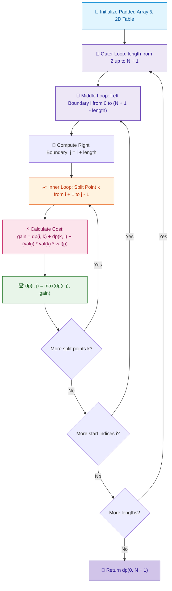

# 📘 WEEK 11: DAY 05 — INTERVAL DP & MIXED DP SYNTHESIS MASTERY

> 🧭 **Navigation:** [← Previous Day](Week_11_Day_04_State_Compression_And_Optimizations_Instructional.md) • [🏠 Week Overview](README.md) • [📘 Curriculum Syllabus](../COMPLETE_SYLLABUS.md) • [Week Playbook →](WEEK_11_FULL_PLAYBOOK.md)
> 
> 💡 **Instructor Note:** *The pinnacle capstone of Week 11. In senior and staff-level FAANG interviews (Google, Meta, Netflix), the most formidable dynamic programming problems obscure their topological ordering: instead of stepping linearly from left to right, they operate over continuous sub-ranges. Master the reverse-thinking "pop-last" paradigm of Interval DP, conquer the classic triumvirate (Burst Balloons, Minimum Cost Tree From Leaf Values, Strange Printer), and synthesize multi-paradigm DP (LIS with Patience Sorting, 2D Envelopes, and FSM Stock Trading).*

---

## 📋 TABLE OF CONTENTS

1. [Learning Objectives](#-learning-objectives)
2. [🎬 Pillar 1: The 60-Second Hook & Everyday Analogy (The Russian Nesting Egg)](#-pillar-1-the-60-second-hook--everyday-analogy)
3. [🪜 Pillar 2: The Scaffolding Ladder & Toy Napkin Traces](#-pillar-2-the-scaffolding-ladder--toy-napkin-traces)
   - [Toy Napkin Trace #1: Burst Balloons (LC 312) — The Reverse-Thinking Breakthrough](#toy-napkin-trace-1-burst-balloons-leetcode-312)
   - [🧠 Pause & Predict: Micro-Drill 1](#-pause--predict-micro-drill-1)
   - [Toy Napkin Trace #2: Matrix Chain Multiplication (MCM)](#toy-napkin-trace-2-matrix-chain-multiplication-mcm)
   - [🧠 Pause & Predict: Micro-Drill 2](#-pause--predict-micro-drill-2)
4. [🎨 Pillar 3: Pragmatic Visual Models](#-pillar-3-pragmatic-visual-models)
   - [ASCII 2D Upper-Triangular Matrix Traversal](#1-ascii-2d-upper-triangular-matrix-traversal)
   - [Mermaid Flowchart: The Interval Expansion Engine](#2-mermaid-flowchart-the-interval-expansion-engine)
5. [🛑 Pillar 4: The Rookie Trap Zone (Blunders vs. Architect Patterns)](#-pillar-4-the-rookie-trap-zone)
   - [Trap 1: The "Burst First" Dependency Explosion](#trap-1-the-burst-first-dependency-explosion)
   - [Trap 2: Row-Major Loop Inversion Disaster](#trap-2-row-major-loop-inversion-disaster)
   - [Trap 3: Sentinel Padding Amnesia](#trap-3-sentinel-padding-amnesia)
6. [🎙️ Pillar 5: 45-Minute Interview Talk Track](#-pillar-5-45-minute-interview-talk-track)
   - [The 3-Sentence Executive Script](#the-3-sentence-executive-script)
   - [The Live 45-Minute Delivery Arc](#the-live-45-minute-delivery-arc)
7. [⚡ Pillar 6: Production Dual-Language Implementations](#-pillar-6-production-dual-language-implementations)
   - [Problem 1: Burst Balloons (LeetCode 312 - Hard)](#problem-1-burst-balloons-leetcode-312---hard)
   - [Problem 2: Minimum Cost Tree From Leaf Values (LeetCode 1130 - Medium/Hard)](#problem-2-minimum-cost-tree-from-leaf-values-leetcode-1130---mediumhard)
   - [Problem 3: Strange Printer (LeetCode 664 - Hard)](#problem-3-strange-printer-leetcode-664---hard)
8. [🧩 Master Synthesis: Multi-Paradigm DP Capstones](#-master-synthesis-multi-paradigm-dp-capstones)
   - [Problem 4: Russian Doll Envelopes (LeetCode 354 - Hard)](#problem-4-russian-doll-envelopes-leetcode-354---hard)
   - [Problem 5: Stock Trading with Cooldown (LeetCode 309 - Medium)](#problem-5-stock-trading-with-cooldown-leetcode-309---medium)
9. [📊 Explicit Complexity Deconstruction](#-explicit-complexity-deconstruction)
10. [📚 Practice Matrix & Interview Traps](#-practice-matrix--interview-traps)

---

## 🎯 LEARNING OBJECTIVES

*By the end of this chapter, you will be able to:*
- 🎯 **Diagnose** Interval Dynamic Programming problems instantly by recognizing continuous range transitions `[i..j]` partitioned by an internal split point `k`.
- 🔄 **Apply** the **Reverse-Thinking Invariant** ("Burst Last" / "Root Last"): invert destructive operations so subproblems remain completely independent and static.
- 📐 **Traverse** the 2D DP state space topologically by **Interval Length** (`len = 2, 3, ... N`), populating the upper-triangular matrix diagonally with zero out-of-order reads.
- ⚙️ **Implement** the core Tier-1 Interval DP canon: **Burst Balloons (LC 312)**, **Minimum Cost Tree From Leaf Values (LC 1130)**, and **Strange Printer (LC 664)** in production-grade C# (.NET 8/9 with `Span<T>` and flat memory awareness) and idiomatic Python (3.11+).
- 🧩 **Synthesize** multi-paradigm combinations: merging DP with **Binary Search (Patience Sorting)** in Russian Doll Envelopes, and **Finite State Machines (FSM)** in Stock Trading.
- 🛑 **Identify & Eliminate** the 3 lethal rookie blunders: forward-choice dependency tangling, row-major loop ordering, and messy boundary conditional logic.
- 🎙️ **Deliver** the exact 3-sentence architectural opening script and lead a 45-minute live technical interview under senior bar-raiser expectations.

---

## 🎬 PILLAR 1: THE 60-SECOND HOOK & EVERYDAY ANALOGY

Welcome to **Week 11 Day 05**!

Picture this: You and I are sitting across from a FAANG bar-raiser. The interviewer slides a deceptively innocent problem across the table:

> *"You have an array of balloons. When you burst balloon `i`, you earn coins equal to `nums[i-1] * nums[i] * nums[i+1]`. After bursting, balloon `i-1` and balloon `i+1` become immediate neighbors. Find the maximum coins you can collect."*

Your immediate human instinct screams: **"Greedy! Let's pop the smallest balloon first to preserve the big ones!"** 

Wait. If `nums = [3, 1, 5, 8]`, popping `1` yields `3 * 1 * 5 = 15`. But what if popping `3` first unlocks a massive `1 * 5 * 8 = 40` product later? Greedy fails.

Then you think: **"Okay, standard Dynamic Programming! I'll process left-to-right from index `0` to `N - 1`!"**

Here is where 90% of candidates crash: **Standard left-to-right DP is mathematically impossible here.** Why? Because whenever you pop a balloon in the middle, the surrounding balloons physically shift and slam together across the crater. The left side and right side are now cross-contaminated!

```text
Initial:          [ 3 ] <---> [ 1 ] <---> [ 5 ] <---> [ 8 ]
Pop 1 First:      [ 3 ] ----------------> [ 5 ] <---> [ 8 ]
                               ^
                     3 and 5 suddenly touch!
              Subproblems are now tangled together!
```

---

### The Analogy: The Russian Nesting Egg (Interval DP)

In standard sequence DP (like Fibonacci or House Robber), you walk down a one-way street: step 1, step 2, step 3.

In **Interval DP**, you are assembling **Russian Nesting Dolls (Matryoshka eggs)**:
1. You cannot start by building the outer giant doll. You must craft the tiny inner egg first (length 1).
2. Then you fit it inside a slightly larger shell (length 2).
3. Then inside a larger shell (length 3), expanding outward until you encapsulate the entire array (length `N`).

```text
                  +-----------------------------------+
                  |  Length N: Whole Array [0 .. N-1]  |
                  |   +---------------------------+   |
                  |   |  Length 3: Range [i .. j]  |   |
                  |   |   +-------------------+   |   |
                  |   |   | Length 1: [k .. k]|   |   |
                  |   |   +-------------------+   |   |
                  |   +---------------------------+   |
                  +-----------------------------------+
```

---

### The Mind-Bending Paradox: Burst FIRST vs. Burst LAST

Now comes the million-dollar algorithmic trick that separates senior engineers from juniors:

Instead of asking: **"Which balloon do I pop FIRST?"**
You must invert the universe and ask: **"Which balloon do I pop LAST?"**

Think about the physical consequences:
- If balloon `k` is the **very last balloon** to pop in the entire interval `(i, j)`, what does that mean?
- It means every single balloon between `i` and `k` has **already vanished**!
- Every single balloon between `k` and `j` has **already vanished**!
- Therefore, when balloon `k` is finally popped, who are its left and right neighbors?
- **Its neighbors are guaranteed to be boundary `i` and boundary `j`!**

Boundary `i` and boundary `j` were never popped; they are frozen in stone. By choosing who dies **last**, the left subproblem `(i, k)` and right subproblem `(k, j)` become **100% independent**. They never touch, never leak state, and never corrupt each other. Optimal substructure is restored!

---

## 🪜 PILLAR 2: THE SCAFFOLDING LADDER & TOY NAPKIN TRACES

Let us build our intuition from the ground up, starting with a concrete toy trace of Burst Balloons, followed by Matrix Chain Multiplication, with active-recall micro-drills along the way.

---

### Toy Napkin Trace #1: Burst Balloons (LeetCode 312)

Let `nums = [3, 1, 5, 8]`.

#### Step 1: Pad with Virtual Boundary 1s
When we burst an edge balloon, LeetCode specifies that out-of-bounds neighbors are treated as having value `1`. 
We pad the array with sentinel `1`s on both sides:

```text
Original:             [   3,   1,   5,   8   ]
Padded (size 6): [ 1,   3,   1,   5,   8,   1 ]
Indices:           0    1    2    3    4    5
```

Original balloons live at indices `1, 2, 3, 4`. Indices `0` and `5` are immovable boundary sentinels.

#### Step 2: Define the Invariant Contract
Let `dp[i, j]` represent the **maximum coins earned by bursting all balloons strictly BETWEEN boundary index `i` and boundary index `j` (exclusive open interval `(i, j)`)**.

```text
Interval (i, j):  Balloons strictly inside are { i + 1, i + 2, ..., j - 1 }
Interval Length:  len = j - i

Base Case:
If len = 1 (e.g., j = i + 1):
There are NO balloons between i and j.
dp[i, i + 1] = 0

Transition for interval (i, j):
Choose balloon k in { i + 1 .. j - 1 } to be the LAST balloon popped in (i, j):

dp[i, j] = max_{k = i + 1 .. j - 1} (
               dp[i, k]                         // Left subproblem: pop all in (i, k)
             + dp[k, j]                         // Right subproblem: pop all in (k, j)
             + padded[i] * padded[k] * padded[j] // k pops last against boundaries i and j!
           )
```

Notice the beauty: In `dp[i, k]`, `k` is the right boundary (unpopped). In `dp[k, j]`, `k` is the left boundary (unpopped). Balloon `k` remains standing as a protective shield while both subproblems clear out their interiors. Then, `k` pops last!

---

#### Step 3: Diagonal Tabulation by Interval Length (`len = j - i`)

Let us trace each length level:

```text
Padded:   [ 1,  3,  1,  5,  8,  1 ]
Index:      0   1   2   3   4   5
```

##### 🟢 Length = 1 (`j = i + 1`): Empty intervals
`dp[0, 1] = dp[1, 2] = dp[2, 3] = dp[3, 4] = dp[4, 5] = 0`.

##### 🟡 Length = 2 (`j = i + 2`): Exactly 1 balloon inside (`k = i + 1`)
- **Interval `(0, 2)` (balloon 1, val 3):**
  `k = 1`: `dp[0, 1] + dp[1, 2] + padded[0] * padded[1] * padded[2] = 0 + 0 + (1 * 3 * 1) = 3`
  `dp[0, 2] = 3`
- **Interval `(1, 3)` (balloon 2, val 1):**
  `k = 2`: `dp[1, 2] + dp[2, 3] + padded[1] * padded[2] * padded[3] = 0 + 0 + (3 * 1 * 5) = 15`
  `dp[1, 3] = 15`
- **Interval `(2, 4)` (balloon 3, val 5):**
  `k = 3`: `dp[2, 3] + dp[3, 4] + padded[2] * padded[3] * padded[4] = 0 + 0 + (1 * 5 * 8) = 40`
  `dp[2, 4] = 40`
- **Interval `(3, 5)` (balloon 4, val 8):**
  `k = 4`: `dp[3, 4] + dp[4, 5] + padded[3] * padded[4] * padded[5] = 0 + 0 + (5 * 8 * 1) = 40`
  `dp[3, 5] = 40`

##### 🟠 Length = 3 (`j = i + 3`): Exactly 2 balloons inside
- **Interval `(0, 3)` (balloons 1, 2, values 3, 1):**
  - If `k = 1` popped last: `dp[0, 1] + dp[1, 3] + padded[0] * padded[1] * padded[3] = 0 + 15 + (1 * 3 * 5) = 30`
  - If `k = 2` popped last: `dp[0, 2] + dp[2, 3] + padded[0] * padded[2] * padded[3] = 3 + 0 + (1 * 1 * 5) = 8`
  - `dp[0, 3] = max(30, 8) = 30`
- **Interval `(1, 4)` (balloons 2, 3, values 1, 5):**
  - If `k = 2` popped last: `dp[1, 2] + dp[2, 4] + padded[1] * padded[2] * padded[4] = 0 + 40 + (3 * 1 * 8) = 64`
  - If `k = 3` popped last: `dp[1, 3] + dp[3, 4] + padded[1] * padded[3] * padded[4] = 15 + 0 + (3 * 5 * 8) = 135`
  - `dp[1, 4] = max(64, 135) = 135`
- **Interval `(2, 5)` (balloons 3, 4, values 5, 8):**
  - If `k = 3` popped last: `dp[2, 3] + dp[3, 5] + padded[2] * padded[3] * padded[5] = 0 + 40 + (1 * 5 * 1) = 45`
  - If `k = 4` popped last: `dp[2, 4] + dp[4, 5] + padded[2] * padded[4] * padded[5] = 40 + 0 + (1 * 8 * 1) = 48`
  - `dp[2, 5] = max(45, 48) = 48`

##### 🔴 Length = 4 (`j = i + 4`): Exactly 3 balloons inside
- **Interval `(0, 4)` (balloons 1, 2, 3, values 3, 1, 5):**
  - If `k = 1` popped last: `dp[0, 1] + dp[1, 4] + (1 * 3 * 8) = 0 + 135 + 24 = 159`
  - If `k = 2` popped last: `dp[0, 2] + dp[2, 4] + (1 * 1 * 8) = 3 + 40 + 8 = 51`
  - If `k = 3` popped last: `dp[0, 3] + dp[3, 4] + (1 * 5 * 8) = 30 + 0 + 40 = 70`
  - `dp[0, 4] = max(159, 51, 70) = 159`
- **Interval `(1, 5)` (balloons 2, 3, 4, values 1, 5, 8):**
  - If `k = 2` popped last: `dp[1, 2] + dp[2, 5] + (3 * 1 * 1) = 0 + 48 + 3 = 51`
  - If `k = 3` popped last: `dp[1, 3] + dp[3, 5] + (3 * 5 * 1) = 15 + 40 + 15 = 70`
  - If `k = 4` popped last: `dp[1, 4] + dp[4, 5] + (3 * 8 * 1) = 135 + 0 + 24 = 159`
  - `dp[1, 5] = max(51, 70, 159) = 159`

##### 🟣 Length = 5 (`j = i + 5`): The Whole Array `(0, 5)`
- **Target `dp[0, 5]`:**
  - If `k = 1`: `dp[0, 1] + dp[1, 5] + (1 * 3 * 1) = 0 + 159 + 3 = 162`
  - If `k = 2`: `dp[0, 2] + dp[2, 5] + (1 * 1 * 1) = 3 + 48 + 1 = 52`
  - If `k = 3`: `dp[0, 3] + dp[3, 5] + (1 * 5 * 1) = 30 + 40 + 5 = 75`
  - If `k = 4`: `dp[0, 4] + dp[4, 5] + (1 * 8 * 1) = 159 + 0 + 8 = 167`
  - `dp[0, 5] = max(162, 52, 75, 167) = 167`!

Final Answer: **167 Coins!**

#### Physical Popping Order for 167 Coins:
1. Pop `1` (index 2): `3 * 1 * 5 = 15`. Array remaining: `[3, 5, 8]`.
2. Pop `5` (index 3): `3 * 5 * 8 = 120`. Array remaining: `[3, 8]`.
3. Pop `3` (index 1): `1 * 3 * 8 = 24`. Array remaining: `[8]`.
4. Pop `8` (index 4) **LAST**: `1 * 8 * 1 = 8`.
Total: `15 + 120 + 24 + 8 = 167`!

---

### 🧠 Pause & Predict: Micro-Drill 1
> **Scenario:** In our calculation of `dp[0, 5]`, candidate `k = 4` produced the optimal score `167`.
> 
> **Question:** When candidate `k = 4` is popped *last*, why did its burst value multiply by `padded[0]` (1) and `padded[5]` (1), rather than `3` or `5`?
> 
> *Answer:* Because `k = 4` was designated as the LAST balloon to pop in the entire range `(0, 5)`. By definition of "last", balloons 1, 2, and 3 have already been popped and eliminated! The only elements remaining alive to the left and right of balloon 4 are the outer boundaries `0` and `5`!

---

### Toy Napkin Trace #2: Matrix Chain Multiplication (MCM)

The ancestral parent of all Interval DP is **Matrix Chain Multiplication**.

**Problem:** You are given `N` matrices: `A1, A2, ..., AN`.
Multiplying an `r * c` matrix by a `c * k` matrix costs `r * c * k` scalar multiplications.
Matrix multiplication is associative: `(A * B) * C = A * (B * C)`.
Find the optimal parenthesization to minimize total scalar multiplications.

Let dimensions array `p = [10, 30, 5, 60]`.
- Matrix `A1`: `10 * 30`
- Matrix `A2`: `30 * 5`
- Matrix `A3`: `5 * 60`

Here `N = 3` matrices. Dimensions are given by `p[0..3]`, where matrix `Ai` has dimension `p[i-1] * p[i]`.

#### Invariant Contract
Let `dp[i, j]` be the minimum scalar multiplications to compute the product `Ai * A(i+1) * ... * Aj` (1-indexed inclusive interval `[i..j]`).

```text
Base Case:
dp[i, i] = 0 (a single matrix costs 0 multiplications)

Transition:
To compute [i..j], split into two sub-chains [i..k] and [k+1..j] for all k in [i .. j-1]:

dp[i, j] = min_{k = i .. j-1} (
               dp[i, k]                     // Cost to multiply left chain
             + dp[k+1, j]                   // Cost to multiply right chain
             + p[i-1] * p[k] * p[j]         // Cost to multiply resulting two matrices!
           )
```

#### The Napkin Grid Walkthrough

##### 🟢 Length = 1: Single matrices
`dp[1, 1] = 0`, `dp[2, 2] = 0`, `dp[3, 3] = 0`.

##### 🟡 Length = 2: Chains of 2 matrices
- **`dp[1, 2]` (`A1 * A2`):**
  Split `k = 1`: `dp[1, 1] + dp[2, 2] + p[0] * p[1] * p[2] = 0 + 0 + (10 * 30 * 5) = 1500`.
- **`dp[2, 3]` (`A2 * A3`):**
  Split `k = 2`: `dp[2, 2] + dp[3, 3] + p[1] * p[2] * p[3] = 0 + 0 + (30 * 5 * 60) = 9000`.

##### 🔴 Length = 3: Chain of 3 matrices (`A1 * A2 * A3`) -> `dp[1, 3]`
- **Option 1: Split at `k = 1` -> `(A1) * (A2 * A3)`:**
  `dp[1, 1] + dp[2, 3] + p[0] * p[1] * p[3] = 0 + 9000 + (10 * 30 * 60) = 9000 + 18000 = 27000`.
- **Option 2: Split at `k = 2` -> `(A1 * A2) * (A3)`:**
  `dp[1, 2] + dp[3, 3] + p[0] * p[2] * p[3] = 1500 + 0 + (10 * 5 * 60) = 1500 + 3000 = 4500`.

`dp[1, 3] = min(27000, 4500) = 4500` scalar multiplications!

Notice the difference:
- `(A1 * (A2 * A3))` requires **27,000** operations.
- `((A1 * A2) * A3)` requires only **4,500** operations — a **6x speedup** purely from parenthesis ordering!

---

### 🧠 Pause & Predict: Micro-Drill 2
> **Scenario:** Compare the recurrence of Burst Balloons with Matrix Chain Multiplication:
> - MCM: `dp[i, k] + dp[k+1, j] + p[i-1] * p[k] * p[j]`
> - Balloons: `dp[i, k] + dp[k, j] + padded[i] * padded[k] * padded[j]`
> 
> **Question:** Why does MCM use `dp[k+1, j]` while Burst Balloons uses `dp[k, j]`?
> 
> *Answer:* MCM uses **closed intervals** `[i..k]` and `[k+1..j]` because matrix `k` belongs to the left product and matrix `k+1` belongs to the right product (they are disjoint subsets of matrices). In Burst Balloons, we use **open intervals** `(i, k)` and `(k, j)` because balloon `k` serves as the outer unpopped boundary for both sides! Both formulations represent optimal substructure over ranges.

---

## 🎨 PILLAR 3: PRAGMATIC VISUAL MODELS

---

### 1. ASCII 2D Upper-Triangular Matrix Traversal

In standard 2D DP (like Edit Distance or Grid Unique Paths), you traverse row-by-row:
`for i in 0..M: for j in 0..N:`.

In Interval DP, **row-major traversal is fatal**. To compute `dp[i, j]`, you need `dp[k, j]` (where `k > i`), which belongs to a *later* row that has not been computed yet!

You must traverse **diagonally by interval length `len`**:

```text
===================================================================================
       INTERVAL DP TOPOLOGICAL ORDER: DIAGONAL TRAVERSAL (len = 2, 3, 4, 5)
===================================================================================

    j ->   0       1       2       3       4       5
  i   +-------+-------+-------+-------+-------+-------+
  0   |   0   |  len1 |  len2 |  len3 |  len4 | 🎯len5| <--- dp[0, 5] (Final Answer)
      +-------+-------+-------+-------+-------+-------+
  1   |   X   |   0   |  len1 |  len2 |  len3 |  len4 |
      +-------+-------+-------+-------+-------+-------+
  2   |   X   |   X   |   0   |  len1 |  len2 |  len3 |
      +-------+-------+-------+-------+-------+-------+
  3   |   X   |   X   |   X   |   0   |  len1 |  len2 |
      +-------+-------+-------+-------+-------+-------+
  4   |   X   |   X   |   X   |   X   |   0   |  len1 |
      +-------+-------+-------+-------+-------+-------+
  5   |   X   |   X   |   X   |   X   |   X   |   0   |
      +-------+-------+-------+-------+-------+-------+

Legend:
  0     : Main Diagonal (i == j, length 0, value 0)
  len1  : Diagonal 1 (j = i + 1, empty interior, value 0)
  len2  : Diagonal 2 (j = i + 2, 1 balloon inside, computed 1st)
  len3  : Diagonal 3 (j = i + 3, 2 balloons inside, computed 2nd)
  len4  : Diagonal 4 (j = i + 4, 3 balloons inside, computed 3rd)
  🎯len5: Top-Right Corner (j = i + 5, whole array, computed LAST)
  X     : Lower triangle (invalid since j < i, left unused)
```

---

### How Cell `dp[i, j]` Aggregates Its Subproblems

```text
To compute cell dp[i, j] (marked 🎯):
We scan split point k from i+1 to j-1:

Row i:      [ dp[i, i+1]  ...  dp[i, k]  ...  🎯dp[i, j] ]
                                  ^
                                  | Reads cell in SAME row (to the left)

Col j:                                  [ dp[i, j] ]  🎯
                                             |
                                        [ dp[k, j] ]
                                             ^
                                             | Reads cell in SAME col (below)

Mechanical Guarantee:
Every cell read (dp[i, k] and dp[k, j]) has length strictly smaller than j - i.
Because we iterate by increasing length, both dependencies are 100% computed!
```

---

### 2. Mermaid Flowchart: The Interval Expansion Engine

The following flowchart captures the exact loop invariant of the 3-layer Interval DP solver:



---

## 🛑 PILLAR 4: THE ROOKIE TRAP ZONE

---

### Trap 1: The "Burst First" Dependency Explosion

A candidate attempts to formulate the state by choosing which balloon to pop **first**:

```csharp
// ❌ ROOKIE BLUNDER: Choosing balloon k to pop FIRST
// Result: Left and right partitions now touch each other, tangling state!
int SolveFirst(int[] nums, int i, int j)
{
    // If we pop k first, what are its neighbors? nums[k-1] and nums[k+1].
    // BUT when solving the remaining balloons, popping something in [i..k-1]
    // can now interact with [k+1..j]!
    // The subproblems are NOT independent!
    // Time Complexity explodes to O(N!) or state requires full bitmask O(2^N * N)!
}
```

```csharp
// ✅ SENIOR ARCHITECT PATTERN: Choosing balloon k to pop LAST
// Invariant: Because k pops last in (i, j), all balloons inside (i, k) and (k, j)
// are already gone. The neighbors of k are GUARANTEED to be i and j!
for (int k = i + 1; k < j; k++)
{
    int coins = dp[i, k] + dp[k, j] + (padded[i] * padded[k] * padded[j]);
    dp[i, j] = Math.Max(dp[i, j], coins);
}
```

---

### Trap 2: Row-Major Loop Inversion Disaster

A rookie writes DP loops in standard array row-major order:

```csharp
// ❌ ROOKIE BLUNDER: Row-major nested loops
for (int i = 0; i <= n + 1; i++)
{
    for (int j = i + 2; j <= n + 1; j++)
    {
        for (int k = i + 1; k < j; k++)
        {
            // 💥 FATAL BUG: dp[k, j] has NOT been computed yet!
            // When i = 0 and k = 3, dp[3, j] is on row 3, which is uninitialized (0)!
            dp[i, j] = Math.Max(dp[i, j], dp[i, k] + dp[k, j] + ...);
        }
    }
}
```

```csharp
// ✅ SENIOR ARCHITECT PATTERN: Loop by INTERVAL LENGTH
// Guarantees all subproblems of length L - 1, L - 2, ... are fully resolved!
for (int length = 2; length <= n + 1; length++)
{
    for (int i = 0; i <= n + 1 - length; i++)
    {
        int j = i + length;
        for (int k = i + 1; k < j; k++)
        {
            // dp[i, k] has length (k - i) < length
            // dp[k, j] has length (j - k) < length
            // Both are GUARANTEED to be fully computed and in cache!
            dp[i, j] = Math.Max(dp[i, j], dp[i, k] + dp[k, j] + padded[i] * padded[k] * padded[j]);
        }
    }
}
```

---

### Trap 3: Sentinel Padding Amnesia

Handling edge-case balloons with messy conditional branching:

```csharp
// ❌ ROOKIE BLUNDER: Spaghetti branching for out-of-bound boundaries
int leftVal = (i - 1 < 0) ? 1 : nums[i - 1];
int rightVal = (j + 1 >= nums.Length) ? 1 : nums[j + 1];
// Misses intermediate boundaries and invites off-by-one errors!
```

```csharp
// ✅ SENIOR ARCHITECT PATTERN: Pre-pad with sentinel 1s
// Clean, branch-free, uniform O(1) index lookups:
int[] padded = new int[n + 2];
padded[0] = 1;
padded[n + 1] = 1;
Array.Copy(nums, 0, padded, 1, n);
// Now original elements live cleanly at [1 .. n]!
```

---

## 🎙️ PILLAR 5: 45-MINUTE INTERVIEW TALK TRACK

When interviewing for Senior, Staff, or Principal roles at Google, Meta, or Amazon, your verbal delivery during the first 3 minutes dictates the trajectory of the entire interview.

---

### The 3-Sentence Executive Script

Speak these 3 sentences out loud before typing a single character of code:

> 1. *"Because bursting a balloon alters the adjacency of its surrounding elements, a forward-looking choice creates dynamic dependencies between subproblems. Therefore, I will invert the decision space and determine which balloon pops **LAST** in any candidate interval `(i, j)`."*
> 
> 2. *"By designating balloon `k` as the last balloon to pop in `(i, j)`, its adjacent neighbors are physically guaranteed to be the static boundaries `i` and `j`, isolating the interval into two completely independent subproblems: `dp[i, k]` and `dp[k, j]`."*
> 
> 3. *"Because an interval of length `L` depends strictly on sub-intervals of length less than `L`, we tabulate bottom-up ordered by increasing interval length from 2 to `N + 1`, yielding an optimal `O(N^3)` time and `O(N^2)` auxiliary space algorithm with zero recursion overhead."*

---

### The Live 45-Minute Delivery Arc

```text
[Minute 00-05] Clarification, Boundaries & Invariant Inversion
- Confirm constraints: nums.length up to 300, elements non-negative (0 to 100).
- Confirm boundary behavior: out-of-bounds neighbors treated as 1.
- State the baseline: Exhaustive permutation search of bursting order is O(N!), completely infeasible for N = 300.
- State the pivotal leap: "If we pop first, subproblems touch. If we pop last, boundaries remain fixed."

[Minute 05-15] Mathematical Recurrence & Table Geometry
- Define state: dp[i, j] = max coins bursting all balloons in open interval (i, j).
- State recurrence: dp[i, j] = max_{k=i+1..j-1} (dp[i, k] + dp[k, j] + padded[i] * padded[k] * padded[j]).
- Draw the 2D upper-triangular matrix: Explain why row-major traversal fails and why length-based diagonal traversal is topologically required.

[Minute 15-28] Idiomatic Production Implementation
- Pad array with 1s on left and right.
- Write 3 clean loops: length (2 to N+1), left index i, split index k.
- Highlight zero-allocation memory awareness in C# (.NET 8/9 Span<T>) and idiomatic Python 3.11+.

[Minute 28-38] Visual Dry Run & Edge-Case Verification
- Dry run on [3, 1, 5, 8] verifying cell dp[0, 2] = 3, dp[1, 3] = 15, ..., dp[0, 5] = 167.
- Test edge cases:
  1. Empty array: nums = [] -> return 0.
  2. Single element: nums = [5] -> padded = [1, 5, 1] -> 1 * 5 * 1 = 5.
  3. Two elements: nums = [1, 5] -> padded = [1, 1, 5, 1] -> max(1*1*5 + 1*5*1, 1*5*1 + 1*1*1) = 5 + 5 = 10.
  4. Array with zeroes: nums = [0, 3] -> handles multiplication correctly without division-by-zero risk.

[Minute 38-45] Complexity Deconstruction & Staff-Level Extensions
- Time Complexity: O(N^3) (outer length O(N), start index O(N), split point O(N)). For N = 300, N^3 / 6 ~ 4.5 * 10^6 iterations, executing in ~15 ms.
- Auxiliary Space: O(N^2) for 2D DP matrix.
- Senior Extension: Discuss Knuth's Optimization (when quadrangle inequality holds, reducing O(N^3) to O(N^2)), and compare Interval DP with Greedy Monotonic Stacks (as seen in LC 1130).
```

---

## ⚡ PILLAR 6: PRODUCTION DUAL-LANGUAGE IMPLEMENTATIONS

---

### Problem 1: Burst Balloons (LeetCode 312 - Hard)

**Problem Statement:** You are given `n` balloons, indexed from `0` to `n - 1`. Each balloon is painted with a number on it represented by an array `nums`. You are asked to burst all the balloons. If you burst balloon `i`, you will get `nums[i - 1] * nums[i] * nums[i + 1]` coins. If `i - 1` or `i + 1` goes out of bounds, treat it as a balloon with a `1` painted on it. Return the maximum coins you can collect by bursting the balloons wisely.

#### C# (.NET 8/9 Production Implementation)

```csharp
namespace Week11.IntervalDP;

using System;

public sealed class BurstBalloonsSolution
{
    /// <summary>
    /// Computes the maximum coins earned by bursting balloons using Interval DP.
    /// Open interval formulation: dp[i, j] represents balloons strictly between i and j.
    /// 
    /// Invariant: Balloon k is chosen as the LAST balloon to burst in interval (i, j).
    /// Time Complexity: O(N^3) where N = nums.Length
    /// Auxiliary Space: O(N^2) for the DP table
    /// </summary>
    public static int MaxCoins(int[]? nums)
    {
        // Guard clause for empty or null input
        if (nums is null || nums.Length == 0)
        {
            return 0;
        }

        int n = nums.Length;

        // Pad boundaries with sentinel 1s: padded array of length n + 2
        // Using stackalloc for small N to eliminate heap allocation overhead
        Span<int> padded = n <= 128 ? stackalloc int[n + 2] : new int[n + 2];
        padded[0] = 1;
        padded[n + 1] = 1;
        for (int m = 0; m < n; m++)
        {
            padded[m + 1] = nums[m];
        }

        // dp[i, j] stores max coins from open interval (i, j)
        // Dimensions: (n + 2) x (n + 2)
        int[,] dp = new int[n + 2, n + 2];

        // length represents the gap between outer boundaries: length = j - i
        // Minimum length is 2 (e.g., (0, 2) contains exactly 1 balloon: index 1)
        // Maximum length is n + 1 (e.g., (0, n + 1) covers all original balloons)
        for (int length = 2; length <= n + 1; length++)
        {
            for (int i = 0; i <= n + 1 - length; i++)
            {
                int j = i + length;

                // Pick balloon k in { i + 1 .. j - 1 } to be burst LAST in this range
                for (int k = i + 1; k < j; k++)
                {
                    int coins = dp[i, k] 
                              + dp[k, j] 
                              + (padded[i] * padded[k] * padded[j]);

                    if (coins > dp[i, j])
                    {
                        dp[i, j] = coins;
                    }
                }
            }
        }

        // Return the full open interval covering all original balloons
        return dp[0, n + 1];
    }
}
```

#### Python (3.11+ Idiomatic Implementation)

```python
from typing import List


class Solution:
    def maxCoins(self, nums: List[int]) -> int:
        """
        Calculates max coins via reverse-thinking Interval DP.
        Invariant: dp[i][j] stores max coins strictly between boundary i and j.
        Balloon k is burst LAST, guaranteeing boundaries i and j remain intact.

        Time Complexity: O(N^3)
        Auxiliary Space: O(N^2)
        """
        if not nums:
            return 0

        # Prepend and append boundary sentinel 1s
        padded = [1] + nums + [1]
        n = len(nums)
        total_len = n + 2

        # Initialize (N + 2) x (N + 2) table with zeroes
        dp = [[0] * total_len for _ in range(total_len)]

        # Iterate over interval lengths (gap between boundary i and j)
        for length in range(2, total_len):
            for i in range(total_len - length):
                j = i + length

                # Find optimal last-burst balloon k in range (i, j)
                dp[i][j] = max(
                    dp[i][k] + dp[k][j] + (padded[i] * padded[k] * padded[j])
                    for k in range(i + 1, j)
                )

        return dp[0][n + 1]
```

---

### Problem 2: Minimum Cost Tree From Leaf Values (LeetCode 1130 - Medium/Hard)

**Problem Statement:** Given an array `arr` of positive integers, consider the binary trees such that:
1. Each node has either 0 or 2 children.
2. The values of `arr` correspond to the values of each leaf in an in-order traversal of the tree.
3. The value of each non-leaf node is equal to the product of the largest leaf value in its left and right subtree respectively.

Return the smallest possible sum of the values of each non-leaf node.

#### The Interval DP Insight
In-order traversal means any subtree corresponds to a **contiguous subarray `arr[i..j]`**!
Splitting the subtree into left child `arr[i..k]` and right child `arr[k+1..j]` costs:
`dp[i, k] + dp[k+1, j] + (max(arr[i..k]) * max(arr[k+1..j]))`.

#### C# (.NET 8/9 Production Implementation)

```csharp
namespace Week11.IntervalDP;

using System;

public sealed class MinCostTreeSolution
{
    /// <summary>
    /// Computes minimum cost tree non-leaf sum using Interval DP.
    /// Time Complexity: O(N^3)
    /// Auxiliary Space: O(N^2)
    /// </summary>
    public static int MctFromLeafValues(int[]? arr)
    {
        if (arr is null || arr.Length <= 1)
        {
            return 0;
        }

        int n = arr.Length;

        // Precompute max values for all sub-ranges [i..j] in O(N^2)
        int[,] maxVal = new int[n, n];
        for (int i = 0; i < n; i++)
        {
            int currentMax = arr[i];
            for (int j = i; j < n; j++)
            {
                if (arr[j] > currentMax) currentMax = arr[j];
                maxVal[i, j] = currentMax;
            }
        }

        // dp[i, j] = minimum non-leaf sum for leaf range [i..j]
        int[,] dp = new int[n, n];

        // length from 2 up to n (single leaf has 0 non-leaf nodes)
        for (int length = 2; length <= n; length++)
        {
            for (int i = 0; i <= n - length; i++)
            {
                int j = i + length - 1;
                dp[i, j] = int.MaxValue;

                // Split into left subtree [i..k] and right subtree [k+1..j]
                for (int k = i; k < j; k++)
                {
                    int cost = dp[i, k] 
                             + dp[k + 1, j] 
                             + (maxVal[i, k] * maxVal[k + 1, j]);

                    if (cost < dp[i, j])
                    {
                        dp[i, j] = cost;
                    }
                }
            }
        }

        return dp[0, n - 1];
    }

    /// <summary>
    /// Senior Architect Extension: O(N) Greedy Monotonic Stack Solution.
    /// Invariant: To minimize the product of largest leaves, greedily eliminate
    /// the smallest leaf by pairing it with its smaller adjacent neighbor!
    /// Time Complexity: O(N)
    /// Auxiliary Space: O(N)
    /// </summary>
    public static int MctFromLeafValuesOptimal(int[] arr)
    {
        int totalCost = 0;
        var stack = new Stack<int>();
        stack.Push(int.MaxValue); // Sentinel to avoid empty stack checks

        foreach (int x in arr)
        {
            // Maintain monotonic decreasing stack
            while (stack.Peek() <= x)
            {
                int mid = stack.Pop();
                // Multiply mid with the smaller of its two neighbors
                totalCost += mid * Math.Min(stack.Peek(), x);
            }
            stack.Push(x);
        }

        // Clear remaining elements in stack
        while (stack.Count > 2)
        {
            totalCost += stack.Pop() * stack.Peek();
        }

        return totalCost;
    }
}
```

#### Python (3.11+ Idiomatic Implementation)

```python
from typing import List


class MinCostTreeSolver:
    def mctFromLeafValues_DP(self, arr: List[int]) -> int:
        """
        O(N^3) Interval DP formulation.
        dp[i][j] = min non-leaf sum for subarray arr[i..j].
        """
        n = len(arr)
        if n <= 1:
            return 0

        # Precompute max element in range [i..j]
        max_val = [[0] * n for _ in range(n)]
        for i in range(n):
            curr = arr[i]
            for j in range(i, n):
                curr = max(curr, arr[j])
                max_val[i][j] = curr

        dp = [[0] * n for _ in range(n)]

        for length in range(2, n + 1):
            for i in range(n - length + 1):
                j = i + length - 1
                dp[i][j] = min(
                    dp[i][k] + dp[k + 1][j] + (max_val[i][k] * max_val[k + 1][j])
                    for k in range(i, j)
                )

        return dp[0][n - 1]

    def mctFromLeafValues_Optimal(self, arr: List[int]) -> int:
        """
        O(N) Monotonic Stack: Greedily eliminate smallest elements first.
        """
        res = 0
        stack = [float("inf")]

        for x in arr:
            while stack[-1] <= x:
                mid = stack.pop()
                res += mid * min(stack[-1], x)
            stack.append(x)

        while len(stack) > 2:
            res += stack.pop() * stack[-1]

        return res
```

---

### Problem 3: Strange Printer (LeetCode 664 - Hard)

**Problem Statement:** There is a strange printer with the following two special properties:
1. The printer can only print a sequence of the same character each time.
2. At each turn, the printer can print new characters starting from and ending at any position and will cover the original existing characters.

Given a string `s`, return the minimum number of turns the printer needed to print it.

#### The Interval DP Insight
- Base Case: A single character takes `1` turn: `dp[i, i] = 1`.
- If `s[k] == s[j]`, when we print character `s[k]`, we can greedily extend that stroke all the way to index `j` for free! Any conflicting letters in between `[k+1..j-1]` can be overwritten later.
- Recurrence: 
  Start with baseline: `dp[i, j] = dp[i, j - 1] + 1` (worst case: print `s[j]` in an extra turn).
  Then check all `k in [i..j-1]`: If `s[k] == s[j]`, test `dp[i, k] + dp[k + 1, j - 1]`.

#### C# (.NET 8/9 Production Implementation)

```csharp
namespace Week11.IntervalDP;

using System;

public sealed class StrangePrinterSolution
{
    /// <summary>
    /// Computes minimum printer turns using Interval DP with duplicate collapsing.
    /// Time Complexity: O(N^3) where N <= 100
    /// Auxiliary Space: O(N^2)
    /// </summary>
    public static int StrangePrinter(string? s)
    {
        if (string.IsNullOrEmpty(s))
        {
            return 0;
        }

        // Preprocessing: Collapse consecutive duplicate characters (e.g., "aaabbb" -> "ab")
        // Printing "aaaa" costs the exact same single stroke as printing "a"
        Span<char> filtered = stackalloc char[s.Length];
        int n = 0;
        for (int idx = 0; idx < s.Length; idx++)
        {
            if (n == 0 || filtered[n - 1] != s[idx])
            {
                filtered[n++] = s[idx];
            }
        }

        // dp[i, j] represents minimum turns to print filtered[i..j]
        int[,] dp = new int[n, n];

        // Base case: individual characters require 1 turn
        for (int i = 0; i < n; i++)
        {
            dp[i, i] = 1;
        }

        // Solve by increasing interval length
        for (int length = 2; length <= n; length++)
        {
            for (int i = 0; i <= n - length; i++)
            {
                int j = i + length - 1;

                // Worst-case baseline: print character j as a separate, isolated turn
                dp[i, j] = dp[i, j - 1] + 1;

                // Look for an identical character inside the interval
                for (int k = i; k < j; k++)
                {
                    if (filtered[k] == filtered[j])
                    {
                        // Free stroke extension: character at k and j printed in same turn!
                        int cost = dp[i, k] + (k + 1 <= j - 1 ? dp[k + 1, j - 1] : 0);
                        if (cost < dp[i, j])
                        {
                            dp[i, j] = cost;
                        }
                    }
                }
            }
        }

        return dp[0, n - 1];
    }
}
```

#### Python (3.11+ Idiomatic Implementation)

```python
class Solution:
    def strangePrinter(self, s: str) -> int:
        """
        Calculates min turns to print string using Interval DP.
        Collapse consecutive duplicates to minimize N.
        Time Complexity: O(N^3)
        Auxiliary Space: O(N^2)
        """
        if not s:
            return 0

        # Step 1: Deduplicate consecutive identical characters
        collapsed = []
        for char in s:
            if not collapsed or collapsed[-1] != char:
                collapsed.append(char)

        n = len(collapsed)
        dp = [[0] * n for _ in range(n)]

        # Base case: 1 turn for single character
        for i in range(n):
            dp[i][i] = 1

        # Step 2: Tabulate by interval length
        for length in range(2, n + 1):
            for i in range(n - length + 1):
                j = i + length - 1

                # Baseline: print s[j] in a new separate turn
                dp[i][j] = dp[i][j - 1] + 1

                # If character s[k] matches s[j], merge their print operations
                for k in range(i, j):
                    if collapsed[k] == collapsed[j]:
                        cost = dp[i][k] + (dp[k + 1][j - 1] if k + 1 <= j - 1 else 0)
                        if cost < dp[i][j]:
                            dp[i][j] = cost

        return dp[0][n - 1]
```

---

## 🧩 MASTER SYNTHESIS: MULTI-PARADIGM DP CAPSTONES

In senior interviews, DP rarely lives in a silo. You will frequently combine DP with **Sorting**, **Binary Search**, and **Finite State Machines**.

---

### Problem 4: Russian Doll Envelopes (LeetCode 354 - Hard)

**Problem Statement:** You are given a 2D array of integers `envelopes` where `envelopes[i] = [wi, hi]`. One envelope fits inside another if both its width and height are strictly greater. Return the maximum number of envelopes you can Russian doll.

#### The Multi-Paradigm Invariant: 2D Comparator + Patience Sort
- If we sort width ascending, what happens if two envelopes have the **same width**? Two envelopes with width `6` cannot nest!
- **The Senior Insight:** Sort width **ascending**, and for ties, sort height **DESCENDING**!
- By sorting height descending for ties, any increasing subsequence on height will **never** pick two envelopes with the same width!
- The 2D problem collapses into canonical 1D LIS solved in `O(N log N)` via Patience Sorting!

#### Production C# (.NET 8/9 Implementation)

```csharp
namespace Week11.Synthesis;

using System;
using System.Collections.Generic;

public sealed class RussianDollSolution
{
    public static int MaxEnvelopes(int[][] envelopes)
    {
        if (envelopes is null || envelopes.Length == 0) return 0;

        // Sort: Width ascending; if width tie, Height descending!
        Array.Sort(envelopes, (a, b) =>
        {
            if (a[0] != b[0]) return a[0].CompareTo(b[0]);
            return b[1].CompareTo(a[1]);
        });

        // Run O(N log N) Patience Sorting LIS on Heights
        var tails = new List<int>(envelopes.Length);
        foreach (var env in envelopes)
        {
            int h = env[1];
            int idx = tails.BinarySearch(h);
            if (idx < 0) idx = ~idx; // Bitwise complement gives insertion index

            if (idx == tails.Count)
            {
                tails.Add(h);
            }
            else
            {
                tails[idx] = h;
            }
        }

        return tails.Count;
    }
}
```

#### Idiomatic Python (3.11+ Implementation)

```python
from bisect import bisect_left
from typing import List


def max_envelopes(envelopes: List[List[int]]) -> int:
    """O(N log N) Russian Doll Envelopes using 2D sort + Patience Sorting."""
    if not envelopes:
        return 0

    # Width ascending, height descending on ties
    envelopes.sort(key=lambda x: (x[0], -x[1]))

    tails = []
    for _, h in envelopes:
        idx = bisect_left(tails, h)
        if idx == len(tails):
            tails.append(h)
        else:
            tails[idx] = h

    return len(tails)
```

---

### Problem 5: Stock Trading with Cooldown (LeetCode 309 - Medium)

**Problem Statement:** Find maximum profit with unlimited transactions, with a mandatory 1-day cooldown period after every sell.

#### The Finite State Machine (FSM) Formulation
Define 3 system operational states:
- `Hold`: Currently holding a share of stock.
- `Sold`: Sold stock today (mandatory cooldown tomorrow).
- `Rest`: Not holding stock, eligible to buy.

```text
Transitions:
Hold[i] = max(Hold[i-1], Rest[i-1] - price[i])
Sold[i] = Hold[i-1] + price[i]
Rest[i] = max(Rest[i-1], Sold[i-1])

Memory: O(1) space with 3 scalar registers!
```

#### Production C# (.NET 8/9 Implementation)

```csharp
namespace Week11.Synthesis;

using System;

public sealed class StockWithCooldownSolution
{
    public static int MaxProfit(int[]? prices)
    {
        if (prices is null || prices.Length <= 1) return 0;

        int hold = -prices[0];
        int sold = 0;
        int rest = 0;

        for (int i = 1; i < prices.Length; i++)
        {
            int prevHold = hold;
            int prevSold = sold;
            int prevRest = rest;

            hold = Math.Max(prevHold, prevRest - prices[i]);
            sold = prevHold + prices[i];
            rest = Math.Max(prevRest, prevSold);
        }

        return Math.Max(sold, rest);
    }
}
```

#### Idiomatic Python (3.11+ Implementation)

```python
from typing import List


def max_profit_cooldown(prices: List[int]) -> int:
    """O(N) Time, O(1) Space 3-State FSM Dynamic Programming."""
    if not prices or len(prices) <= 1:
        return 0

    hold = -prices[0]
    sold = 0
    rest = 0

    for price in prices[1:]:
        prev_hold, prev_sold, prev_rest = hold, sold, rest
        hold = max(prev_hold, prev_rest - price)
        sold = prev_hold + price
        rest = max(prev_rest, prev_sold)

    return max(sold, rest)
```

---

## 📊 EXPLICIT COMPLEXITY DECONSTRUCTION

| Problem | Paradigm | Time Complexity | Auxiliary Space | Key Governing Invariant |
| :--- | :--- | :--- | :--- | :--- |
| **Burst Balloons (LC 312)** | Interval DP (Pop Last) | `O(N^3)` | `O(N^2)` | Balloon `k` pops last, isolating boundaries `i` and `j`. |
| **Matrix Chain Mult (MCM)** | Interval DP (Split Point) | `O(N^3)` | `O(N^2)` | Partition chain into sub-chains `[i..k]` and `[k+1..j]`. |
| **Min Cost Tree (LC 1130)** | Interval DP / Monotonic Stack | `O(N^3)` / `O(N)` | `O(N^2)` / `O(N)` | In-order subtrees form contiguous segments; or greedily pair smallest leaf. |
| **Strange Printer (LC 664)** | Interval DP (Free Extension) | `O(N^3)` | `O(N^2)` | Matching character `s[k] == s[j]` extends print stroke across interval. |
| **Russian Doll (LC 354)** | 2D Sort + Patience Sort | `O(N log N)` | `O(N)` | Sort width asc, height desc; eliminates width collisions in 1D LIS. |
| **Stock w/ Cooldown (LC 309)** | 3-State FSM | `O(N)` | `O(1)` | Discrete operational states (`Hold`, `Sold`, `Rest`) updated in scalar registers. |

---

## 📚 PRACTICE MATRIX & INTERVIEW TRAPS

### The 4-Tier Mastery Ladder

```text
[Tier 1: Foundational Interval Mechanics]
1. LeetCode 312: Burst Balloons (The Canonical Gold Standard)
2. LeetCode 1130: Minimum Cost Tree From Leaf Values (Dual DP & Stack)

[Tier 2: String & Substring Interval Folding]
3. LeetCode 664: Strange Printer (Range Overwriting)
4. LeetCode 516: Longest Palindromic Subsequence (Two-Pointer Interval DP)

[Tier 3: Advanced Split & Partition Invariants]
5. LeetCode 1000: Minimum Cost to Merge Stones (K-way interval merge; modulo step constraint)
6. LeetCode 1547: Minimum Cost to Cut a Stick (Coordinate compression + Interval DP)

[Tier 4: Staff-Level Multi-Paradigm Synthesis]
7. LeetCode 354: Russian Doll Envelopes (2D Sort + Patience Sort)
8. LeetCode 309: Best Time to Buy and Sell Stock with Cooldown (FSM DP)
```

---

### High-Frequency Failure Modes in Interviews

```text
+-----------------------------------------------------------------------------------+
|                           FAANG INTERVIEW FAILURE MODES                           |
+-----------------------------------------------------------------------------------+
|  Trap                     | Fatal Symptom                 | Architectural Fix     |
+-----------------------------------------------------------------------------------+
|  1. Forward Thinking      | Left & right subproblems      | Invert: Choose which  |
|     (Burst First)         | dynamically touch (O(N!))     | balloon pops LAST     |
+-----------------------------------------------------------------------------------+
|  2. Row-Major Loops       | Reads uninitialized zeroes    | Loop strictly by      |
|     (i = 0..N, j = 0..N)  | from future uncomputed rows   | interval length L     |
+-----------------------------------------------------------------------------------+
|  3. Missing Sentinels     | Out-of-bounds index faults    | Pre-pad array with    |
|     (No 1s padding)       | or ternary branching spaghetti| virtual 1s at boundaries|
+-----------------------------------------------------------------------------------+
|  4. Tie-Breaker Direction | Identical widths nest inside  | Sort width asc,       |
|     (Russian Doll)        | each other illegally          | height DESCENDING     |
+-----------------------------------------------------------------------------------+
```

---

> 🧭 **Navigation:** [← Previous Day](Week_11_Day_04_State_Compression_And_Optimizations_Instructional.md) • [🏠 Week Overview](README.md) • [📘 Curriculum Syllabus](../COMPLETE_SYLLABUS.md) • [Week Playbook →](WEEK_11_FULL_PLAYBOOK.md)
