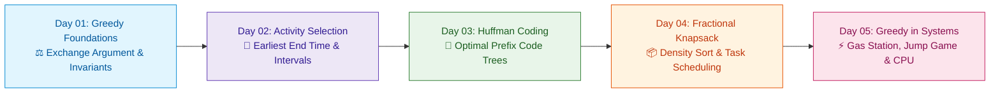

# 📘 Week 12: Greedy Algorithms & Exchange Arguments

> 🧭 **Navigation:** [← Previous: Week 11](../week_11_dp_ii_advanced/README.md) • [🏠 Curriculum Overview](../README.md) • [📘 Complete Syllabus](../COMPLETE_SYLLABUS.md) • [Next: Week 13 →](../week_13_backtracking_and_branch_bound/README.md)

---

## 🎬 Welcome to Week 12: The Ruthless Optimizer's Masterclass!

In algorithm design, Dynamic Programming is thorough: it explores all plausible choices because an early decision might turn out suboptimal later. Greedy algorithms, by contrast, are **ruthless**: they make the locally optimal choice at every single step, NEVER reconsider, and NEVER backtrack.

When does this work? And when is it a fatal trap?
This week equips you with the mathematical superpower of the **Exchange Argument**: proving that if an adversary claims a better solution exists, you can swap their choice for your greedy choice without making the outcome worse.

You will master: **Greedy choice properties & when greedy fails**, **Activity selection & interval scheduling**, **Huffman coding & prefix trees**, **Fractional Knapsack vs 0/1 Knapsack**, and **Greedy algorithms in production systems (Gas Station, Jump Game, Task Scheduler)**.

---

## 📅 Day-by-Day Learning Path

| Day | Instructional Masterclass | Core Mental Model & Intuition | Key Pattern / Invariant |
| :--- | :--- | :--- | :--- |
| **Day 01** | [Greedy Fundamentals & Exchange Arguments](Week_12_Day_01_Greedy_Fundamentals_Instructional.md) | **The Dollar Bill Cashier:** Making change with canonical vs non-canonical coins. | Greedy choice property, optimal substructure, the exchange argument proof. |
| **Day 02** | [Activity Selection & Interval Problems](Week_12_Day_02_Activity_Selection_And_Interval_Problems_Instructional.md) | **The Movie Marathon:** Sorting by earliest finish time. | Sort by end time, non-overlapping intervals (LC 435), meeting rooms (LC 253). |
| **Day 03** | [Huffman Coding & Optimal Trees](Week_12_Day_03_Huffman_Coding_And_Optimal_Trees_Instructional.md) | **The Morse Code Transmitter:** Shorter codes for frequent symbols. | Priority queue tree construction, prefix property, entropy reduction. |
| **Day 04** | [Fractional Knapsack & Scheduling](Week_12_Day_04_Fractional_Knapsack_And_Scheduling_Instructional.md) | **The Gold Dust Robber:** Sorting by value density `v / w`. | Continuous selection vs 0/1 DP, deadline scheduling with penalties. |
| **Day 05** | [Greedy in Systems & LeetCode Hard](Week_12_Day_05_Greedy_In_Systems_Instructional.md) | **The Cross-Country Roadtrip:** Gas Station odometer reset. | Gas Station (LC 134), Jump Game I/II (LC 55, 45), Task Scheduler (LC 621). |

---

## 📚 Consolidated Playbooks & Reference Guides

*   📖 **Comprehensive Week Playbook:** [WEEK_12_FULL_PLAYBOOK.md](WEEK_12_FULL_PLAYBOOK.md) — High-density synthesis of all invariants, theorems, and pattern triggers for this week.
*   📊 **Visual Concepts Playbook (Hybrid):** [Week_12_Visual_Concepts_Playbook_HYBRID.md](Week_12_Visual_Concepts_Playbook_HYBRID.md) — Compact Mermaid diagrams, state transitions, and complexity reference tables.
*   💻 **Production C# Reference (.NET 8/9):** [Week_12_Extended_CSharp_Complete.md](Week_12_Extended_CSharp_Complete.md) — Idiomatic, zero-allocation memory-aware implementations and problem ladders.
*   🐍 **Production Python Reference (Python 3.11+):** [Week_12_Extended_Python_Complete.md](Week_12_Extended_Python_Complete.md) — Clean, pythonic reference implementations for rapid whiteboard prototyping.

---

## 🛠️ The 5 Core Support Files (`support files/`)

1.  📋 [Daily Progress Checklist](support%20files/Week_12_Daily_Progress_Checklist.md) — Step-by-step accountability tracker for theory, coding, and variants.
2.  🧭 [Weekly Guidelines & Mental Models](support%20files/Week_12_Guidelines.md) — Strategic roadmap, common pitfalls, and conceptual anchors.
3.  🎙️ [Interview Q&A Comprehensive Reference](support%20files/Week_12_Interview_QA_Reference.md) — High-frequency senior technical questions with verbal response frameworks.
4.  🗺️ [Problem-Solving Roadmap](support%20files/Week_12_Problem_Solving_Roadmap.md) — Tier-1 problem progression ladder from warm-up to advanced.
5.  📑 [Summary & Key Concepts Synthesis](support%20files/Week_12_Summary_Key_Concepts.md) — Fast-revision cheat sheet covering all governing invariants and system trade-offs.

---

> 🧭 **Navigation:** [← Previous: Week 11](../week_11_dp_ii_advanced/README.md) • [🏠 Curriculum Overview](../README.md) • [📘 Complete Syllabus](../COMPLETE_SYLLABUS.md) • [Next: Week 13 →](../week_13_backtracking_and_branch_bound/README.md)
