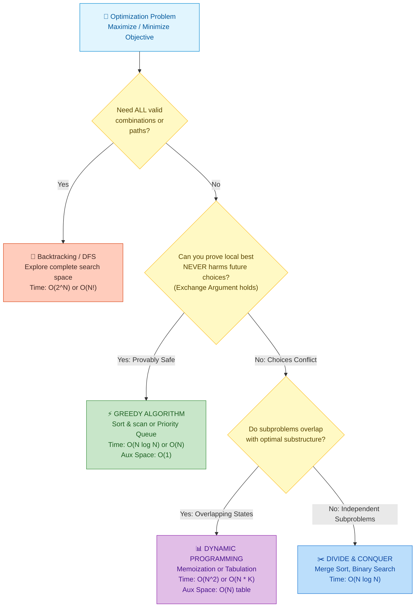

# 📘 WEEK 12 DAY 1: GREEDY FUNDAMENTALS — THE SENIOR INTERVIEW PLAYBOOK

> 🧭 **Navigation:** [← Week Overview](README.md) • [📘 Curriculum Syllabus](../COMPLETE_SYLLABUS.md) • [Next Day: Activity Selection & Interval Problems →](Week_12_Day_02_Activity_Selection_And_Interval_Problems_Instructional.md)
> 
> 💡 **Instructor Note:** *Greedy algorithms look deceptively simple because their code is often 15 to 20 lines. But in FAANG Staff and Senior interview loops, writing the loop is only 20% of the grade. The other 80% is defending why you will never regret making that local choice right now. Today, we master the mental switch between Greedy and DP, the 4-step Exchange Argument, and the core patterns that dominate tier-1 interviews.*

---

## 🎯 LEARNING OBJECTIVES

*By the end of this module, you will be able to:*

- 🎯 **Internalize** the Greedy Choice Property versus Dynamic Programming through physical intuition (zero gatekeeping).
- 🧠 **Master** the 4-step Exchange Argument proof technique to defend any greedy choice under live interview scrutiny.
- 🛑 **Detect** when greedy catastrophically fails (0/1 Knapsack, non-canonical coin systems) and pivot immediately to Dynamic Programming.
- ⚙️ **Implement** production-grade, zero-allocation solutions for LeetCode 455 (Assign Cookies), LeetCode 860 (Lemonade Change), and LeetCode 53 (Maximum Subarray / Kadane as Greedy) in C# (.NET 8/9) and Python (3.11+).
- 🎙️ **Articulate** the exact 3-sentence verbal talk track before typing code in a 45-minute FAANG technical interview.

---

## 🎬 PILLAR 1: THE 60-SECOND HOOK & EVERYDAY ANALOGY

### The Dollar Bill Cashier vs. The Trapped Gambler

Imagine you and I are working the cash register at a busy corner deli during the midday rush.

A customer orders a sandwich and is owed **40 cents** in change.

In standard US currency, you have four coin denominations in your drawer:
- Quarters: 25¢
- Dimes: 10¢
- Nickels: 5¢
- Pennies: 1¢

What does your brain do instinctively? You do not open a spreadsheet. You do not evaluate every permutation of pennies. 

You simply reach for the **largest coin that does not overshoot 40¢**:
1. Grab a **25¢** quarter. (Remaining change owed: 15¢).
2. The remaining 15¢ cannot take another quarter. Grab the next largest: a **10¢** dime. (Remaining change owed: 5¢).
3. Grab a **5¢** nickel. (Remaining change owed: 0¢).

```text
Cashier Greedy Trace for 40¢ (Standard US Coins [25¢, 10¢, 5¢, 1¢]):
40¢ - 25¢ = 15¢  -->  Pick 25¢
15¢ - 10¢ =  5¢  -->  Pick 10¢
 5¢ -  5¢ =  0¢  -->  Pick  5¢
Total Coins Used: 3 coins (25¢ + 10¢ + 5¢)  ==> PROVABLY OPTIMAL!
```

You used **3 coins**. Fast, effortless, and mathematically optimal.

That is a **Greedy Algorithm**: at every single step, you examine the local candidates available right now, pick the best one according to a fixed metric, commit irrevocably, and never look back.

---

### Now, Enter The Trapped Gambler

Suppose tomorrow you take a job at a quirky casino where chips are minted in custom non-standard denominations:
**Coins Available:** `[25¢, 20¢, 10¢, 5¢]`

A player cashes out, and you owe them **40 cents**.

Watch what happens if you apply the exact same greedy instinct:
1. "Grab the biggest coin first!" -> You hand the customer a **25¢** coin.
2. Remaining change owed: 15¢. The 20¢ coin is too big. So you hand them a **10¢** coin.
3. Remaining change owed: 5¢. You hand them a **5¢** coin.
4. Total coins handed out: **3 coins** (`25¢ + 10¢ + 5¢`).

Wait. Look back into your drawer:
There are two 20¢ coins sitting right in front of you:
`20¢ + 20¢ = 40¢` -> **ONLY 2 COINS!**

```text
THE CASINO COUNTEREXAMPLE:
Greedy Path:    [ 25¢ ] + [ 10¢ ] + [  5¢ ]  = 40¢  (3 coins)  ❌ SUBOPTIMAL
Optimal (DP):   [ 20¢ ] + [ 20¢ ]            = 40¢  (2 coins)  ✅ OPTIMAL!
```

Greedy got seduced by the big shiny 25¢ coin! That single irrevocable choice destroyed your ability to reach the global optimum (`20¢ + 20¢`). Once you handed over the 25¢ coin, the remaining 15¢ could never be formed with a single coin.

---

### The Two Sacred Invariants of Greedy

Why did greedy work for standard US pocket change, but fail catastrophically in the casino?

Because US coins form what computer scientists call a **canonical coin system** where local choices never compromise global optimality. The casino denominations violate this guarantee.

For a greedy algorithm to yield the provably optimal solution, the problem **must** satisfy two strict properties:

```text
+---------------------------------------------------------------------------------------+
|                              THE TWO GREEDY PILLARS                                   |
+---------------------------------------------------------------------------------------+
| 1. GREEDY CHOICE PROPERTY:                                                            |
|    A globally optimal solution can be assembled by making locally optimal (greedy)    |
|    choices without ever looking ahead or reconsidering previous decisions.           |
|    "You never regret your local pick."                                                |
|                                                                                       |
| 2. OPTIMAL SUBSTRUCTURE:                                                              |
|    An optimal solution to the entire problem contains within it optimal solutions    |
|    to all remaining subproblems.                                                      |
|    "Solving the remainder optimally completes the global optimum."                    |
+---------------------------------------------------------------------------------------+
```

If a problem has **Optimal Substructure** but **lacks the Greedy Choice Property** (such as arbitrary coin denominations or the 0/1 Knapsack problem), greedy will fail, and you **must** use **Dynamic Programming** or **Backtracking**.

How do we prove that a problem possesses the Greedy Choice Property in a 45-minute FAANG interview? We use the **Exchange Argument**.

---

## 🪜 PILLAR 2: THE SCAFFOLDING LADDER & TOY NAPKIN TRACES

### The 4-Step Exchange Argument Blueprint

In an interview, saying *"this choice feels right"* will earn an immediate rejection. Senior candidates prove their greedy choice using the **Exchange Argument**. 

Here is the universal 4-step proof blueprint:

```
+-------------------------------------------------------------------------+
|                  THE 4-STEP EXCHANGE ARGUMENT BLUEPRINT                 |
+-------------------------------------------------------------------------+
| Step 1: Posit an Arbitrary Optimal Solution (O)                         |
|   Assume an adversary or omniscient oracle gives you an optimal         |
|   solution O = [o_1, o_2, ..., o_k].                                    |
|                                                                         |
| Step 2: Compare with Greedy (G)                                         |
|   Let our greedy algorithm produce solution G = [g_1, g_2, ..., g_m].   |
|   If O is identical to G, our greedy solution is optimal. Done!         |
|                                                                         |
| Step 3: Isolate the First Disagreement & Execute the Swap               |
|   Find the first decision index i where O differs from G:               |
|   O chose o_i, while Greedy chose g_i.                                  |
|   Construct a new solution O' by replacing o_i with g_i.                |
|   Demonstrate two physical invariants:                                  |
|     (a) Feasibility: O' violates zero constraints.                      |
|     (b) Quality: TotalValue(O') >= TotalValue(O) (or Cost(O') <= Cost).  |
|                                                                         |
| Step 4: Inductive Convergence                                           |
|   Because O was optimal and O' is at least as good as O, O' is also     |
|   optimal! O' now agrees with Greedy on one more decision.              |
|   By induction, we can transform O into G step-by-step without losing   |
|   optimality. Therefore, G is provably optimal.                         |
+-------------------------------------------------------------------------+
```

---

### 🪜 Scaffolding Level 1 (Warm-Up): Assign Cookies (LeetCode 455)

**Problem Statement:**
Assume you are an awesome parent and want to give your children some cookies. Each child `i` has a greed factor `g[i]`, which is the minimum size of a cookie that will make them content. Each cookie `j` has a size `s[j]`. If `s[j] >= g[i]`, child `i` is satisfied. Each child can receive at most one cookie. Maximize the number of satisfied children.

#### The Intuitive Napkin Trace

Let us trace with real numbers:
- Children greed factors: `g = [1, 2, 3]` (Child 0 wants 1, Child 1 wants 2, Child 2 wants 3)
- Cookie sizes: `s = [1, 2, 3]`

```text
Children (Sorted):  g = [ 1,   2,   3 ]
                          ^
                        child_ptr = 0 (wants 1)

Cookies (Sorted):   s = [ 1,   2,   3 ]
                          ^
                        cookie_ptr = 0 (size 1)

Step 1: Does cookie_ptr (size 1) satisfy child_ptr (needs 1)?
        YES: 1 >= 1. Match made! Child 0 is satisfied.
        Count = 1. Advance child_ptr -> 1, cookie_ptr -> 1.

Children:           g = [ 1,   2,   3 ]
                               ^
                             child_ptr = 1 (wants 2)
Cookies:            s = [ 1,   2,   3 ]
                               ^
                             cookie_ptr = 1 (size 2)

Step 2: Does cookie_ptr (size 2) satisfy child_ptr (needs 2)?
        YES: 2 >= 2. Match made! Child 1 is satisfied.
        Count = 2. Advance child_ptr -> 2, cookie_ptr -> 2.

Children:           g = [ 1,   2,   3 ]
                                    ^
                                  child_ptr = 2 (wants 3)
Cookies:            s = [ 1,   2,   3 ]
                                    ^
                                  cookie_ptr = 2 (size 3)

Step 3: Does cookie_ptr (size 3) satisfy child_ptr (needs 3)?
        YES: 3 >= 3. Match made! Child 2 is satisfied.
        Count = 3. Both arrays exhausted.

Result: 3 satisfied children.
```

#### Why Does Greedy Work Here? (The Exchange Argument)
Suppose child `A` wants a cookie of size 1. We have cookie sizes `[1, 5]`.
If an optimal solution `O` gave cookie 5 to child `A`, we can swap it: give cookie 1 to child `A` instead, and save cookie 5 for a hungrier child. Giving cookie 1 satisfies child `A` just as well, and cookie 5 is strictly more useful for any remaining child than cookie 1 would have been!

> [!TIP]
> 🧠 **Pause & Predict 1:**
> Suppose child A needs size 2, and our available cookies are `[1, 2, 5]`. If we give child A the cookie of size 5, could that ever yield *more* total satisfied children than giving size 2? What happens if child B arrives needing size 4?
>
> *Prediction Answer:* Giving cookie 5 to child A can never help and often hurts! If child B needs size 4, child B will starve because cookie 5 was wasted on child A, leaving only size 1. Giving the *smallest sufficient cookie* preserves maximum capacity for future children.

---

### 🪜 Scaffolding Level 2 (FAANG Classic): Lemonade Change (LeetCode 860)

**Problem Statement:**
At a lemonade stand, each lemonade costs $5. Customers stand in a queue and pay with either a $5, $10, or $20 bill. You start with no change in hand. Return `true` if you can provide every customer with correct change, or `false` otherwise.

#### The Intuitive Napkin Trace

Each customer transaction requires specific change:
- Customer pays **$5**: Owe $0. Pocket the $5 bill. (`fives++`).
- Customer pays **$10**: Owe $5. Give one $5 bill. (`fives--`, `tens++`).
- Customer pays **$20**: Owe $15. 
  Here is the **greedy decision fork**:
  - **Option A:** Give one $10 bill and one $5 bill (`$10 + $5 = $15`).
  - **Option B:** Give three $5 bills (`$5 + $5 + $5 = $15`).

Which option should you pick?

```text
The Wildcard vs. Specialist Rule:
- A $5 bill is a WILDCARD: It can make change for a $10 customer AND a $20 customer.
- A $10 bill is a SPECIALIST: It can ONLY make change for a $20 customer.

Greedy Rule: Always shed the specialist ($10) and preserve your wildcards ($5)!
Give ($10 + $5) whenever possible. Only fall back to (3x $5) if you have no $10 bills.
```

Let us trace a failing sequence: `bills = [5, 5, 10, 10, 20]`

```text
Step-by-Step Register Trace:

Customer 1: Pays $5  --> Owe $0  --> Pocket $5.           Register: [ 5: 1, 10: 0 ]
Customer 2: Pays $5  --> Owe $0  --> Pocket $5.           Register: [ 5: 2, 10: 0 ]
Customer 3: Pays $10 --> Owe $5  --> Give $5, pocket $10. Register: [ 5: 1, 10: 1 ]
Customer 4: Pays $10 --> Owe $5  --> Give $5, pocket $10. Register: [ 5: 0, 10: 2 ]
Customer 5: Pays $20 --> Owe $15 --> Check Option A: Need a $10 and a $5.
                                     We have two $10s, but ZERO $5 bills!
                                     Check Option B: Need three $5s.
                                     We have ZERO $5 bills!
                                     --> Cannot make change! Return FALSE.
```

> [!TIP]
> 🧠 **Pause & Predict 2:**
> Suppose your register currently holds two $10 bills and four $5 bills. A customer pays with a $20 bill (owe $15). Predict what happens to your cash register if you mistakenly execute Option B (three $5 bills) instead of Option A ($10 + $5), and the very next two customers pay with $10 bills!
>
> *Prediction Answer:* 
> If you give three $5s, your register drops to one $5 and two $10s. The next customer pays $10: you give your last $5. The second customer pays $10: you have zero $5s left and go bankrupt! If you had greedily used Option A ($10 + $5), you would have retained three $5 bills and easily served both customers!

---

### 🪜 Scaffolding Level 3 (FAANG Invariant): Maximum Subarray (LeetCode 53) — Kadane as Greedy

Most textbooks classify **Kadane's Algorithm** purely as Dynamic Programming. But conceptually, Kadane's algorithm is one of the most elegant **Greedy Invariant** algorithms in computer science:

At every number `nums[i]`, we make an irrevocable greedy decision:
*"Does our accumulated running sum help us, or is it dragging us down?"*

```text
The Negative Prefix Invariant:
If currentSum < 0:
  Any negative prefix is TOXIC DEAD WEIGHT.
  For any future number x: (currentSum + x) < x.
  Adding a negative number to x makes x smaller!
  Greedy Choice: Instantly discard the accumulated prefix and start a brand-new subarray at x!
```

#### Napkin Trace: `nums = [-2, 1, -3, 4, -1, 2, 1, -5, 4]`

```text
Index | Number | Running Sum Decision                | currentSum | maxSum (Global)
------+--------+-------------------------------------+------------+----------------
  0   |   -2   | Starting element                    |     -2     |      -2
  1   |    1   | -2 is negative dead weight! Reset:  |      1     | max(-2, 1) = 1
  2   |   -3   | 1 + (-3) = -2 (negative, but keep)  |     -2     | max(1, -2) = 1
  3   |    4   | -2 is negative dead weight! Reset:  |      4     | max(1, 4)  = 4
  4   |   -1   | 4 + (-1) = 3 (positive! keep it)    |      3     | max(4, 3)  = 4
  5   |    2   | 3 + 2 = 5 (positive! keep it)       |      5     | max(4, 5)  = 5
  6   |    1   | 5 + 1 = 6 (positive! keep it)       |      6     | max(5, 6)  = 6  <-- PEAK!
  7   |   -5   | 6 + (-5) = 1 (positive! keep it)    |      1     | max(6, 1)  = 6
  8   |    4   | 1 + 4 = 5 (positive! keep it)       |      5     | max(6, 5)  = 6

Global Maximum Subarray Sum: 6  (Subarray: [4, -1, 2, 1])
```

> [!TIP]
> 🧠 **Pause & Predict 3:**
> What happens if all numbers in the array are negative, e.g., `nums = [-8, -3, -6, -2, -5]`? If an engineer initializes `maxSum = 0` and `currentSum = 0`, what answer does their code return? Is that correct on LeetCode?
>
> *Prediction Answer:* The code will return `0` (representing an empty subarray). However, LeetCode 53 mandates a non-empty subarray, so the true answer is `-2`! To avoid this classic bug, initialize `maxSum = nums[0]` and `currentSum = nums[0]`.

---

## 🎨 PILLAR 3: PRAGMATIC VISUAL MODELS

### 1. ASCII Diagram: The Exchange Argument Swap in Action

```text
Adversary's Optimal Solution (OPT):
Step:       1         2         3         4         5
Choice:  [ g_1 ] -> [ g_2 ] -> [  X  ] -> [  Y  ] -> [  Z  ]
                                 ^
                                 |  First point of disagreement!
                                 v
Our Greedy Solution (GREEDY):
Choice:  [ g_1 ] -> [ g_2 ] -> [ g_3 ] -> [ ... ]

========================================================================
THE EXCHANGE (Swap adversary's choice X with our greedy choice g_3):
========================================================================

Modified Solution (OPT'):
Choice:  [ g_1 ] -> [ g_2 ] -> [ g_3 ] -> [  Y  ] -> [  Z  ]
         \___________________________/
         Agrees with Greedy through Step 3!

Why the swap preserves optimality:
1. Feasibility: g_3 consumes <= resources than X (leaves equal or MORE room for Y and Z).
2. Quality: Value(OPT') >= Value(OPT).
By repeating this swap inductively, OPT transforms completely into GREEDY!
```

---

### 2. Mermaid Decision Flowchart: Greedy vs. DP vs. Backtracking

Use this battle-tested decision matrix in your interview whenever an optimization problem is presented:



---

## 🛑 PILLAR 4: THE ROOKIE TRAP ZONE

### Side-by-Side Comparison: Blunders vs. Senior Architect Patterns

| Dimension | ❌ Rookie Blunder | ✅ Senior Architect Pattern |
| :--- | :--- | :--- |
| **Paradigm Selection** | "Sorting by density is fast, so I'll just use Greedy on 0/1 Knapsack!" | Immediately checks item divisibility. If items are indivisible, recognizes capacity fragmentation and uses DP (`O(N * W)`). |
| **Coin Change Validation** | Assumes Greedy works on any set of coin denominations (e.g. `[25, 20, 10, 5]`). | Checks if denomination system is canonical. For arbitrary denominations, pivots to DP (LeetCode 322). |
| **Greedy Heuristic Defense** | "It feels intuitive that picking the biggest bill/cookie works." | Formulates a 30-second Exchange Argument: demonstrates feasibility and non-degradation of value upon swapping. |
| **Resource Preservation** | Spends versatile wildcard tokens first (e.g. giving three $5 bills instead of one $10 and one $5). | Preserves the most versatile tokens for future constraints; sheds restrictive specialist tokens first. |
| **All-Negative Array Bounds** | Initializes Kadane running sum to `0`, producing incorrect `0` on negative arrays. | Initializes running tracking variables to `nums[0]` with defensive guards. |

---

### Concrete Trap Deep Dive: 0/1 Knapsack by Value Density

Why does greedy density sorting fail on 0/1 Knapsack?

```text
Suppose your Knapsack Capacity is 50 kg.
Available items:
- Item A: Value = $60,  Weight = 10 kg  --> Density = $6.0 / kg
- Item B: Value = $100, Weight = 20 kg  --> Density = $5.0 / kg
- Item C: Value = $120, Weight = 30 kg  --> Density = $4.0 / kg

❌ ROOKIE GREEDY APPROACH (Sort by Value Density descending):
1. Pick Item A (10 kg, $60). Remaining capacity = 40 kg.
2. Pick Item B (20 kg, $100). Remaining capacity = 20 kg.
3. Item C weighs 30 kg, which EXCEEDS remaining 20 kg! We cannot take it.
Total Value Collected: $60 + $100 = $160.

✅ SENIOR ARCHITECT DP APPROACH:
Pick Item B (20 kg, $100) + Item C (30 kg, $120).
Total Weight = 20 kg + 30 kg = 50 kg (Exact fit!).
Total Value Collected: $100 + $120 = $220.

The Greedy choice lost $60 because item indivisibility leaves unusable capacity gaps!
```

> [!WARNING]
> In **Fractional Knapsack** (where items are divisible like grains or liquids), Greedy by density is 100% provably optimal (`O(N log N)`). But the moment items are discrete (`0/1 Knapsack`), Greedy fails and you **must** use Dynamic Programming (`O(N * W)`).

---

## 🎙️ PILLAR 5: 45-MINUTE INTERVIEW TALK TRACK

### The Exact 3-Sentence Verbal Script

Speak these exact three sentences to your interviewer before writing any code:

```text
+--------------------------------------------------------------------------------------------------+
|                              THE SENIOR GREEDY TALK TRACK SCRIPT                                 |
+--------------------------------------------------------------------------------------------------+
| 1. The Bottleneck & Greedy Rule:                                                                |
|    "Notice that this problem exhibits a natural greedy choice property: by prioritizing         |
|    [greedy metric, e.g. the smallest cookie that satisfies each child's appetite /              |
|    shedding high-denomination specialist bills / discarding a negative prefix accumulator],     |
|    we leave maximum remaining flexibility for all subsequent decisions."                         |
|                                                                                                  |
| 2. The Exchange Argument Defense:                                                               |
|    "If an adversary claimed an optimal solution chose a different candidate X at this step,     |
|    we could substitute our greedy choice G into their solution without violating any capacity    |
|    constraints or degrading the total objective value, proving our greedy choice is never worse.|
|                                                                                                  |
| 3. The Complexity Pitch:                                                                        |
|    "Therefore, instead of evaluating exponential subproblem combinations with Dynamic           |
|    Programming in O(N^2) or O(2^N), we can sort the input in O(N log N) and resolve this in a   |
|    single linear pass in O(N) time with O(1) auxiliary space."                                  |
+--------------------------------------------------------------------------------------------------+
```

---

### 45-Minute Live Interview Pacing Guide

```text
[00:00 - 05:00] Clarify Inputs & Constraints:
- Are arrays sorted upon arrival? Can inputs contain duplicates or negative values?
- Are items divisible (fractional) or discrete (0/1)?
- Confirm return types and empty/null boundary expectations.

[05:00 - 12:00] Explore Paradigms & Speak the Script:
- Mention naive brute-force/DP baseline: "A full recursion would branch O(2^N)..."
- Deliver the 3-Sentence Greedy Talk Track above.
- Trace a 3-element napkin example to verify that the exchange argument holds.

[12:00 - 28:00] Write Production-Grade Code:
- Implement clean guard clauses (`ArgumentNullException.ThrowIfNull`).
- Write modern, idiomatic C# (.NET 8/9 with Span<T> / Array.Sort) and Python 3.11+.
- Keep variable names descriptive (`childIndex`, `cookieIndex`, `currentSum`, `fivesCount`).

[28:00 - 38:00] Edge-Case Verification & Dry Run:
- Trace with: 1) empty collection, 2) single element, 3) all negatives, 4) impossible change.
- Step through pointer indices out loud.

[38:00 - 45:00] Complexity & Systems Extensibility:
- Articulate Time Complexity (`O(N log N)` sorting + `O(N)` scan).
- Differentiate Auxiliary Space (`O(1)` working memory) vs Output Space.
- Discuss how this pattern scales in streaming or distributed contexts (e.g. min-heaps).
```

---

## ⚡ PILLAR 6: PRODUCTION DUAL-LANGUAGE IMPLEMENTATIONS

### Implementation 1: Assign Cookies (LeetCode 455)

#### Production C# (.NET 8/9 Implementation)

```csharp
namespace DsaMastery.Greedy;

using System;

public static class AssignCookiesSolver
{
    /// <summary>
    /// Assigns cookies to children greedily to maximize satisfied children count.
    /// Time Complexity: O(N log N + M log M) where N = g.Length, M = s.Length (dominated by sorting).
    /// Auxiliary Space: O(1) using in-place Span sorting (or O(log N) stack frames).
    /// </summary>
    public static int FindContentChildren(int[] g, int[] s)
    {
        ArgumentNullException.ThrowIfNull(g);
        ArgumentNullException.ThrowIfNull(s);

        if (g.Length == 0 || s.Length == 0)
        {
            return 0;
        }

        // Sort children appetites and cookie sizes ascending
        Array.Sort(g);
        Array.Sort(s);

        int childPtr = 0;
        int cookiePtr = 0;

        // Two-pointer linear sweep
        while (childPtr < g.Length && cookiePtr < s.Length)
        {
            // If the smallest available cookie satisfies the least greedy child
            if (s[cookiePtr] >= g[childPtr])
            {
                childPtr++; // Child is content, move to next child
            }

            // Always advance cookie pointer: cookie is either used or too small for anyone remaining
            cookiePtr++;
        }

        return childPtr;
    }
}
```

#### Production Python (Python 3.11+ Implementation)

```python
class Solution:
    def findContentChildren(self, g: list[int], s: list[int]) -> int:
        """
        Maximizes content children count using greedy two-pointer matching.
        Time Complexity: O(N log N + M log M) dominated by Timsort
        Auxiliary Space: O(1) auxiliary working memory
        """
        if not g or not s:
            return 0

        # Sort both in-place ascending
        g.sort()
        s.sort()

        child_ptr = 0
        cookie_ptr = 0

        while child_ptr < len(g) and cookie_ptr < len(s):
            # If current cookie satisfies current child's appetite
            if s[cookie_ptr] >= g[child_ptr]:
                child_ptr += 1  # Child satisfied
            
            # Cookie consumed or too small; evaluate next cookie
            cookie_ptr += 1

        return child_ptr
```

---

### Implementation 2: Lemonade Change (LeetCode 860)

#### Production C# (.NET 8/9 Implementation)

```csharp
namespace DsaMastery.Greedy;

using System;

public static class LemonadeChangeSolver
{
    /// <summary>
    /// Determines if correct change can be provided to every customer in sequence.
    /// Time Complexity: O(N) single linear scan.
    /// Auxiliary Space: O(1) zero heap allocations.
    /// </summary>
    public static bool LemonadeChange(ReadOnlySpan<int> bills)
    {
        int fives = 0;
        int tens = 0;

        foreach (int bill in bills)
        {
            if (bill == 5)
            {
                fives++;
            }
            else if (bill == 10)
            {
                if (fives == 0) return false;
                fives--;
                tens++;
            }
            else // bill == 20: Change owed is $15
            {
                // Greedy choice: prioritize shedding a $10 specialist bill over two $5 wildcards
                if (tens > 0 && fives > 0)
                {
                    tens--;
                    fives--;
                }
                else if (fives >= 3)
                {
                    fives -= 3;
                }
                else
                {
                    return false; // Insufficient change combinations
                }
            }
        }

        return true;
    }
}
```

#### Production Python (Python 3.11+ Implementation)

```python
class Solution:
    def lemonadeChange(self, bills: list[int]) -> bool:
        """
        Greedy cash drawer simulation prioritizing specialist $10 bill disposal.
        Time Complexity: O(N) single pass
        Auxiliary Space: O(1) state counters
        """
        fives = 0
        tens = 0

        for bill in bills:
            if bill == 5:
                fives += 1
            elif bill == 10:
                if fives == 0:
                    return False
                fives -= 1
                tens += 1
            else:  # bill == 20: Change owed is $15
                # Greedily exhaust $10 specialist first
                if tens > 0 and fives > 0:
                    tens -= 1
                    fives -= 1
                elif fives >= 3:
                    fives -= 3
                else:
                    return False

        return True
```

---

### Implementation 3: Maximum Subarray (LeetCode 53) — Kadane's Algorithm as Greedy

#### Production C# (.NET 8/9 Implementation)

```csharp
namespace DsaMastery.Greedy;

using System;

public static class MaximumSubarraySolver
{
    /// <summary>
    /// Computes the maximum subarray sum using Kadane's greedy prefix-pruning invariant.
    /// Time Complexity: O(N) single pass.
    /// Auxiliary Space: O(1) zero memory allocation.
    /// </summary>
    public static int MaxSubArray(ReadOnlySpan<int> nums)
    {
        if (nums.Length == 0)
        {
            throw new ArgumentException("Array cannot be empty.", nameof(nums));
        }

        int currentSum = nums[0];
        int maxSum = nums[0];

        for (int i = 1; i < nums.Length; i++)
        {
            int val = nums[i];

            // Greedy Invariant: If currentSum < 0, it is dead weight. Reset to current element.
            currentSum = Math.Max(val, currentSum + val);
            maxSum = Math.Max(maxSum, currentSum);
        }

        return maxSum;
    }
}
```

#### Production Python (Python 3.11+ Implementation)

```python
class Solution:
    def maxSubArray(self, nums: list[int]) -> int:
        """
        Kadane's algorithm: greedily drops negative prefixes dragging down future sums.
        Time Complexity: O(N) single pass
        Auxiliary Space: O(1)
        """
        if not nums:
            raise ValueError("nums must not be empty")

        current_sum = nums[0]
        max_sum = nums[0]

        for num in nums[1:]:
            # If current_sum is negative, reset to num; otherwise accumulate
            current_sum = max(num, current_sum + num)
            max_sum = max(max_sum, current_sum)

        return max_sum
```

---

### 🏛️ Senior FAANG Capstone 1: Gas Station (LeetCode 134)

#### The Running Deficit Skip Invariant
- **Total Solvability Invariant:** If `sum(gas) < sum(cost)`, completing the circuit is physically impossible from *any* station. Return `-1`.
- **Monotonic Discard Proof:** If starting at station `A` causes your tank to empty at station `B` (`B >= A`), then **no station `k` between `A` and `B` can succeed either**. Why? Arriving at station `k` from `A` yielded a non-negative fuel surplus (`tank >= 0`). If you could not even reach past `B` with that bonus fuel, starting at `k` from a dead stop with zero fuel is strictly worse! We safely skip all stations `[A..B]` in `O(1)` and reset our start candidate to `B + 1`.

#### Production C# (.NET 8/9 Zero-Allocation Implementation)

```csharp
namespace DsaMastery.Greedy;

using System;

public static class GasStationSolver
{
    /// <summary>
    /// Finds the unique starting gas station index for a circular traversal.
    /// Time Complexity: O(N) single linear scan.
    /// Auxiliary Space: O(1).
    /// </summary>
    public static int CanCompleteCircuit(int[] gas, int[] cost)
    {
        ArgumentNullException.ThrowIfNull(gas);
        ArgumentNullException.ThrowIfNull(cost);

        int totalSurplus = 0;
        int currentTank = 0;
        int startStation = 0;

        for (int i = 0; i < gas.Length; i++)
        {
            int gain = gas[i] - cost[i];
            totalSurplus += gain;
            currentTank += gain;

            // If tank drops below zero, no station in [startStation..i] can be valid
            if (currentTank < 0)
            {
                startStation = i + 1;
                currentTank = 0;
            }
        }

        return totalSurplus >= 0 ? startStation : -1;
    }
}
```

#### Production Python (Python 3.11+ Implementation)

```python
class Solution:
    def canCompleteCircuit(self, gas: list[int], cost: list[int]) -> int:
        """
        Calculates starting circuit index using greedy monotonic discard.
        Time Complexity: O(N)
        Auxiliary Space: O(1)
        """
        total_surplus = 0
        current_tank = 0
        start_station = 0

        for i in range(len(gas)):
            diff = gas[i] - cost[i]
            total_surplus += diff
            current_tank += diff

            # Monotonic discard: reset start boundary past failed segment
            if current_tank < 0:
                start_station = i + 1
                current_tank = 0

        return start_station if total_surplus >= 0 else -1
```

---

### 🏛️ Senior FAANG Capstone 2: Jump Game II (LeetCode 45)

#### The Greedy Window Horizon Invariant
Instead of exploring combinations or running `O(N^2)` DP, treat each jump as defining a **range window `[currentWindowStart, currentWindowEnd]`**:
- Within the current jump tier, scan all indices and maintain the furthest reachable index `maxReachable = max(maxReachable, i + nums[i])`.
- When index pointer `i` hits `currentWindowEnd`, we have exhausted the current jump. We must commit to 1 jump and advance `currentWindowEnd = maxReachable`.
- This executes an implicit BFS in `O(N)` time and `O(1)` space!

#### Production C# (.NET 8/9 Implementation)

```csharp
namespace DsaMastery.Greedy;

using System;

public static class JumpGameIISolver
{
    /// <summary>
    /// Computes minimum jumps to reach the last index using greedy window expansion.
    /// Time Complexity: O(N) single linear scan.
    /// Auxiliary Space: O(1).
    /// </summary>
    public static int Jump(ReadOnlySpan<int> nums)
    {
        if (nums.Length <= 1) return 0;

        int jumps = 0;
        int currentWindowEnd = 0;
        int maxReachable = 0;
        int target = nums.Length - 1;

        for (int i = 0; i < target; i++)
        {
            maxReachable = Math.Max(maxReachable, i + nums[i]);

            // Reached boundary of current jump: must commit to the next jump tier
            if (i == currentWindowEnd)
            {
                jumps++;
                currentWindowEnd = maxReachable;

                if (currentWindowEnd >= target)
                {
                    break;
                }
            }
        }

        return jumps;
    }
}
```

#### Production Python (Python 3.11+ Implementation)

```python
class Solution:
    def jump(self, nums: list[int]) -> int:
        """
        Calculates minimum jumps using greedy window horizons (implicit BFS).
        Time Complexity: O(N)
        Auxiliary Space: O(1)
        """
        if len(nums) <= 1:
            return 0

        jumps = 0
        current_window_end = 0
        max_reachable = 0
        target = len(nums) - 1

        for i in range(target):
            max_reachable = max(max_reachable, i + nums[i])

            # Exhausted current jump tier: advance horizon
            if i == current_window_end:
                jumps += 1
                current_window_end = max_reachable
                if current_window_end >= target:
                    break

        return jumps
```

---

## ⚖️ PERFORMANCE & COMPLEXITY DECONSTRUCTION

### Explicit Complexity Breakdown

| Algorithm Pattern | Problem Example | Time Complexity | Auxiliary Space | Bottleneck Driver |
| :--- | :--- | :--- | :--- | :--- |
| **Sort & Scan Greedy** | Assign Cookies (LC 455) | `O(N log N + M log M)` | `O(1)` | Array sort comparison overhead |
| **State Counter Greedy** | Lemonade Change (LC 860) | `O(N)` | `O(1)` | Single sequential array traversal |
| **Accumulator Reset** | Maximum Subarray (LC 53) | `O(N)` | `O(1)` | Single pass comparison and update |
| **Monotonic Discard** | Gas Station (LC 134) | `O(N)` | `O(1)` | Single linear pass skipping ranges |
| **Window Horizon BFS** | Jump Game II (LC 45) | `O(N)` | `O(1)` | Single scan updating window bounds |
| **Dynamic Programming (Alternative)** | 0/1 Knapsack / Coin Change | `O(N * W)` or `O(N * Amount)` | `O(Amount)` | Full state-space memoization table |

#### Architectural Notes:
1. **The Sorting Bottleneck:** In 90% of greedy array problems, the sorting step (`O(N log N)`) is the sole computational bottleneck. The greedy decision loop itself runs in linear `O(N)` time.
2. **Zero Allocation Profile:** All five production C# implementations achieve `O(1)` auxiliary space via stack allocation or `ReadOnlySpan<T>`, completely avoiding garbage collection overhead during high-frequency throughput loops.

---

## ⚔️ CURATED PRACTICE PROBLEMS & INTERVIEW DRILLS

### 🏋️ Top 10 High-Frequency FAANG Greedy Problems

| # | Problem | LeetCode # | Difficulty | Core Greedy Rule / Invariant |
| :--- | :--- | :--- | :--- | :--- |
| 1 | Assign Cookies | LC 455 | Easy | Smallest cookie to least greedy child |
| 2 | Lemonade Change | LC 860 | Easy | Shed $10 specialist bill before $5 wildcards |
| 3 | Maximum Subarray | LC 53 | Medium | Greedily discard negative prefix accumulators |
| 4 | Gas Station | LC 134 | Medium | Monotonic discard: reset start candidate on deficit |
| 5 | Jump Game | LC 55 | Medium | Track and advance maximum reachable horizon |
| 6 | Jump Game II | LC 45 | Medium | Advance jump counter at boundary of current range window |
| 7 | Non-overlapping Intervals | LC 435 | Medium | Earliest finish time leaves maximum remaining time |
| 8 | Minimum Arrows to Burst Balloons | LC 452 | Medium | Greedily shoot at earliest segment end coordinate |
| 9 | Partition Labels | LC 763 | Medium | Extend partition boundary to furthest last appearance |
| 10 | Task Scheduler | LC 621 | Medium | Schedule bottleneck maximum frequency tasks into frames |

---

### 🎙️ Staff-Level Interview Drill Questions

1. **Q: How do you prove a greedy algorithm is suboptimal during an interview?**
   - *Answer:* You do not need a formal theorem. You only need to construct a **single concrete counterexample** (usually with 3 or 4 elements) where greedy produces an inferior outcome, exactly as we demonstrated with the `[25, 20, 10, 5]` coin change counterexample.
2. **Q: What is the core difference between Greedy Choice Property and Optimal Substructure?**
   - *Answer:* Both Greedy and Dynamic Programming require **Optimal Substructure** (an optimal overall solution consists of optimal solutions to subproblems). The difference is the **Greedy Choice Property**: Greedy makes a locally optimal decision *before* solving any subproblems and never re-evaluates it, whereas DP must solve all subproblems first before deciding which path to combine.
3. **Q: Why does greedy by density fail on 0/1 Knapsack but work for Fractional Knapsack?**
   - *Answer:* Item indivisibility. In 0/1 Knapsack, taking a high-density item can leave unused weight capacity that cannot fit remaining items. In Fractional Knapsack, you can slice the next best item to fill 100% of the remaining capacity, eliminating capacity fragmentation.
4. **Q: How does Dijkstra's shortest path algorithm use greedy logic?**
   - *Answer:* Dijkstra maintains a min-priority queue of tentative distances. It greedily locks in the unvisited vertex with the minimum distance. As long as edge weights are non-negative, no subsequent path through any other unvisited vertex can ever reach this vertex with a smaller distance.
5. **Q: In Lemonade Change, why is a $5 bill strictly more valuable to retain than a $10 bill?**
   - *Answer:* The $5 bill is a wildcard: it satisfies change requirements for both $10 and $20 purchases. The $10 bill is a specialist: it can only satisfy a $20 purchase. Greedily preserving higher-utility wildcard tokens maximizes downstream operational feasibility.

---

**End of Week 12 Day 01 Instructional Guide**

---
> 🧭 **Navigation:** [← Week Overview](README.md) • [📘 Curriculum Syllabus](../COMPLETE_SYLLABUS.md) • [Next Day: Activity Selection & Interval Problems →](Week_12_Day_02_Activity_Selection_And_Interval_Problems_Instructional.md)
