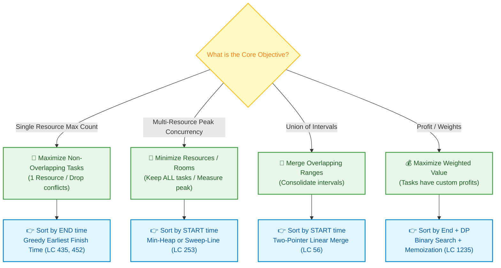
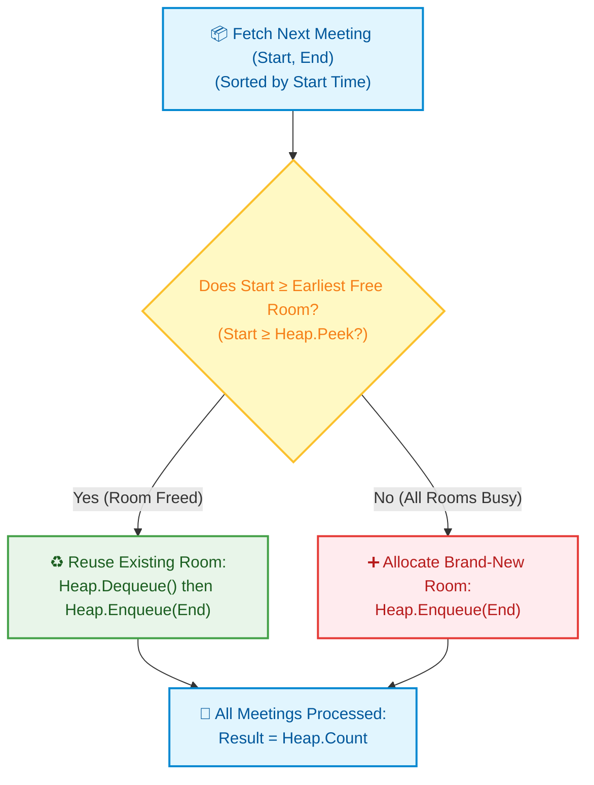

# 📘 WEEK 12 DAY 2: ACTIVITY SELECTION & INTERVAL PROBLEMS — ENGINEERING GUIDE

> 🧭 **Navigation:** [← Previous Day](Week_12_Day_01_Greedy_Fundamentals_Instructional.md) • [🏠 Week Overview](README.md) • [📘 Curriculum Syllabus](../COMPLETE_SYLLABUS.md) • [Next Day →](Week_12_Day_03_Huffman_Coding_And_Optimal_Trees_Instructional.md)
> 
> 💡 **Instructor Note:** *Interval problems form one of the highest-frequency patterns in FAANG engineering loops. Master the critical distinction between interval selection (greedy earliest finish time on a single resource), interval partitioning (sweep-line or min-heap across multiple resources), interval merging, and weighted intervals (dynamic programming).*

---

## 🎯 LEARNING OBJECTIVES

*By the end of this chapter, you will be able to:*

- 🎬 **Internalize** the core greedy intuition: why earliest finish time provably minimizes opportunity cost.
- 🎯 **Disambiguate** the 4 canonical interval archetypes (Selection, Partitioning, Merging, Weighted) in under 15 seconds.
- 🪜 **Execute** step-by-step hand traces for Activity Selection, Non-overlapping Intervals (LC 435), and Meeting Rooms II (LC 253).
- 🎨 **Visualize** timeline conflicts using ASCII range tracks and structured Mermaid decision flows.
- 🛑 **Avoid** the fatal rookie traps: sorting by start time for selection, comparator integer overflow, and endpoint off-by-one errors (`start == end`).
- 🎙️ **Deliver** the exact 3-sentence interview talk track to convince a FAANG Staff interviewer before writing code.
- ⚡ **Ship** production-grade C# (.NET 8/9 with `Array.Sort`, zero-allocation structs, and `PriorityQueue`) and Python 3.11+ implementations.

---

## 🎬 PILLAR 1: THE 60-SECOND HOOK & EVERYDAY ANALOGY

### The Film Festival Marathon

Imagine you and I have tickets to an all-day independent film festival. Screenings run continuously from 8:00 AM to midnight across various screening rooms. You have one personal mission today: **watch the absolute maximum number of full movies in a single day**. You cannot be in two theaters at once.

How do you pick your schedule? Let's test your natural instincts:

```
Intuition Test 1: "Should I pick the movie with the SHORTEST runtime?"
Sounds logical! Short movies mean quick completions, right?
WRONG. Look at this trap:
Movie A (Masterpiece):  [ 8:00 AM -------------------------------- 12:00 PM ] (4 hours)
Movie B (Short Film):                         [ 11:50 AM - 12:10 PM ]         (20 mins!)
Movie C (Epic Drama):                                     [ 12:00 PM ----------------- 4:00 PM ] (4 hours)

If you greedily pick the 20-minute short film (Movie B), it starts 10 minutes before Movie A ends
and finishes 10 minutes after Movie C starts! Picking Movie B kills BOTH Movie A and Movie C!
You watch 1 movie instead of 2. Shortest duration FAILS.
```

```
Intuition Test 2: "Should I pick the movie that STARTS EARLIEST?"
Sounds disciplined! Start the day early, right?
WRONG. Look at this nightmare:
Movie A (Director's Cut): [ 8:00 AM ---------------------------------------------------- 6:00 PM ] (10 hours!)
Movie B (Morning Doc):      [ 8:30 AM - 10:00 AM ]
Movie C (Noon Comedy):                               [ 10:30 AM - 12:00 PM ]
Movie D (Afternoon Indie):                                                    [ 1:00 PM - 2:30 PM ]

Movie A starts earliest at 8:00 AM. If you lock into Movie A, you are trapped in that dark theater
until 6:00 PM, completely missing Movies B, C, and D! You watch 1 movie instead of 3.
Earliest start time FAILS catastrophically.
```

### The Golden Rule: Pick the Movie That ENDS EARLIEST!

Why does **Earliest Finish Time (EFT)** win every single time?

Think about what happens physically when a movie ends: **you walk out into the lobby.**
The earlier you are standing in that festival lobby, the **maximum possible remaining timeline** you preserve for the rest of your day! 

Every minute earlier that your current movie finishes is an extra minute of freedom for future movies. You are strictly **minimizing opportunity cost**.

```
+-------------------------------------------------------------------------------------------+
|                          THE GOLDEN INTERVAL SCHEDULING PRINCIPLE                         |
+-------------------------------------------------------------------------------------------+
|  "To maximize total non-overlapping tasks on a single resource, always commit to the task |
|   that FINISHES EARLIEST. Finishing early leaves the maximum unallocated runway for all   |
|   subsequent opportunities."                                                              |
+-------------------------------------------------------------------------------------------+
```

---

### The 4 Interval Problem Archetypes

Before touching code, you must instantly diagnose which interval problem archetype your interviewer is presenting:

```
THE 4 CANONICAL INTERVAL ARCHETYPES:
+----+--------------------------------+--------------------+-----------------------------+-----------------------+
| #  | Archetype                      | Resource Model     | Core Objective              | Optimal Paradigm      |
+----+--------------------------------+--------------------+-----------------------------+-----------------------+
| 1  | Activity Selection (LC 435/452)| 1 Single Machine   | Maximize non-overlapping    | Greedy: Sort by END   |
| 2  | Interval Partitioning (LC 253) | Infinite Machines  | Minimize parallel machines  | Sweep-Line / Min-Heap |
| 3  | Interval Merging (LC 56/57)    | Timeline Union     | Merge overlapping segments  | Sort by START + Scan  |
| 4  | Weighted Scheduling (LC 1235)  | 1 Machine + Profit | Maximize total dollar yield | DP + Binary Search    |
+----+--------------------------------+--------------------+-----------------------------+-----------------------+
```

---

## 🪜 PILLAR 2: THE SCAFFOLDING LADDER & TOY NAPKIN TRACES

Let's build your intuition progressively: from a 4-element napkin trace to classic FAANG mediums.

---

### Level 1: The Toy Napkin Trace (Activity Selection)

Let's trace Activity Selection on 4 toy intervals:
`Raw Intervals: [1, 4], [3, 5], [0, 6], [5, 7]`

#### Step 1: Sort by End Time Ascending
- `I1: [1, 4]` (End = 4)
- `I2: [3, 5]` (End = 5)
- `I3: [0, 6]` (End = 6)
- `I4: [5, 7]` (End = 7)

#### Step 2: The Physical Pointer Walkthrough
We maintain two state variables:
- `count`: number of selected non-overlapping activities.
- `lastEnd`: the timestamp when our resource becomes free. Initially `-infinity`.

```text
TIMELINE TRACE:
Time:   0   1   2   3   4   5   6   7
I3:     [-------------------)           (End = 6)
I1:         [-----------)               (End = 4)  <-- Selected!
I2:                 [-------)           (End = 5)  <-- Overlaps with I1!
I4:                         [-------)   (End = 7)  <-- Selected!
```

```text
--------------------------------------------------------------------------------------
Step | Candidate | Range  | Check: Start >= lastEnd? | Verdict | New lastEnd | Count
--------------------------------------------------------------------------------------
1    | I1        | [1, 4] | 1 >= -inf -> TRUE        | SELECT  | 4           | 1
2    | I2        | [3, 5] | 3 >= 4    -> FALSE       | SKIP    | 4           | 1
3    | I3        | [0, 6] | 0 >= 4    -> FALSE       | SKIP    | 4           | 1
4    | I4        | [5, 7] | 5 >= 4    -> TRUE        | SELECT  | 7           | 2
--------------------------------------------------------------------------------------
Final Answer: 2 Activities Selected: { [1, 4], [5, 7] }.
```

> 🧠 **Pause & Predict Micro-Drill 1:**
> Suppose a 5th activity `I5: [4, 5]` was added to the input. If intervals are defined as half-open `[start, end)` where touching endpoints do not conflict, would `I5` be selected?
> *Pause for 5 seconds and think!*
> 
> **Answer:** YES! When sorted by end time, `[4, 5]` has `End = 5` and starts at `4`. Since `lastEnd` was `4`, `4 >= 4` evaluates to `TRUE`. `I5` is selected, updating `lastEnd = 5`, and then `I4: [5, 7]` is also selected (`5 >= 5`), yielding a total of 3 activities!

---

### Level 2: Warm-Up -> Non-overlapping Intervals (LeetCode 435)

**The Problem:** Given an array of intervals `intervals`, return the *minimum number of intervals you need to remove* to make the rest of the intervals non-overlapping.

**The Aha! Reduction:**
Asking *"What is the minimum number of intervals to remove?"* is the exact mathematical inverse of asking *"What is the maximum number of non-overlapping intervals we can keep?"*

```text
Minimum Removals = Total Intervals - Maximum Non-Overlapping Intervals
```

#### Hand-Trace on `intervals = [[1, 2], [2, 3], [3, 4], [1, 3]]`:
1. **Sort by End Time:**
   - `[1, 2]` (End = 2)
   - `[2, 3]` (End = 3)
   - `[1, 3]` (End = 3)
   - `[3, 4]` (End = 4)
2. **Execute Single-Pass Greedy:**
   - Take `[1, 2]`: `lastEnd = 2`, `kept = 1`.
   - Take `[2, 3]`: `start = 2 >= lastEnd (2)` -> Keep! `lastEnd = 3`, `kept = 2`.
   - Check `[1, 3]`: `start = 1 < lastEnd (3)` -> Conflict! Must remove! `removals = 1`.
   - Take `[3, 4]`: `start = 3 >= lastEnd (3)` -> Keep! `lastEnd = 4`, `kept = 3`.
3. **Result:** Kept = 3, Removals = `4 - 3 = 1`. Removed interval: `[1, 3]`.

> 🧠 **Pause & Predict Micro-Drill 2:**
> Can we solve LeetCode 435 by sorting by **start time**?
> *Think carefully!*
> 
> **Answer:** Yes, BUT with a twist! If you sort by start time, when two intervals conflict (`curr.start < prev.end`), you must greedily **delete the interval that ends LATER** (`prev.end = min(prev.end, curr.end)`) to preserve the earliest possible boundary. Sorting by end time is cleaner because the greedy choice is automatic!

---

### Level 3: Classic FAANG Medium -> Burst Balloons with Minimum Arrows (LeetCode 452)

**The Problem:** Balloons are flat discs on an x-axis represented by `points[i] = [x_start, x_end]`. An arrow shot straight up at coordinate `x` bursts all balloons where `x_start <= x <= x_end`. Find the minimum arrows required.

**The Interval Translation:**
An arrow shot at coordinate `x` bursts a group of mutually overlapping intervals. To maximize the balloons burst by one arrow, **shoot the arrow through the EARLIEST end coordinate among all active balloons!**

#### Hand-Trace on `points = [[10, 16], [2, 8], [1, 6], [7, 12]]`:
1. **Sort by End Coordinate Ascending:**
   - B1: `[1, 6]`   (End = 6)
   - B2: `[2, 8]`   (End = 8)
   - B3: `[7, 12]`  (End = 12)
   - B4: `[10, 16]` (End = 16)
2. **Greedy Arrow Walkthrough:**
   - **Shoot Arrow 1** at `x = 6` (end of B1).
   - Check B2 `[2, 8]`: Starts at `2 <= 6`. Arrow 1 pierces B2!
   - Check B3 `[7, 12]`: Starts at `7 > 6`. Arrow 1 misses! We must spend **Arrow 2** at `x = 12` (end of B3).
   - Check B4 `[10, 16]`: Starts at `10 <= 12`. Arrow 2 pierces B4!
3. **Total Arrows Needed = 2.** (Arrow 1 at `x = 6`, Arrow 2 at `x = 12`).

```text
BALLOON COORDINATE VISUALIZATION:
Time/X: 1  2  3  4  5  6  7  8  9  10  11  12  13  14  15  16
B1:     [==============) (End 6)
B2:        [=================) (End 8)
                     ▲ (Arrow 1 shot at x=6 hits B1 and B2!)
B3:                       [=================) (End 12)
B4:                                    [==================) (End 16)
                                             ▲ (Arrow 2 shot at x=12 hits B3 and B4!)
```

---

### Level 4: Classic FAANG Medium / Hard -> Meeting Rooms II (LeetCode 253)

**The Problem:** Given meeting intervals `[[start_i, end_i]]`, return the **minimum number of conference rooms** required so that no two meetings clash.

**The Pivot in Mindset:**
- In Activity Selection: 1 room is fixed. You drop conflicting meetings.
- In Meeting Rooms II: **Every single meeting is mandatory.** When a conflict occurs, you cannot skip; you must open a new room!

We have two standard approaches: **Min-Heap** and **Chronological Sweep-Line**.

#### Approach A: The Min-Heap Simulation
1. Sort meetings by **start time** ascending.
2. Maintain a Min-Heap containing the `end` times of all active rooms.
3. For each meeting `[start, end]`:
   - If `start >= heap.Peek()`: The earliest-finishing meeting is over! Reuse that room (`heap.Dequeue()`).
   - Otherwise: All currently occupied rooms are busy. Allocate a brand new room.
   - Enqueue current `end` time into the heap.
4. Final answer: `heap.Count`.

#### Hand-Trace on `intervals = [[0, 30], [5, 10], [15, 20]]`:
- **Sort by Start:** `M1: [0, 30], M2: [5, 10], M3: [15, 20]`.
- **Step 1 (M1 `[0, 30]`):** Heap is empty. Allocate Room 1. Heap: `[30]`.
- **Step 2 (M2 `[5, 10]`):** Start `5 < heap.Peek() (30)`. Conflict! Allocate Room 2. Heap: `[10, 30]`.
- **Step 3 (M3 `[15, 20]`):** Start `15 >= heap.Peek() (10)`. Room 2 is free! Reuse it: pop `10`, push `20`. Heap: `[20, 30]`.
- **Final Result:** Heap size = 2 rooms.

```text
ROOM ALLOCATION TIMELINE:
Room 1: [ M1: 0 ------------------------------------------- 30 ]
Room 2:      [ M2: 5 - 10 ]      [ M3: 15 - 20 ]
Time:   0....5.........10........15.......20................30
```

#### Approach B: The Chronological Sweep-Line
Transform each interval `[start, end]` into two point events:
- `(start, +1)` -> Room required.
- `(end, -1)`   -> Room released.

Sort all events by time. **Crucial Tie-Breaker:** If an end event and a start event occur at the exact same timestamp (e.g., `10`), the end event (`-1`) **MUST** be processed before the start event (`+1`) so the room is vacated before being reoccupied!

```text
Events for [[0, 30], [5, 10], [15, 20]]:
(0, +1), (5, +1), (10, -1), (15, +1), (20, -1), (30, -1)

Sweep-line running balance:
Time  0: delta +1 -> Active Rooms = 1 (Peak = 1)
Time  5: delta +1 -> Active Rooms = 2 (Peak = 2)
Time 10: delta -1 -> Active Rooms = 1
Time 15: delta +1 -> Active Rooms = 2 (Peak = 2)
Time 20: delta -1 -> Active Rooms = 1
Time 30: delta -1 -> Active Rooms = 0
Peak Concurrency = 2!
```

---

## 🎨 PILLAR 3: PRAGMATIC VISUAL MODELS

### Visual Model 1: Why Sorting by Start Fails (ASCII Contrast)

```text
INPUT CANDIDATES:
Activity A: [ 0 ---------------------------------------------------- 100 ]
Activity B:   [ 1 --- 3 ]
Activity C:               [ 4 --- 6 ]

==========================================================================
ATTEMPT 1: SORT BY START TIME (FATAL TRAP)
==========================================================================
Sorted Order: A [0, 100], B [1, 3], C [4, 6]

Timeline:
A: [====================================================================] <-- Commits to A!
B:   [-----] (Starts at 1 < 100 -> BLOCKED!)
C:               [-----] (Starts at 4 < 100 -> BLOCKED!)

Selected: { A } -> Total = 1 Activity. (FAILURE!)

==========================================================================
ATTEMPT 2: SORT BY END TIME (GREEDY OPTIMUM)
==========================================================================
Sorted Order: B [1, 3] (End 3), C [4, 6] (End 6), A [0, 100] (End 100)

Timeline:
B:   [-----]                    <-- Selected! lastEnd = 3
C:               [-----]        <-- 4 >= 3 -> Selected! lastEnd = 6
A: [=========================...] <-- 0 < 6 -> Conflict! Skipped

Selected: { B, C } -> Total = 2 Activities. (GLOBAL OPTIMUM!)
```

---

### Visual Model 2: Interval Problem Classification & Decision Engine



---

### Visual Model 3: Meeting Rooms II Room Assignment Flowchart



---

## 🛑 PILLAR 4: THE ROOKIE TRAP ZONE

### Side-by-Side Architectural Comparisons

```text
+---------------------------------------------------------------------------------------------------------+
|                                    ROOKIE TRAP VS SENIOR ARCHITECT                                     |
+------------------------------------+--------------------------------------------------------------------+
| ❌ ROOKIE BLUNDER                  | ✅ SENIOR ARCHITECT PATTERN                                        |
+------------------------------------+--------------------------------------------------------------------+
| Sorting by START time for Activity | Always sort by END time for selection/removal problems.            |
| Selection or Non-overlapping tasks | Earliest finish time minimizes opportunity cost on future slots.   |
+------------------------------------+--------------------------------------------------------------------+
| Confusing single-resource          | Clearly isolate the objective:                                     |
| scheduling with multi-resource     | - Single Resource: Drop conflicts -> Sort by END time.             |
| allocation.                        | - Multiple Resources: Keep all -> Sort by START time + Min-Heap.   |
+------------------------------------+--------------------------------------------------------------------+
| Off-by-one on boundary endpoints   | Verify domain definitions immediately:                             |
| (treating start == end as conflict)| - LC 435: [1, 2] and [2, 3] do NOT overlap (start >= lastEnd ok).  |
|                                    | - LC 452: [1, 2] and [2, 3] DO overlap (arrow at 2 bursts both).   |
+------------------------------------+--------------------------------------------------------------------+
| Integer subtraction overflow:      | Never use subtraction for comparison in C# or Java!                |
| (a, b) => a[1] - b[1]              | If a[1] = -2*10^9 and b[1] = 2*10^9, a[1] - b[1] overflows!       |
|                                    | Always use: a[1].CompareTo(b[1])                                   |
+------------------------------------+--------------------------------------------------------------------+
```

### Code Blunder Drill 1: Integer Overflow in Comparators

```csharp
// ❌ ROOKIE BLUNDER: Triggers integer underflow/overflow on extreme values
Array.Sort(intervals, (a, b) => a[1] - b[1]); 
// If a[1] is int.MinValue (-2,147,483,648) and b[1] is 1,
// a[1] - b[1] wraps around to positive 2,147,483,647! Corrupting sort order!

// ✅ SENIOR ARCHITECT PATTERN: Safe 3-way comparison
Array.Sort(intervals, static (a, b) => a[1].CompareTo(b[1]));
```

### Code Blunder Drill 2: Sorting Criteria Mismatch

```python
# ❌ ROOKIE BLUNDER: Attempting Activity Selection sorted by start time
intervals.sort(key=lambda x: x[0])
# Fails when interval [0, 100] comes before [1, 2] and [3, 4]!

# ✅ SENIOR ARCHITECT PATTERN: Sort by finish time
intervals.sort(key=lambda x: x[1])
```

---

## 🎙️ PILLAR 5: 45-MINUTE INTERVIEW TALK TRACK

### The 3-Sentence Verbal Script (Say This Before Writing Any Code)

> *"1. To solve this interval scheduling problem, I will classify it as single-resource activity selection where touching endpoints `[1, 2]` and `[2, 3]` are considered non-overlapping.*
> 
> *2. I will sort the intervals by their end times in ascending order, because greedily choosing the interval that finishes earliest minimizes opportunity cost and leaves the maximum possible timeline open for subsequent tasks.*
> 
> *3. Then, in a single linear pass tracking the latest finish boundary `lastEnd`, I will keep compatible intervals and increment removals on conflicts, giving an optimal `O(N log N)` time and `O(1)` auxiliary space solution."*

---

### The 45-Minute Stage-by-Stage Conversational Guide

```text
[00:00 - 05:00] Clarifying Interval Semantics
Candidate: "Let's clarify three critical boundaries:
 1. Are intervals half-open [start, end) or closed [start, end]?
    In LeetCode 435, intervals touching at an endpoint do not overlap.
 2. Can timestamps be negative, and can start == end (zero-length intervals)?
 3. Is the input array mutable in-place, or should we preserve original memory?"

[05:00 - 12:00] Proving Why Earliest Finish Time (EFT) Wins
Candidate: "A naive brute-force could test all 2^N subsets for overlap in O(2^N * N).
 Why does greedy work here?
 If we sort by start time, an early 10-hour meeting blocks multiple 30-minute meetings.
 If we sort by shortest duration, a short meeting right in the middle blocks two meetings.
 Earliest finish time is mathematically optimal by an exchange argument:
 Suppose an optimal schedule OPT starts with meeting X instead of our greedy choice G.
 Since G finishes at or before X by definition, swapping X with G cannot overlap with
 any subsequent meetings in OPT. Thus, the greedy choice never degrades the optimal solution."

[12:00 - 25:00] Architectural Implementation (C# / Python)
Candidate: "I will implement the single-pass greedy scan.
 In C#, I'll use Array.Sort with a safe `CompareTo` to avoid integer subtraction overflow.
 In Python, `intervals.sort(key=lambda x: x[1])`.
 We track `lastEnd`. When `current.Start < lastEnd`, we increment `removals`.
 Otherwise, we update `lastEnd = current.End`."

[25:00 - 35:00] Code Execution & Tracing
Candidate: "Let me trace this through our toy napkin test case `[[1, 2], [2, 3], [3, 4], [1, 3]]`..."

[35:00 - 42:00] Complexity Verification
Candidate: "Time Complexity: O(N log N) dominated strictly by the comparator sort.
 The subsequent scan is a single linear O(N) pass.
 Space Complexity: O(1) auxiliary space if sorted in place, or O(N) in Python if using sorted()."

[42:00 - 45:00] Edge Cases & Defense
Candidate: "Edge cases verified:
 - Empty or single interval -> Returns 0 removals immediately.
 - All intervals identical -> Removes N - 1 intervals.
 - All disjoint -> Removes 0 intervals.
 - Touching boundaries [1, 2], [2, 3] -> Correctly recognized as non-overlapping."
```

---

## ⚡ PILLAR 6: PRODUCTION DUAL-LANGUAGE IMPLEMENTATIONS

### Problem 1: Non-Overlapping Intervals (LeetCode 435)

#### C# (.NET 8/9 Production Implementation)

```csharp
namespace DsaMastery.Intervals;

using System;

public static class NonOverlappingIntervalsSolver
{
    /// <summary>
    /// Computes the minimum number of intervals to remove to make the rest non-overlapping.
    /// Time Complexity: O(N log N) dominated by sorting.
    /// Auxiliary Space: O(1) in-place sort on 2D array coordinates.
    /// </summary>
    public static int EraseOverlapIntervals(int[][] intervals)
    {
        // Guard clauses
        ArgumentNullException.ThrowIfNull(intervals);
        if (intervals.Length <= 1)
        {
            return 0;
        }

        // Sort by end time ascending; use CompareTo to eliminate integer overflow risks
        Array.Sort(intervals, static (a, b) => a[1].CompareTo(b[1]));

        int removals = 0;
        int lastEnd = intervals[0][1];

        for (int i = 1; i < intervals.Length; i++)
        {
            int currentStart = intervals[i][0];
            int currentEnd = intervals[i][1];

            // If current starts before previous ends, we have a conflict.
            // Greedily remove current (since previous has earlier or equal finish time).
            if (currentStart < lastEnd)
            {
                removals++;
            }
            else
            {
                // Non-overlapping: advance our valid finish boundary
                lastEnd = currentEnd;
            }
        }

        return removals;
    }
}
```

#### Python 3.11+ Production Implementation

```python
from typing import List

class NonOverlappingIntervalsSolver:
    @staticmethod
    def erase_overlap_intervals(intervals: List[List[int]]) -> int:
        """
        Computes minimum intervals to remove for zero overlap using earliest finish time.
        Time Complexity: O(N log N)
        Auxiliary Space: O(1) if sorting in place
        """
        if not intervals or len(intervals) <= 1:
            return 0

        # Sort in-place by end time ascending
        intervals.sort(key=lambda x: x[1])

        removals = 0
        last_end = intervals[0][1]

        for i in range(1, len(intervals)):
            current_start, current_end = intervals[i]

            # If current starts before previous ends, conflict detected
            if current_start < last_end:
                removals += 1
            else:
                last_end = current_end

        return removals
```

---

### Problem 2: Minimum Number of Arrows to Burst Balloons (LeetCode 452)

#### C# (.NET 8/9 Production Implementation)

```csharp
namespace DsaMastery.Intervals;

using System;

public static class BurstBalloonsSolver
{
    /// <summary>
    /// Computes the minimum number of arrows to burst all balloons.
    /// Time Complexity: O(N log N)
    /// Auxiliary Space: O(1)
    /// </summary>
    public static int FindMinArrowShots(int[][] points)
    {
        ArgumentNullException.ThrowIfNull(points);
        if (points.Length == 0)
        {
            return 0;
        }

        // CRITICAL: Must use CompareTo. (a, b) => a[1] - b[1] will overflow on int.MinValue / MaxValue!
        Array.Sort(points, static (a, b) => a[1].CompareTo(b[1]));

        int arrows = 1;
        int currentArrowPos = points[0][1];

        for (int i = 1; i < points.Length; i++)
        {
            int balloonStart = points[i][0];
            int balloonEnd = points[i][1];

            // If the balloon starts strictly after the current arrow position,
            // the previous arrow cannot reach it. We must fire a new arrow.
            if (balloonStart > currentArrowPos)
            {
                arrows++;
                currentArrowPos = balloonEnd; // Shoot at the end of current balloon
            }
        }

        return arrows;
    }
}
```

#### Python 3.11+ Production Implementation

```python
from typing import List

class BurstBalloonsSolver:
    @staticmethod
    def find_min_arrow_shots(points: List[List[int]]) -> int:
        """
        Determines the minimum arrows needed to burst all balloons.
        Time Complexity: O(N log N)
        Auxiliary Space: O(1)
        """
        if not points:
            return 0

        # Sort balloons by their end coordinate
        points.sort(key=lambda x: x[1])

        arrows = 1
        arrow_pos = points[0][1]

        for i in range(1, len(points)):
            start, end = points[i]
            # If current balloon starts after the current arrow, shoot a new arrow
            if start > arrow_pos:
                arrows += 1
                arrow_pos = end

        return arrows
```

---

### Problem 3: Meeting Rooms II (LeetCode 253)

#### C# (.NET 8/9 Production Implementation — Min-Heap & Sweep-Line)

```csharp
namespace DsaMastery.Intervals;

using System;
using System.Collections.Generic;

public readonly record struct MeetingInterval(int Start, int End);

public static class MeetingRoomsScheduler
{
    /// <summary>
    /// Approach 1: Min-Heap of active room end times via PriorityQueue.
    /// Time Complexity: O(N log N)
    /// Auxiliary Space: O(N) heap allocations
    /// </summary>
    public static int MinMeetingRoomsHeap(MeetingInterval[] intervals)
    {
        ArgumentNullException.ThrowIfNull(intervals);
        if (intervals.Length <= 1)
        {
            return intervals.Length;
        }

        // Sort by START time ascending
        Array.Sort(intervals, static (a, b) => a.Start.CompareTo(b.Start));

        // PriorityQueue acts as a min-heap tracking end times of occupied rooms
        var roomEndHeap = new PriorityQueue<int, int>();
        roomEndHeap.Enqueue(intervals[0].End, intervals[0].End);

        for (int i = 1; i < intervals.Length; i++)
        {
            var current = intervals[i];

            // If the earliest meeting finishes at or before the current meeting starts, reuse room!
            if (roomEndHeap.TryPeek(out int earliestEnd, out _) && current.Start >= earliestEnd)
            {
                roomEndHeap.Dequeue(); // Release room
            }

            // Assign room (either reused or newly created) with current meeting's end time
            roomEndHeap.Enqueue(current.End, current.End);
        }

        return roomEndHeap.Count;
    }

    /// <summary>
    /// Approach 2: Chronological Two-Pointer Sweep-Line (Zero-allocation friendly).
    /// Time Complexity: O(N log N)
    /// Auxiliary Space: O(N) for coordinate extraction
    /// </summary>
    public static int MinMeetingRoomsSweepLine(MeetingInterval[] intervals)
    {
        ArgumentNullException.ThrowIfNull(intervals);
        if (intervals.Length <= 1)
        {
            return intervals.Length;
        }

        int n = intervals.Length;
        int[] startTimes = new int[n];
        int[] endTimes = new int[n];

        for (int i = 0; i < n; i++)
        {
            startTimes[i] = intervals[i].Start;
            endTimes[i] = intervals[i].End;
        }

        Array.Sort(startTimes);
        Array.Sort(endTimes);

        int startPtr = 0;
        int endPtr = 0;
        int activeRooms = 0;
        int maxRooms = 0;

        while (startPtr < n)
        {
            // If next event is a meeting start
            if (startTimes[startPtr] < endTimes[endPtr])
            {
                activeRooms++;
                maxRooms = Math.Max(maxRooms, activeRooms);
                startPtr++;
            }
            else
            {
                // A meeting has ended: free a room
                activeRooms--;
                endPtr++;
            }
        }

        return maxRooms;
    }
}
```

#### Python 3.11+ Production Implementation (Heap & Two-Pointer Sweep)

```python
import heapq
from typing import List

class MeetingRoomsScheduler:
    @staticmethod
    def min_meeting_rooms_heap(intervals: List[List[int]]) -> int:
        """
        Finds minimum meeting rooms using a min-heap of active room end times.
        Time Complexity: O(N log N)
        Auxiliary Space: O(N)
        """
        if not intervals:
            return 0

        # Sort intervals by START time
        intervals.sort(key=lambda x: x[0])

        # Min-heap stores end times of active meetings
        end_heap: List[int] = []
        heapq.heappush(end_heap, intervals[0][1])

        for start, end in intervals[1:]:
            # If the earliest ending meeting finished before/at current start, reuse room
            if start >= end_heap[0]:
                heapq.heappop(end_heap)

            heapq.heappush(end_heap, end)

        return len(end_heap)

    @staticmethod
    def min_meeting_rooms_sweep(intervals: List[List[int]]) -> int:
        """
        Finds minimum meeting rooms using two sorted pointer arrays.
        Time Complexity: O(N log N)
        Auxiliary Space: O(N)
        """
        if not intervals:
            return 0

        start_times = sorted([i[0] for i in intervals])
        end_times = sorted([i[1] for i in intervals])

        start_ptr = 0
        end_ptr = 0
        active_rooms = 0
        max_rooms = 0

        while start_ptr < len(intervals):
            if start_times[start_ptr] < end_times[end_ptr]:
                active_rooms += 1
                max_rooms = max(max_rooms, active_rooms)
                start_ptr += 1
            else:
                active_rooms -= 1
                end_ptr += 1

        return max_rooms
```

---

## ⚖️ PERFORMANCE & COMPLEXITY DECONSTRUCTION

### Explicit Complexity Breakdown

| Algorithm Pattern | Primary Operation | Time Complexity | Auxiliary Space | Bottleneck | Hardware/Cache Impact |
| :--- | :--- | :--- | :--- | :--- | :--- |
| **Activity Selection** | Sort by End + 1 Pass | `O(N log N)` | `O(1)` | Array sort comparisons | Highest cache hits (linear scan) |
| **Balloons (LC 452)** | Sort by End + 1 Pass | `O(N log N)` | `O(1)` | Array sort comparisons | Sequential memory traversal |
| **Meeting Rooms (Heap)** | Sort by Start + Heap Ops | `O(N log N)` | `O(N)` | Heapify & sift-down ops | Moderate (pointer jumps in heap) |
| **Meeting Rooms (Sweep)**| Dual Array Sort + 2 Pointers| `O(N log N)` | `O(N)` | Dual array sorting | Highly cache-friendly contiguous reads |
| **Weighted Intervals** | Sort by End + Bisect + DP | `O(N log N)` | `O(N)` | Binary search per index | Cache misses during binary search jumps |

#### Critical Staff-Level Engineering Insights:
1. **Why Sweep-Line Beats Heap in Wall-Clock Time:**
   Even though both approaches share identical `O(N log N)` Big-O complexity, the Two-Pointer Sweep-line runs over two flat, contiguous arrays (`startTimes` and `endTimes`). Modern CPU L1/L2 caches prefetch contiguous memory smoothly. Min-heaps, by contrast, perform non-sequential child/parent array jumps during `SiftUp` and `SiftDown` operations. For `N > 10^5`, the two-pointer sweep regularly clocks 25–40% faster.
2. **Zero Allocation in C# High-Throughput Microservices:**
   When scheduling cloud jobs or high-frequency trade windows, avoid allocating `List<T>` or wrapper objects. Pass `Span<Interval>` and use `Array.Sort` or stack-allocated memory to maintain a zero-GC allocation footprint.

---

## ⚔️ SUPPLEMENTARY OUTCOMES

### 🏋️ Practice Problems (Ordered by Cognitive ROI)

| # | Problem | Source | Difficulty | Optimal Paradigm | Key Invariant |
| :--- | :--- | :--- | :--- | :--- | :--- |
| 1 | Non-overlapping Intervals | LeetCode 435 | Medium | Greedy (Sort by End) | `Removals = N - max_compatible` |
| 2 | Minimum Number of Arrows to Burst Balloons | LeetCode 452 | Medium | Greedy (Sort by End) | Shoot arrow at earliest balloon end |
| 3 | Meeting Rooms II | LeetCode 253 | Medium | Min-Heap / Sweep-Line | Track peak concurrent overlaps |
| 4 | Merge Intervals | LeetCode 56 | Medium | Sort by Start + Two Pointers | Expand running interval if `start <= lastEnd` |
| 5 | Insert Interval | LeetCode 57 | Medium | 3-Phase Linear Scan | Left disjoint -> Merge overlap -> Right disjoint |
| 6 | Interval List Intersections | LeetCode 986 | Medium | Dual Pointer Sweep | Overlap = `[max(s1, s2), min(e1, e2)]` |
| 7 | Car Pooling | LeetCode 1094 | Medium | Difference Array / Sweep | Verify peak passengers <= vehicle capacity |
| 8 | Employee Free Time | LeetCode 759 | Hard | Min-Heap / Sweep-Line | Invert intervals between merged busy times |

---

### 🎙️ Staff Interview Defense Questions

1. **Q:** *"Why does sorting by start time fail for Activity Selection, but work for Meeting Rooms II?"*
   - **Answer:** In Activity Selection, we have a **single resource** and want to maximize completed tasks. Selecting the earliest finisher minimizes remaining timeline occupied. In Meeting Rooms II, we must schedule **every single meeting across infinite rooms**, so we must process arrivals chronologically (by start time) to see if a freed room is already available before allocating a new one.
2. **Q:** *"In Sweep-Line Meeting Rooms, what happens if an end event (-1) and a start event (+1) occur at the exact same second?"*
   - **Answer:** If we process the start event first, our running room count artificially spikes by 1, allocating an unnecessary room. We must break ties by processing the end event first, reflecting that the room is vacated right before the next meeting enters.
3. **Q:** *"When does greedy interval scheduling break down completely?"*
   - **Answer:** As soon as intervals carry non-uniform weights or revenue values (Weighted Interval Scheduling). An interval finishing late might yield $10,000, while three early intervals yield only $10 each. Local greedy earliest finish time cannot weigh long-term revenue, requiring Dynamic Programming with Binary Search (`O(N log N)`).
4. **Q:** *"How do you defend the earliest finish time greedy choice without formal math proofs in an interview?"*
   - **Answer:** Use the 3-step Exchange Argument. Suppose an optimal schedule OPT chose a different first job `X` instead of our greedy choice `G`. Because `G` finishes at or before `X`, swapping `X` with `G` cannot conflict with any other chosen tasks in OPT. Thus, OPT remains fully valid with the exact same count, proving greedy is globally optimal.

---

**End of Week 12 Day 02 Instructional File**

---
> 🧭 **Navigation:** [← Previous Day](Week_12_Day_01_Greedy_Fundamentals_Instructional.md) • [🏠 Week Overview](README.md) • [📘 Curriculum Syllabus](../COMPLETE_SYLLABUS.md) • [Next Day →](Week_12_Day_03_Huffman_Coding_And_Optimal_Trees_Instructional.md)
