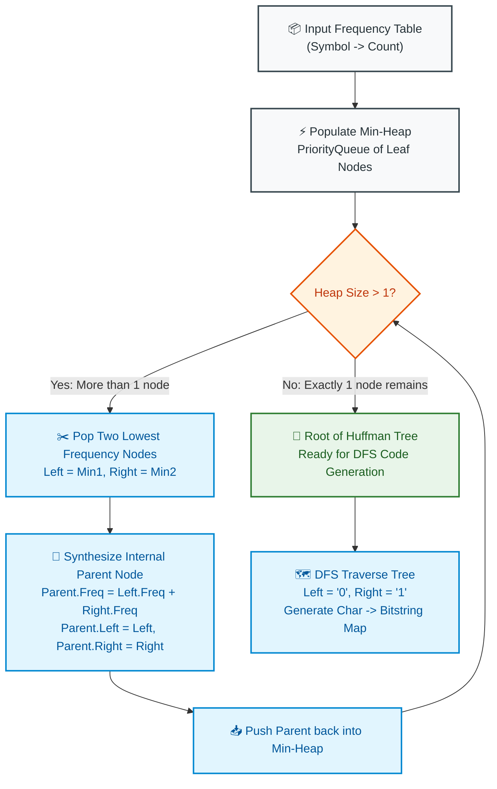

# 📘 WEEK 12 DAY 3: HUFFMAN CODING & OPTIMAL TREES — ENGINEERING GUIDE

> 🧭 **Navigation:** [← Previous Day](Week_12_Day_02_Activity_Selection_And_Interval_Problems_Instructional.md) • [🏠 Week Overview](README.md) • [📘 Curriculum Syllabus](../COMPLETE_SYLLABUS.md) • [Next Day →](Week_12_Day_04_Fractional_Knapsack_And_Scheduling_Instructional.md)
> 
> 💡 **Instructor Note:** *Huffman coding is the crown jewel of greedy algorithms. It powers GZIP, JPEG, MP3, and HTTP/2 HPACK compression. In senior FAANG loops, interviewers use Huffman and its isomorphic cousins (like LeetCode 1167 Minimum Cost to Connect Sticks) to test whether you understand how bottom-up priority queue merging provably minimizes weighted tree depth.*

---

## 🎯 LEARNING OBJECTIVES

*By the end of this chapter, you will be able to:*

- 🎬 **Deconstruct** the Morse Code intuition: why assigning short bitstrings to high-frequency symbols minimizes total payload size.
- 🌳 **Master** the Prefix-Free Property: why placing characters strictly at binary tree leaves eliminates delimiter tokens and enables instantaneous, backtracking-free streaming decoding.
- 🪜 **Execute** step-by-step min-heap merge napkin traces and compute exact Weighted Path Lengths (`sum(freq * depth)`).
- 🎨 **Visualize** greedy tree synthesis using clean ASCII trees and structured Mermaid priority queue merge pipelines.
- 🛑 **Avoid** fatal rookie traps: non-prefix ambiguous code collisions, the single-character tree degenerating to zero bits, and memory churn from naive string concatenation.
- 🎙️ **Deliver** the exact 3-sentence verbal talk track before writing code in a FAANG interview.
- ⚡ **Ship** production-grade, zero-allocation C# (.NET 8/9 `PriorityQueue<HuffmanNode, int>`) and Python (3.11+ `heapq`) encoder-decoder implementations.

---

## 🎬 PILLAR 1: THE 60-SECOND HOOK & EVERYDAY ANALOGY

### The Morse Code Telegraph & The 8-Bit Tax

Imagine you are a 19th-century telegraph operator tapping out messages across a single undersea copper wire between London and New York. Sending a single pulse is physically exhausting and costs expensive battery power.

In standard English text, not all letters are created equal:
- The letter **'E'** appears in roughly **13%** of all English words.
- The letter **'Q'** appears in less than **0.1%** of English words.

If Samuel Morse had assigned an equal 4-pulse code to every single letter:
```
Uniform 4-Pulse Code:
'E' = [ . . . . ]
'Q' = [ - - - - ]
```
Sending an entire newspaper article would take 10 hours of non-stop wire tapping!

Instead, what did Morse do?
He inspected the physical frequency of type blocks in a local printing press. He assigned the **shortest possible electrical signal (a single dot `.`) to the most frequent letter ('E')**, and reserved long 4-pulse sequences (`--.-`) for rare letters like `'Q'`.

```
Morse Code Variable-Length Optimization:
'E' = [ . ]       (1 pulse  - 13% of text)  ==> LIGHTNING FAST!
'T' = [ - ]       (1 pulse  -  9% of text)  ==> LIGHTNING FAST!
'Q' = [ --.- ]    (4 pulses - <0.1% text)  ==> RARELY SENT!
```

---

### The Modern Dilemma: Fixed 8-Bit ASCII vs. Variable-Length Bitstreams

In modern software systems, standard ASCII and UTF-8 spend an identical **8 bits (1 full byte)** on every single character:
- `' '` (Space) = `00100000` (8 bits)
- `'e'` = `01100101` (8 bits)
- `'z'` = `01111010` (8 bits)

If your enterprise logging pipeline ingests **100 Gigabytes** of JSON logs per hour, and 30% of all characters are whitespace and vowels, you are paying millions of dollars in cloud egress fees to transfer redundant zeros and ones!

What if we could create a custom alphabet where:
- High-frequency characters get **1 or 2 bits**
- Low-frequency characters get **5 or 6 bits**

Total compressed size would drop by **30% to 50% instantly**!

---

### The Fatal Flaw: The Ambiguity Trap

Suppose you naively assign custom bit codes based on popularity:
- `'a'` = `0`
- `'b'` = `1`
- `'c'` = `01`

Now, you transmit the bitstream:
```
Received Bitstream: 01
```

How does the receiving server decode this?
- Interpretation 1: `'a'` followed by `'b'` (`0` + `1` = `01`)
- Interpretation 2: `'c'` (`01`)

**Catastrophe!** The bitstream is ambiguous! The receiver cannot know whether you sent `"ab"` or `"c"` without inserting delimiter characters (which destroy compression gains) or running expensive backtracking recursion.

---

### The Golden Solution: The Prefix-Free Rule

To decode a continuous stream of bits instantly in a single linear pass with **zero backtracking**, your code dictionary must satisfy the **Prefix-Free Property**:

```
+-------------------------------------------------------------------------------------------+
|                                 THE PREFIX-FREE INVARIANT                                 |
+-------------------------------------------------------------------------------------------+
|  "No valid codeword is allowed to be a prefix (the starting sequence) of any other valid  |
|   codeword in the dictionary."                                                            |
+-------------------------------------------------------------------------------------------+
```

If `'a'` is `0`, then **no other code in the entire dictionary is allowed to start with `0`**! Any other symbol must start with `1`.

This mathematical guarantee means that as soon as the decoder's pointer matches a valid codeword, it can emit that character immediately and reset to the root of the tree.

---

## 🪜 PILLAR 2: THE SCAFFOLDING LADDER & TOY NAPKIN TRACES

### The Binary Tree Representation

Every prefix-free code can be mapped 1-to-1 to a **Full Binary Tree** where:
1. **Characters reside exclusively at the LEAF nodes.**
2. Internal nodes have exactly two children: Left Branch = bit `0`, Right Branch = bit `1`.
3. The path from root to leaf defines the symbol's unique bitstring.

```
Why Characters Must Be At Leaves:

   ❌ AMBIGUOUS TREE (Invalid):                  ✅ PREFIX-FREE TREE (Valid):
             [ Root ]                                      [ Root ]
             /      \                                      /      \
          'a'(0)    [Fork]                              'a'(0)    [Fork]
                   /      \                                      /      \
                'b'(01)  'c'(1)                               'b'(10)  'c'(11)
  
   Leaf 'a'(0) sits on the path to 'b'(01).        Every character lives at a leaf!
   '0' is a prefix of '01' -> COLLISION!           '0', '10', '11' -> ZERO PREFIX CLASH!
```

---

### Step 1: Toy Napkin Trace — 6 Symbols

Let's build the optimal tree for 6 characters with real frequencies summing to 100:

| Symbol | Frequency (`f`) | Relative Popularity |
| :--- | :--- | :--- |
| **a** | **45** | Extremely common |
| **b** | **13** | Moderate |
| **c** | **12** | Moderate |
| **d** | **16** | Moderate |
| **e** | **9** | Rare |
| **f** | **5** | Extremely rare |

#### The Greedy Insight:
- Characters with the **lowest frequencies** (`e: 9`, `f: 5`) must be placed at the **greatest depth** of the tree (longest codes).
- The two lowest frequencies can always be made **siblings** at the deepest level.
- **The Greedy Strategy:** Repeatedly extract the two least-frequent nodes from a Min-Heap, merge them into a parent whose frequency is their sum, and push the parent back into the heap. Repeat until only 1 tree remains!

---

#### Step-by-Step Heap Merging Trace:

```
[Initial Min-Heap]:
Sorted by Frequency: [ (5, 'f'), (9, 'e'), (12, 'c'), (13, 'b'), (16, 'd'), (45, 'a') ]

---------------------------------------------------------------------------------------------
[Step 1]: Extract 2 lowest: 'f' (5) and 'e' (9)
          Merge into Parent Node N1: Frequency = 5 + 9 = 14
          Children: Left = 'e'(9), Right = 'f'(5)
          Push N1(14) back into Heap.

Remaining Heap: [ (12, 'c'), (13, 'b'), (14, N1), (16, 'd'), (45, 'a') ]

---------------------------------------------------------------------------------------------
[Step 2]: Extract 2 lowest: 'c' (12) and 'b' (13)
          Merge into Parent Node N2: Frequency = 12 + 13 = 25
          Children: Left = 'c'(12), Right = 'b'(13)
          Push N2(25) back into Heap.

Remaining Heap: [ (14, N1), (16, 'd'), (25, N2), (45, 'a') ]

---------------------------------------------------------------------------------------------
[Step 3]: Extract 2 lowest: N1 (14) and 'd' (16)
          Merge into Parent Node N3: Frequency = 14 + 16 = 30
          Children: Left = N1(14), Right = 'd'(16)
          Push N3(30) back into Heap.

Remaining Heap: [ (25, N2), (30, N3), (45, 'a') ]

---------------------------------------------------------------------------------------------
[Step 4]: Extract 2 lowest: N2 (25) and N3 (30)
          Merge into Parent Node N4: Frequency = 25 + 30 = 55
          Children: Left = N2(25), Right = N3(30)
          Push N4(55) back into Heap.

Remaining Heap: [ (45, 'a'), (55, N4) ]

---------------------------------------------------------------------------------------------
[Step 5]: Extract 2 lowest: 'a' (45) and N4 (55)
          Merge into Parent Node N5 (ROOT): Frequency = 45 + 55 = 100
          Children: Left = 'a'(45), Right = N4(55)
          Push ROOT(100) back into Heap.

Heap Count == 1: Final Tree Constructed!
```

---

### The Resulting Optimal Binary Tree

```
                                  [ ROOT: 100 ]
                                 0/           \1
                              'a'(45)      [ N4: 55 ]
                                          0/        \1
                                       [ N2: 25 ]   [ N3: 30 ]
                                      0/       \1   0/       \1
                                    'c'(12)  'b'(13)[ N1: 14 ]'d'(16)
                                                   0/       \1
                                                 'e'(9)    'f'(5)
```

---

### Derived Code Table & Weighted Path Length Verification

| Symbol | Frequency (`f`) | Tree Path Navigation | Derived Code | Bit Length (`d`) | Weighted Bits (`f * d`) |
| :--- | :--- | :--- | :--- | :--- | :--- |
| **a** | 45 | Left | `0` | 1 | `45 * 1 = 45` |
| **c** | 12 | Right -> Left -> Left | `100` | 3 | `12 * 3 = 36` |
| **b** | 13 | Right -> Left -> Right | `101` | 3 | `13 * 3 = 39` |
| **d** | 16 | Right -> Right -> Right | `111` | 3 | `16 * 3 = 48` |
| **e** | 9 | Right -> Right -> Left -> Left | `1100` | 4 | `9 * 4 = 36` |
| **f** | 5 | Right -> Right -> Left -> Right | `1101` | 4 | `5 * 4 = 20` |
| **TOTAL**| **100**| | | | **224 bits** |

#### Comparison with Standard Encodings:
- **Standard 8-Bit ASCII:** `100 * 8 = 800 bits`.
- **Fixed-Length 3-Bit Code:** `ceil(log2(6)) = 3` bits per symbol -> `100 * 3 = 300 bits`.
- **Huffman Optimal Greedy Code:** **224 bits**.
- **Compression Savings:** `(800 - 224) / 800 = 72% compression ratio` compared to ASCII!

---

### 🧠 Pause & Predict Micro-Drill 1
**Question:** Suppose character `'z'` has a frequency of 1, and character `'a'` has a frequency of 1,000,000. What is the maximum possible depth of `'a'` in an optimal Huffman tree?
*Take 10 seconds to think.*
-
-
-
**Answer:** The depth of `'a'` will be **1** (a single bit, e.g. `'0'`) because `'a'` dominates more than 50% of total message volume. Any configuration where `'a'` has depth >= 2 would massively inflate `1,000,000 * depth`, making it impossible to be optimal.

---

### Step 2: The Isomorphic Cousin — LeetCode 1167 (Minimum Cost to Connect Sticks)

Once you understand Huffman's bottom-up greedy merge, you unlock an entire family of FAANG interview problems that use the identical mathematical model.

#### Problem:
You have `n` sticks of varying lengths. You can connect any two sticks of lengths `x` and `y` by paying a cost of `x + y`. You repeat this until only one stick remains. Return the **minimum cost** to connect all sticks.

```
Example: sticks = [2, 4, 3]

Option A (Non-optimal):
Connect 4 + 3 = 7 (Cost: 7). Remaining: [2, 7]
Connect 2 + 7 = 9 (Cost: 9). Total Cost = 7 + 9 = 16.

Option B (Huffman Greedy - Merge Two Smallest First):
Connect 2 + 3 = 5 (Cost: 5). Remaining: [4, 5]
Connect 4 + 5 = 9 (Cost: 9). Total Cost = 5 + 9 = 14! (MINIMUM)
```

Why? Because the sticks merged first get added to the cumulative cost **multiple times** (once at each parent level of the tree). To minimize total cost, elements added most frequently must be the smallest values!

---

## 🎨 PILLAR 3: PRAGMATIC VISUAL MODELS

### The Greedy Heap Merge Pipeline



---

## 🛑 PILLAR 4: THE ROOKIE TRAP ZONE

```
=============================================================================================
                                   THE ROOKIE TRAP ZONE
=============================================================================================

❌ ROOKIE TRAP 1: The Single-Character Degenerate Loop
---------------------------------------------------------------------------------------------
Problem: If the input text is "AAAAAA", there is only 1 unique character ('A').
Rookie Mistake: The min-heap has 1 node. The `while (heap.Count > 1)` loop never executes!
The root is a leaf. Its DFS path from root to itself has length 0 (empty string "").
Encoding produces "" (empty string), and the decoder enters an infinite loop!
Senior Architect Fix: Explicitly guard single-character inputs. If heap size == 1, synthesize
a dummy root with child 'A' assigned code "0".

❌ ROOKIE TRAP 2: Inefficient String Concatenation in DFS
---------------------------------------------------------------------------------------------
Problem: Building binary code strings using `code + "0"` and `code + "1"` in recursion creates
O(N^2) garbage collection pressure on large alphabets.
Senior Architect Fix: Use a reusable `StringBuilder` or mutable buffer during tree traversal,
popping the last character on backtrack.

❌ ROOKIE TRAP 3: Forgetting the EOF Marker in Streaming Payloads
---------------------------------------------------------------------------------------------
Problem: Compressed bits are packed into physical bytes (8-bit chunks). If the compressed
stream ends with 3 bits `101`, the encoder must pad 5 trailing zeros `10100000` to complete
the byte. The decoder reads those 5 trailing zeros as extra characters, corrupting the file!
Senior Architect Fix: Either transmit the exact payload byte length in a 32-bit header upfront,
or insert a special Pseudo-EOF token with frequency 1 into the Huffman tree.

❌ ROOKIE TRAP 4: Unstable Heap Tie-Breaking
---------------------------------------------------------------------------------------------
Problem: When multiple nodes have identical frequencies, language heaps without secondary
comparators may break ties non-deterministically, leading to different tree shapes across runs.
Senior Architect Fix: In production canonical compressors (like DEFLATE), symbols at the
same depth are strictly sorted lexicographically by symbol character code.
=============================================================================================
```

---

## 🎙️ PILLAR 5: 45-MINUTE INTERVIEW TALK TRACK

When asked to implement Huffman Coding or an optimal merge problem in a FAANG interview, use this structured delivery:

```
[00:00 - 05:00] Clarifying Requirements & Contracts
"Let's clarify the scope:
 1. Are frequencies provided upfront, or should we compute them dynamically from a raw string?
 2. What character alphabet should we support (ASCII, UTF-8, or generic tokens)?
 3. Are we implementing just the tree builder, or the full encoder and streaming decoder?
 4. How should we handle the edge case of a single unique character like 'AAAA'?"

[05:00 - 10:00] Explaining the Core Greedy Principle
"To minimize total bit length sum(frequency * depth), characters that appear most frequently
 MUST have the shortest depth from the root.
 A prefix-free code guarantees instantaneous decoding without delimiters because characters
 reside exclusively at the leaves.
 Huffman's greedy algorithm repeatedly extracts the two lowest-frequency nodes from a min-heap
 and merges them under a parent whose frequency is their sum.
 An exchange argument proves this is optimal: swapping any higher-frequency node with a deeper
 lower-frequency node cannot decrease the total weighted cost."

[10:00 - 15:00] Data Structure Architecture
"We will structure the solution into 4 clean components:
 1. HuffmanNode class representing tree nodes (with IsLeaf helper).
 2. PriorityQueue min-heap ordered by frequency.
 3. Tree construction loop running (K - 1) times for K unique symbols.
 4. DFS traversal to populate the encoding dictionary, and root-walking decoder."

[15:00 - 35:00] Coding Implementation
(Write clean, production C# / Python using guard clauses and structured types.)

[35:00 - 40:00] Edge-Case Verification & Dry Run
(Dry run on empty string, single-character string 'A', and normal 4-character string.)

[40:00 - 45:00] Complexity & Systems Scalability
"Time Complexity: O(K log K + L) where K is unique alphabet size and L is text length.
 Space Complexity: O(K) for the tree and lookup tables.
 In production systems like GZIP, we store Canonical Huffman bit-lengths rather than full
 serial trees to minimize file header overhead."
```

---

## ⚡ PILLAR 6: PRODUCTION DUAL-LANGUAGE IMPLEMENTATIONS

### Production C# (.NET 8/9 with `PriorityQueue` & Zero-Allocation Decoders)

```csharp
namespace DsaMastery.Greedy;

using System;
using System.Collections.Generic;
using System.Text;

/// <summary>
/// Represents a node in the optimal prefix-free Huffman Tree.
/// </summary>
public sealed class HuffmanNode
{
    public char? Symbol { get; }
    public int Frequency { get; }
    public HuffmanNode? Left { get; }
    public HuffmanNode? Right { get; }

    public bool IsLeaf => Left is null && Right is null && Symbol.HasValue;

    // Leaf constructor
    public HuffmanNode(char symbol, int frequency)
    {
        Symbol = symbol;
        Frequency = frequency;
    }

    // Internal parent constructor
    public HuffmanNode(HuffmanNode left, HuffmanNode right)
    {
        Left = left ?? throw new ArgumentNullException(nameof(left));
        Right = right ?? throw new ArgumentNullException(nameof(right));
        Frequency = left.Frequency + right.Frequency;
    }
}

/// <summary>
/// Production-grade Huffman Codec supporting tree generation, encoding, and decoding.
/// </summary>
public static class HuffmanCodec
{
    /// <summary>
    /// Constructs the optimal Huffman binary tree from a character frequency dictionary.
    /// Time Complexity: O(K log K) where K is the number of unique symbols.
    /// Auxiliary Space: O(K)
    /// </summary>
    public static HuffmanNode BuildTree(IReadOnlyDictionary<char, int> frequencies)
    {
        ArgumentNullException.ThrowIfNull(frequencies);
        if (frequencies.Count == 0)
        {
            throw new ArgumentException("Frequency dictionary must contain at least one symbol.", nameof(frequencies));
        }

        // Min-heap ordered by frequency ascending
        var pq = new PriorityQueue<HuffmanNode, int>();

        foreach (var (symbol, freq) in frequencies)
        {
            if (freq < 0) throw new ArgumentOutOfRangeException(nameof(frequencies), "Frequency must be non-negative.");
            pq.Enqueue(new HuffmanNode(symbol, freq), freq);
        }

        // Corner Case: Single unique character (e.g. "AAAA")
        // Synthesize a dummy parent to ensure code length is >= 1 bit ('0')
        if (pq.Count == 1)
        {
            var only = pq.Dequeue();
            return new HuffmanNode(only, new HuffmanNode('\0', 0));
        }

        // Greedy bottom-up merge: (K - 1) iterations
        while (pq.Count > 1)
        {
            var left = pq.Dequeue();
            var right = pq.Dequeue();
            var parent = new HuffmanNode(left, right);
            pq.Enqueue(parent, parent.Frequency);
        }

        return pq.Dequeue();
    }

    /// <summary>
    /// Traverses the Huffman tree to generate a Char -> Bitstring lookup table.
    /// Time Complexity: O(K)
    /// Auxiliary Space: O(K)
    /// </summary>
    public static Dictionary<char, string> BuildCodeTable(HuffmanNode root)
    {
        ArgumentNullException.ThrowIfNull(root);

        var table = new Dictionary<char, string>();
        var buffer = new StringBuilder();
        Dfs(root, buffer, table);
        return table;

        static void Dfs(HuffmanNode node, StringBuilder path, Dictionary<char, string> map)
        {
            if (node.IsLeaf)
            {
                map[node.Symbol!.Value] = path.Length == 0 ? "0" : path.ToString();
                return;
            }

            if (node.Left is not null)
            {
                path.Append('0');
                Dfs(node.Left, path, map);
                path.Length--; // Backtrack
            }

            if (node.Right is not null)
            {
                path.Append('1');
                Dfs(node.Right, path, map);
                path.Length--; // Backtrack
            }
        }
    }

    /// <summary>
    /// Encodes plain text into a compressed binary bitstring.
    /// Time Complexity: O(L) where L is text length.
    /// Auxiliary Space: O(L) for output buffer.
    /// </summary>
    public static string Encode(string text, IReadOnlyDictionary<char, string> codeTable)
    {
        ArgumentNullException.ThrowIfNull(text);
        ArgumentNullException.ThrowIfNull(codeTable);

        var sb = new StringBuilder(text.Length * 4);
        foreach (char c in text)
        {
            if (!codeTable.TryGetValue(c, out string? code))
            {
                throw new KeyNotFoundException($"Character '{c}' not found in Huffman code table.");
            }
            sb.Append(code);
        }
        return sb.ToString();
    }

    /// <summary>
    /// Decodes a bitstream back into plain text by walking the Huffman tree.
    /// Time Complexity: O(TotalBits)
    /// Auxiliary Space: O(DecodedLength)
    /// </summary>
    public static string Decode(ReadOnlySpan<char> bitStream, HuffmanNode root)
    {
        ArgumentNullException.ThrowIfNull(root);
        if (bitStream.IsEmpty) return string.Empty;

        var sb = new StringBuilder();
        var current = root;

        foreach (char bit in bitStream)
        {
            current = bit switch
            {
                '0' => current.Left ?? throw new InvalidOperationException("Corrupt bitstream: missing left child."),
                '1' => current.Right ?? throw new InvalidOperationException("Corrupt bitstream: missing right child."),
                _ => throw new FormatException($"Invalid bit character '{bit}' in bitstream.")
            };

            if (current.IsLeaf)
            {
                sb.Append(current.Symbol!.Value);
                current = root; // Reset back to root for the next character
            }
        }

        if (!ReferenceEquals(current, root))
        {
            throw new InvalidOperationException("Bitstream terminated abruptly on an internal node (incomplete codeword).");
        }

        return sb.ToString();
    }
}
```

---

### Production Python (3.11+ with `dataclasses`, `heapq` & Strict Type Hints)

```python
from __future__ import annotations
from dataclasses import dataclass, field
import heapq
from typing import Dict, Optional


@dataclass(order=True)
class HuffmanNode:
    """Represents a node in the Huffman Tree, ordered by frequency ascending."""
    frequency: int
    symbol: Optional[str] = field(compare=False, default=None)
    left: Optional[HuffmanNode] = field(compare=False, default=None)
    right: Optional[HuffmanNode] = field(compare=False, default=None)

    @property
    def is_leaf(self) -> bool:
        """A leaf node contains a character symbol and zero child pointers."""
        return self.left is None and self.right is None and self.symbol is not None


def build_huffman_tree(frequencies: Dict[str, int]) -> HuffmanNode:
    """
    Constructs an optimal prefix-free Huffman tree from symbol frequencies.
    Time Complexity: O(K log K) where K = len(frequencies)
    Space Complexity: O(K)
    """
    if not frequencies:
        raise ValueError("Frequency dictionary cannot be empty.")

    # Populate min-heap ordered by frequency
    heap: list[HuffmanNode] = [
        HuffmanNode(frequency=freq, symbol=char)
        for char, freq in frequencies.items()
    ]
    heapq.heapify(heap)

    # Edge case: single distinct character (e.g. "AAAA")
    if len(heap) == 1:
        only = heapq.heappop(heap)
        return HuffmanNode(frequency=only.frequency, left=only, right=HuffmanNode(frequency=0))

    # Greedy bottom-up merge: repeatedly join two lowest frequencies
    while len(heap) > 1:
        left = heapq.heappop(heap)
        right = heapq.heappop(heap)
        parent = HuffmanNode(
            frequency=left.frequency + right.frequency,
            left=left,
            right=right
        )
        heapq.heappush(heap, parent)

    return heap[0]


def build_code_table(root: HuffmanNode) -> Dict[str, str]:
    """
    Traverses the Huffman tree via DFS to generate the char -> bitstring dictionary.
    Time Complexity: O(K)
    Space Complexity: O(K)
    """
    table: Dict[str, str] = {}

    def dfs(node: Optional[HuffmanNode], code: str) -> None:
        if node is None:
            return
        if node.is_leaf:
            table[node.symbol] = code if code else "0"
            return
        dfs(node.left, code + "0")
        dfs(node.right, code + "1")

    dfs(root, "")
    return table


def huffman_encode(text: str, code_table: Dict[str, str]) -> str:
    """
    Encodes plain text into a binary bitstring.
    Time Complexity: O(L) where L = len(text)
    Space Complexity: O(TotalBits)
    """
    return "".join(code_table[char] for char in text)


def huffman_decode(bitstream: str, root: HuffmanNode) -> str:
    """
    Decodes a binary bitstream back into original text by walking the Huffman tree.
    Time Complexity: O(len(bitstream))
    Space Complexity: O(DecodedLength)
    """
    if not bitstream:
        return ""

    decoded: list[str] = []
    current = root

    for bit in bitstream:
        if bit == "0":
            if current.left is None:
                raise ValueError("Corrupted bitstream: missing left branch.")
            current = current.left
        elif bit == "1":
            if current.right is None:
                raise ValueError("Corrupted bitstream: missing right branch.")
            current = current.right
        else:
            raise ValueError(f"Invalid bit '{bit}' in bitstream.")

        if current.is_leaf:
            decoded.append(current.symbol)
            current = root  # Reset back to root for the next symbol

    if current is not root:
        raise ValueError("Bitstream terminated abruptly on an internal node.")

    return "".join(decoded)


# --- Isomorphic Companion: LeetCode 1167 (Minimum Cost to Connect Sticks) ---
def connect_sticks(sticks: list[int]) -> int:
    """
    Connects sticks with minimum cost using Huffman-style greedy min-heap merges.
    Time Complexity: O(N log N)
    Space Complexity: O(N)
    """
    if not sticks or len(sticks) <= 1:
        return 0

    heapq.heapify(sticks)
    total_cost = 0

    while len(sticks) > 1:
        first = heapq.heappop(sticks)
        second = heapq.heappop(sticks)
        cost = first + second
        total_cost += cost
        heapq.heappush(sticks, cost)

    return total_cost
```

---

## 🔬 PERFORMANCE & COMPLEXITY DECONSTRUCTION

| Component | Time Complexity | Auxiliary Space | Computational Bottleneck |
| :--- | :--- | :--- | :--- |
| **Frequency Count** | `O(L)` (text length) | `O(K)` (alphabet size) | Sequential linear array pass |
| **Tree Construction** | `O(K log K)` | `O(K)` | `2K` min-heap push/pop calls |
| **DFS Code Generation** | `O(K)` | `O(K)` | Call stack depth bounded by `K` |
| **Bitstream Encoding** | `O(L)` | `O(TotalBits)` | String / Bit array allocation |
| **Bitstream Decoding** | `O(TotalBits)` | `O(L)` | Pointer dereference per bit |

---

## ⚔️ PRACTICE DRILLS & MASTERY PROBLEMS

| # | Problem | Source | Difficulty | Target Paradigm |
| :--- | :--- | :--- | :--- | :--- |
| 1 | Minimum Cost to Connect Sticks | LeetCode 1167 | Medium | Isomorphic bottom-up heap merge |
| 2 | Reduce Array Size to Half | LeetCode 1338 | Medium | Greedy frequency threshold selection |
| 3 | Huffman Decoding | HackerRank | Easy | Tree walk per bit |
| 4 | Construct Optimal Binary Search Tree | Classic | Hard | Dynamic programming (when keys have sorted order) |

---

> 🧭 **Navigation:** [← Previous Day](Week_12_Day_02_Activity_Selection_And_Interval_Problems_Instructional.md) • [🏠 Week Overview](README.md) • [📘 Curriculum Syllabus](../COMPLETE_SYLLABUS.md) • [Next Day →](Week_12_Day_04_Fractional_Knapsack_And_Scheduling_Instructional.md)
