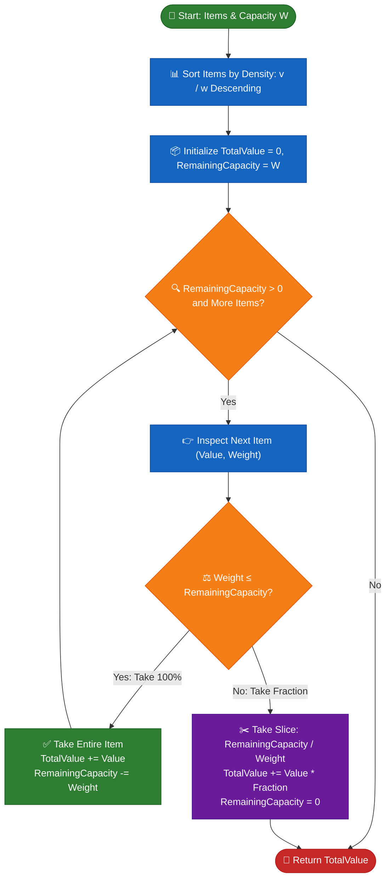

# 📘 WEEK 12 DAY 4: FRACTIONAL KNAPSACK & SCHEDULING — ENGINEERING GUIDE

> 🧭 **Navigation:** [← Previous Day](Week_12_Day_03_Huffman_Coding_And_Optimal_Trees_Instructional.md) • [🏠 Week Overview](README.md) • [📘 Curriculum Syllabus](../COMPLETE_SYLLABUS.md) • [Next Day →](Week_12_Day_05_Greedy_In_Systems_Instructional.md)
> 
> 💡 **Instructor Note:** *Today centers on two classic greedy paradigms: continuous optimization via density sorting (Fractional Knapsack) and deadline slot backward placement (Job Sequencing). Understand why item divisibility makes greedy mathematically optimal, whereas discrete items force dynamic programming due to capacity fragmentation.*

---

## 🎯 LEARNING OBJECTIVES

*By the end of this chapter, you will be able to:*

- 🎯 **Distinguish** between Fractional Knapsack (Greedy optimal) and 0/1 Knapsack (Greedy fails, DP required) through the physical lens of capacity fragmentation.
- ⚙️ **Implement** Fractional Knapsack, Job Sequencing with Deadlines, and Minimum Cost to Hire K Workers (LC 857) in modern C# (.NET 8/9) and Python (3.11+).
- ⚖️ **Master** the Value Density metric and cross-multiplication comparator to avoid floating-point precision traps and integer truncation.
- 🧠 **Prove** why placing jobs into the *latest available slot* before their deadline maximizes future flexibility, and optimize it to `O(N * alpha(D))` via Disjoint Set Union (DSU).
- 🏭 **Connect** continuous and deadline scheduling directly to production systems: network QoS egress packet shaping, spot instance auction schedulers, and worker pool capacity planners.

---

## 🎬 PILLAR 1: 60-SECOND HOOK & EVERYDAY ANALOGY

### The Gold Dust Robber vs The Antique Thief

Imagine two burglars breaking into high-security vaults at 2:00 AM. Both carry an identical backpack with an absolute weight limit of **50 kg**.

```
+-----------------------------------------------------------------------------------------+
|                                THE TWO ROBBERS PARADOX                                  |
+-----------------------------------------------------------------------------------------+
|  THE GOLD DUST ROBBER (Continuous Items)     |  THE ANTIQUE THIEF (Discrete Items)      |
|  - Vault holds: Diamond powder, gold dust,   |  - Vault holds: Laptops, oil paintings,  |
|    and silver shavings in large barrels.     |    and marble statues.                   |
|  - Items are DIVISIBLE: Can scoop any gram.  |  - Items are ATOMIC: Cannot saw a laptop |
|  - Strategy: Sort by $/kg (Value Density).   |    in half and expect it to work!        |
|  - Scoop the densest dust until bag is full. |  - Strategy: Density sorting FAILS!      |
|  - Result: 100% MATHEMATICALLY OPTIMAL!     |  - Result: Leaves empty dead space       |
|    (Fractional Knapsack -> Greedy)           |    (Capacity Fragmentation -> DP)        |
+-----------------------------------------------------------------------------------------+
```

#### Why Divisibility Unlocks Greed

When items are **divisible** (like gold dust or network stream packets), you never suffer from **Capacity Fragmentation**. Every single cubic centimeter or gram of your backpack's capacity can be packed with the highest possible value per unit of weight. If the most valuable item has only 5 kg left, you scoop all 5 kg and seamlessly switch to the second-highest density item.

When items are **discrete** (like a 30 kg marble statue or a 20 kg server rack), greedy density sorting fails catastrophically. Taking a high-density small item might leave 20 kg of empty space that cannot accommodate a slightly lower-density 25 kg item worth far more.

```
Real-World Architecture Mapping:
- Fractional Knapsack: Linux Network QoS Egress Traffic Shaper (Token Bucket / HTB).
  Packets or bandwidth quotas are sliced into arbitrary byte-streams. Every byte of
  egress pipe is allocated to the highest-priority SLA stream.
- Discrete Knapsack: Cloud VM Spot-Instance Allocator.
  You cannot purchase 0.37 of an AWS c5.metal instance. You either allocate the
  entire VM or reject it, requiring Dynamic Programming or Integer Linear Programming.
```

---

## 🪜 PILLAR 2: SCAFFOLDING LADDER & TOY NAPKIN TRACES

### Step 1: Toy Napkin Trace — Fractional Knapsack

Consider a backpack with total capacity `W = 50 kg` and 3 available items:

```
Item 1: Value = 60,  Weight = 10 kg -> Value Density = 60 / 10 = 6.0 $/kg
Item 2: Value = 100, Weight = 20 kg -> Value Density = 100 / 20 = 5.0 $/kg
Item 3: Value = 120, Weight = 30 kg -> Value Density = 120 / 30 = 4.0 $/kg
```

#### Step-by-Step Greedy Execution:

```
Initial State:
Remaining Capacity = 50 kg
Total Value Achieved = $0

[Step 1] Pick highest density: Item 1 (Density = 6.0 $/kg, Weight = 10 kg)
         Weight 10 kg <= Remaining 50 kg -> Take 100% of Item 1!
         Remaining Capacity = 50 - 10 = 40 kg
         Total Value = 0 + 60 = $60

[Step 2] Pick next highest density: Item 2 (Density = 5.0 $/kg, Weight = 20 kg)
         Weight 20 kg <= Remaining 40 kg -> Take 100% of Item 2!
         Remaining Capacity = 40 - 20 = 20 kg
         Total Value = 60 + 100 = $160

[Step 3] Pick next highest density: Item 3 (Density = 4.0 $/kg, Weight = 30 kg)
         Weight 30 kg > Remaining 20 kg -> Cannot take 100%!
         Take fraction: Remaining / Item Weight = 20 / 30 = 2/3 (66.7%)
         Value Gained = 120 * (20 / 30) = $80
         Remaining Capacity = 20 - 20 = 0 kg
         Total Value = 160 + 80 = $240

Optimal Result: Total Value = $240.0
```

#### The 0/1 Knapsack Counter-Proof: Why Discrete Greed Fails

Now assume the exact same items are **indivisible** (cannot take fractions):

```
Greedy by Ratio (0/1 Knapsack):
- Pick Item 1 (Ratio 6.0, Wt 10): Capacity Left = 40, Value = $60
- Pick Item 2 (Ratio 5.0, Wt 20): Capacity Left = 20, Value = $160
- Next is Item 3 (Wt 30): Exceeds remaining capacity (20) -> CANNOT TAKE!
- Finished Greedy Value = $160 (20 kg wasted dead space!).

Optimal Dynamic Programming Choice:
- Take Item 2 (Wt 20, Val $100) + Item 3 (Wt 30, Val $120)
- Total Weight = 20 + 30 = 50 kg (100% capacity utilized, ZERO dead space!)
- Optimal Value = 100 + 120 = $220!

Conclusion: $220 (Optimal DP) > $160 (Greedy by Ratio).
Greedy FAILS on discrete items due to Capacity Fragmentation!
```

---

### Step 2: Deadline Job Sequencing with Penalties & Profits

**Problem Statement:**
You are given `N` jobs. Each job `i` takes exactly 1 unit of time and provides `Profit[i]` if completed on or before its integer `Deadline[i]`. Only one job can execute per unit time slot (slots are 1-based: `[1], [2], [3], ...`). Maximize total profit.

#### The Dual Greedy Insight:
1. **Priority Rule:** Process jobs in descending order of **Profit** (the greed for money).
2. **Placement Rule:** For any job, schedule it into its **latest available free slot** `<= Deadline`.
   - *Why latest?* If Job A is due at time 3, placing it at time 1 consumes slot 1, which blocks Job B that is *only* eligible for slot 1! Pushing Job A as late as possible (slot 3) preserves earlier slots for future jobs with tighter deadlines.

#### Step-by-Step Hand Trace:

Given 5 jobs:
- Job A: Profit 100, Deadline 2
- Job B: Profit 19,  Deadline 1
- Job C: Profit 27,  Deadline 2
- Job D: Profit 25,  Deadline 1
- Job E: Profit 15,  Deadline 3

```
Sort Descending by Profit:
1. Job A: Profit = 100, Deadline = 2
2. Job C: Profit = 27,  Deadline = 2
3. Job D: Profit = 25,  Deadline = 1
4. Job B: Profit = 19,  Deadline = 1
5. Job E: Profit = 15,  Deadline = 3

Max Deadline = 3 -> Available Slots: [ Slot 1 ] [ Slot 2 ] [ Slot 3 ]
Timeline State:                     [   ---    ] [   ---    ] [   ---    ]

[Step 1] Inspect Job A (Profit 100, Deadline 2):
         Latest free slot <= 2 is Slot 2.
         Assign Job A to Slot 2.
         Timeline: [ --- ] [  A  ] [ --- ] | Total Profit = 100

[Step 2] Inspect Job C (Profit 27, Deadline 2):
         Slot 2 is occupied by A.
         Latest free slot <= 2 is Slot 1.
         Assign Job C to Slot 1.
         Timeline: [  C  ] [  A  ] [ --- ] | Total Profit = 100 + 27 = 127

[Step 3] Inspect Job D (Profit 25, Deadline 1):
         Latest free slot <= 1 is Slot 1. Slot 1 is already taken by C!
         No slots available <= 1 -> Drop Job D.
         Timeline: [  C  ] [  A  ] [ --- ] | Total Profit = 127

[Step 4] Inspect Job B (Profit 19, Deadline 1):
         Slot 1 is already taken -> Drop Job B.
         Timeline: [  C  ] [  A  ] [ --- ] | Total Profit = 127

[Step 5] Inspect Job E (Profit 15, Deadline 3):
         Latest free slot <= 3 is Slot 3.
         Assign Job E to Slot 3.
         Timeline: [  C  ] [  A  ] [  E  ] | Total Profit = 127 + 15 = 142

Final Schedule: Slot 1 = Job C, Slot 2 = Job A, Slot 3 = Job E. Total Profit = 142.
```

---

### 🧠 PAUSE & PREDICT: MICRO-DRILLS

#### Micro-Drill 1: The Exchange Argument Check
> **Question:** Suppose an adversary claims that an alternative optimal solution `OPT` exists for Fractional Knapsack that takes 5 kg of Item 3 (density 4.0 $/kg) instead of 5 kg of Item 1 (density 6.0 $/kg). What happens if we exchange those 5 kg?
> 
> **Answer:** If we remove 5 kg of Item 3 (loss: `5 * 4 = $20`) and add 5 kg of Item 1 (gain: `5 * 6 = $30`), the total value increases by `30 - 20 = +$10` without violating capacity! Therefore, `OPT` could not have been optimal. Any deviation from highest density strictly degrades or equals the total value.

#### Micro-Drill 2: The Backward Slot Allocation Invariant
> **Question:** In Job Sequencing, what would go wrong if we greedily picked the *earliest* available slot (`1` up to `Deadline`) instead of the *latest* available slot?
> 
> **Answer:** If Job A has deadline 3 and we place it in Slot 1, then a subsequent Job B with deadline 1 finds Slot 1 occupied and is dropped. Placing Job A in Slot 3 accommodates *both* Job A and Job B. Backward allocation is maximally lazy: it consumes the least flexible slot first.

#### Micro-Drill 3: The Deadline Scaling Nightmare
> **Question:** If `N = 10^5` and the maximum deadline `D = 10^5`, what is the time complexity of the naive backward linear search? How does Disjoint Set Union (DSU) solve it?
> 
> **Answer:** Naive backward scanning takes `O(N * D) = 10^10` operations, which times out (TLE). With DSU, each slot points to itself. When slot `t` is occupied, we union `t` with `t - 1`. `Find(deadline)` uses path compression to jump directly to the next free slot in `O(alpha(D))` time, reducing total time to `O(N * alpha(D))`.

---

## 🎨 PILLAR 3: PRAGMATIC VISUAL MODELS

### ASCII Model 1: Continuous Backpack Filling by Density Tiers

```
Total Knapsack Capacity = 50 kg

0 kg                                                      50 kg
|-----------------------------------------------------------|
|   Item 1 (10 kg)   |     Item 2 (20 kg)    | Item 3 (20kg)|
|   Density: 6.0     |     Density: 5.0      | Density: 4.0 |
|   Value: $60       |     Value: $100       | Value: $80   |
|   (100% taken)     |     (100% taken)      | (66.7% taken)|
|-----------------------------------------------------------|
[======== 10 kg =====][======= 20 kg =======][==== 20 kg ===]
                      Cumulative Value: $240.0
```

### Mermaid Flowchart: Fractional Greedy Decision Loop



### ASCII Model 2: Job Scheduling Deadline Slots and DSU Union Chain

```
Slot Timeline (1-based index):
[ Slot 1 ]      [ Slot 2 ]      [ Slot 3 ]      [ Slot 4 ]
    ^               ^               ^               ^
    |               |               |               |
DSU Initial:
parent[1]=1     parent[2]=2     parent[3]=3     parent[4]=4

Action 1: Job with deadline 3 is placed in Slot 3.
          Union(3, 3 - 1) -> parent[3] points to 2!
          [1] <--- [2] <==== [3]        [4]

Action 2: Job with deadline 3 arrives.
          Find(3) -> follows pointer -> lands on Slot 2!
          Slot 2 is free! Place job in Slot 2.
          Union(2, 2 - 1) -> parent[2] points to 1!
          [1] <==== [2] <==== [3]       [4]

Action 3: Job with deadline 2 arrives.
          Find(2) -> follows pointers -> lands on Slot 1!
          Slot 1 is free! Place job in Slot 1.
          Union(1, 1 - 1) -> parent[1] points to 0 (exhausted!).
          [0] <==== [1] <==== [2] <==== [3]

Action 4: Job with deadline 2 arrives.
          Find(2) -> lands on 0 -> No available slot <= 2 -> Drop job in O(1)!
```

---

## 🛑 PILLAR 4: THE ROOKIE TRAP ZONE

### Trap 1: Integer Division Truncation

```csharp
// ❌ ROOKIE BLUNDER: Integer division truncates decimals!
int value = 5;
int weight = 2;
double density = value / weight; // Results in 2.0 instead of 2.5!

// ✅ SENIOR ARCHITECT PATTERN: Explicit floating-point cast
double density = (double)value / weight; // Correctly yields 2.5
```

### Trap 2: Floating-Point Precision Loss in Comparators

When sorting items by density, calculating `(double)v / w` can cause rounding issues when values are very large (e.g. `10^9`) or when two items have microscopic differences. Furthermore, floating-point comparison can introduce non-transitive sorting bugs.

```csharp
// ❌ ROOKIE BLUNDER: Division introduces IEEE 754 precision loss
Array.Sort(items, (a, b) => ((double)b.Value / b.Weight).CompareTo((double)a.Value / a.Weight));

// ✅ SENIOR ARCHITECT PATTERN: Cross-Multiplication using 64-bit integers
// To check if (b.Value / b.Weight) > (a.Value / a.Weight):
// Multiply both sides by (b.Weight * a.Weight) -> (b.Value * a.Weight) > (a.Value * b.Weight)
Array.Sort(items, static (a, b) =>
{
    long lhs = (long)b.Value * a.Weight;
    long rhs = (long)a.Value * b.Weight;
    return lhs.CompareTo(rhs);
});
```

### Trap 3: Applying Greedy to Discrete 0/1 Items

| Condition | Fractional Knapsack | 0/1 Knapsack |
| :--- | :--- | :--- |
| **Item Divisibility** | Continuous (any real fraction `[0.0 ... 1.0]`) | Discrete binary (strictly `0` or `1`) |
| **Optimal Paradigm** | **Greedy** (`O(N log N)`) | **Dynamic Programming** (`O(N * W)`) |
| **Why Greedy Works / Fails**| No capacity fragmentation; every gram fits | Capacity fragmentation leaves unusable gaps |
| **Trap Defense** | Always verify input contract: "Can items be cut?" | If items are atomic, reject greedy immediately |

### Trap 4: Naive Linear Slot Scan Causing `O(N * D)` TLE

```text
❌ Rookie Blunder:
for (int t = job.Deadline; t >= 1; t--) {
    if (slots[t] == null) { slots[t] = job.Id; break; }
}
// If N = 10^5 and D = 10^5, worst-case is O(N * D) = 10^10 operations -> TLE!

✅ Senior Architect Pattern:
Use Disjoint Set Union (DSU) where parent[t] points to the next available free slot.
int freeSlot = dsu.Find(Math.Min(maxDeadline, job.Deadline));
if (freeSlot > 0) {
    slots[freeSlot] = job.Id;
    dsu.Union(freeSlot, dsu.Find(freeSlot - 1));
}
// Time Complexity: O(N * alpha(D)) -> Runs in under 25 milliseconds!
```

---

## 🎙️ PILLAR 5: 45-MINUTE INTERVIEW TALK TRACK

### The 3-Sentence Verbal Script (Spoken Before Typing Code)

```text
1. "Because items in Fractional Knapsack are continuous and divisible, capacity fragmentation cannot occur, guaranteeing that greedily packing items in decreasing order of value density (Value / Weight) achieves the global mathematical optimum."

2. "For Job Sequencing with Deadlines, we prioritize jobs by descending profit and assign each job to its latest possible available slot before its deadline, which preserves earlier slots for future jobs with tighter deadlines."

3. "To ensure production scalability, we avoid precision loss by using cross-multiplication in our comparators, and we optimize the deadline slot search from O(N * D) down to O(N * alpha(D)) using Disjoint Set Union with path compression."
```

### The 45-Minute Interview Delivery Arc

| Time Window | Phase | Interviewer Expectation | What You Say & Do |
| :--- | :--- | :--- | :--- |
| **00:00 - 05:00** | **1. Clarify & Bounds** | Pin down constraints & types | *"Can items be divided into fractional amounts? Are values and weights integers? Can capacity be zero or negative? Are job deadlines 1-based?"* |
| **05:00 - 10:00** | **2. Naive Baseline** | Establish brute force | *"In 0/1 knapsack, brute force is O(2^N). For Fractional Knapsack, sorting gives O(N log N). For Job Sequencing, naive backward scan is O(N log N + N * D)."* |
| **10:00 - 15:00** | **3. Spot Bottleneck** | Identify inefficiencies | *"Linear slot searching repeatedly scans occupied slots. We can compress this lookup to near O(1) using Disjoint Set Union."* |
| **15:00 - 20:00** | **4. Intuitive Hook** | Real-world metaphor | *"Explain the Gold Dust Robber and why latest-slot assignment is lazy and preserves early-slot flexibility."* |
| **20:00 - 25:00** | **5. Visual Proof** | Step-by-step trace | Hand-trace the `(60, 10)`, `(100, 20)`, `(120, 30)` example on the whiteboard showing why 240 is optimal. |
| **25:00 - 35:00** | **6. Idiomatic Code** | Clean, bug-free typing | Write production C# with `readonly record struct`, cross-multiplication comparator, and overflow guards. |
| **35:00 - 40:00** | **7. Complexity** | Precise Big-O breakdown | Differentiate Time (`O(N log N)`), Auxiliary Space (`O(1)` or `O(D)`), and Output Space. |
| **40:00 - 45:00** | **8. Edge Cases** | Extreme bounds verification | Test `Capacity == 0`, `Weights > Capacity`, duplicate profits, and `Deadlines > N`. |

---

## ⚡ PILLAR 6: PRODUCTION DUAL-LANGUAGE CODE

### Problem 1: Fractional Knapsack (Divisible Items)

#### C# (.NET 8/9 Production Implementation)

```csharp
namespace DsaMastery.Greedy;

using System;
using System.Collections.Generic;

/// <summary>
/// Immutable representation of an item available for the knapsack.
/// Uses 64-bit integers to prevent overflow during cross-multiplication.
/// </summary>
public readonly record struct KnapsackItem(long Value, long Weight, string Id)
{
    public double Density => Weight > 0 ? (double)Value / Weight : 0.0;
}

public sealed record FractionalKnapsackResult(double TotalValue, IReadOnlyList<(string Id, double FractionTaken)> Allocations);

public static class FractionalKnapsack
{
    /// <summary>
    /// Computes the maximum value achievable with fractional items using density sorting.
    /// Time Complexity: O(N log N) dominated by sorting
    /// Auxiliary Space: O(N) for output allocation tracking, O(1) if only value is returned
    /// </summary>
    public static FractionalKnapsackResult Solve(KnapsackItem[] items, double capacity)
    {
        ArgumentNullException.ThrowIfNull(items);

        // Guard clauses
        if (capacity <= 0.0 || items.Length == 0)
        {
            return new FractionalKnapsackResult(0.0, []);
        }

        // Clone array to prevent mutating caller's memory
        var sortedItems = (KnapsackItem[])items.Clone();

        // Sort descending by value density using cross-multiplication to eliminate precision error
        // b.Value / b.Weight > a.Value / a.Weight <=> b.Value * a.Weight > a.Value * b.Weight
        Array.Sort(sortedItems, static (a, b) =>
        {
            long lhs = b.Value * a.Weight;
            long rhs = a.Value * b.Weight;
            return lhs.CompareTo(rhs);
        });

        double totalValue = 0.0;
        double remainingCapacity = capacity;
        var allocations = new List<(string Id, double FractionTaken)>(sortedItems.Length);

        foreach (ref readonly var item in sortedItems.AsSpan())
        {
            if (remainingCapacity <= 0.0)
            {
                break;
            }

            if (item.Weight <= 0)
            {
                continue; // Skip invalid or zero-weight items
            }

            if (item.Weight <= remainingCapacity)
            {
                // Take 100% of the item
                remainingCapacity -= item.Weight;
                totalValue += item.Value;
                allocations.Add((item.Id, 1.0));
            }
            else
            {
                // Take fraction to exhaust remaining capacity
                double fraction = remainingCapacity / item.Weight;
                totalValue += item.Value * fraction;
                allocations.Add((item.Id, fraction));
                remainingCapacity = 0.0;
                break;
            }
        }

        return new FractionalKnapsackResult(totalValue, allocations);
    }
}
```

#### Python (3.11+ Production Implementation)

```python
from dataclasses import dataclass
from typing import List, Tuple

@dataclass(frozen=True)
class KnapsackItem:
    value: int
    weight: int
    item_id: str

    @property
    def density(self) -> float:
        return self.value / self.weight if self.weight > 0 else 0.0


def fractional_knapsack(
    items: List[KnapsackItem], capacity: float
) -> Tuple[float, List[Tuple[str, float]]]:
    """
    Computes optimal fractional knapsack value and item fractions taken.
    Time Complexity: O(N log N)
    Auxiliary Space: O(N) for output tracking
    """
    if capacity <= 0.0 or not items:
        return 0.0, []

    # Sort descending by value density
    # In Python, we can sort by -density or key with reverse=True
    sorted_items = sorted(
        items,
        key=lambda item: (item.value / item.weight) if item.weight > 0 else 0.0,
        reverse=True,
    )

    total_value: float = 0.0
    remaining_capacity: float = capacity
    allocations: List[Tuple[str, float]] = []

    for item in sorted_items:
        if remaining_capacity <= 0.0:
            break

        if item.weight <= 0:
            continue

        if item.weight <= remaining_capacity:
            # Take 100% of the item
            remaining_capacity -= item.weight
            total_value += float(item.value)
            allocations.append((item.item_id, 1.0))
        else:
            # Take fraction that saturates remaining capacity
            fraction = remaining_capacity / item.weight
            total_value += item.value * fraction
            allocations.append((item.item_id, fraction))
            remaining_capacity = 0.0
            break

    return total_value, allocations
```

---

### Problem 2: Deadline Job Sequencing with Penalties & Profits

#### C# (.NET 8/9 Production Implementation with DSU Optimization)

```csharp
namespace DsaMastery.Greedy;

using System;
using System.Collections.Generic;
using System.Linq;

public readonly record struct Job(string Id, int Profit, int Deadline);

public sealed record JobScheduleResult(int TotalProfit, int ScheduledCount, IReadOnlyList<string?> Schedule);

/// <summary>
/// Disjoint Set Union with Path Compression for O(alpha(D)) slot lookup.
/// parent[i] stores the latest available free slot at or before slot i.
/// </summary>
public sealed class DeadlineDsu
{
    private readonly int[] _parent;

    public DeadlineDsu(int maxDeadline)
    {
        _parent = new int[maxDeadline + 1];
        for (int i = 0; i <= maxDeadline; i++)
        {
            _parent[i] = i;
        }
    }

    public int Find(int slot)
    {
        if (_parent[slot] == slot)
        {
            return slot;
        }
        // Path compression
        return _parent[slot] = Find(_parent[slot]);
    }

    public void UnionSlots(int slot, int nextAvailable)
    {
        _parent[slot] = nextAvailable;
    }
}

public static class JobScheduler
{
    /// <summary>
    /// Schedules jobs to maximize profit using Disjoint Set Union (DSU).
    /// Time Complexity: O(N log N + N * alpha(D))
    /// Auxiliary Space: O(D) where D = max_deadline
    /// </summary>
    public static JobScheduleResult ScheduleDsu(Job[] jobs)
    {
        ArgumentNullException.ThrowIfNull(jobs);
        if (jobs.Length == 0) return new JobScheduleResult(0, 0, []);

        // Sort jobs descending by profit
        var sortedJobs = (Job[])jobs.Clone();
        Array.Sort(sortedJobs, static (a, b) => b.Profit.CompareTo(a.Profit));

        int maxDeadline = sortedJobs.Max(j => j.Deadline);
        if (maxDeadline <= 0) return new JobScheduleResult(0, 0, []);

        var dsu = new DeadlineDsu(maxDeadline);
        var slots = new string?[maxDeadline + 1]; // 1-based indexing
        int totalProfit = 0;
        int scheduledCount = 0;

        foreach (ref readonly var job in sortedJobs.AsSpan())
        {
            // Bounding deadline to max available slot index
            int effectiveDeadline = Math.Min(job.Deadline, maxDeadline);

            // Find latest available free slot <= effectiveDeadline
            int availableSlot = dsu.Find(effectiveDeadline);

            if (availableSlot > 0)
            {
                // Slot is free! Place job
                slots[availableSlot] = job.Id;
                totalProfit += job.Profit;
                scheduledCount++;

                // Union current slot with the next available free slot to its left
                dsu.UnionSlots(availableSlot, dsu.Find(availableSlot - 1));
            }
        }

        var resultSchedule = new string?[maxDeadline];
        Array.Copy(slots, 1, resultSchedule, 0, maxDeadline);

        return new JobScheduleResult(totalProfit, scheduledCount, resultSchedule);
    }
}
```

#### Python (3.11+ Production Implementation with DSU)

```python
from dataclasses import dataclass
from typing import List, Optional, Tuple

class DeadlineDSU:
    """Disjoint Set Union with Path Compression for O(alpha(D)) slot resolution."""
    def __init__(self, max_deadline: int):
        self.parent = list(range(max_deadline + 1))

    def find(self, slot: int) -> int:
        if self.parent[slot] == slot:
            return slot
        self.parent[slot] = self.find(self.parent[slot])
        return self.parent[slot]

    def union(self, slot: int, next_free: int) -> None:
        self.parent[slot] = next_free


def schedule_jobs_dsu(
    jobs: List[Tuple[str, int, int]]
) -> Tuple[int, int, List[Optional[str]]]:
    """
    Schedules jobs with deadlines to maximize profit using DSU.
    Input jobs: list of (job_id, profit, deadline)
    Time Complexity: O(N log N + N * alpha(D))
    Auxiliary Space: O(D)
    """
    if not jobs:
        return 0, 0, []

    # Sort descending by profit
    sorted_jobs = sorted(jobs, key=lambda x: x[1], reverse=True)

    max_deadline = max(job[2] for job in sorted_jobs)
    if max_deadline <= 0:
        return 0, 0, []

    dsu = DeadlineDSU(max_deadline)
    slots: List[Optional[str]] = [None] * (max_deadline + 1)
    total_profit = 0
    scheduled_count = 0

    for job_id, profit, deadline in sorted_jobs:
        effective_deadline = min(deadline, max_deadline)
        available_slot = dsu.find(effective_deadline)

        if available_slot > 0:
            slots[available_slot] = job_id
            total_profit += profit
            scheduled_count += 1
            # Connect this slot to the next available free slot to the left
            dsu.union(available_slot, dsu.find(available_slot - 1))

    return total_profit, scheduled_count, slots[1:]
```

---

### Problem 3: Minimum Cost to Hire K Workers (LeetCode 857)

**The Problem:**
There are `N` workers. Each worker `i` has a `quality[i]` and a minimum `wage[i]`. We must hire exactly `K` workers such that:
1. Every worker is paid proportionally to their quality relative to others: `Pay[i] / Quality[i] = Pay[j] / Quality[j] = Ratio`.
2. Every worker receives at least their minimum wage: `Pay[i] >= Wage[i]`, which means `Ratio * Quality[i] >= Wage[i]` -> `Ratio >= Wage[i] / Quality[i]`.
Minimize total paid wage: `Total = Ratio * Sum(Quality of chosen K workers)`.

#### The Greedy + Max-Heap Derivation:
- The group ratio `Ratio` must be `>= max(Wage[i] / Quality[i])` for all workers in the group.
- To minimize cost, for any chosen group, set `Ratio = max(Wage[i] / Quality[i])`.
- Sort all workers by their ratio `Wage / Quality` ascending.
- Fix worker `i` as the maximum ratio in our group of size `K`. Then all other `K - 1` workers must come from `0 ... i - 1`.
- To minimize `Ratio * Sum(Quality)`, we must select `K - 1` workers with the **smallest qualities**!
- We maintain a **Max-Heap** of qualities of size `K`. When size exceeds `K`, evict the worker with the largest quality.

#### C# (.NET 8/9 Production Implementation)

```csharp
namespace DsaMastery.Greedy;

using System;
using System.Collections.Generic;

public static class MinimumCostToHireKWorkers
{
    private readonly record struct Worker(double Ratio, int Quality);

    /// <summary>
    /// Solves LeetCode 857: Minimum Cost to Hire K Workers.
    /// Time Complexity: O(N log N + N log K)
    /// Auxiliary Space: O(N + K)
    /// </summary>
    public static double MinCostToHireWorkers(int[] quality, int[] wage, int k)
    {
        ArgumentNullException.ThrowIfNull(quality);
        ArgumentNullException.ThrowIfNull(wage);

        int n = quality.Length;
        if (n != wage.Length || k <= 0 || k > n)
        {
            throw new ArgumentException("Invalid input dimensions or k value.");
        }

        var workers = new Worker[n];
        for (int i = 0; i < n; i++)
        {
            workers[i] = new Worker((double)wage[i] / quality[i], quality[i]);
        }

        // Sort workers ascending by ratio
        Array.Sort(workers, static (a, b) => a.Ratio.CompareTo(b.Ratio));

        // PriorityQueue is a min-heap by default; use descending comparer for Max-Heap
        var maxHeap = new PriorityQueue<int, int>(Comparer<int>.Create(static (a, b) => b.CompareTo(a)));
        long currentQualitySum = 0;
        double minTotalCost = double.MaxValue;

        foreach (ref readonly var worker in workers.AsSpan())
        {
            maxHeap.Enqueue(worker.Quality, worker.Quality);
            currentQualitySum += worker.Quality;

            if (maxHeap.Count > k)
            {
                // Evict worker with largest quality to minimize sum
                int largestQuality = maxHeap.Dequeue();
                currentQualitySum -= largestQuality;
            }

            if (maxHeap.Count == k)
            {
                double cost = worker.Ratio * currentQualitySum;
                if (cost < minTotalCost)
                {
                    minTotalCost = cost;
                }
            }
        }

        return minTotalCost;
    }
}
```

#### Python (3.11+ Production Implementation)

```python
import heapq
from typing import List

def min_cost_to_hire_workers(quality: List[int], wage: List[int], k: int) -> float:
    """
    Solves LeetCode 857: Minimum Cost to Hire K Workers.
    Time Complexity: O(N log N + N log K)
    Auxiliary Space: O(N + K)
    """
    n = len(quality)
    if n != len(wage) or k <= 0 or k > n:
        raise ValueError("Invalid input dimensions or k.")

    # Sort workers by wage-to-quality ratio ascending
    workers = sorted([(w / q, q) for w, q in zip(wage, quality)], key=lambda x: x[0])

    max_heap: List[int] = []  # Store negative qualities to simulate Max-Heap in Python
    total_quality: int = 0
    min_total_cost: float = float("inf")

    for ratio, q in workers:
        heapq.heappush(max_heap, -q)
        total_quality += q

        if len(max_heap) > k:
            # Evict the highest quality worker
            evicted_q = -heapq.heappop(max_heap)
            total_quality -= evicted_q

        if len(max_heap) == k:
            min_total_cost = min(min_total_cost, ratio * total_quality)

    return min_total_cost
```

---

## ⚖️ HIGH-ROI ALGORITHMIC TRADE-OFFS

| Algorithm | Paradigm | Decision Rule | Time Complexity | Auxiliary Space | When to Use in Production |
| :--- | :--- | :--- | :--- | :--- | :--- |
| **Fractional Knapsack** | Greedy | Sort by Value Density (`v / w`) | `O(N log N)` | `O(1)` | Continuous resource slicing, network egress traffic shaping |
| **0/1 Knapsack** | Dynamic Programming | Include vs Exclude subproblem | `O(N * W)` | `O(W)` | Indivisible discrete cargo, physical container loading |
| **Job Sequencing (Array)** | Greedy | Sort by profit, scan backward | `O(N log N + N * D)` | `O(D)` | Small deadline limits (`D <= 10^3`) |
| **Job Sequencing (DSU)** | Greedy | DSU slot lookup with path compression | `O(N log N + N * alpha(D))` | `O(D)` | High-throughput scheduling with large deadlines (`D >= 10^5`) |
| **Hiring K Workers (LC 857)**| Greedy + Heap | Sort by ratio, Max-Heap on quality | `O(N log N + N log K)` | `O(N + K)` | Budget optimization under proportional fairness constraints |

---

## 🏭 PRODUCTION ARCHITECTURAL CONNECTIONS

### 1. Linux Network QoS Egress Traffic Shaper (HTB / Token Bucket)
In high-throughput distributed microservices, network proxies (Envoy, Nginx) shape outbound bandwidth across competing tenants. Because data packets are stream-divisible at the byte level, egress rate limiters execute the exact logic of Fractional Knapsack: high-tier SLA streams with higher revenue-per-megabyte ratios are allocated complete egress windows first, while lower-tier telemetry streams are proportionally throttled or fractionally deferred.

### 2. Cloud Spot-Instance Auction & Deadline Scheduling
Cloud providers (AWS, Azure) execute batch job schedulers for spot VM pools. When customers submit jobs with explicit completion deadlines and bid prices, the hypervisor allocates host execution slots backwards from customer SLA deadlines. This backward assignment guarantees that immediate execution windows remain free for incoming high-priority, zero-deadline latency-sensitive workloads.

### 3. Elastic Worker Autoscaling under Proportional Fairness
In distributed query engines (Presto, Spark), resource brokers allocate worker executors to multi-tenant queries. Under proportional fairness SLAs, worker compensation must align with query memory footprints (`quality`). Using the greedy ratio + max-heap pattern allows the cluster manager to dynamically elect the optimal query worker pool that fulfills SLA fairness while minimizing aggregate cloud compute burn.

---

## ⚔️ SUPPLEMENTARY OUTCOMES

### 🏋️ Practice Problems (10 Problems)

| # | Problem | Source | Difficulty | Key Concept |
| :--- | :--- | :--- | :--- | :--- |
| 1 | Fractional Knapsack | GeeksForGeeks | Easy | Value density sorting & continuous capacity filling |
| 2 | Maximum Units on a Truck | LeetCode 1710 | Easy | Fractional knapsack variant with discrete box capacities |
| 3 | Job Sequencing with Deadlines | GeeksForGeeks | Medium | Backward slot assignment & DSU path compression |
| 4 | Task Scheduler | LeetCode 621 | Medium | Greedy frequency slot filling with cooldown idle slots |
| 5 | Course Schedule III | LeetCode 630 | Hard | Greedy duration sorting + Max-Heap deadline replacement |
| 6 | Minimum Cost to Hire K Workers | LeetCode 857 | Hard | Wage-to-quality ratio sorting + Max-Heap quality pruning |
| 7 | Minimum Number of Refueling Stops | LeetCode 871 | Hard | Greedy Max-Heap gas station selection |
| 8 | IPO (Maximize Capital) | LeetCode 502 | Hard | Dual-heap: min-heap capital + max-heap profit greedy pick |
| 9 | Reorganize String | LeetCode 767 | Medium | Max-Heap frequency greedy pairing |
| 10 | Minimum Cost to Connect Sticks | LeetCode 1167 | Medium | Huffman-style greedy two-element min-heap merge |

---

### 🎙️ Interview Questions (8 Questions)

#### 1. Why does greedy density sorting fail for 0/1 Knapsack?
**Answer:** Greedy density sorting fails because discrete items cannot be divided. An algorithm might greedily select a high-density item with a small weight that prevents a slightly lower-density item with a larger weight and significantly larger absolute value from fitting into the remaining capacity. This phenomenon is called **Capacity Fragmentation**.

#### 2. How can Fractional Knapsack be solved in `O(N)` average time without sorting?
**Answer:** Using the **Quickselect** algorithm (Median of Medians). Instead of sorting all `N` items, we partition items around the median density in `O(N)` average time. If the total weight of items in the higher-density partition is less than capacity, we take all of them, subtract their weight from capacity, and recurse on the lower partition. Otherwise, we discard the lower partition and recurse on the higher partition.

#### 3. Why must Job Sequencing search backwards from `Deadline` down to `1`?
**Answer:** Searching backward is a greedy strategy for future flexibility. Placing a job at its absolute latest feasible slot leaves the earlier slots free for subsequent jobs that have more urgent, restrictive deadlines. Placing a job early consumes a slot that a deadline-1 job strictly needs.

#### 4. How does Disjoint Set Union (DSU) improve Job Sequencing from `O(N * D)` to `O(N * alpha(D))`?
**Answer:** In the naive approach, if many slots are already filled, scanning backwards linearly to find an empty slot takes `O(D)` steps per job. In the DSU approach, each slot `t` points to the latest free slot `<= t`. When a slot is filled, we union it with `slot - 1`. Path compression ensures that `Find(deadline)` resolves the available slot in amortized `O(alpha(D))` time.

#### 5. How do you prevent integer division truncation and precision issues in C#?
**Answer:** If values and weights are integers, `item.Value / item.Weight` performs integer division and truncates the decimal part (e.g. `5 / 2 = 2`). We cast to `double` before dividing: `(double)item.Value / item.Weight`. For sorting comparisons, we cross-multiply using 64-bit integers: `(long)b.Value * a.Weight > (long)a.Value * b.Weight` to avoid floating-point rounding errors entirely.

#### 6. In LeetCode 857 (Minimum Cost to Hire K Workers), why do we sort by `Wage / Quality`?
**Answer:** The group wage ratio `r` must satisfy `r >= Wage[i] / Quality[i]` for every worker in the group. Thus, `r` must equal `max(Wage[i] / Quality[i])` among the chosen workers. By sorting workers by ratio ascending and iterating through worker `i`, we can fix worker `i` as the maximum ratio in our candidate group, guaranteeing that all previously seen workers have a ratio `<= worker[i].Ratio`.

#### 7. In LeetCode 857, why do we use a Max-Heap on `Quality` instead of a Min-Heap?
**Answer:** The total cost formula is `Ratio * Sum(Quality)`. Since `Ratio` is already fixed for the current iteration, we minimize the cost by minimizing `Sum(Quality)` of the `K` selected workers. When our pool of candidate workers exceeds `K`, we must evict the worker who contributes the most to the sum — that is, the worker with the largest quality. A Max-Heap allows us to find and evict this maximum quality in `O(log K)` time.

#### 8. How does Job Sequencing handle duplicate profits?
**Answer:** When two jobs have identical profits, any arbitrary tie-breaking order is valid. Both jobs will attempt to find their latest available slot before their respective deadlines. The optimality of total profit is preserved regardless of which same-profit job is inspected first.

---

**End of Week 12 Day 04 Instructional File**

---
> 🧭 **Navigation:** [← Previous Day](Week_12_Day_03_Huffman_Coding_And_Optimal_Trees_Instructional.md) • [🏠 Week Overview](README.md) • [📘 Curriculum Syllabus](../COMPLETE_SYLLABUS.md) • [Next Day →](Week_12_Day_05_Greedy_In_Systems_Instructional.md)
