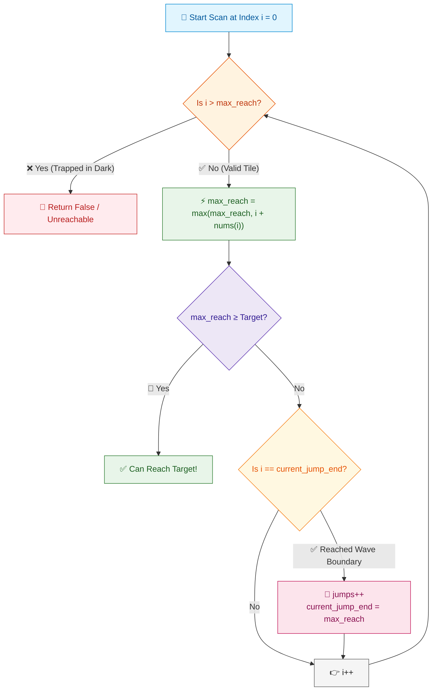

# 📘 WEEK 12 DAY 5: GREEDY IN SYSTEMS & LEETCODE HARD — ENGINEERING GUIDE

> 🧭 **Navigation:** [← Previous Day](Week_12_Day_04_Fractional_Knapsack_And_Scheduling_Instructional.md) • [🏠 Week Overview](README.md) • [📘 Curriculum Syllabus](../COMPLETE_SYLLABUS.md) • [Week Playbook →](WEEK_12_FULL_PLAYBOOK.md)
> 
> 💡 **Instructor Note:** *Day 5 is where greedy algorithms graduate from basic sort-and-pick drills to real-world distributed scheduling and circular constraints. We deconstruct the four canonical FAANG heavyweights: Gas Station (LC 134), Jump Game I & II (LC 55, LC 45), and Task Scheduler (LC 621). Master the physical invariants that collapse brute-force O(N^2) simulations into lightning O(N) and O(1) single-pass architectures.*

---

## 🎯 LEARNING OBJECTIVES

*By the end of this masterclass, you will be able to:*

- 🚗 **Derive the Valley Reset Invariant** for circular resource routing (Gas Station) to prove why running out of fuel at station `B` eliminates every candidate between `A` and `B` in `O(N)` time.
- 🦘 **Model Greedy Wavefront Expansion** (Jump Game I & II) as an implicit Breadth-First Search (BFS) in contiguous memory without allocating queues.
- ⏱️ **Formulate the Bento-Box Frame Theorem** for CPU Task Scheduling (LC 621) to calculate optimal cooling cycles in `O(1)` auxiliary space without event simulation.
- 🛑 **Identify and Eliminate** the three classic interview traps: the `O(N^2)` circular gas brute-force, the off-by-one destination jump, and priority queue simulation thrashing.
- 🎙️ **Deliver the 3-Sentence Talk Track** in live FAANG interviews that proves greedy correctness upfront before touching the keyboard.
- ⚡ **Write Production-Ready Implementations** in C# (.NET 8/9 `ReadOnlySpan<T>`, zero allocations) and Python 3.11+.

---

## 🎬 PILLAR 1: THE 60-SECOND HOOK & EVERYDAY ANALOGIES

```
========================================================================================
                          THE GREEDY SYSTEMS INTUITION HOOK
========================================================================================
  Analogy 1: The Desert Highway Odometer Reset (Gas Station)
  --------------------------------------------------------------------------------------
  Imagine driving a 2,000-mile circular loop across Death Valley. You pull out of
  Station A with a full tank. You drive through Station K, refueling along the way,
  but your engine sputters and dies before reaching Station B.
  
  Do you need to test whether starting at Station K would have worked?
  NO! You arrived at Station K with SOME fuel left over from Station A. If having
  bonus fuel wasn't enough to survive past Station B, starting at Station K with
  ZERO fuel will fail even harder. You can instantly eliminate every station from
  A to B! Your next possible candidate is Station B + 1.

  Analogy 2: The CPU Bento Box (Task Scheduler)
  --------------------------------------------------------------------------------------
  Imagine packing a multi-compartment Bento lunchbox where identical dishes must be
  separated by cooling zones. The tallest dish (the task with maximum frequency)
  dictates the structure of the box. All other dishes simply fill the empty slots
  between the tall dividers. You don't need a live clock simulator; you just compute
  the geometric footprint of the Bento box!
========================================================================================
```

### The Engineering Reality
In high-throughput systems—whether Linux kernel CPU scheduling, distributed stream processing, or autonomous vehicle battery route planning—you cannot afford `O(N^2)` combinatorial backtracks or state-explosion DP tables.

When an invariant guarantees that a local deficit eliminates an entire prefix of possibilities, greedy transforms what appears to be an intractable simulation into a clean, zero-allocation linear scan.

---

## 🪜 PILLAR 2: THE SCAFFOLDING LADDER & TOY NAPKIN TRACES

Let's climb the ladder from warm-up single-pass range tracking to classic FAANG mediums and mathematical scheduling formulas.

```
       [Level 4: Task Scheduler (LC 621)]
       -> Bento Box Geometric Framing in O(1) space
               ▲
               │
       [Level 3: Gas Station (LC 134)]
       -> Circular Prefix Deficit & Valley Reset in O(N)
               ▲
               │
       [Level 2: Jump Game II (LC 45)]
       -> Implicit BFS Range Wavefront in O(N)
               ▲
               │
       [Level 1: Jump Game I (LC 55)]
       -> Expanding Searchlight Reachability in O(N)
```

---

### Level 1: Jump Game I (LeetCode 55) — The Expanding Searchlight

#### Problem Statement
Given an integer array `nums`, you start at index `0`. Each element `nums[i]` represents your maximum jump length at that position. Return `true` if you can reach the last index (`nums.Length - 1`), or `false` otherwise.

#### The Core Mental Model: The Searchlight
Imagine standing at index `0` holding a searchlight. At each step `i`, your searchlight illuminates up to `i + nums[i]`. As you walk forward, you can only step on ground that is already illuminated (`i <= max_reach`). At each tile, you push your beam further: `max_reach = max(max_reach, i + nums[i])`. If your foot ever lands on unlit ground (`i > max_reach`), you are trapped forever in darkness.

#### Toy Napkin Trace: Happy Path vs Dead End

**Case A: `nums = [2, 3, 1, 1, 4]` (Target = index 4)**

```
Index i:       0       1       2       3       4
Value:       [ 2 ]   [ 3 ]   [ 1 ]   [ 1 ]   [ 4 ]
------------------------------------------------------
Start:       max_reach = 0

i = 0:       Can reach? 0 <= 0 (Yes).
             Beam reach: 0 + 2 = 2.
             max_reach = max(0, 2) = 2.

i = 1:       Can reach? 1 <= 2 (Yes).
             Beam reach: 1 + 3 = 4.
             max_reach = max(2, 4) = 4.
             Target reached! 4 >= 4 -> RETURN TRUE.
```

**Case B: `nums = [3, 2, 1, 0, 4]` (Target = index 4)**

```
Index i:       0       1       2       3       4
Value:       [ 3 ]   [ 2 ]   [ 1 ]   [ 0 ]   [ 4 ]
------------------------------------------------------
Start:       max_reach = 0

i = 0:       max_reach = max(0, 0 + 3) = 3.
i = 1:       1 <= 3 (Yes). max_reach = max(3, 1 + 2) = 3.
i = 2:       2 <= 3 (Yes). max_reach = max(3, 2 + 1) = 3.
i = 3:       3 <= 3 (Yes). max_reach = max(3, 3 + 0) = 3.
i = 4:       4 <= 3 (NO!). Foot hit unlit darkness! -> RETURN FALSE.
```

> 🧠 **Pause & Predict 1:**
> *What if `nums = [0]`? What does the code return?*
> **Answer:** Target is index `0`. We start at index `0`, so `max_reach >= nums.Length - 1` (`0 >= 0`) is true immediately before taking a single step! It returns `true`.

---

### Level 2: Jump Game II (LeetCode 45) — The Greedy BFS Wavefront

#### Problem Statement
Given a 0-indexed array `nums` of length `N`, where each element is your maximum jump length, return the **minimum number of jumps** to reach `nums[N - 1]`. You are guaranteed that you can reach the target.

#### The Core Mental Model: BFS Levels Without a Queue
In standard BFS, you explore all nodes at distance 1, then distance 2, then distance 3. Notice that all positions reachable in `k` jumps form a contiguous range `[left, right]`.
- Instead of allocating a queue of indices, we only need two pointers:
  - `current_jump_end`: The boundary of the current jump level.
  - `max_reach`: The furthest boundary reachable by jumping from *any* position within the current level.
- When your scan index `i` reaches `current_jump_end`, you are forced to make another jump:
  - `jumps++`
  - `current_jump_end = max_reach`

#### Toy Napkin Trace: `nums = [2, 3, 1, 1, 4]`

```
Index i:           0       1       2       3       4
Value:           [ 2 ]   [ 3 ]   [ 1 ]   [ 1 ]   [ 4 ]
Target:          Index 4

Initial state:   jumps = 0, current_jump_end = 0, max_reach = 0

Step i = 0:
  max_reach = max(0, 0 + 2) = 2
  i == current_jump_end (0 == 0) -> MUST COMMIT JUMP #1!
  jumps = 1
  current_jump_end = 2
  [Wavefront for Jump 1 covers indices 1 through 2]

Step i = 1:
  max_reach = max(2, 1 + 3) = 4
  i != current_jump_end (1 != 2) -> Keep scanning current wave.

Step i = 2:
  max_reach = max(4, 2 + 1) = 4
  i == current_jump_end (2 == 2) -> MUST COMMIT JUMP #2!
  jumps = 2
  current_jump_end = 4
  [Wavefront for Jump 2 covers indices 3 through 4]
  current_jump_end >= 4 -> Reached target! Stop loop.

Total Jumps = 2 (Jump from 0 -> 1, then from 1 -> 4).
```

> 🧠 **Pause & Predict 2:**
> *Why does the loop in Jump Game II terminate at `i < nums.Length - 1` rather than `i < nums.Length`?*
> **Answer:** If we iterated all the way to `nums.Length - 1`, landing on the last index when `i == current_jump_end` would trigger `jumps++`, artificially counting an extra jump *from* the target to somewhere beyond!

---

### Level 3: Gas Station (LeetCode 134) — The Desert Highway Invariant

#### Problem Statement
There are `n` gas stations along a circular route. You are given two integer arrays `gas` and `cost`, where `gas[i]` is the fuel at station `i`, and `cost[i]` is the fuel needed to travel from station `i` to `(i + 1) % n`.
Return the starting station's index if you can travel around the circuit once in the clockwise direction, otherwise return `-1`. If a solution exists, it is guaranteed to be unique.

#### The Mathematical Invariant: The Cumulative Valley
Let `net[i] = gas[i] - cost[i]`.
Two physical facts govern this problem:

1. **Total Fuel Conservation Law:**
   If `sum(gas) < sum(cost)`, total fuel in the system is strictly less than total consumption. No matter where you start, you will run out of gas. A solution is impossible.
   Conversely, if `sum(gas) >= sum(cost)`, **a valid starting station is mathematically guaranteed to exist!**

2. **The Sub-Path Elimination Theorem (The Core Greedy Invariant):**
   Suppose you start at station `A` with an empty tank. You successfully pass stations `A, A+1, ..., K`, but run out of fuel trying to reach station `B` (where `B >= K >= A`).
   *Can any intermediate station `K` between `A` and `B` be a valid starting station?*
   
   **PROOF BY CONTRADICTION:**
   To reach station `K` starting from `A`, your fuel tank upon entering station `K` was `tank >= 0` (otherwise you would have stalled before `K`).
   Starting from `A`, you entered `K` with `tank >= 0` and STILL starved at `B`.
   If you had started at `K` with an empty tank (`tank = 0`), you would have strictly LESS fuel at every subsequent mile than when starting from `A`. Therefore, starting at `K` will run dry at or before station `B`.
   **Conclusion:** NO station in the range `[A, B]` can be the start. The next candidate MUST be `B + 1`!

#### Toy Napkin Trace: `gas = [1, 2, 3, 4, 5]`, `cost = [3, 4, 5, 1, 2]`

```
Index i:             0        1        2        3        4
gas[i]:              1        2        3        4        5
cost[i]:             3        4        5        1        2
------------------------------------------------------------
net[i]:             -2       -2       -2       +3       +3
Total sum(net) = -2 + (-2) + (-2) + 3 + 3 = 0 (>= 0, solution GUARANTEED!)

Trace with candidate tracking:
Start with: start = 0, curr_tank = 0, total_tank = 0

i = 0: net = -2.
       curr_tank += -2 = -2 (< 0!).
       Cannot reach station 1 from station 0.
       Eliminate index 0. Next candidate: start = 1.
       Reset curr_tank = 0.

i = 1: net = -2.
       curr_tank += -2 = -2 (< 0!).
       Cannot reach station 2 from station 1.
       Eliminate index 1. Next candidate: start = 2.
       Reset curr_tank = 0.

i = 2: net = -2.
       curr_tank += -2 = -2 (< 0!).
       Cannot reach station 3 from station 2.
       Eliminate index 2. Next candidate: start = 3.
       Reset curr_tank = 0.

i = 3: net = +3.
       curr_tank += +3 = +3 (>= 0). Keep going! Candidate 3 holds.

i = 4: net = +3.
       curr_tank += +3 = +6 (>= 0). Keep going!

End of array reached!
Total net sum = 0 >= 0.
Final Answer: start = 3.
```

> 🧠 **Pause & Predict 3:**
> *We stopped our loop at the end of the array (index 4) without circularly wrapping around to check if station 3 can reach station 0, 1, and 2. How do we know for 100% certainty that station 3 won't starve on the wrap-around?*
> **Answer:** Because `total_tank = sum(net) >= 0`! We already proved station 3 reaches the end with `curr_tank = +6`. The deficit of the entire remaining prefix `[0..2]` was `-6`. Since `+6 + (-6) = 0 >= 0`, the accumulated surplus from `[3..4]` is guaranteed to absorb the prefix deficit! No second pass needed.

---

### Level 4: Task Scheduler (LeetCode 621) — The Bento Box Frame

#### Problem Statement
Given a characters array `tasks`, representing CPU tasks, and an integer `n` representing the cooling interval between two **identical** tasks (the CPU must wait at least `n` intervals before running the same task again). Return the **minimum number of CPU intervals** required to finish all tasks.

#### The Core Mental Model: Geometric Bento Boxes
Instead of simulating a clock tick-by-tick with priority queues and waiting lists, look at the task that appears the most frequently.
- Let `max_freq` be the highest frequency of any task.
- Suppose task `A` has `max_freq = 3`, and cooling `n = 2`.
- Task `A` forces `max_freq - 1 = 2` empty frame chunks. Each chunk has width `n + 1` (task `A` itself + `n` cooling slots):

```
Frame 1:  [ A ] [ _ ] [ _ ]   (length n + 1 = 3)
Frame 2:  [ A ] [ _ ] [ _ ]   (length n + 1 = 3)
Last Row: [ A ]               (no cooling needed after final instance!)
```

Now, what if multiple tasks tie for the maximum frequency? (e.g., both `A` and `B` have frequency 3):
- Each task with `freq == max_freq` occupies a slot in the final row!
- Let `max_freq_count` be the number of tasks with `freq == max_freq`.

```
Frame 1:  [ A ] [ B ] [ _ ]
Frame 2:  [ A ] [ B ] [ _ ]
Last Row: [ A ] [ B ]
```

#### The Universal Formula
```
Frame Intervals = (max_freq - 1) * (n + 1) + max_freq_count
```

What if we have lots of other tasks (`C, D, E, F, G...`)?
- They simply fill in the idle slots `[ _ ]`.
- What if there are MORE tasks than available idle slots?
- Then **NO IDLE SLOTS ARE NEEDED AT ALL!** The tasks just naturally stretch the rows wider without violating the `n` cooling distance.
- Therefore, the answer is simply:
```
Total Intervals = max( (max_freq - 1) * (n + 1) + max_freq_count, tasks.Length )
```

#### Toy Napkin Trace: `tasks = ['A','A','A','B','B','B']`, `n = 2`
1. Frequency map: `A: 3`, `B: 3`.
2. `max_freq = 3`.
3. Tasks with frequency 3: `A` and `B` -> `max_freq_count = 2`.
4. Formula calculation:
   `(3 - 1) * (2 + 1) + 2 = (2 * 3) + 2 = 6 + 2 = 8`.
5. Check against total tasks: `max(8, 6) = 8`.
   Schedule: `A -> B -> idle -> A -> B -> idle -> A -> B` (Length = 8).

> 🧠 **Pause & Predict 4:**
> *What if `tasks = ['A','A','A','B','B','B','C','C','C','D','D','E']`, `n = 2`?*
> *`max_freq = 3` (for A, B, C), `max_freq_count = 3`.*
> *Formula: `(3 - 1) * (2 + 1) + 3 = (2 * 3) + 3 = 9`. Total tasks = 12.*
> *What is the answer?*
> **Answer:** `max(9, 12) = 12`. We have enough tasks to completely saturate all idle slots and stretch the schedule with zero idle downtime!

---

## 🎨 PILLAR 3: PRAGMATIC VISUAL MODELS

### Model A: ASCII Fuel Tank Trace & Candidate Reset (LC 134)

```
========================================================================================
                      GAS STATION VALLEY RESET MECHANICAL TRACE
========================================================================================
 Station Index:         [ 0 ]         [ 1 ]         [ 2 ]         [ 3 ]         [ 4 ]
 Gas Provided:            1             2             3             4             5
 Cost to Next:            3             4             5             1             2
 Net (Gas - Cost):       -2            -2            -2            +3            +3
----------------------------------------------------------------------------------------
 Running Tank:
 
 Start at 0:
 Tank: 0 ---> [ 0 ] == (-2)
                       |
                  TANK EMPTY!
                  Reset candidate to: Start = 1, Tank = 0
 
 Start at 1:
 Tank: 0 --------------> [ 1 ] == (-2)
                                 |
                            TANK EMPTY!
                            Reset candidate to: Start = 2, Tank = 0
 
 Start at 2:
 Tank: 0 ------------------------> [ 2 ] == (-2)
                                           |
                                      TANK EMPTY!
                                      Reset candidate to: Start = 3, Tank = 0
 
 Start at 3:
 Tank: 0 ----------------------------------> [ 3 ] == (+3)
                                                   |
                                                   v
                                             [ 4 ] == (+3) -> Tank = +6!
                                                   |
                                                   v (Wrap around to 0, 1, 2)
                                             [ 0 ] == (-2) -> Tank = +4
                                             [ 1 ] == (-2) -> Tank = +2
                                             [ 2 ] == (-2) -> Tank = 0 (Survives!)
========================================================================================
```

---

### Model B: ASCII CPU Idle Slot Frame Layout (LC 621)

```
========================================================================================
                         BENTO BOX CPU TASK SCHEDULER FRAMES
========================================================================================
 Input: tasks = ["A","A","A","B","B","B","C","D"], n = 2
 
 Counts: A: 3, B: 3, C: 1, D: 1
 max_freq = 3 ('A' and 'B')
 max_freq_count = 2 ('A' and 'B')
 Width of each frame chunk = n + 1 = 3 slots
 
           Slot 1        Slot 2        Slot 3 (Cooling / Filler)
         +-------------+-------------+-------------------------+
 Chunk 1 | Task A      | Task B      | Task C (Fills idle!)    |
         +-------------+-------------+-------------------------+
 Chunk 2 | Task A      | Task B      | Task D (Fills idle!)    |
         +-------------+-------------+-------------------------+
 Final   | Task A      | Task B      | (No cooling needed)     |
 Row     +-------------+-------------+
 
 Calculation:
 (max_freq - 1) chunks * (n + 1) width + max_freq_count
 = (3 - 1) * (2 + 1) + 2
 = (2 * 3) + 2 = 8 total intervals.
========================================================================================
```

---

### Model C: Mermaid Flowchart: Jump Game Greedy Wavefront (LC 45 & 55)



---

## 🛑 PILLAR 4: THE ROOKIE TRAP ZONE

Let's dissect the three fatal mistakes that derail candidates during FAANG on-sites.

### Trap 1: Gas Station — Circular Simulation vs Single-Pass Valley Reset

```
❌ ROOKIE BLUNDER: O(N^2) Full Circular Simulation
----------------------------------------------------------------------------------------
for (int i = 0; i < n; i++) {
    int tank = 0;
    bool success = true;
    for (int step = 0; step < n; step++) {
        int curr = (i + step) % n;
        tank += gas[curr] - cost[curr];
        if (tank < 0) {
            success = false;
            break;
        }
    }
    if (success) return i;
}
return -1;
// Why it's bad: O(N^2) time complexity. For N = 10^5, 10^10 operations trigger TLE!

✅ SENIOR ARCHITECT PATTERN: O(N) Sub-Path Invariant Reset
----------------------------------------------------------------------------------------
int totalTank = 0, currTank = 0, start = 0;
for (int i = 0; i < gas.Length; i++) {
    int net = gas[i] - cost[i];
    totalTank += net;
    currTank += net;
    if (currTank < 0) {
        start = i + 1; // Prune all stations [start..i]!
        currTank = 0;
    }
}
return totalTank >= 0 ? start : -1;
// Why it wins: Exactly O(N) time and O(1) auxiliary space in a single blazing pass.
```

---

### Trap 2: Jump Game II — Destination Over-Jump Off-by-One

```
❌ ROOKIE BLUNDER: Scanning all the way to N - 1
----------------------------------------------------------------------------------------
for (int i = 0; i < nums.Length; i++) { // BUG: scans to last index!
    maxReach = Math.Max(maxReach, i + nums[i]);
    if (i == currentJumpEnd) {
        jumps++;
        currentJumpEnd = maxReach;
    }
}
// Why it fails: When nums = [2, 3, 1, 1, 4], at i = 4 (destination), i == currentJumpEnd!
// The code executes jumps++ again, returning 3 instead of 2!

✅ SENIOR ARCHITECT PATTERN: Terminate scan at N - 2
----------------------------------------------------------------------------------------
for (int i = 0; i < nums.Length - 1; i++) { // Stops before the target!
    maxReach = Math.Max(maxReach, i + nums[i]);
    if (i == currentJumpEnd) {
        jumps++;
        currentJumpEnd = maxReach;
        if (currentJumpEnd >= nums.Length - 1) break; // Early exit
    }
}
// Why it wins: You only jump FROM an index to reach the destination; you never jump FROM the destination.
```

---

### Trap 3: Task Scheduler — Priority Queue Simulation vs Bento Box Frame

```
❌ ROOKIE BLUNDER: Simulating the CPU clock tick-by-tick with Max-Heap & Queue
----------------------------------------------------------------------------------------
// Allocating PriorityQueue<int, int> + Queue<(int task, int readyTime)>
// Simulating every single empty CPU clock tick!
// Why it's bad: When tasks.Length = 10^4 and n = 100, the loop runs thousands of empty
// iterations, churning heap nodes and pointer references. O(Total Intervals * log 26).

✅ SENIOR ARCHITECT PATTERN: O(1) Space Bento Box Formula
----------------------------------------------------------------------------------------
Span<int> freq = stackalloc int[26];
int maxFreq = 0;
foreach (char c in tasks) maxFreq = Math.Max(maxFreq, ++freq[c - 'A']);

int maxFreqCount = 0;
foreach (int f in freq) if (f == maxFreq) maxFreqCount++;

int frameSize = (maxFreq - 1) * (n + 1) + maxFreqCount;
return Math.Max(frameSize, tasks.Length);
// Why it wins: O(N) single pass to count, O(26) = O(1) calculation, stackalloc 0 heap bytes!
```

---

## 🎙️ PILLAR 5: 45-MINUTE INTERVIEW TALK TRACK

When you get these questions in a FAANG interview, do NOT jump into code immediately. Deliver this exact 3-sentence script out loud to establish leadership.

### For Gas Station (LC 134):
> *"First, notice that if the total gas available across all stations is at least the total cost, a valid starting station is mathematically guaranteed to exist.*
> *Second, if we run out of gas at station `B` after starting at `A`, no station between `A` and `B` can be a valid start because arriving at any intermediate station with an empty tank gives us strictly less fuel than arriving with our accumulated surplus.*
> *Therefore, we can greedily reset our candidate start to `B + 1` whenever the tank dips below zero, solving the entire problem in a single `O(N)` pass with `O(1)` memory."*

### For Jump Game II (LC 45):
> *"We can model this as an implicit Breadth-First Search where each jump level corresponds to a contiguous index window `[current_pos, current_jump_end]`.*
> *As we scan through the current window, we greedily track the furthest reachable index `max_reach` across all candidates.*
> *When we hit `current_jump_end`, we commit to one jump, shift our window boundary to `max_reach`, and repeat until the window covers the last index in `O(N)` time and `O(1)` auxiliary space."*

### For Task Scheduler (LC 621):
> *"The bottleneck in this schedule is solely determined by the tasks with the maximum frequency, which define periodic chunks of length `n + 1` separated by cooling intervals.*
> *The minimum frame size is strictly `(max_freq - 1) * (n + 1) + max_freq_count`, where the remaining tasks simply fill in the idle gaps.*
> *If the number of tasks exceeds the frame size, no idle slots are required at all, so the final answer is simply `max(frame_size, tasks.Length)`, computable in `O(N)` time and `O(1)` space."*

---

## ⚡ PILLAR 6: PRODUCTION DUAL-LANGUAGE CODE

Here are the complete, production-grade implementations in modern C# (.NET 8/9) and Python 3.11+.

---

### 1. Gas Station (LeetCode 134)

#### Production C# (.NET 8/9)
```csharp
namespace DsaMastery.Greedy;

using System;

public static class GasStation
{
    /// <summary>
    /// Finds the starting gas station index to complete the circular route.
    /// Time Complexity: O(N) - single pass over the stations.
    /// Auxiliary Space: O(1) - zero allocations using ReadOnlySpan.
    /// </summary>
    public static int CanCompleteCircuit(ReadOnlySpan<int> gas, ReadOnlySpan<int> cost)
    {
        if (gas.Length != cost.Length || gas.IsEmpty)
        {
            return -1;
        }

        int totalTank = 0;
        int currentTank = 0;
        int startingStation = 0;

        for (int i = 0; i < gas.Length; i++)
        {
            int netGain = gas[i] - cost[i];
            totalTank += netGain;
            currentTank += netGain;

            // If we run dry, stations [startingStation..i] are impossible starts.
            if (currentTank < 0)
            {
                startingStation = i + 1;
                currentTank = 0;
            }
        }

        // If total gas < total cost, completion is physically impossible.
        return totalTank >= 0 ? startingStation : -1;
    }
}
```

#### Production Python (3.11+)
```python
def can_complete_circuit(gas: list[int], cost: list[int]) -> int:
    """
    Finds the starting gas station index to complete the circular route.
    Time Complexity: O(N)
    Auxiliary Space: O(1)
    """
    if len(gas) != len(cost) or not gas:
        return -1

    total_tank = 0
    current_tank = 0
    starting_station = 0

    for i in range(len(gas)):
        net_gain = gas[i] - cost[i]
        total_tank += net_gain
        current_tank += net_gain

        # Deficit reached: reset start candidate to i + 1
        if current_tank < 0:
            starting_station = i + 1
            current_tank = 0

    return starting_station if total_tank >= 0 else -1
```

---

### 2. Jump Game I (LeetCode 55)

#### Production C# (.NET 8/9)
```csharp
namespace DsaMastery.Greedy;

using System;

public static class JumpGameOne
{
    /// <summary>
    /// Determines if the last index is reachable.
    /// Time Complexity: O(N) - single forward pass.
    /// Auxiliary Space: O(1) - zero heap allocations.
    /// </summary>
    public static bool CanJump(ReadOnlySpan<int> nums)
    {
        if (nums.IsEmpty) return false;

        int maxReach = 0;
        int target = nums.Length - 1;

        for (int i = 0; i < nums.Length; i++)
        {
            // Stepped beyond our furthest illuminated reach
            if (i > maxReach)
            {
                return false;
            }

            maxReach = Math.Max(maxReach, i + nums[i]);

            // Early exit if target already within reach
            if (maxReach >= target)
            {
                return true;
            }
        }

        return true;
    }
}
```

#### Production Python (3.11+)
```python
def can_jump(nums: list[int]) -> bool:
    """
    Determines if the last index is reachable.
    Time Complexity: O(N)
    Auxiliary Space: O(1)
    """
    if not nums:
        return False

    max_reach = 0
    target = len(nums) - 1

    for i, jump in enumerate(nums):
        if i > max_reach:
            return False

        max_reach = max(max_reach, i + jump)
        if max_reach >= target:
            return True

    return True
```

---

### 3. Jump Game II (LeetCode 45)

#### Production C# (.NET 8/9)
```csharp
namespace DsaMastery.Greedy;

using System;

public static class JumpGameTwo
{
    /// <summary>
    /// Computes the minimum number of jumps to reach the last index.
    /// Time Complexity: O(N) - single forward pass.
    /// Auxiliary Space: O(1) - implicit BFS in contiguous memory.
    /// </summary>
    public static int Jump(ReadOnlySpan<int> nums)
    {
        if (nums.Length <= 1)
        {
            return 0;
        }

        int jumps = 0;
        int currentJumpEnd = 0;
        int maxReach = 0;
        int target = nums.Length - 1;

        // Loop stops at nums.Length - 1 to prevent phantom jumps from the destination!
        for (int i = 0; i < target; i++)
        {
            maxReach = Math.Max(maxReach, i + nums[i]);

            // Reached the boundary of the current BFS level
            if (i == currentJumpEnd)
            {
                jumps++;
                currentJumpEnd = maxReach;

                if (currentJumpEnd >= target)
                {
                    break;
                }
            }
        }

        return jumps;
    }
}
```

#### Production Python (3.11+)
```python
def jump(nums: list[int]) -> int:
    """
    Computes the minimum number of jumps to reach the last index.
    Time Complexity: O(N)
    Auxiliary Space: O(1)
    """
    if len(nums) <= 1:
        return 0

    jumps = 0
    current_jump_end = 0
    max_reach = 0
    target = len(nums) - 1

    # Stop before target to avoid jumping from the destination
    for i in range(target):
        max_reach = max(max_reach, i + nums[i])

        if i == current_jump_end:
            jumps += 1
            current_jump_end = max_reach
            if current_jump_end >= target:
                break

    return jumps
```

---

### 4. Task Scheduler (LeetCode 621)

#### Production C# (.NET 8/9)
```csharp
namespace DsaMastery.Greedy;

using System;

public static class TaskScheduler
{
    /// <summary>
    /// Calculates the minimum CPU intervals to execute all tasks with cooling period n.
    /// Time Complexity: O(N) where N is tasks.Length.
    /// Auxiliary Space: O(1) using stackalloc for fixed 26-element alphabet.
    /// </summary>
    public static int LeastInterval(char[] tasks, int n)
    {
        ArgumentNullException.ThrowIfNull(tasks);

        if (tasks.Length == 0) return 0;
        if (n == 0) return tasks.Length;

        // Zero heap allocations: fixed 26 characters on thread stack
        Span<int> frequencies = stackalloc int[26];
        int maxFreq = 0;

        foreach (char task in tasks)
        {
            int count = ++frequencies[task - 'A'];
            if (count > maxFreq)
            {
                maxFreq = count;
            }
        }

        int maxFreqCount = 0;
        foreach (int freq in frequencies)
        {
            if (freq == maxFreq)
            {
                maxFreqCount++;
            }
        }

        // Geometric Bento Box formula
        int frameIntervals = (maxFreq - 1) * (n + 1) + maxFreqCount;

        // If tasks exceed frame capacity, no idle slots are required!
        return Math.Max(frameIntervals, tasks.Length);
    }
}
```

#### Production Python (3.11+)
```python
from collections import Counter

def least_interval(tasks: list[str], n: int) -> int:
    """
    Calculates the minimum CPU intervals to execute all tasks with cooling period n.
    Time Complexity: O(N)
    Auxiliary Space: O(1) - at most 26 keys in hash map
    """
    if not tasks:
        return 0
    if n == 0:
        return len(tasks)

    counts = Counter(tasks)
    max_freq = max(counts.values())
    max_freq_count = sum(1 for count in counts.values() if count == max_freq)

    # Geometric Bento Box formula
    frame_intervals = (max_freq - 1) * (n + 1) + max_freq_count

    return max(frame_intervals, len(tasks))
```

---

## ⚖️ PERFORMANCE & COMPLEXITY DECONSTRUCTION

| Problem | Time Complexity | Auxiliary Space | Bottleneck | Why Greedy Is Optimal |
| :--- | :--- | :--- | :--- | :--- |
| **Gas Station** (LC 134) | `O(N)` | `O(1)` | Single array scan | Running dry at `B` invalidates all starts in `[A, B]` (monotonic deficit). |
| **Jump Game I** (LC 55) | `O(N)` | `O(1)` | Forward iteration | Storing maximum reachability interval is sufficient; no need to explore paths. |
| **Jump Game II** (LC 45) | `O(N)` | `O(1)` | Wavefront updates | BFS range extension: jumping to max reach boundary covers all possible sub-jumps. |
| **Task Scheduler** (LC 621)| `O(N)` | `O(1)` | Frequency counting | Idle time is strictly bounded by the highest frequency task; filler tasks expand dynamically. |

---

## ⚔️ PRACTICE LADDER & FAANG EDGE-CASE CHECKLIST

### 🏋️ High-ROI Practice Progression
1. **LeetCode 55 — Jump Game I (Medium):** Warm-up for range tracking.
2. **LeetCode 45 — Jump Game II (Medium):** Master implicit BFS level updates without queue allocations.
3. **LeetCode 134 — Gas Station (Medium):** Master circular deficit resets and valley proofs.
4. **LeetCode 621 — Task Scheduler (Medium):** Master geometric slot framing over clock simulation.
5. **LeetCode 1029 — Two City Scheduling (Medium):** Sort by opportunity cost `costA - costB`.
6. **LeetCode 135 — Candy (Hard):** Two-pass greedy (left-to-right, then right-to-left) to satisfy dual neighbor constraints.

### 🧪 Edge-Case Checklist for Live Interviews
- **Gas Station:**
  - `gas.Length == 1`: Can we make a loop if `gas[0] >= cost[0]`? (Yes, returns index 0).
  - Net zero total: `sum(gas) == sum(cost)`. Guarantees a solution exists.
  - Alternating spikes: High surplus at end, large deficit at front.
- **Jump Game I & II:**
  - Array of length 1: `nums = [0]`. Target is index 0. Jumps = 0, CanJump = true!
  - Immediate zero blocker: `nums = [0, 2, 3]`. Cannot move past index 0.
  - Large jump at start: `nums = [10, 0, 0, ...]` reaches target in 1 jump.
- **Task Scheduler:**
  - `n = 0`: No cooling required. Returns `tasks.Length`.
  - All tasks identical: `['A', 'A', 'A']`, `n = 2`. Output = 7 (`A -> idle -> idle -> A -> idle -> idle -> A`).
  - All tasks distinct: `['A', 'B', 'C', 'D']`, `n = 2`. Output = 4 (`max_freq = 1`, frame = 4).

---

## 🏁 SUMMARY: THE SYSTEMS GREEDY PLAYBOOK

```
+---------------------------------------------------------------------------------------+
|                              THE SYSTEMS GREEDY MATRIX                                |
+-----------------------+-------------------------------+-------------------------------+
| Scenario              | Trap to Avoid                 | Senior Invariant              |
+-----------------------+-------------------------------+-------------------------------+
| Circular Energy Loop  | Nested O(N^2) restart loop    | Sub-path failure at B prunes  |
| (Gas Station)         |                               | all starts in [A, B].         |
+-----------------------+-------------------------------+-------------------------------+
| Reachability Scan     | Recursive backtracking        | Searchlight reach: track      |
| (Jump Game I)         |                               | max_reach = max(i + nums[i]). |
+-----------------------+-------------------------------+-------------------------------+
| Minimum Steps BFS     | Heap / Queue allocations      | Implicit BFS wave: update     |
| (Jump Game II)        |                               | jumps at current_jump_end.    |
+-----------------------+-------------------------------+-------------------------------+
| Rate Limiter / CPU    | Simulating clock ticks with   | Bento Box frame:              |
| (Task Scheduler)      | priority queue                | (max_freq - 1)*(n + 1) + cnt. |
+-----------------------+-------------------------------+-------------------------------+
```

---

> 🧭 **Navigation:** [← Previous Day](Week_12_Day_04_Fractional_Knapsack_And_Scheduling_Instructional.md) • [🏠 Week Overview](README.md) • [📘 Curriculum Syllabus](../COMPLETE_SYLLABUS.md) • [Week Playbook →](WEEK_12_FULL_PLAYBOOK.md)
