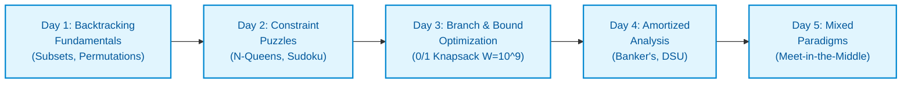

# 📘 WEEK 13: BACKTRACKING, BRANCH AND BOUND & AMORTIZED ANALYSIS

> 🧭 **Navigation:** [← Previous: Week 12](../week_12_greedy_and_paradigms/README.md) • [🏠 Curriculum Overview](../README.md) • [📘 Complete Syllabus](../COMPLETE_SYLLABUS.md) • [Next: Week 14 →](../week_14_matrix_backtracking_bits/README.md)
> 
> 💡 **Instructor Note:** *Week 13 covers the mastery of exhaustive search under constraints, mathematical upper/lower bounding, and sequence cost amortization. In senior and Staff interviews, these problems separate engineers who blindly guess from those who can rigorously defend the boundaries of computational feasibility.*

---

## 🎯 Weekly Mission & Conceptual Focus

Master the full combinatorial spectrum: Depth-First Search on implicit decision trees, state symmetry restoration (Choose / Explore / Unchoose), early constraint pruning, Best-First Branch and Bound with continuous relaxations, the 3 classical frameworks of Amortized Analysis (Aggregate, Banker's, Potential), and hybrid strategies like Meet-in-the-Middle for $N = 40$.

---

## 📅 Day-by-Day Learning Path

| Day | Instructional Module | Focus & Core Objective |
| :--- | :--- | :--- |
| **Day 01** | [Backtracking Fundamentals](Week_13_Day_01_Backtracking_Fundamentals_Instructional.md) | Universal Choose / Explore / Unchoose state symmetry, Subsets (LC 78), Permutations (LC 46), Combination Sum (LC 39), avoiding mutable reference bugs. |
| **Day 02** | [Classic Backtracking Problems](Week_13_Day_02_Backtracking_Problems_Instructional.md) | Exhaustive vs Short-Circuit target search, N-Queens (LC 51) with $O(1)$ diagonal hashing, Sudoku Solver (LC 37) with boolean bubbling, Word Search (LC 79) with in-place grid masking. |
| **Day 03** | [Branch and Bound](Week_13_Day_03_Branch_And_Bound_Instructional.md) | Best-First Search via PriorityQueue, admissible continuous relaxations (Fractional Knapsack for 0/1 Knapsack), pruning when theoretical upper bound $\le$ best known profit. |
| **Day 04** | [Amortized Analysis](Week_13_Day_04_Amortized_Analysis_Instructional.md) | Aggregate Method, Banker's Accounting Method, Potential Method $\Phi(D)$, proving $O(1)$ geometric doubling vs $O(N)$ arithmetic growth, Disjoint Set Union $O(\alpha(N))$. |
| **Day 05** | [Mixed Paradigm Problems](Week_13_Day_05_Mixed_Paradigm_Problems_Instructional.md) | Meet-in-the-Middle for $N = 40$, Backtracking with Memoization (Word Break II - LC 140), and the 60-Second Constraint-to-Complexity Rosetta Stone. |

---

## 📚 Consolidated Playbooks & Reference Guides

*   📖 **Comprehensive Week Playbook:** [WEEK_13_FULL_PLAYBOOK.md](WEEK_13_FULL_PLAYBOOK.md) — High-density synthesis of all invariants, theorems, and pattern triggers for this week.
*   📊 **Visual Concepts Playbook (Hybrid):** [Week_13_Visual_Concepts_Playbook_HYBRID.md](Week_13_Visual_Concepts_Playbook_HYBRID.md) — Compact Mermaid diagrams, state transitions, and complexity reference tables.
*   💻 **Production C# Reference (.NET 8/9):** [Week_13_Extended_CSharp_Complete.md](Week_13_Extended_CSharp_Complete.md) — Idiomatic, zero-allocation memory-aware implementations and problem ladders.
*   🐍 **Production Python Reference (Python 3.11+):** [Week_13_Extended_Python_Complete.md](Week_13_Extended_Python_Complete.md) — Clean, pythonic reference implementations for rapid whiteboard prototyping.

---

## 🛠️ The 5 Core Support Files (`support files/`)

Every week is accompanied by five dedicated support files located in the `support files/` subdirectory:

1.  📋 [Daily Progress Checklist](support%20files/Week_13_Daily_Progress_Checklist.md) — Step-by-step accountability tracker for theory, coding, and variants.
2.  🧭 [Weekly Guidelines & Mental Models](support%20files/Week_13_Guidelines.md) — Strategic roadmap, common pitfalls, and conceptual anchors.
3.  🎙️ [Interview Q&A Comprehensive Reference](support%20files/Week_13_Interview_QA_Reference.md) — High-frequency senior technical questions with verbal response frameworks.
4.  🗺️ [Problem-Solving Roadmap](support%20files/Week_13_Problem_Solving_Roadmap.md) — Tier-1 problem progression ladder from warm-up to advanced.
5.  📑 [Summary & Key Concepts Synthesis](support%20files/Week_13_Summary_Key_Concepts.md) — Fast-revision cheat sheet covering all governing invariants and system trade-offs.

---

> 🧭 **Navigation:** [← Previous: Week 12](../week_12_greedy_and_paradigms/README.md) • [🏠 Curriculum Overview](../README.md) • [📘 Complete Syllabus](../COMPLETE_SYLLABUS.md) • [Next: Week 14 →](../week_14_matrix_backtracking_bits/README.md)
