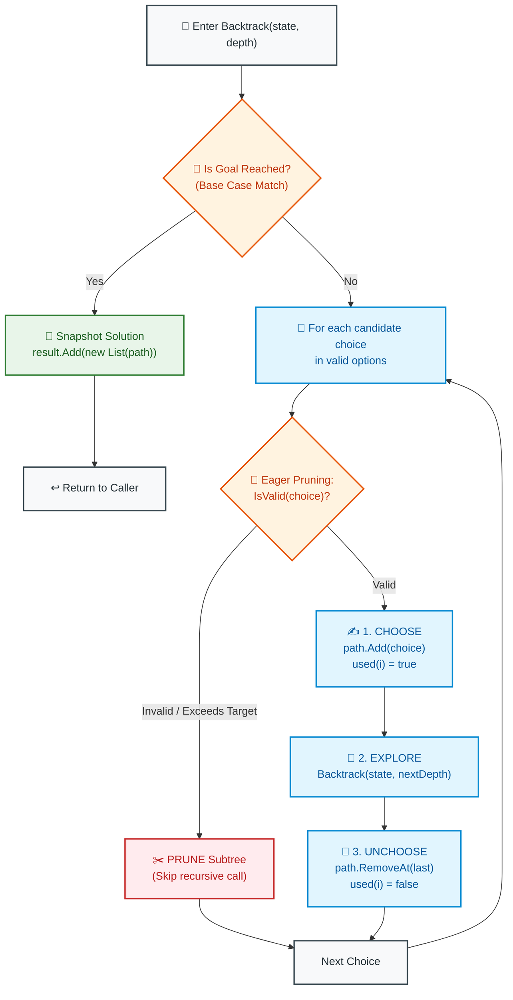

# 📘 WEEK 13 DAY 1: BACKTRACKING FUNDAMENTALS — THE SENIOR INTERVIEW PLAYBOOK

> 🧭 **Navigation:** [← Week Overview](README.md) • [📘 Curriculum Syllabus](../COMPLETE_SYLLABUS.md) • [Next Day: Classic Backtracking Problems →](Week_13_Day_02_Backtracking_Problems_Instructional.md)
> 
> 💡 **Instructor Note:** *Backtracking is essentially Depth-First Search over an implicit combinatorial decision tree. In senior FAANG loops, interviewers are not just checking if you can write recursion; they are testing your state symmetry invariant (Choose / Explore / Unchoose), your zero-allocation memory awareness (mutating a single buffer vs allocating path copies), and your ability to prune exponential branches before they explode.*

---

## 🎯 LEARNING OBJECTIVES

*By the end of this module, you will be able to:*

- 🎬 **Internalize** the core backtracking intuition: why depth-first search on an implicit decision tree with chalk-mark rollback beats brute-force combinatorial generation.
- 🪜 **Master** the 3 foundational archetypes: Subsets (Power Set - LC 78), Permutations (LC 46), and Combination Sum (LC 39).
- ⚙️ **Enforce** the sacred **State Symmetry Invariant**: ensuring every mutation made during the Choose phase is 100% reversed during the Unchoose phase.
- 🎨 **Visualize** state space explosions and eager pruning using ASCII decision trees and structured Mermaid state-machine flows.
- 🛑 **Identify and Eliminate** the 4 classic rookie blunders: the Reference Ghost (storing mutable references), path-concatenation GC memory churn, lazy base-case pruning, and asymmetric early returns.
- 🎙️ **Deliver** the exact 3-sentence verbal talk track before typing code in a 45-minute FAANG technical interview.
- ⚡ **Ship** production-grade C# (.NET 8/9) and Python (3.11+) implementations with optimal `O(N)` auxiliary memory.

---

## 🎬 PILLAR 1: THE 60-SECOND HOOK & EVERYDAY ANALOGY

### The Maze of Theseus & The Chalk Invariant

Imagine you are trapped inside an ancient, pitch-black underground labyrinth with hundreds of branching corridors. You have two tools: a lantern and a single piece of chalk.

How do you find the exit without getting lost forever?

```
========================================================================================
                              THE MAZE EXPLORATION PROTOCOL
========================================================================================

1. CHOOSE (Mark the Path):
   You stand at a 3-way intersection. You pick Corridor A. Before taking a step,
   you draw a chalk arrow pointing forward and advance your boots into Corridor A.

2. EXPLORE (Go Deeper):
   You walk deeper down Corridor A, recursively confronting any new sub-corridors.

3. HIT A DEAD END (Constraint Violation):
   Suddenly, you slam into a solid stone wall. You cannot proceed forward.

4. UNCHOOSE (The Backtrack):
   Do you sit down and cry? No! You walk backward to the intersection, erase your
   chalk arrow, and try Corridor B!

The Invariant: When you step back to the intersection, the world looks EXACTLY
as it did before you ever explored Corridor A.
========================================================================================
```

That is **Backtracking**: an exhaustive Depth-First Search on an **implicit decision tree**. We systematically test candidate choices, dive deep, and the instant a candidate violates our rules or reaches a dead end, we **revert our state back to the parent** and test the next alternative.

---

### The Combinatorial Explosion: Why Brute Force Dies

Why not just generate every possible outcome and filter for the valid ones?

Look at what happens to naive combinatorial generation as `N` grows:

```
+---------------+------------------------+------------------------------------+--------------------------+
| Problem Type  | Mathematical Growth    | Size for N = 10                    | Size for N = 20          |
+---------------+------------------------+------------------------------------+--------------------------+
| Subsets       | 2^N                    | 1,024 states                       | 1,048,576 states         |
| Subsets       | 2^N                    | N = 30 -> 1,073,741,824 states     | > 1 Billion (TKO!)       |
| Permutations  | N! (Factorial)         | 3,628,800 states                   | 2.43 * 10^18 states (💥) |
+---------------+------------------------+------------------------------------+--------------------------+
```

A naive brute-force generator creates every leaf at depth `N` before checking if it's valid.

**Backtracking with Eager Pruning**, by contrast, evaluates constraints at every interior node. The moment a partial state violates a constraint (e.g. current sum > target, or character already used), it **chops off the entire multi-million node subtree immediately**.

```
BRUTE FORCE vs BACKTRACKING WITH EAGER PRUNING:
========================================================================================
Brute Force:  Generate leaf (depth N) ---> Test validity ---> Keep or Discard
Backtracking: Check constraint at depth k << N ---> If invalid: PRUNE SUBTREE!
              (Saves exploring k! or 2^(N - k) impossible leaves)
========================================================================================
```

---

## 🪜 PILLAR 2: THE SCAFFOLDING LADDER & TOY NAPKIN TRACES

Combinatorial backtracking problems in FAANG loops boil down to **Three Archetypes**:

```
                  [THE 3 COMBINATORIAL ARCHETYPES]
                                 │
         ┌───────────────────────┼────────────────────────┐
         ▼                       ▼                        ▼
    [1. SUBSETS]         [2. PERMUTATIONS]       [3. COMBINATIONS / SUM]
   (Order DOES NOT        (Order DOES matter,     (Target sum constraint,
   matter, size varies)   elements used once)     can reuse elements or not)
   LC 78, LC 90           LC 46, LC 47            LC 39, LC 40, LC 77
```

---

### Scaffold Level 1: Subsets / Power Set (LeetCode 78)

**Problem:** Given an integer array `nums` of unique elements, return all possible subsets (the power set). The solution set must not contain duplicate subsets.

#### Core Decision Invariant:
At each step, we iterate from `startIndex` to the end of the array. Every single prefix path we reach is a mathematically valid subset! We snapshot `path`, then recursively explore `i + 1`.

#### Toy Napkin Trace: `nums = [1, 2, 3]`

```
Initial State: path = [], result = [ [] ]

Level 0:
  startIndex = 0:
  ├── Choose 1 -> path = [1]
  │   Snapshot: Add [1] to result
  │   Recurse startIndex = 1:
  │   ├── Choose 2 -> path = [1, 2]
  │   │   Snapshot: Add [1, 2] to result
  │   │   Recurse startIndex = 2:
  │   │   ├── Choose 3 -> path = [1, 2, 3]
  │   │   │   Snapshot: Add [1, 2, 3] to result
  │   │   │   Recurse startIndex = 3 -> Loop finishes
  │   │   └── Unchoose 3 -> path = [1, 2]
  │   │   Loop finishes -> Unchoose 2 -> path = [1]
  │   ├── Choose 3 -> path = [1, 3]
  │   │   Snapshot: Add [1, 3] to result
  │   │   Recurse startIndex = 3 -> Loop finishes
  │   └── Unchoose 3 -> path = [1]
  │   Loop finishes -> Unchoose 1 -> path = []
  │
  ├── Choose 2 -> path = [2]
  │   Snapshot: Add [2] to result
  │   Recurse startIndex = 2:
  │   ├── Choose 3 -> path = [2, 3]
  │   │   Snapshot: Add [2, 3] to result
  │   │   Recurse startIndex = 3 -> Loop finishes
  │   └── Unchoose 3 -> path = [2]
  │   Loop finishes -> Unchoose 2 -> path = []
  │
  └── Choose 3 -> path = [3]
      Snapshot: Add [3] to result
      Recurse startIndex = 3 -> Loop finishes
      Unchoose 3 -> path = []

Total Subsets Generated: 2^3 = 8
Result: [ [], [1], [1, 2], [1, 2, 3], [1, 3], [2], [2, 3], [3] ]
```

---

### Scaffold Level 2: Permutations (LeetCode 46)

**Problem:** Given an array `nums` of distinct integers, return all possible permutations in any order.

#### Core Decision Invariant:
Order **matters**! `[1, 2]` is distinct from `[2, 1]`. Therefore, we do not advance `startIndex`. Instead, we loop over all indices `0` through `N - 1`, tracking used elements with a boolean lookup array `used[i]`. When `path.Count == nums.Length`, we have built a complete permutation!

#### Toy Napkin Trace: `nums = [1, 2, 3]`

```
                                    []
                 /                  |                  \
              [1]                  [2]                 [3]
           /       \            /       \           /       \
        [1,2]     [1,3]      [2,1]     [2,3]     [3,1]     [3,2]
          |         |          |         |         |         |
       [1,2,3]   [1,3,2]    [2,1,3]   [2,3,1]   [3,1,2]   [3,2,1]

Notice: At depth 2, if path = [1, 2], elements 1 and 2 are marked used = true.
The loop scans index 0 (used -> skip), index 1 (used -> skip), index 2 (unused -> take 3!).
Leaves: Exactly 3! = 6 permutations.
```

---

### Scaffold Level 3: Combination Sum (LeetCode 39) — Eager Pruning

**Problem:** Given an array of distinct integers `candidates` and a target integer `target`, return a list of all unique combinations where the chosen numbers sum to `target`. You may use the same element an **unlimited number of times**.

#### Core Decision Invariant:
Because elements can be reused, when we choose `candidates[i]`, we recurse with the **same** index `i` (not `i + 1`).
To prevent infinite loops and eliminate wasteful exploration, we **eagerly prune**:
- If `currentSum + candidates[i] > target`, do not even make the recursive call!
- Sorting `candidates` upfront allows us to `break` the loop early as soon as one candidate exceeds the remaining target!

```
Napkin Trace: candidates = [2, 3, 6, 7], target = 7
Sort candidates: [2, 3, 6, 7]

Root: remain = 7
├── Pick 2 (remain = 5):
│   ├── Pick 2 (remain = 3):
│   │   ├── Pick 2 (remain = 1):
│   │   │   ├── Pick 2 (2 > 1 -> BREAK! Pruned!)
│   │   │   └── Pick 3, 6, 7 (All > 1 -> All Pruned!)
│   │   ├── Pick 3 (remain = 0) -> 🎯 TARGET REACHED! Record [2, 2, 3]!
│   │   └── Pick 6, 7 (All > 3 -> BREAK! Pruned!)
│   └── Pick 3, 6, 7 ...
├── Pick 3 (remain = 4):
│   └── Pick 3 (remain = 1 -> next > 1 -> Pruned!)
├── Pick 6 (remain = 1 -> next > 1 -> Pruned!)
└── Pick 7 (remain = 0) -> 🎯 TARGET REACHED! Record [7]!

Solutions: [ [2, 2, 3], [7] ]
```

---

### 🧠 Pause & Predict Micro-Drill
**Question:** In Permutations of `[1, 2, 3]`, what happens if you forget `used[i] = false;` in the Unchoose step?
*Take 10 seconds to trace mentally.*
-
-
-
**Answer:** The `used` array will remain `true` permanently for elements chosen in earlier branches. When backtracking returns to the root and tries to start a new branch with `[2]`, element `1` is still marked as used, causing the algorithm to miss all permutations that contain `1` after `2` (like `[2, 1, 3]`). The entire search tree is corrupted!

---

## 🎨 PILLAR 3: PRAGMATIC VISUAL MODELS

### The Universal Backtracking State Machine



---

## 🛑 PILLAR 4: THE ROOKIE TRAP ZONE

```
=============================================================================================
                                   THE ROOKIE TRAP ZONE
=============================================================================================

❌ ROOKIE TRAP 1: The Reference Ghost (Recording Mutable Paths)
---------------------------------------------------------------------------------------------
Problem: Writing `result.Add(path);` in C# or `result.append(path)` in Python.
Why it Fails: `path` is a reference to a single heap object. As the recursion unwinds,
the unchoose step empties `path`. When the function finishes, your final `result` list
contains 8 empty lists: `[ [], [], [], [], [], [], [], [] ]`!
Senior Architect Fix: Always allocate a snapshot copy at the leaf:
- C#: `result.Add(new List<int>(path));` or `result.Add([.. path]);`
- Python: `result.append(path.copy())` or `result.append(list(path))`

❌ ROOKIE TRAP 2: Memory Churn via Immutable Path Concatenation
---------------------------------------------------------------------------------------------
Problem: Passing `Dfs(path.Concat(new[] { nums[i] }).ToList())` in C# or `dfs(path + [val])`.
Why it Fails: Allocating a brand new list at every single recursive node produces O(N * 2^N)
heap allocations. For N = 20, this creates millions of objects, choking the garbage collector.
Senior Architect Fix: Mutate a SINGLE shared list in O(1) time and unchoose with RemoveAt/pop.
Auxiliary space drops from O(N * 2^N) to strict O(N).

❌ ROOKIE TRAP 3: Lazy Base-Case Pruning vs. Eager Branch Pruning
---------------------------------------------------------------------------------------------
Problem: Allowing the recursive call to execute, and only checking `if (sum > target) return;`
inside the base case.
Why it Fails: Even though it returns immediately, calling the function allocates a stack
frame and burns CPU instructions millions of times on doomed branches.
Senior Architect Fix: Eagerly prune BEFORE the call:
`if (currentSum + candidates[i] > target) break; // If array is sorted`

❌ ROOKIE TRAP 4: Asymmetric State Mutations on Guard Clauses
---------------------------------------------------------------------------------------------
Problem: Mutating state, then hitting an early conditional return inside the recursive function
before reaching the Unchoose step.
Why it Fails: The unchoose line is skipped, leaving the state permanently dirty for parent frames.
Senior Architect Fix: Keep Choose / Explore / Unchoose tightly coupled inside the loop body,
never allowing early returns to bypass the Unchoose cleanup.
=============================================================================================
```

---

## 🎙️ PILLAR 5: 45-MINUTE INTERVIEW TALK TRACK

When solving a combinatorial backtracking problem in a FAANG interview, deliver this verbal roadmap:

```
[00:00 - 05:00] Clarifying Requirements & Contracts
"Let's clarify the problem contracts:
 1. Are the input elements guaranteed to be distinct, or can duplicates exist?
 2. Does the order of elements matter in our output (Permutations vs Combinations)?
 3. Can an element be reused multiple times, or is each number single-use?
 4. What are the constraints on N? If N <= 15, an O(2^N) or O(N!) combinatorial search
    is expected. If N >= 100, we would need Dynamic Programming or Greedy instead."

[05:00 - 10:00] Formulating the Decision Tree & Invariants
"Because we need to enumerate all valid configurations, I will model this as Depth-First
 Search over an implicit decision tree.
 At each level of the tree:
 - We maintain a mutable working buffer 'path' to achieve strict O(N) auxiliary memory.
 - We maintain the State Symmetry Invariant: Choose (push), Explore (recurse), Unchoose (pop).
 - To prevent duplicate subsets, we advance a 'startIndex' pointer.
 - When we reach our goal, we clone a snapshot of 'path' into our results."

[10:00 - 15:00] Eager Pruning Justification
"To optimize the exponential search space, we will sort the array upfront. Sorting costs
 O(N log N), which is negligible compared to the combinatorial tree. Once sorted, if
 pathSum + candidates[i] exceeds our target, we can break out of the loop immediately,
 pruning thousands of doomed child branches."

[15:00 - 35:00] Writing Clean, Idiomatic Code
(Write clean C# / Python using guard clauses, zero allocations, and proper snapshotting.)

[35:00 - 40:00] Manual Trace & Edge-Case Verification
(Walk through a 3-element input: empty list, single element, duplicate candidate.)

[40:00 - 45:00] Complexity Deconstruction
"For Subsets: Time is O(N * 2^N) because there are 2^N subsets, each taking O(N) to copy.
 Auxiliary Space is O(N) stack frames and O(N) path buffer space.
 Output Space is O(N * 2^N) to return the results."
```

---

## ⚡ PILLAR 6: PRODUCTION DUAL-LANGUAGE IMPLEMENTATIONS

### Production C# (.NET 8/9 — Zero-Allocation State Mutation)

```csharp
namespace DsaMastery.Backtracking;

using System;
using System.Collections.Generic;

public static class BacktrackingFundamentals
{
    // =========================================================================
    // 1. SUBSETS / POWER SET (LeetCode 78)
    // Time: O(N * 2^N) | Space: O(N) Auxiliary Memory
    // =========================================================================
    public static IList<IList<int>> Subsets(int[] nums)
    {
        ArgumentNullException.ThrowIfNull(nums);

        var result = new List<IList<int>>(1 << nums.Length);
        var path = new List<int>(nums.Length);

        void Dfs(int startIndex)
        {
            // Invariant: Every interior and leaf node represents a valid subset
            result.Add(new List<int>(path)); // Snapshot clone

            for (int i = startIndex; i < nums.Length; i++)
            {
                path.Add(nums[i]);       // 1. Choose
                Dfs(i + 1);              // 2. Explore
                path.RemoveAt(path.Count - 1); // 3. Unchoose
            }
        }

        Dfs(0);
        return result;
    }

    // =========================================================================
    // 2. PERMUTATIONS (LeetCode 46)
    // Time: O(N * N!) | Space: O(N) Auxiliary Memory
    // =========================================================================
    public static IList<IList<int>> Permute(int[] nums)
    {
        ArgumentNullException.ThrowIfNull(nums);

        var result = new List<IList<int>>();
        var path = new List<int>(nums.Length);
        var used = new bool[nums.Length];

        void Dfs()
        {
            // Base Case: Full permutation built
            if (path.Count == nums.Length)
            {
                result.Add(new List<int>(path)); // Snapshot clone
                return;
            }

            for (int i = 0; i < nums.Length; i++)
            {
                if (used[i]) continue; // Eager pruning: already in path

                used[i] = true;          // 1. Choose
                path.Add(nums[i]);

                Dfs();                   // 2. Explore

                path.RemoveAt(path.Count - 1); // 3. Unchoose
                used[i] = false;
            }
        }

        Dfs();
        return result;
    }

    // =========================================================================
    // 3. COMBINATION SUM (LeetCode 39)
    // Time: O(N^(Target/MinVal)) | Space: O(Target/MinVal) Auxiliary Memory
    // =========================================================================
    public static IList<IList<int>> CombinationSum(int[] candidates, int target)
    {
        ArgumentNullException.ThrowIfNull(candidates);
        if (target <= 0) return [];

        // Sorting allows instant break pruning when element exceeds remaining target
        Array.Sort(candidates);

        var result = new List<IList<int>>();
        var path = new List<int>();

        void Dfs(int startIndex, int remaining)
        {
            if (remaining == 0)
            {
                result.Add(new List<int>(path)); // Snapshot clone
                return;
            }

            for (int i = startIndex; i < candidates.Length; i++)
            {
                int val = candidates[i];
                if (val > remaining)
                {
                    // Eager pruning: all subsequent sorted candidates are also too large!
                    break;
                }

                path.Add(val);           // 1. Choose
                Dfs(i, remaining - val); // 2. Explore (index i allows reuse!)
                path.RemoveAt(path.Count - 1); // 3. Unchoose
            }
        }

        Dfs(0, target);
        return result;
    }
}
```

---

### Production Python (3.11+ with Explicit Typing & Scoped Recursion)

```python
from __future__ import annotations
from typing import List


class BacktrackingFundamentals:
    # =========================================================================
    # 1. SUBSETS / POWER SET (LeetCode 78)
    # Time: O(N * 2^N) | Space: O(N) Auxiliary Memory
    # =========================================================================
    @staticmethod
    def subsets(nums: List[int]) -> List[List[int]]:
        """
        Generates all subsets (power set) using start-index forward recursion.
        """
        if nums is None:
            raise ValueError("Input array cannot be None.")

        result: List[List[int]] = []
        path: List[int] = []

        def dfs(start_index: int) -> None:
            # Invariant: Every visited state is a valid subset
            result.append(path.copy())  # Snapshot clone

            for i in range(start_index, len(nums)):
                path.append(nums[i])    # 1. Choose
                dfs(i + 1)              # 2. Explore
                path.pop()              # 3. Unchoose

        dfs(0)
        return result

    # =========================================================================
    # 2. PERMUTATIONS (LeetCode 46)
    # Time: O(N * N!) | Space: O(N) Auxiliary Memory
    # =========================================================================
    @staticmethod
    def permute(nums: List[int]) -> List[List[int]]:
        """
        Generates all permutations using a boolean used array for O(1) presence checks.
        """
        if nums is None:
            raise ValueError("Input array cannot be None.")

        result: List[List[int]] = []
        path: List[int] = []
        used: List[bool] = [False] * len(nums)

        def dfs() -> None:
            if len(path) == len(nums):
                result.append(path.copy())  # Snapshot clone
                return

            for i in range(len(nums)):
                if used[i]:
                    continue  # Eager pruning: skip already used elements

                used[i] = True          # 1. Choose
                path.append(nums[i])

                dfs()                   # 2. Explore

                path.pop()              # 3. Unchoose
                used[i] = False

        dfs()
        return result

    # =========================================================================
    # 3. COMBINATION SUM (LeetCode 39)
    # Time: O(N^(Target/MinVal)) | Space: O(Target/MinVal) Auxiliary Memory
    # =========================================================================
    @staticmethod
    def combination_sum(candidates: List[int], target: int) -> List[List[int]]:
        """
        Finds all unique combinations summing to target with element reuse and eager pruning.
        """
        if not candidates or target <= 0:
            return []

        # Sorting enables eager break-pruning
        candidates.sort()

        result: List[List[int]] = []
        path: List[int] = []

        def dfs(start_index: int, remaining: int) -> None:
            if remaining == 0:
                result.append(path.copy())  # Snapshot clone
                return

            for i in range(start_index, len(candidates)):
                val = candidates[i]
                if val > remaining:
                    # Eager pruning: all subsequent elements are also too large
                    break

                path.append(val)                # 1. Choose
                dfs(i, remaining - val)         # 2. Explore (i allows reuse)
                path.pop()                      # 3. Unchoose

        dfs(0, target)
        return result
```

---

## 🔬 PERFORMANCE & COMPLEXITY DECONSTRUCTION

| Archetype | Problem | Time Complexity | Auxiliary Stack Space | Space Bottleneck |
| :--- | :--- | :--- | :--- | :--- |
| **Subsets** | LeetCode 78 | `O(N * 2^N)` | `O(N)` | Maximum call stack depth = `N` |
| **Permutations** | LeetCode 46 | `O(N * N!)` | `O(N)` | Maximum call stack depth = `N` |
| **Combination Sum** | LeetCode 39 | `O(N^(T / min_val))` | `O(T / min_val)` | Call stack depth bounded by minimum candidate |

---

## ⚔️ PRACTICE DRILLS & MASTERY PROBLEMS

| # | Problem | Source | Difficulty | Target Invariant |
| :--- | :--- | :--- | :--- | :--- |
| 1 | Subsets | LeetCode 78 | Medium | Forward startIndex iteration |
| 2 | Subsets II (With Duplicates) | LeetCode 90 | Medium | Skip `nums[i] == nums[i-1]` when `i > startIndex` |
| 3 | Permutations | LeetCode 46 | Medium | `used[i]` boolean array tracking |
| 4 | Permutations II (With Duplicates) | LeetCode 47 | Medium | Prune `!used[i-1]` on duplicate values |
| 5 | Combination Sum | LeetCode 39 | Medium | Element reuse with sorted break pruning |
| 6 | Combination Sum II | LeetCode 40 | Medium | Single-use elements with duplicate pruning |

---

> 🧭 **Navigation:** [← Week Overview](README.md) • [📘 Curriculum Syllabus](../COMPLETE_SYLLABUS.md) • [Next Day: Classic Backtracking Problems →](Week_13_Day_02_Backtracking_Problems_Instructional.md)
