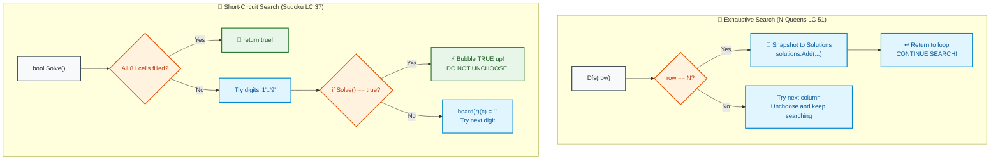

# 📘 WEEK 13 DAY 2: CLASSIC BACKTRACKING PROBLEMS — THE SENIOR INTERVIEW PLAYBOOK

> 🧭 **Navigation:** [← Previous Day](Week_13_Day_01_Backtracking_Fundamentals_Instructional.md) • [🏠 Week Overview](README.md) • [📘 Curriculum Syllabus](../COMPLETE_SYLLABUS.md) • [Next Day: Branch and Bound →](Week_13_Day_03_Branch_And_Bound_Instructional.md)
> 
> 💡 **Instructor Note:** *Day 2 moves from basic list permutations into multi-dimensional constraint satisfaction. Master the critical architectural distinction between EXHAUSTIVE ENUMERATION (finding ALL solutions, e.g. N-Queens LC 51) and SHORT-CIRCUIT TARGET SEARCH (stopping immediately on the FIRST valid solution via boolean bubbling, e.g. Sudoku Solver LC 37, Word Search LC 79).*

---

## 🎯 LEARNING OBJECTIVES

*By the end of this module, you will be able to:*

- 👑 **Solve** N-Queens (LC 51) using row-by-row placement and `O(1)` diagonal math (`r - c` and `r + c`).
- 🧩 **Implement** an optimal Sudoku Solver (LC 37) terminating instantaneously on the first valid solution using boolean bubble returns.
- 🗺️ **Master** In-Place Grid Masking in Word Search (LC 79) to eliminate auxiliary heap allocations during 4-directional DFS.
- ⚖️ **Disambiguate** Exhaustive Search (`void` backtrack) versus Target Search (`bool` backtrack).
- 🛑 **Avoid** the 4 classic interview traps: negative array indexing on `r - c`, leaking grid mask characters on failed paths, overwriting solved Sudoku boards, and quadratic string creation.
- 🎙️ **Deliver** the exact 3-sentence verbal talk track before writing code in a FAANG interview.
- ⚡ **Ship** production-grade C# (.NET 8/9) and Python (3.11+) implementations with zero unnecessary memory allocations.

---

## 🎬 PILLAR 1: THE 60-SECOND HOOK & EVERYDAY ANALOGIES

### Analogy 1: The Royal Diplomat Chessboard (N-Queens)

Imagine you are the chief of protocol at a royal summit. You have **8 foreign queens** sitting in a great hall arranged as an `8 x 8` chessboard. Every queen is armed with an invisible laser beam that fires across her entire **row**, her entire **column**, and both of her **diagonals**.

If any queen can see another queen, war breaks out!

```
How many ways can you place 8 queens on 64 squares?
Brute Force Permutations: (64 choose 8) = 4,426,165,368 possibilities!
Even a supercomputer evaluating every leaf will choke and stall.
```

How does an intelligent human place them?
1. You know every row MUST have exactly one queen.
2. Put Queen 0 in Row 0, Column 0.
3. Move to Row 1. Can you put Queen 1 in Column 0? No (Column 0 blocked). Column 1? No (Diagonal blocked). Put her in Column 2!
4. The instant a square is threatened, **you don't even consider it**.

```
Combinatorial Shrinkage:
- Naive 64-square placement: 4.4 BILLION states.
- Row-by-row placement (N!): 40,320 states.
- Row-by-row with O(1) Column & Diagonal Pruning: ONLY 2,057 states explored!
  (Over 99.999% of dead-end trees are pruned before they ever spawn!)
```

---

### Analogy 2: The Sunday Newspaper Pencil (Sudoku & Word Search)

When you solve a Sudoku puzzle in the Sunday paper, you don't write down a digit in dark permanent ink. You write with a **light pencil**.

You pick an empty cell, lightly pencil in `'5'`. You move to the next cell. If three steps later you realize that no digit from `'1'` to `'9'` is legal, what do you do?

You don't throw the newspaper in the trash! You take your eraser, rub out the `'5'`, and pencil in `'6'`.

And notice the fundamental goal difference:
- In N-Queens, the royal court wants a catalog of **all valid layouts**.
- In Sudoku, the newspaper editor only asks: **"Can you fill the board?"** You find ONE valid configuration, drop your pencil, shout "Done!", and **stop the clock immediately**!

---

## 🪜 PILLAR 2: THE SCAFFOLDING LADDER & TOY NAPKIN TRACES

Let's climb from 4-Queens to Sudoku cell verification and grid word search.

```
       [Level 3: Word Search (LC 79)]
       -> 2D Grid DFS with In-Place Character Masking
               ▲
               │
       [Level 2: Sudoku Solver (LC 37)]
       -> Constraint Checking + Boolean Short-Circuit Unwinding
               ▲
               │
       [Level 1: N-Queens (LC 51)]
       -> Row-by-Row + O(1) Column/Diagonal Hashing
```

---

### Level 1: N-Queens (LeetCode 51) — The 4x4 Napkin Trace

Let's trace `N = 4` on a `4 x 4` board. We place queens row-by-row (`r = 0, 1, 2, 3`).

```
How to Identify Threats in O(1):
- Column c: blocked if cols.Contains(c)
- Main Diagonal (\): Row and Col both increase together -> (r - c) is constant!
  Range: -(N - 1) to (N - 1)
- Anti-Diagonal (/): Row increases, Col decreases -> (r + c) is constant!
  Range: 0 to 2N - 2
```

#### Step-by-Step 4x4 Trace:

```
[Row 0]: Try Column 0 -> Place Q at (0, 0).
         Occupied: col=0, diag1=(0-0)=0, diag2=(0+0)=0

[Row 1]: Try Col 0: Blocked by col=0!
         Try Col 1: Blocked by diag1=(1-1)=0!
         Try Col 2: (1-2)=-1, (1+2)=3 -> FREE! Place Q at (1, 2).
         Occupied: col={0, 2}, diag1={0, -1}, diag2={0, 3}

[Row 2]: Try Col 0: Blocked by col=0!
         Try Col 1: (2-1)=1, (2+1)=3 (Blocked by diag2=3!)
         Try Col 2: Blocked by col=2!
         Try Col 3: (2-3)=-1 (Blocked by diag1=-1!)
         💥 ALL COLUMNS IN ROW 2 BLOCKED! DEAD END!

[Backtrack to Row 1]:
         Erase Q from (1, 2).
         Try Col 3: (1-3)=-2, (1+3)=4 -> FREE! Place Q at (1, 3).
         Occupied: col={0, 3}, diag1={0, -2}, diag2={0, 4}

[Row 2]: Try Col 0: Blocked by col=0!
         Try Col 1: (2-1)=1, (2+1)=3 -> FREE! Place Q at (2, 1).
         Occupied: col={0, 3, 1}, diag1={0, -2, 1}, diag2={0, 4, 3}

[Row 3]: Try Col 0, 1, 2, 3:
         Col 0: Blocked by col=0
         Col 1: Blocked by col=1
         Col 2: (3-2)=1 (Blocked by diag1=1!)
         Col 3: Blocked by col=3
         💥 ALL BLOCKED! DEAD END!

[Backtrack all the way to Row 0]:
         Erase Q from (0, 0).
         Try Col 1: Place Q at (0, 1)!
         Following this branch leads directly to SOLUTION 1:
         Row 0: Col 1 | Row 1: Col 3 | Row 2: Col 0 | Row 3: Col 2
```

```
Solution 1 Visualized:
  . Q . .    (Row 0, Col 1)
  . . . Q    (Row 1, Col 3)
  Q . . .    (Row 2, Col 0)
  . . Q .    (Row 3, Col 2)
  No two queens share a row, column, or diagonal!
```

---

### Level 2: Sudoku Solver (LeetCode 37) — Boolean Short-Circuiting

In Sudoku, we search for the **first empty cell** `board[r][c] == '.'`. We attempt digits `'1'` through `'9'`.

#### The 3x3 Box Formula:
Which 3x3 box does cell `(r, c)` belong to?
```
Box Top-Left Row:    startRow = (r / 3) * 3
Box Top-Left Column: startCol = (c / 3) * 3

Cell in Box at offset i (0..8):
Row = startRow + (i / 3)
Col = startCol + (i % 3)
```

#### Boolean Short-Circuit Mechanism:
```csharp
// If deeper recursion finds the full solution, RETURN TRUE IMMEDIATELY!
// Do NOT unchoose! Leave the board solved!
if (Solve(board))
{
    return true; // Bubbles up through the entire call stack!
}
board[r][c] = '.'; // Only unchoose if this digit led to a dead end!
```

---

### Level 3: Word Search (LeetCode 79) — In-Place Grid Masking

When searching for word `"ABCCED"` in a 2D grid, how do you prevent walking back onto the same cell (e.g. from `(0, 1)` back to `(0, 0)`)?

- **Rookie Approach:** Allocate `bool[,] visited = new bool[m, n]`.
  Creating this array or passing a set of coordinates creates unnecessary memory allocations on every DFS step.
- **Senior Architect Approach:** Mutate the board cell **in-place**!
  ```csharp
  char original = board[r][c];
  board[r][c] = '#'; // Choose: mask cell so future steps cannot match

  // Explore 4 cardinal directions
  bool found = Dfs(r + 1, c, k + 1) ||
               Dfs(r - 1, c, k + 1) ||
               Dfs(r, c + 1, k + 1) ||
               Dfs(r, c - 1, k + 1);

  board[r][c] = original; // Unchoose: ALWAYS restore original char!
  return found;
  ```

---

### 🧠 Pause & Predict Micro-Drill
**Question:** In Word Search, if the word length `L` is 6, and the board has 100 cells, what is the maximum call stack depth?
*Take 5 seconds to think.*
-
-
-
**Answer:** Exactly **`L = 6`**. The recursion only goes as deep as the length of the target word! Once `k == word.Length`, it returns `true`. Auxiliary space is `O(L)`, NOT `O(M * N)`.

---

## 🎨 PILLAR 3: PRAGMATIC VISUAL MODELS

### Exhaustive Search vs. Short-Circuit Search



---

## 🛑 PILLAR 4: THE ROOKIE TRAP ZONE

```
=============================================================================================
                                   THE ROOKIE TRAP ZONE
=============================================================================================

❌ ROOKIE TRAP 1: The Negative Index Array Crash on (r - c)
---------------------------------------------------------------------------------------------
Problem: Using `bool[] diag1 = new bool[2 * n];` and indexing `diag1[r - c]`.
Why it Fails: For row 0, col 3: `r - c = -3`. In C# and Python, indexing negative offsets in
an array throws `IndexOutOfRangeException` or wraps around incorrectly.
Senior Architect Fix:
- Option A: Add offset `(r - c + n - 1)` to shift range `[-(n-1) .. (n-1)]` to `[0 .. 2n-2]`.
- Option B: Use a `HashSet<int>` or bitmask.

❌ ROOKIE TRAP 2: Leaking the Masking Token '#' on Return True
---------------------------------------------------------------------------------------------
Problem: In Word Search, returning `true` inside the 4-directional search without restoring
the board character. If the caller checks the board again or has multiple searches,
the board is permanently corrupted with '#' characters.
Senior Architect Fix: Always restore `board[r][c] = original` in a finally block or before
every exit path, ensuring strict board idempotency.

❌ ROOKIE TRAP 3: Overwriting a Solved Sudoku Board
---------------------------------------------------------------------------------------------
Problem: Forgetting to check the boolean return of the recursive step in Sudoku:
`Solve(board); board[r][c] = '.';`
Why it Fails: The recursive call successfully solves the entire board and returns `true`,
but the caller ignores the return value, executes the unchoose step, and erases the solution!
Senior Architect Fix: Wrap in an immediate guard:
`if (Solve(board)) return true; // Bubble up without unchoosing!`

❌ ROOKIE TRAP 4: Allocating Visited Sets in 2D Grid Traversal
---------------------------------------------------------------------------------------------
Problem: Creating `HashSet<(int, int)> visited` for each DFS step in Word Search.
Why it Fails: Heap allocation on every cell causes massive garbage collection pressure.
Senior Architect Fix: In-place grid replacement (`'#'`) achieves zero auxiliary heap space.
=============================================================================================
```

---

## 🎙️ PILLAR 5: 45-MINUTE INTERVIEW TALK TRACK

When presented with N-Queens or Sudoku in a FAANG interview, use this structured verbal script:

```
[00:00 - 05:00] Clarifying Requirements & Search Objective
"Let's identify the core objective:
 1. Are we finding ALL valid configurations (exhaustive enumeration, void return) or
    are we finding ONE valid solution / checking existence (target search, bool return)?
 2. For N-Queens, we want all boards. For Sudoku and Word Search, we want immediate short-circuiting.
 3. What are the grid dimensions? For N-Queens N <= 12, Sudoku is fixed 9x9, Word Search is M x N.
    These small bounds explicitly signal combinatorial backtracking with pruning."

[05:00 - 10:00] Invariant Formulation & Math Proof
"For N-Queens, placing one queen per row eliminates all row collisions by construction.
 To check columns and diagonals in O(1):
 - Columns are tracked via a boolean array cols[c].
 - Main diagonals (\) have constant (r - c); we index with offset (r - c + N - 1).
 - Anti-diagonals (/) have constant (r + c).
 This reduces conflict detection from an O(N) board scan to 3 O(1) lookups."

[10:00 - 15:00] Short-Circuit Architecture (For Sudoku / Word Search)
"For Sudoku, our recursive method returns a boolean.
 When all 81 cells are filled, we return true.
 In the loop: we Choose a digit, Explore via if (Solve()) return true, and Unchoose only if false.
 This ensures that once the solution is found, the call stack collapses instantly without
 undoing the solved numbers."

[15:00 - 35:00] Coding Implementation
(Write clean C# / Python using boolean arrays or in-place masking.)

[35:00 - 40:00] Edge Cases & Bounds Check
"Edge cases:
 - N = 1 (Trivial single queen: valid).
 - N = 2 and N = 3 (No solutions exist: returns empty list).
 - Unsolvable Sudoku board (returns false gracefully).
 - Word Search where word length exceeds total grid cells (early return false)."

[40:00 - 45:00] Complexity Deconstruction
"N-Queens: O(N!) time upper bound, O(N) auxiliary stack and hashing memory.
 Sudoku: O(9^(empty cells)) worst-case, but constraint propagation prunes it to milliseconds.
 Word Search: O(M * N * 3^L) time, O(L) auxiliary stack space, O(1) heap memory."
```

---

## ⚡ PILLAR 6: PRODUCTION DUAL-LANGUAGE IMPLEMENTATIONS

### Production C# (.NET 8/9 — Zero-Allocation Arrays & Boolean Bubbling)

```csharp
namespace DsaMastery.Backtracking;

using System;
using System.Collections.Generic;

public static class ClassicBacktrackingProblems
{
    // =========================================================================
    // 1. N-QUEENS (LeetCode 51) — Exhaustive All-Solutions Search
    // Time: O(N!) | Space: O(N) Auxiliary Memory (Boolean Arrays)
    // =========================================================================
    public static IList<IList<string>> SolveNQueens(int n)
    {
        if (n <= 0) return [];

        var solutions = new List<IList<string>>();
        var board = new char[n][];
        for (int i = 0; i < n; i++)
        {
            board[i] = new char[n];
            Array.Fill(board[i], '.');
        }

        // O(1) conflict trackers with zero heap allocation
        var cols = new bool[n];
        var diag1 = new bool[2 * n]; // (r - c + n - 1)
        var diag2 = new bool[2 * n]; // (r + c)

        void Dfs(int r)
        {
            if (r == n)
            {
                var snapshot = new List<string>(n);
                for (int i = 0; i < n; i++)
                {
                    snapshot.Add(new string(board[i]));
                }
                solutions.Add(snapshot);
                return;
            }

            for (int c = 0; c < n; c++)
            {
                int d1 = r - c + n - 1;
                int d2 = r + c;

                if (cols[c] || diag1[d1] || diag2[d2])
                {
                    continue; // Eager pruning: square is threatened!
                }

                // 1. Choose
                board[r][c] = 'Q';
                cols[c] = true;
                diag1[d1] = true;
                diag2[d2] = true;

                // 2. Explore
                Dfs(r + 1);

                // 3. Unchoose
                board[r][c] = '.';
                cols[c] = false;
                diag1[d1] = false;
                diag2[d2] = false;
            }
        }

        Dfs(0);
        return solutions;
    }

    // =========================================================================
    // 2. SUDOKU SOLVER (LeetCode 37) — Short-Circuit Target Search
    // Time: O(9^EmptyCells) | Space: O(EmptyCells) Call Stack
    // =========================================================================
    public static void SolveSudoku(char[][] board)
    {
        ArgumentNullException.ThrowIfNull(board);
        Solve(board);
    }

    private static bool Solve(char[][] board)
    {
        for (int r = 0; r < 9; r++)
        {
            for (int c = 0; c < 9; c++)
            {
                if (board[r][c] != '.') continue;

                for (char d = '1'; d <= '9'; d++)
                {
                    if (IsValidSudokuCell(board, r, c, d))
                    {
                        board[r][c] = d; // 1. Choose

                        if (Solve(board)) // 2. Explore: Short-circuit check!
                        {
                            return true; // Bubble true up without unchoosing!
                        }

                        board[r][c] = '.'; // 3. Unchoose (only on failure)
                    }
                }

                return false; // None of '1'..'9' worked; backtrack to parent
            }
        }

        return true; // All 81 cells successfully filled!
    }

    private static bool IsValidSudokuCell(char[][] board, int r, int c, char digit)
    {
        int boxRowStart = 3 * (r / 3);
        int boxColStart = 3 * (c / 3);

        for (int i = 0; i < 9; i++)
        {
            if (board[r][i] == digit) return false; // Row conflict
            if (board[i][c] == digit) return false; // Column conflict
            if (board[boxRowStart + i / 3][boxColStart + i % 3] == digit) return false; // 3x3 Box conflict
        }

        return true;
    }

    // =========================================================================
    // 3. WORD SEARCH (LeetCode 79) — In-Place Grid Masking
    // Time: O(M * N * 3^L) | Space: O(L) Call Stack, O(1) Heap
    // =========================================================================
    public static bool Exist(char[][] board, string word)
    {
        ArgumentNullException.ThrowIfNull(board);
        ArgumentNullException.ThrowIfNull(word);
        if (word.Length == 0) return true;

        int m = board.Length, n = board[0].Length;
        if (word.Length > m * n) return false; // Guard: word longer than board capacity

        for (int r = 0; r < m; r++)
        {
            for (int c = 0; c < n; c++)
            {
                if (board[r][c] == word[0] && Dfs(r, c, 0))
                {
                    return true;
                }
            }
        }

        return false;

        bool Dfs(int r, int c, int k)
        {
            if (k == word.Length) return true;
            if (r < 0 || r >= m || c < 0 || c >= n || board[r][c] != word[k])
            {
                return false;
            }

            // In-place masking: eliminates auxiliary visited array
            char original = board[r][c];
            board[r][c] = '#'; // Choose

            bool found = Dfs(r + 1, c, k + 1) ||
                         Dfs(r - 1, c, k + 1) ||
                         Dfs(r, c + 1, k + 1) ||
                         Dfs(r, c - 1, k + 1); // Explore 4 cardinal directions

            board[r][c] = original; // Unchoose: ALWAYS restore state
            return found;
        }
    }
}
```

---

### Production Python (3.11+ — Clean, Idiomatic Implementations)

```python
from __future__ import annotations
from typing import List


class ClassicBacktrackingProblems:
    # =========================================================================
    # 1. N-QUEENS (LeetCode 51) — Exhaustive All-Solutions Search
    # Time: O(N!) | Space: O(N) Auxiliary Memory
    # =========================================================================
    @staticmethod
    def solve_n_queens(n: int) -> List[List[str]]:
        if n <= 0:
            return []

        solutions: List[List[str]] = []
        board = [["." for _ in range(n)] for _ in range(n)]

        cols: set[int] = set()
        diag1: set[int] = set()  # (r - c)
        diag2: set[int] = set()  # (r + c)

        def dfs(r: int) -> None:
            if r == n:
                solutions.append(["".join(row) for row in board])
                return

            for c in range(n):
                if c in cols or (r - c) in diag1 or (r + c) in diag2:
                    continue  # Pruned: threatened cell

                # 1. Choose
                board[r][c] = "Q"
                cols.add(c)
                diag1.add(r - c)
                diag2.add(r + c)

                # 2. Explore
                dfs(r + 1)

                # 3. Unchoose
                board[r][c] = "."
                cols.remove(c)
                diag1.remove(r - c)
                diag2.remove(r + c)

        dfs(0)
        return solutions

    # =========================================================================
    # 2. SUDOKU SOLVER (LeetCode 37) — Short-Circuit Target Search
    # Time: O(9^EmptyCells) | Space: O(EmptyCells) Call Stack
    # =========================================================================
    @staticmethod
    def solve_sudoku(board: List[List[str]]) -> None:
        def is_valid(r: int, c: int, num: str) -> bool:
            box_r, box_c = 3 * (r // 3), 3 * (c // 3)
            for i in range(9):
                if board[r][i] == num:
                    return False
                if board[i][c] == num:
                    return False
                if board[box_r + i // 3][box_c + i % 3] == num:
                    return False
            return True

        def solve() -> bool:
            for r in range(9):
                for c in range(9):
                    if board[r][c] != ".":
                        continue

                    for digit in "123456789":
                        if is_valid(r, c, digit):
                            board[r][c] = digit  # 1. Choose

                            if solve():  # 2. Explore
                                return True  # Bubble true up without unchoosing!

                            board[r][c] = "."  # 3. Unchoose

                    return False  # All digits exhausted; trigger backtrack
            return True  # All cells filled!

        solve()

    # =========================================================================
    # 3. WORD SEARCH (LeetCode 79) — In-Place Grid Masking
    # Time: O(M * N * 3^L) | Space: O(L) Call Stack, O(1) Heap
    # =========================================================================
    @staticmethod
    def exist(board: List[List[str]], word: str) -> bool:
        if not board or not word:
            return False

        m, n = len(board), len(board[0])
        if len(word) > m * n:
            return False

        def dfs(r: int, c: int, k: int) -> bool:
            if k == len(word):
                return True
            if not (0 <= r < m and 0 <= c < n) or board[r][c] != word[k]:
                return False

            original = board[r][c]
            board[r][c] = "#"  # 1. Choose: in-place mask

            found = (
                dfs(r + 1, c, k + 1) or
                dfs(r - 1, c, k + 1) or
                dfs(r, c + 1, k + 1) or
                dfs(r, c - 1, k + 1)
            )  # 2. Explore

            board[r][c] = original  # 3. Unchoose: restore
            return found

        for r in range(m):
            for c in range(n):
                if board[r][c] == word[0] and dfs(r, c, 0):
                    return True

        return False
```

---

## 🔬 PERFORMANCE & COMPLEXITY DECONSTRUCTION

| Problem | Time Complexity | Auxiliary Stack Space | Auxiliary Heap Space | Governing Invariant |
| :--- | :--- | :--- | :--- | :--- |
| **N-Queens (LC 51)** | `O(N!)` | `O(N)` | `O(N)` (boolean arrays) | 1 Queen per row; `O(1)` diagonal hashing |
| **Sudoku Solver (LC 37)** | `O(9^E)` (`E <= 81` empty cells) | `O(E)` | `O(1)` | Immediate boolean bubbling on full board |
| **Word Search (LC 79)** | `O(M * N * 3^L)` (`L` = word length) | `O(L)` | `O(1)` in-place masking | At most 3 branch choices at step `k > 0` |

---

## ⚔️ PRACTICE DRILLS & MASTERY PROBLEMS

| # | Problem | Source | Difficulty | Target Invariant |
| :--- | :--- | :--- | :--- | :--- |
| 1 | N-Queens | LeetCode 51 | Hard | `r - c` and `r + c` diagonal hashing |
| 2 | N-Queens II | LeetCode 52 | Hard | Solution count without string building |
| 3 | Sudoku Solver | LeetCode 37 | Hard | Boolean bubble short-circuit search |
| 4 | Word Search | LeetCode 79 | Medium | 4-directional DFS with in-place masking |
| 5 | Word Search II | LeetCode 212 | Hard | Trie-backed prefix pruning |
| 6 | Palindrome Partitioning | LeetCode 131 | Medium | Substring palindrome validation before recurse |

---

> 🧭 **Navigation:** [← Previous Day](Week_13_Day_01_Backtracking_Fundamentals_Instructional.md) • [🏠 Week Overview](README.md) • [📘 Curriculum Syllabus](../COMPLETE_SYLLABUS.md) • [Next Day: Branch and Bound →](Week_13_Day_03_Branch_And_Bound_Instructional.md)
