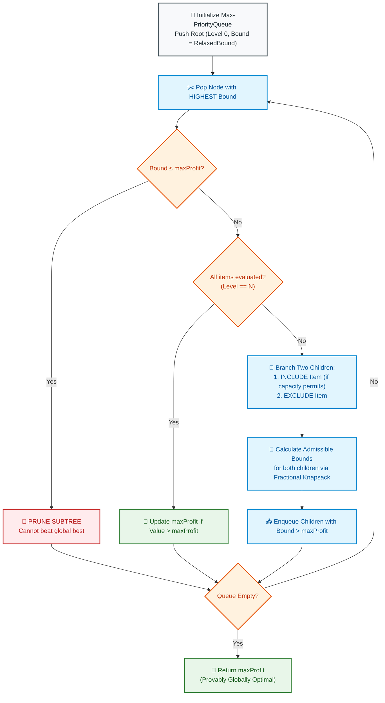

# 📘 WEEK 13 DAY 3: BRANCH AND BOUND — THE SENIOR INTERVIEW PLAYBOOK

> 🧭 **Navigation:** [← Previous Day](Week_13_Day_02_Backtracking_Problems_Instructional.md) • [🏠 Week Overview](README.md) • [📘 Curriculum Syllabus](../COMPLETE_SYLLABUS.md) • [Next Day: Amortized Analysis →](Week_13_Day_04_Amortized_Analysis_Instructional.md)
> 
> 💡 **Instructor Note:** *Backtracking searches for FEASIBILITY (can we satisfy constraints?); Branch and Bound searches for OPTIMALITY (find the global maximum profit or minimum cost). Instead of blind DFS, Branch and Bound uses an admissible mathematical bounding heuristic and a Priority Queue (Best-First Search) to aggressively prune entire subtrees that cannot beat our best known solution.*

---

## 🎯 LEARNING OBJECTIVES

*By the end of this module, you will be able to:*

- ⚖️ **Disambiguate** Backtracking (feasibility via DFS) from Branch and Bound (optimality via Best-First Search and priority queues).
- 📐 **Formulate** Admissible Bounding Functions using continuous problem relaxations (e.g. Fractional Knapsack as an upper bound for 0/1 Knapsack).
- 🚀 **Implement** Best-First Search Branch and Bound in modern C# (.NET 8/9 `PriorityQueue<KnapsackNode, double>`) and Python (3.11+ `heapq`).
- 🎨 **Visualize** state space tree pruning where upper bounds fall below current global maximums.
- 🛑 **Avoid** the 4 fatal rookie pitfalls: inadmissible bounding heuristics, Priority Queue memory explosions, unsorted ratio arrays, and using B&B when Dynamic Programming is strictly faster.
- 🎙️ **Deliver** the exact 3-sentence verbal script to pitch Branch and Bound when pseudo-polynomial DP fails due to massive capacities (`W = 10^9`).

---

## 🎬 PILLAR 1: THE 60-SECOND HOOK & EVERYDAY ANALOGIES

### The Venture Capitalist & The Gold Mine Metal Detector

Imagine you are a venture capitalist with **$10,000,000** to invest. You are inspecting 50 startup pitches.

- **Standard Backtracking:** You sit through all 50 full 3-hour pitch presentations from start to finish before deciding which combination to fund. That's 150 hours of wasted time!
- **Branch and Bound:** 
  1. Early in the morning, Pitch #2 proves it can generate **$50,000,000** in guaranteed revenue. That is your current benchmark: `best_profit = $50M`.
  2. Pitch #3 walks in. Within the first 2 minutes, their financial model shows that even in the most optimistic fantasy world (relaxation), the absolute maximum theoretical market cap they can ever reach is **$30,000,000**.
  3. What do you do? **You stop the pitch immediately.**
  4. Why sit through the remaining 2 hours and 58 minutes? Their theoretical ceiling ($30M) cannot beat the cash you already have locked in ($50M). You kick them out of the boardroom!

```
+---------------------------------------------------------------------------------------+
|                             THE BRANCH & BOUND INVARIANT                              |
+---------------------------------------------------------------------------------------+
|  "If the THEORETICAL MAXIMUM CEILING (Upper Bound) of a subtree cannot beat the       |
|   ACTUAL REALIZED FLOOR (Best Known Solution) already discovered, PRUNE THE ENTIRE    |
|   SUBTREE IMMEDIATELY. Do not spend a single CPU cycle exploring its children."       |
+---------------------------------------------------------------------------------------+
```

---

### The Dynamic Programming Catastrophe: Why B&B Saves Production

In Week 10, we learned that 0/1 Knapsack can be solved with Dynamic Programming in `O(N * W)` time.

Why not just use DP forever?

Look at this real-world production scenario:
- Number of items: `N = 40`
- Knapsack capacity: `W = 1,000,000,000` (1 Billion bytes / bandwidth / dollars)

What happens to Dynamic Programming?
```
DP Memory Required: N * W = 40 * 1,000,000,000 = 40 BILLION integers!
Memory: 40 GB * 4 bytes = 160 GIGABYTES of RAM!
Result: OUT OF MEMORY (OOM) CRASH!
```
Dynamic Programming is **pseudo-polynomial**; when the capacity `W` is massive, DP chokes and dies.

A standard brute-force search explores `2^40 ≈ 1.09 * 10^12` states, which takes 3 hours.

**Branch and Bound with Fractional Knapsack Bounding**, however, establishes a high `best_profit` within the first 100 iterations. It uses that high watermark to prune 99.99% of the remaining search space, solving the problem in **under 50 milliseconds** using only a few kilobytes of RAM!

---

## 🪜 PILLAR 2: THE SCAFFOLDING LADDER & TOY NAPKIN TRACES

### The Mathematical Rule: Admissibility

For Branch and Bound to guarantee that it finds the **true global optimum**, your bounding function MUST be **Admissible**:
- For a **Maximization Problem** (Knapsack): `Upper Bound(u) >= TrueOptimal(u)`. It must be an optimistic ceiling. It must NEVER underestimate what is possible.
- For a **Minimization Problem** (TSP / Shortest Route): `Lower Bound(u) <= TrueOptimal(u)`. It must be an optimistic floor. It must NEVER overestimate the cost.

#### The Magic Relaxation: Fractional Knapsack
How do we compute an admissible upper bound for discrete 0/1 Knapsack?
We **relax the 0/1 integer constraint**! We allow ourselves to take fractional slices of items. Because taking continuous fractions of high-density items is provably better than or equal to taking discrete items, `FractionalKnapsackBound >= DiscreteKnapsackOptimal`.

---

### Step 1: Toy Napkin Trace — 0/1 Knapsack with Best-First Search

**Problem:** Knapsack Capacity `W = 10`. Items sorted by Value/Weight ratio descending:

| Item | Value (`v`) | Weight (`w`) | Density (`v / w`) |
| :--- | :--- | :--- | :--- |
| **Item 1** | $40 | 4 kg | **10.0 $/kg** |
| **Item 2** | $70 | 7 kg | **10.0 $/kg** |
| **Item 3** | $100 | 9 kg | **11.1 $/kg** |

*(Let's sort descending by density: Item 3 (11.1), Item 1 (10.0), Item 2 (10.0))*

Let's trace:
- Item 0: `v = 100, w = 9` (Ratio = 11.11)
- Item 1: `v = 40, w = 4` (Ratio = 10.0)
- Item 2: `v = 70, w = 7` (Ratio = 10.0)
Capacity `W = 10`.

#### Priority Queue Trace:

```
[Level 0 - ROOT]: Value = 0, Weight = 0
Compute Bound:
- Take Item 0 (9kg, $100). Remaining Capacity: 10 - 9 = 1 kg.
- Take 1/4 of Item 1 (1kg * 10 $/kg = $10).
- Bound = 100 + 10 = $110.0.
Enqueue Root (Bound = 110.0). Global maxProfit = 0.

----------------------------------------------------------------------------------------
[Iteration 1]: Pop Root (Bound = 110.0). Level = 0 (Examine Item 0: v=100, w=9).

Branch A (INCLUDE Item 0):
  Weight = 0 + 9 = 9 kg <= 10 kg (Feasible!).
  Value = 0 + 100 = $100.
  Update Global maxProfit = max(0, 100) = $100! 🎯 (HIGH WATERMARK ESTABLISHED!)
  Compute Bound for Node (Include 0):
    Remaining Capacity = 10 - 9 = 1 kg.
    Fraction of Item 1 = 1/4 * 40 = $10.
    Bound = 100 + 10 = $110.0.
  Since Bound (110.0) > maxProfit (100), Enqueue Node A (Level 1, v=100, w=9, Bound=110.0).

Branch B (EXCLUDE Item 0):
  Weight = 0 kg, Value = $0.
  Compute Bound for Node (Exclude 0):
    Remaining Capacity = 10 kg.
    Take all of Item 1 (4kg, $40). Remaining: 6 kg.
    Take 6/7 of Item 2 (6kg * 10 $/kg = $60).
    Bound = 40 + 60 = $100.0.
  Since Bound (100.0) <= maxProfit (100), ✂️ PRUNE BRANCH B IMMEDIATELY!
  (Excluding Item 0 can at best reach $100, which we already matched!)

----------------------------------------------------------------------------------------
[Iteration 2]: Pop Node A (Bound = 110.0). Level = 1 (Examine Item 1: v=40, w=4).

Branch A1 (INCLUDE Item 1):
  Weight = 9 + 4 = 13 kg > 10 kg 💥 (INFEASIBLE! Exceeds capacity! Drop!)

Branch A2 (EXCLUDE Item 1):
  Weight = 9 kg, Value = $100.
  Compute Bound:
    Remaining Capacity = 10 - 9 = 1 kg.
    Fraction of Item 2 = 1/7 * 70 = $10.
    Bound = 100 + 10 = $110.0.
  Enqueue Node A2 (Level 2, v=100, w=9, Bound=110.0).

----------------------------------------------------------------------------------------
[Iteration 3]: Pop Node A2 (Bound = 110.0). Level = 2 (Examine Item 2: v=70, w=7).

Branch A2_1 (INCLUDE Item 2):
  Weight = 9 + 7 = 16 kg > 10 kg 💥 (INFEASIBLE! Exceeds capacity! Drop!)

Branch A2_2 (EXCLUDE Item 2):
  Weight = 9 kg, Value = $100.
  Level = 3 (All items processed! Leaf reached!)
  Final Feasible Value = $100.

Priority Queue is now EMPTY!
Final Optimal Value: $100 (Take Item 0 alone).
```

Look at how many nodes we explored: **ONLY 3 NODES** out of the full binary tree! The entire right half of the tree was pruned at the root.

---

### 🧠 Pause & Predict Micro-Drill
**Question:** If we are solving a MINIMIZATION problem (like Traveling Salesperson or Vehicle Routing), what is our pruning condition when node `u` has lower bound `LB(u)` and our current best completed tour is `best_cost`?
*Take 5 seconds to think.*
-
-
-
**Answer:** We prune node `u` whenever `LB(u) >= best_cost`. If the optimistic minimum cost to finish through node `u` is already greater than or equal to a tour we already completed, exploring `u` is guaranteed to be a waste of time.

---

## 🎨 PILLAR 3: PRAGMATIC VISUAL MODELS

### Best-First Search Branch and Bound Architecture



---

## 🛑 PILLAR 4: THE ROOKIE TRAP ZONE

```
=============================================================================================
                                   THE ROOKIE TRAP ZONE
=============================================================================================

❌ ROOKIE TRAP 1: The Inadmissible Bounding Function (Suboptimal Output)
---------------------------------------------------------------------------------------------
Problem: Using a naive heuristic that underestimates the upper bound in a maximization problem
(e.g., ignoring remaining items or truncating floating-point ratios).
Why it Fails: If `UB(u)` calculates $90 when the true optimal branch through `u` could yield
$105, and `maxProfit` is $95, the algorithm prunes node `u`! The true optimal solution is
permanently deleted, and the algorithm returns an incorrect answer.
Senior Architect Fix: An upper bound must ALWAYS be a true mathematical relaxation.
Prove that `UB(u) >= TrueOptimal(u)` for every reachable state.

❌ ROOKIE TRAP 2: Priority Queue Memory Explosion (Best-First vs Depth-First B&B)
---------------------------------------------------------------------------------------------
Problem: Best-First Search stores all active frontier nodes in a Priority Queue. In adversarial
cases where bounds are loose, the heap can accumulate O(2^N) nodes, triggering Out-Of-Memory.
Senior Architect Fix: If RAM is strictly constrained, switch to Depth-First Branch and Bound
(DFBnB). DFBnB uses call-stack recursion with strict O(N) memory while still updating
`maxProfit` and pruning subtrees whose upper bound falls below `maxProfit`.

❌ ROOKIE TRAP 3: Forgetting to Sort by Ratio Upfront
---------------------------------------------------------------------------------------------
Problem: Computing fractional knapsack bounds without sorting items by `value / weight` descending.
Why it Fails: Fractional knapsack is only optimal when greedily packing the highest density
items first! If items are unsorted, the bounding function produces garbage values and
fails to prune the tree effectively.
Senior Architect Fix: Sort items by `v / w` descending at step 0: `O(N log N)` cost upfront
saves millions of priority queue operations downstream.

❌ ROOKIE TRAP 4: Using B&B When Capacity is Small (Over-Engineering)
---------------------------------------------------------------------------------------------
Problem: Implementing complex Branch and Bound for 0/1 Knapsack when `W = 500` and `N = 100`.
Why it Fails: When `W` is small, 1D Dynamic Programming runs in 1 millisecond with zero heap
overhead. Branch and Bound has object allocation overhead and priority queue operations.
Senior Architect Fix: Choose DP when `W <= 10^5`. Choose B&B when `W >= 10^7` or `W` is floating-point.
=============================================================================================
```

---

## 🎙️ PILLAR 5: 45-MINUTE INTERVIEW TALK TRACK

When pitching Branch and Bound in a senior FAANG systems or algorithmic interview:

```
[00:00 - 05:00] Identifying the Trade-Off & Pitching B&B
"Let's evaluate our constraints:
 We have discrete 0/1 choices where we need to maximize total profit under a capacity bound.
 If capacity W were small (say W <= 10^4), I would immediately implement a 1D Dynamic Programming
 table running in O(N * W) time.
 However, if capacity W is massive (e.g. W = 10^9), DP experiences state space explosion and
 fails due to memory exhaustion.
 Pure backtracking is O(2^N), which is intractable for N = 40.
 Therefore, I will use Branch and Bound with Best-First Search to prune unpromising subtrees."

[05:00 - 10:00] Defining the Admissible Bounding Relaxation
"To guarantee global optimality, our upper bound must be admissible—meaning it never underestimates
 the true maximum profit achievable from a partial state.
 I will formulate the bound using the Fractional Knapsack relaxation: sorting remaining items
 by value-to-weight ratio and allowing continuous fractional filling of the last item.
 Because the continuous fractional space strictly contains all discrete 0/1 assignments,
 this bound is provably an upper bound."

[10:00 - 15:00] Data Structure Architecture
"We will structure the solution with:
 1. An Item record pre-sorted by value-to-weight ratio descending.
 2. A KnapsackNode tracking current level, value, weight, and theoretical upper bound.
 3. A Max-PriorityQueue keyed by bound to explore the most promising paths first.
 4. A global maxProfit benchmark to prune any node whose bound <= maxProfit."

[15:00 - 35:00] Writing Clean, Production Code
(Implement the priority queue loop with include/exclude branching in C# / Python.)

[35:00 - 40:00] Dry Run & Pruning Demonstration
(Dry-run with a 3-item napkin trace, showing the exact node where upper bound falls below maxProfit.)

[40:00 - 45:00] Complexity & Memory Bounds
"Worst-case Time: O(2^N), but average-case is drastically lower due to 90%+ branch pruning.
 Auxiliary Space: O(2^N) for Best-First Search heap, or O(N) if adapted to Depth-First B&B.
 This delivers an optimal exact solution where DP is physically impossible."
```

---

## ⚡ PILLAR 6: PRODUCTION DUAL-LANGUAGE IMPLEMENTATIONS

### Production C# (.NET 8/9 — `PriorityQueue` with Inverted Priority)

```csharp
namespace DsaMastery.Backtracking;

using System;
using System.Collections.Generic;

public sealed record KnapsackItem(int Value, int Weight, double Ratio);

public sealed class KnapsackNode
{
    public int Level { get; init; }
    public int Value { get; init; }
    public int Weight { get; init; }
    public double Bound { get; init; }
}

public static class KnapsackBranchAndBound
{
    /// <summary>
    /// Solves discrete 0/1 Knapsack using Best-First Search Branch and Bound.
    /// Time Complexity: O(2^N) worst-case, heavily pruned in practice.
    /// Auxiliary Space: O(2^N) heap space.
    /// </summary>
    public static int SolveKnapsack(int capacity, int[] values, int[] weights)
    {
        ArgumentNullException.ThrowIfNull(values);
        ArgumentNullException.ThrowIfNull(weights);
        if (values.Length != weights.Length)
        {
            throw new ArgumentException("Values and weights must have identical lengths.");
        }
        if (capacity <= 0 || values.Length == 0) return 0;

        int n = values.Length;
        var items = new KnapsackItem[n];
        for (int i = 0; i < n; i++)
        {
            if (weights[i] <= 0) throw new ArgumentOutOfRangeException(nameof(weights), "Weights must be positive.");
            items[i] = new KnapsackItem(values[i], weights[i], (double)values[i] / weights[i]);
        }

        // Step 0: Sort descending by value-to-weight ratio
        Array.Sort(items, (a, b) => b.Ratio.CompareTo(a.Ratio));

        // .NET PriorityQueue is a Min-Heap by default; pass negative bound to create a Max-Heap
        var pq = new PriorityQueue<KnapsackNode, double>();

        double rootBound = CalculateBound(0, 0, 0, capacity, items);
        var root = new KnapsackNode
        {
            Level = 0,
            Value = 0,
            Weight = 0,
            Bound = rootBound
        };

        pq.Enqueue(root, -rootBound);
        int maxProfit = 0;

        while (pq.Count > 0)
        {
            var curr = pq.Dequeue();

            // Pruning Invariant: If node's upper bound cannot beat current best known, PRUNE!
            if (curr.Bound <= maxProfit || curr.Level == n)
            {
                continue;
            }

            var item = items[curr.Level];

            // -----------------------------------------------------------------
            // Branch 1: INCLUDE current item (if capacity allows)
            // -----------------------------------------------------------------
            if (curr.Weight + item.Weight <= capacity)
            {
                int nextVal = curr.Value + item.Value;
                int nextWt = curr.Weight + item.Weight;
                maxProfit = Math.Max(maxProfit, nextVal); // Update high watermark

                double includeBound = CalculateBound(curr.Level + 1, nextVal, nextWt, capacity, items);
                if (includeBound > maxProfit)
                {
                    pq.Enqueue(new KnapsackNode
                    {
                        Level = curr.Level + 1,
                        Value = nextVal,
                        Weight = nextWt,
                        Bound = includeBound
                    }, -includeBound);
                }
            }

            // -----------------------------------------------------------------
            // Branch 2: EXCLUDE current item
            // -----------------------------------------------------------------
            double excludeBound = CalculateBound(curr.Level + 1, curr.Value, curr.Weight, capacity, items);
            if (excludeBound > maxProfit)
            {
                pq.Enqueue(new KnapsackNode
                {
                    Level = curr.Level + 1,
                    Value = curr.Value,
                    Weight = curr.Weight,
                    Bound = excludeBound
                }, -excludeBound);
            }
        }

        return maxProfit;
    }

    /// <summary>
    /// Computes the admissible upper bound using the continuous Fractional Knapsack relaxation.
    /// </summary>
    private static double CalculateBound(int level, int currentVal, int currentWt, int capacity, KnapsackItem[] items)
    {
        if (currentWt >= capacity) return 0;

        double bound = currentVal;
        int remainingCapacity = capacity - currentWt;

        for (int i = level; i < items.Length; i++)
        {
            if (items[i].Weight <= remainingCapacity)
            {
                remainingCapacity -= items[i].Weight;
                bound += items[i].Value;
            }
            else
            {
                // Take fraction of the next item to fill the exact remaining capacity
                bound += items[i].Ratio * remainingCapacity;
                break;
            }
        }

        return bound;
    }
}
```

---

### Production Python (3.11+ — `dataclasses`, `heapq` with Tie-Breaker ID)

```python
from __future__ import annotations
from dataclasses import dataclass
import heapq
from typing import List


@dataclass
class KnapsackItem:
    value: int
    weight: int
    ratio: float


@dataclass
class KnapsackNode:
    level: int
    value: int
    weight: int
    bound: float


class KnapsackBranchAndBound:
    @staticmethod
    def solve_knapsack(capacity: int, values: List[int], weights: List[int]) -> int:
        """
        Solves discrete 0/1 Knapsack using Best-First Search Branch and Bound.
        Time Complexity: O(2^N) worst-case (empirically fast with pruning).
        Space Complexity: O(2^N) heap memory.
        """
        if not values or not weights or capacity <= 0:
            return 0
        if len(values) != len(weights):
            raise ValueError("Values and weights must have identical lengths.")

        n = len(values)
        items = [KnapsackItem(v, w, v / w) for v, w in zip(values, weights)]
        # Sort descending by ratio
        items.sort(key=lambda x: x.ratio, reverse=True)

        def calculate_bound(level: int, current_val: int, current_wt: int) -> float:
            if current_wt >= capacity:
                return 0.0

            bound = float(current_val)
            rem = capacity - current_wt

            for i in range(level, n):
                if items[i].weight <= rem:
                    rem -= items[i].weight
                    bound += items[i].value
                else:
                    bound += items[i].ratio * rem
                    break

            return bound

        root_bound = calculate_bound(0, 0, 0)
        root = KnapsackNode(level=0, value=0, weight=0, bound=root_bound)

        # Max-heap via negative bound. Use entry_id as secondary comparator for stable tie-breaking.
        pq: list[tuple[float, int, KnapsackNode]] = [(-root_bound, 0, root)]
        entry_id = 1
        max_profit = 0

        while pq:
            _, _, curr = heapq.heappop(pq)

            # Pruning check
            if curr.bound <= max_profit or curr.level == n:
                continue

            item = items[curr.level]

            # -----------------------------------------------------------------
            # Branch 1: INCLUDE current item
            # -----------------------------------------------------------------
            if curr.weight + item.weight <= capacity:
                next_val = curr.value + item.value
                next_wt = curr.weight + item.weight
                max_profit = max(max_profit, next_val)  # Update high watermark

                inc_bound = calculate_bound(curr.level + 1, next_val, next_wt)
                if inc_bound > max_profit:
                    inc_node = KnapsackNode(curr.level + 1, next_val, next_wt, inc_bound)
                    heapq.heappush(pq, (-inc_bound, entry_id, inc_node))
                    entry_id += 1

            # -----------------------------------------------------------------
            # Branch 2: EXCLUDE current item
            # -----------------------------------------------------------------
            exc_bound = calculate_bound(curr.level + 1, curr.value, curr.weight)
            if exc_bound > max_profit:
                exc_node = KnapsackNode(curr.level + 1, curr.value, curr.weight, exc_bound)
                heapq.heappush(pq, (-exc_bound, entry_id, exc_node))
                entry_id += 1

        return max_profit
```

---

## 🔬 PERFORMANCE & COMPLEXITY DECONSTRUCTION

| Paradigm | Worst-Case Time | Typical Empirical Time | Memory Complexity | Optimal Use Case |
| :--- | :--- | :--- | :--- | :--- |
| **Branch and Bound (Best-First)** | `O(2^N)` | Milliseconds (prunes 90%+) | `O(2^N)` (PriorityQueue) | `W = 10^9`, `N <= 50` |
| **Depth-First Branch and Bound** | `O(2^N)` | Slightly slower than Best-First | `O(N)` (Call Stack) | Memory-constrained systems |
| **Dynamic Programming (0/1)** | `O(N * W)` | `O(N * W)` constant | `O(W)` (1D array) | `W <= 10^5`, `N <= 1000` |
| **Standard Backtracking** | `O(2^N)` | Full exponential tree search | `O(N)` | Finding all feasible solutions |

---

## ⚔️ PRACTICE DRILLS & MASTERY PROBLEMS

| # | Problem | Source | Difficulty | Target Invariant |
| :--- | :--- | :--- | :--- | :--- |
| 1 | 0/1 Knapsack via B&B | Classic | Hard | Fractional Knapsack upper bounding |
| 2 | Traveling Salesperson Problem (TSP) | Classic | Hard | Reduced cost matrix lower bounding |
| 3 | Job Assignment Problem | Classic | Hard | Hungarian algorithm or row min-reduction bounding |
| 4 | Partition Equal Subset Sum | LeetCode 416 | Medium | Compare B&B vs Bitset DP |

---

> 🧭 **Navigation:** [← Previous Day](Week_13_Day_02_Backtracking_Problems_Instructional.md) • [🏠 Week Overview](README.md) • [📘 Curriculum Syllabus](../COMPLETE_SYLLABUS.md) • [Next Day: Amortized Analysis →](Week_13_Day_04_Amortized_Analysis_Instructional.md)
