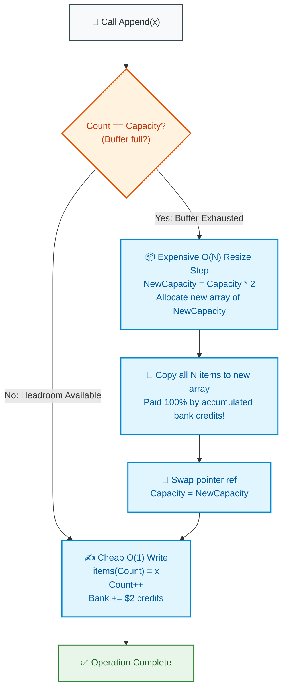

# 📘 WEEK 13 DAY 4: AMORTIZED ANALYSIS — THE SENIOR INTERVIEW PLAYBOOK

> 🧭 **Navigation:** [← Previous Day](Week_13_Day_03_Branch_And_Bound_Instructional.md) • [🏠 Week Overview](README.md) • [📘 Curriculum Syllabus](../COMPLETE_SYLLABUS.md) • [Next Day: Mixed Paradigm Problems →](Week_13_Day_05_Mixed_Paradigm_Problems_Instructional.md)
> 
> 💡 **Instructor Note:** *Amortized analysis is one of the top differentiators between Junior and Staff engineers in systems architecture interviews. Staff engineers understand that an operation whose worst-case single execution is O(N) can still be guaranteed O(1) amortized across any arbitrary sequence of operations—even when manipulated by an omniscient adversary.*

---

## 🎯 LEARNING OBJECTIVES

*By the end of this module, you will be able to:*

- 🎬 **Deconstruct** the Gym Membership / Moving Van metaphor to explain amortized cost to non-technical stakeholders and interviewers alike.
- 🧠 **Master** the 3 classical analytical frameworks: The Aggregate Method, The Accounting (Banker's) Method, and The Potential Method.
- 📦 **Prove** why geometric doubling (`* 2` or `* 1.5`) guarantees `O(1)` amortized append, while arithmetic step growth (`+ 1000`) degrades to a catastrophic `O(N)` quadratic disaster.
- 🔗 **Implement** and analyze Disjoint Set Union (Union-Find) with path compression and rank, deconstructing the inverse Ackermann function `O(alpha(N))`.
- 🛑 **Avoid** the 4 fatal rookie traps: conflating amortized with average-case, arithmetic buffer resizing, ignoring tail latency spikes in low-latency SLAs, and uncompressed DSU linear chains.
- 🎙️ **Deliver** the exact 3-sentence verbal talk track to prove amortized complexity under 45-minute live interview pressure.
- ⚡ **Ship** production-grade C# (.NET 8/9) and Python (3.11+) implementations with zero unnecessary memory churn.

---

## 🎬 PILLAR 1: THE 60-SECOND HOOK & EVERYDAY ANALOGIES

### Analogy 1: The Gym Membership vs. The Cash Register

Imagine two different payment models for working out at a high-end fitness center:

- **Model A (Pay-Per-Visit):** You hand the receptionist **$10 in cash** every single morning you walk through the door. Every visit costs exactly $10.
- **Model B (Annual Membership):** On January 1st, you pay a terrifying lump sum of **$365 upfront**. For the remaining 364 days of the year, you swipe your badge and walk in for **$0**.

If an auditor inspects only January 1st, they scream: *"A single gym visit cost $365! That's absurdly expensive!"*

A senior software engineer smiles and says: *"Look at the entire year. Across 365 days, total expenditure is $365. The **amortized cost per visit** is strictly **$1 per day**."*

```
+---------------------------------------------------------------------------------------+
|                                 AMORTIZED INVARIANT                                   |
+---------------------------------------------------------------------------------------+
|  "An amortized bound guarantees the AVERAGE COST PER OPERATION over a WORST-CASE      |
|   SEQUENCE of N operations. Occasional expensive operations are prepaid by the        |
|   accumulated surplus of cheap operations that precede them."                        |
+---------------------------------------------------------------------------------------+
```

---

### Analogy 2: The Moving Van & Apartment Leases (Dynamic Arrays)

When you move to a new city, you rent a small studio apartment with space for **1 suitcase**.

When you buy a second suitcase, what do you do?
- **The Rookie Architect (Arithmetic Expansion `+1`):** You hire a moving company, pack up all your furniture, terminate your lease, and rent an apartment with space for **2 suitcases**. When you buy suitcase #3, you hire movers again and rent an apartment for **3 suitcases**!
  - Moving 100 suitcases requires moving your entire household **100 consecutive times**!
  - Total moves = `1 + 2 + 3 + ... + 100 = 5,050 moves`! **Quadratic `O(N^2)` bankruptcy!**
- **The Senior Architect (Geometric Doubling `* 2`):** When your 1-suitcase studio is full, you move into a **2-suitcase** apartment. When that fills, you move to a **4-suitcase** flat, then an **8-suitcase** loft, then a **16-suitcase** house!
  - You only move when capacity doubles.
  - Across 100 suitcases, you move only **7 times**!
  - The total items copied across all 7 moves is strictly less than **`2 * N`**. Each suitcase pays an amortized cost of **`O(1)`**!

---

### Amortized vs. Average-Case: The Vital Staff Distinction

In FAANG interviews, candidates fail when they conflate **Amortized** with **Average-Case**:

```
========================================================================================
                          AMORTIZED vs. AVERAGE-CASE ANALYSIS
========================================================================================

1. AVERAGE-CASE COMPLEXITY (e.g., QuickSort O(N log N)):
   - Relies on PROBABILISTIC ASSUMPTIONS about input data distribution (e.g. uniform random).
   - An omniscient adversary can craft a malicious input (e.g. already sorted array)
     that forces EVERY operation to hit the catastrophic worst-case (O(N^2))!

2. AMORTIZED COMPLEXITY (e.g., List.Add O(1), Union-Find O(alpha(N))):
   - Makes ZERO PROBABILISTIC ASSUMPTIONS.
   - Holds true for ANY arbitrary sequence of operations, even if chosen by an ADVERSARY!
   - Because the expensive operation PHYSICALLY REQUIRES a long sequence of cheap operations
     to set up, an adversary CANNOT force consecutive expensive operations!
========================================================================================
```

---

## 🪜 PILLAR 2: THE SCAFFOLDING LADDER & TOY NAPKIN TRACES

### The 3 Classical Analysis Frameworks

```
                      Sequence of N Operations
                 ┌────────────────────────────────┐
                 │ op 1 │ op 2 │ ... │ op k (EXP) │
                 └────────────────────────────────┘
                                  │
         ┌────────────────────────┼────────────────────────┐
         ▼                        ▼                        ▼
  1. Aggregate Method      2. Accounting Method     3. Potential Method
  Sum total cost T(N)      Charge credit c'_i       Define energy Phi(D_i)
  Amortized = T(N) / N     Save surplus in bank     c'_i = c_i + Delta(Phi)
```

---

### Framework 1: The Aggregate Method

Compute the total actual cost `T(N)` across any arbitrary sequence of `N` operations. Divide by `N`:

$$\text{Amortized Cost} = \frac{T(N)}{N}$$

#### Example: Dynamic Array Append Doubling (Capacity 1 -> 2 -> 4 -> 8 -> 16 ...)
Appending `N = 16` elements starting from an empty array of capacity 1:
- Normal appends (no copy): 16 writes = 16.
- Resizing copies at count 1, 2, 4, 8:
  - Copy at 1: 1 element copied
  - Copy at 2: 2 elements copied
  - Copy at 4: 4 elements copied
  - Copy at 8: 8 elements copied
- Total Copies: `1 + 2 + 4 + 8 = 15` copies!

Total actual operations: `16 + 15 = 31` operations!

$$\text{Amortized Cost} = \frac{31}{16} \approx 1.94 \text{ ops/append} \implies O(1)$$

In general, for any `N`:
$$\text{Total Copies} = \sum_{k=0}^{\lfloor \log_2 N \rfloor} 2^k = 2^{\lfloor \log_2 N \rfloor + 1} - 1 < 2N$$

$$\text{Total Work } T(N) = N + \text{Total Copies} < N + 2N = 3N$$

$$\text{Amortized Cost } \frac{T(N)}{N} < \frac{3N}{N} = 3 = O(1)$$

---

### Framework 2: The Accounting (Banker's) Method

Instead of looking at the entire sequence at the end, we act as a banker:
- We charge each append an **artificial fee** of **$3 credits**.
- The actual insertion into an empty slot costs **$1 credit**.
- The remaining **$2 credits** are deposited into a savings account:
  - **$1 credit** is stored on the newly inserted element itself to pay for copying it during the next resize.
  - **$1 credit** is stored on an older element that has already moved and has no remaining credit.

#### Step-by-Step Bank Balance Trace:

```
Initial: Capacity = 4, Elements = [ A, B, C, D ] (Bank has 4 credits saved)

Index:        [ 0 ]      [ 1 ]      [ 2 ]      [ 3 ]
Element:        A          B          C          D
Credit:       ($1)       ($1)       ($1)       ($1)   ==> Total Bank = $4 credits

----------------------------------------------------------------------------------------
Operation: Append(E) triggers RESIZE to Capacity = 8:
Actual Cost: 4 (copy A, B, C, D) + 1 (write E) = 5 operations.
Who pays for this?
- The 4 copies are PAID ENTIRELY by the $4 credits stored in the bank!
- The 1 write is paid by the $1 base charge of Append(E).
- Bank balance drops to $0.
- Append(E) deposits its $2 bonus credit!

Resulting Array (Capacity = 8, Count = 5):
Index:     [ 0 ]   [ 1 ]   [ 2 ]   [ 3 ]   [ 4 ]   [ 5 ]   [ 6 ]   [ 7 ]
Element:     A       B       C       D       E       .       .       .
Credit:    ($0)    ($0)    ($0)    ($0)    ($2)      -       -       -

As elements F, G, and H arrive, each deposits $2 into the bank.
When H arrives, the bank holds $2 * 4 = $8 credits, perfectly ready to pay for
the next resize to capacity 16!
```

Because the bank balance **NEVER DROPS BELOW ZERO**, the amortized charge of $3 credits is a provably strict upper bound on actual runtime!

---

### Framework 3: The Potential Method (Physics Energy Analogy)

Instead of individual coin accounts, we define a **potential function $\Phi(D)$** that measures the "stored energy" or "tension" of the data structure state $D$:

$$\text{Amortized Cost } c'_i = c_i + \Phi(D_i) - \Phi(D_{i-1})$$

For dynamic arrays:
$$\Phi(D) = 2 \cdot \text{Count} - \text{Capacity}$$

Let's check the potential values:
- Just after resize from $C$ to $2C$: $\text{Count} = C + 1$, $\text{Capacity} = 2C$.
  $$\Phi = 2(C + 1) - 2C = 2 \quad (\text{Minimum tension})$$
- Just before resize: $\text{Count} = 2C$, $\text{Capacity} = 2C$.
  $$\Phi = 2(2C) - 2C = 2C \quad (\text{Maximum tension, ready to burst!})$$
- When resize happens: the accumulated potential $2C$ is **released** to pay for the $2C$ actual copy operations!

Summing across $N$ operations causes telescoping cancellation:

$$\sum_{i=1}^N c'_i = \sum_{i=1}^N c_i + \Phi(D_N) - \Phi(D_0)$$

Because $\Phi(D_N) \ge \Phi(D_0) = 0$, the total amortized cost is an absolute mathematical upper bound!

---

### 🧠 Pause & Predict Micro-Drill
**Question:** Suppose our dynamic array expands by **`+ 1,000`** elements (arithmetic growth) instead of doubling (`* 2`). What is the amortized cost per append across 1,000,000 appends?
*Take 5 seconds to think.*
-
-
-
**Answer:** **`O(N)` (Catastrophic Quadratic)**! Resizing occurs every 1,000 appends. Total copies = $1,000 + 2,000 + 3,000 + \dots + 1,000,000 \approx \frac{1}{2} \cdot \frac{10^6}{10^3} \cdot 10^6 \approx 5 \cdot 10^8$ copies! Dividing by $10^6$ operations yields an amortized cost of **500 operations per append**.

---

## 🎨 PILLAR 3: PRAGMATIC VISUAL MODELS

### Dynamic Array Append & Resizing Lifecycle



---

## 🛑 PILLAR 4: THE ROOKIE TRAP ZONE

```
=============================================================================================
                                   THE ROOKIE TRAP ZONE
=============================================================================================

❌ ROOKIE TRAP 1: Confusing Amortized O(1) with Worst-Case O(1) in Low-Latency Systems
---------------------------------------------------------------------------------------------
Problem: Using `List<T>.Add()` in high-frequency trading (HFT), autonomous vehicle braking,
or audio streaming engines without pre-allocation.
Why it Fails: While amortized time is O(1), that single 99.9th percentile resize operation
on a 1GB array will allocate a 2GB block and copy 1GB of memory. This causes a 25ms GC freeze,
dropping audio frames or missing trading orders!
Senior Architect Fix: In latency-critical systems, always call `EnsureCapacity(N)` or `reserve()`
upfront, or use non-contiguous chunked ring buffers (e.g. `System.IO.Pipelines`).

❌ ROOKIE TRAP 2: Arithmetic Step Resizing (`Capacity += 1024`)
---------------------------------------------------------------------------------------------
Problem: Attempting to save RAM by expanding buffer capacity by a constant step `+K` rather
than a geometric multiplier `* 2` or `* 1.5`.
Why it Fails: Arithmetic step resizing turns an O(N) linear append pipeline into an O(N^2)
quadratic disaster.
Senior Architect Fix: Always use geometric expansion: `* 2` (C# .NET `List<T>`, Java `ArrayList`)
or `* 1.125 - 1.25` (Python `list` to balance memory footprint vs copy frequency).

❌ ROOKIE TRAP 3: Conflating Amortized with Average-Case
---------------------------------------------------------------------------------------------
Problem: Telling an interviewer: "Amortized means that on average, if the inputs are random,
it runs in O(1)."
Why it Fails: That is the definition of Average-Case! Amortized analysis guarantees O(1)
over ANY sequence of operations, even if chosen adversarially, with ZERO randomness.
Senior Architect Fix: State clearly: "Amortized analysis guarantees average cost over a sequence
in the worst case, without any probabilistic assumptions."

❌ ROOKIE TRAP 4: Uncompressed Disjoint Set Union Degradation
---------------------------------------------------------------------------------------------
Problem: Implementing Disjoint Set Union (Union-Find) with Union-by-Rank but forgetting
Path Compression in `Find()`.
Why it Fails: Without path compression, trees can have logarithmic height `O(log N)`,
and without rank, degenerate into linear chains `O(N)`.
Senior Architect Fix: Always implement both Path Compression (`parent[x] = Find(parent[x])`)
and Union by Rank, achieving the celebrated `O(alpha(N))` inverse Ackermann bound.
=============================================================================================
```

---

## 🎙️ PILLAR 5: 45-MINUTE INTERVIEW TALK TRACK

When explaining amortized analysis in a FAANG interview, use this structured response:

```
[00:00 - 05:00] Defining the Amortized Guarantee
"When analyzing operations like dynamic array appends or disjoint-set unions, looking at a
 single operation in isolation gives a distorted picture.
 While an append that triggers a resize costs O(N) due to memory copying, this expensive copy
 physically requires N cheap O(1) appends to trigger.
 Amortized analysis proves that across any sequence of N operations, the average cost per
 operation is strictly bounded by O(1)."

[05:00 - 10:00] Explaining via Banker's Accounting Method
"To prove this rigorously without complex calculus, I use the Banker's Method.
 We assign an amortized charge of 3 credits to every append operation:
 - 1 credit pays for the immediate array write.
 - 1 credit is saved to pay for copying this element during the next resize.
 - 1 credit is saved to pay for copying an older element whose credit was already spent.
 Because the capacity doubles geometrically, the accumulated bank credit is guaranteed to
 cover the entire O(N) copy cost when a resize occurs, with zero debt."

[10:00 - 15:00] Contrasting with Average-Case Complexity
"It is vital to distinguish amortized analysis from average-case analysis:
 Average-case assumes inputs follow a probabilistic distribution (like uniform random keys).
 Amortized analysis makes zero probabilistic assumptions—even an adversarial sequence of inputs
 cannot force the data structure to exceed its amortized bound."

[15:00 - 30:00] Production Trade-offs (Tail Latency & Pre-allocation)
"In production environments with strict SLA limits (like game loops or trading engines),
 amortized O(1) can hide severe tail-latency spikes (P99/P99.9). A single 10ms copy pause can
 violate deadlines.
 To solve this in C#, we pre-allocate memory using new List<T>(capacity) or EnsureCapacity(),
 completely eliminating all resize events."
```

---

## ⚡ PILLAR 6: PRODUCTION DUAL-LANGUAGE IMPLEMENTATIONS

### Production C# (.NET 8/9 — Resizing Simulation & Production DSU)

```csharp
namespace DsaMastery.Amortized;

using System;

/// <summary>
/// Simulates and empirically proves the O(1) amortized cost of geometric doubling vs arithmetic growth.
/// </summary>
public static class AmortizedArraySimulator
{
    public static (long totalWork, double amortizedCost) SimulateGeometricDoubling(int operations)
    {
        if (operations <= 0) return (0, 0);

        int capacity = 1;
        int count = 0;
        long totalActualWork = 0;

        for (int i = 0; i < operations; i++)
        {
            int workThisOp = 1; // 1 write operation

            if (count == capacity)
            {
                // Resize: copy count items
                workThisOp += count;
                capacity *= 2; // Geometric doubling (* 2)
            }

            count++;
            totalActualWork += workThisOp;
        }

        double amortizedCost = (double)totalActualWork / operations;
        return (totalActualWork, amortizedCost);
    }
}

/// <summary>
/// Production-grade Disjoint Set Union (Union-Find) with Path Compression and Union by Rank.
/// Time Complexity: O(alpha(N)) amortized per Find / Union operation (practically <= 4).
/// Auxiliary Space: O(N)
/// </summary>
public sealed class DisjointSetUnion
{
    private readonly int[] _parent;
    private readonly int[] _rank;

    public int DisjointComponentCount { get; private set; }

    public DisjointSetUnion(int n)
    {
        if (n <= 0) throw new ArgumentOutOfRangeException(nameof(n), "Node count must be positive.");

        _parent = new int[n];
        _rank = new int[n];
        DisjointComponentCount = n;

        for (int i = 0; i < n; i++)
        {
            _parent[i] = i; // Every node is initially its own root
        }
    }

    /// <summary>
    /// Finds the representative root of element x with two-pass Path Compression.
    /// Amortized Time Complexity: O(alpha(N))
    /// </summary>
    public int Find(int x)
    {
        if ((uint)x >= (uint)_parent.Length)
        {
            throw new ArgumentOutOfRangeException(nameof(x), "Index out of range.");
        }

        if (_parent[x] != x)
        {
            // Path Compression: point directly to root, flattening the tree!
            _parent[x] = Find(_parent[x]);
        }

        return _parent[x];
    }

    /// <summary>
    /// Unites the sets containing x and y using Union by Rank.
    /// Returns true if x and y were in different sets, false if already connected.
    /// Amortized Time Complexity: O(alpha(N))
    /// </summary>
    public bool Union(int x, int y)
    {
        int rootX = Find(x);
        int rootY = Find(y);

        if (rootX == rootY)
        {
            return false; // Cycle detected: already in the same component
        }

        // Union by Rank: attach shallower tree under deeper tree
        if (_rank[rootX] < _rank[rootY])
        {
            _parent[rootX] = rootY;
        }
        else if (_rank[rootX] > _rank[rootY])
        {
            _parent[rootY] = rootX;
        }
        else
        {
            _parent[rootY] = rootX;
            _rank[rootX]++;
        }

        DisjointComponentCount--;
        return true;
    }
}
```

---

### Production Python (3.11+ — Simulator & Idiomatic DSU)

```python
from __future__ import annotations
from typing import Tuple


class AmortizedArraySimulator:
    @staticmethod
    def simulate_geometric_doubling(operations: int) -> Tuple[int, float]:
        """
        Simulates geometric doubling and calculates total work and amortized cost.
        """
        if operations <= 0:
            return 0, 0.0

        capacity = 1
        count = 0
        total_work = 0

        for _ in range(operations):
            work = 1  # 1 append write

            if count == capacity:
                work += count  # Copy all existing items
                capacity *= 2  # Geometric doubling

            count += 1
            total_work += work

        amortized_cost = total_work / operations
        return total_work, amortized_cost


class DisjointSetUnion:
    """
    Production-grade Disjoint Set Union with Path Compression and Union by Rank.
    Amortized Time Complexity: O(alpha(N)) per operation.
    Space Complexity: O(N)
    """
    def __init__(self, n: int) -> None:
        if n <= 0:
            raise ValueError("Component count must be positive.")
        self.parent = list(range(n))
        self.rank = [0] * n
        self.component_count = n

    def find(self, x: int) -> int:
        """Finds representative root with recursive path compression."""
        if self.parent[x] != x:
            self.parent[x] = self.find(self.parent[x])  # Flatten tree
        return self.parent[x]

    def union(self, x: int, y: int) -> bool:
        """Unites two elements by rank. Returns True if united, False if already connected."""
        root_x = self.find(x)
        root_y = self.find(y)

        if root_x == root_y:
            return False

        # Attach smaller rank tree under larger rank tree
        if self.rank[root_x] < self.rank[root_y]:
            self.parent[root_x] = root_y
        elif self.rank[root_x] > self.rank[root_y]:
            self.parent[root_y] = root_x
        else:
            self.parent[root_y] = root_x
            self.rank[root_x] += 1

        self.component_count -= 1
        return True
```

---

## 🔬 PERFORMANCE & COMPLEXITY DECONSTRUCTION

| Data Structure / Operation | Worst-Case Single Op | Amortized Cost Over Sequence | Analytical Proof Method |
| :--- | :--- | :--- | :--- |
| **Dynamic Array Geometric Doubling** | `O(N)` (on resize) | `O(1)` | Banker's Method (3 credits deposit) |
| **Arithmetic Step Growth (`+K`)** | `O(N)` | `O(N)` (Quadratic Disaster!) | Aggregate Method (`T(N) = O(N^2)`) |
| **Binary Counter Increment** | `O(K)` (`K` = bit width) | `O(1)` | Aggregate Method (`Total flips < 2N`) |
| **Multi-Pop Stack (`Pop(k)`)** | `O(N)` | `O(1)` | Potential Method (`Phi = Count`) |
| **Union-Find with Compression & Rank** | `O(log N)` | `O(alpha(N)) ≈ O(1)` | Ackermann Potential Function |

---

## ⚔️ PRACTICE DRILLS & MASTERY PROBLEMS

| # | Problem | Source | Difficulty | Target Paradigm |
| :--- | :--- | :--- | :--- | :--- |
| 1 | Number of Operations to Make Network Connected | LeetCode 1319 | Medium | DSU with component counting |
| 2 | Redundant Connection | LeetCode 684 | Medium | DSU cycle detection in undirected graph |
| 3 | Accounts Merge | LeetCode 721 | Medium | DSU string-to-index component grouping |
| 4 | Evaluate Division | LeetCode 399 | Medium | Weighted DSU with floating-point ratios |

---

> 🧭 **Navigation:** [← Previous Day](Week_13_Day_03_Branch_And_Bound_Instructional.md) • [🏠 Week Overview](README.md) • [📘 Curriculum Syllabus](../COMPLETE_SYLLABUS.md) • [Next Day: Mixed Paradigm Problems →](Week_13_Day_05_Mixed_Paradigm_Problems_Instructional.md)
