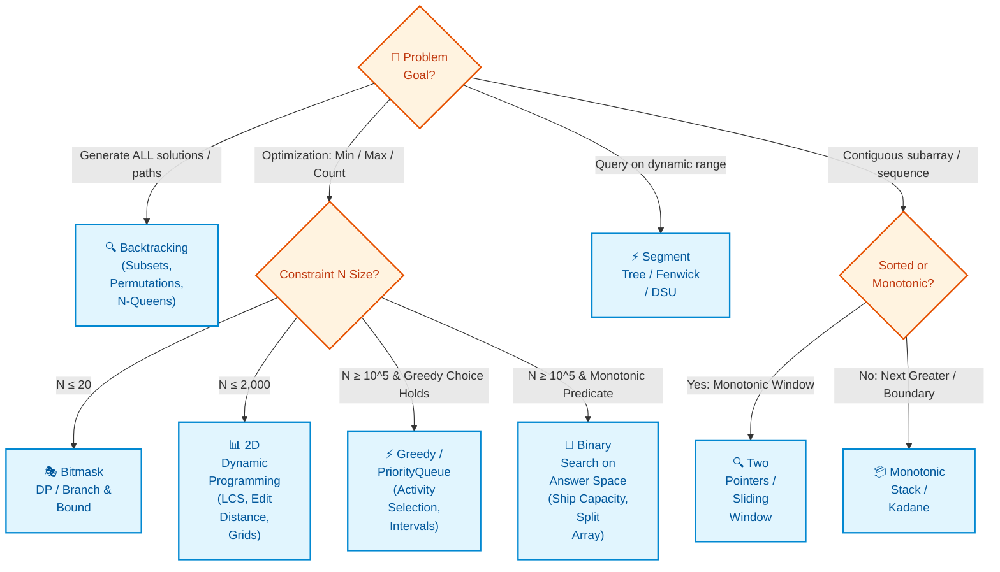

# 📘 WEEK 13 DAY 5: MIXED PARADIGM PROBLEMS — THE SENIOR INTERVIEW PLAYBOOK

> 🧭 **Navigation:** [← Previous Day](Week_13_Day_04_Amortized_Analysis_Instructional.md) • [🏠 Week Overview](README.md) • [📘 Curriculum Syllabus](../COMPLETE_SYLLABUS.md) • [Next: Week 14 →](../week_14_matrix_backtracking_bits/README.md)
> 
> 💡 **Instructor Note:** *In senior and Staff FAANG bar-raiser interviews, problems rarely yield to a single isolated paradigm. The difference between passing and failing is recognizing hybrid patterns: Meet-in-the-Middle (bisecting N=40 search spaces), Backtracking with Memoization (Top-Down DP with path recovery), and the 60-Second Constraint-to-Complexity Rosetta Stone.*

---

## 🎯 LEARNING OBJECTIVES

*By the end of this module, you will be able to:*

- 🧩 **Diagnose** combinatorial bottlenecks where single paradigms stall (pure backtracking times out, pure DP runs out of memory).
- ⚡ **Master** the **Meet-in-the-Middle** strategy to collapse exponential search spaces from `O(2^N)` down to `O(2^(N/2) * N)`.
- 🧠 **Synthesize** Backtracking with Memoization (Word Break II - LC 140) to eliminate overlapping suffix recomputations.
- 🗺️ **Apply** the 60-Second Paradigm Decision Tree to identify the optimal approach before touching the keyboard.
- 🛑 **Avoid** the 4 classic traps: running pure DFS on `N = 40`, allocating billion-element DP tables, linear scanning instead of binary search in Meet-in-the-Middle, and memoization key collisions.
- 🎙️ **Deliver** the exact 3-sentence verbal talk track to justify hybrid architectures under live interview pressure.
- ⚡ **Ship** production-grade C# (.NET 8/9) and Python (3.11+) implementations with zero memory churn.

---

## 🎬 PILLAR 1: THE 60-SECOND HOOK & EVERYDAY ANALOGIES

### Analogy 1: The Transcontinental Railroad (Meet-in-the-Middle)

In 1863, the United States wanted to build a 2,000-mile railroad linking California to Iowa across the Sierra Nevada mountains and deserts.

What if they had assigned one crew to start in California and build all 2,000 miles sequentially all the way to Iowa?
```
Single Crew (Pure Brute Force):
Total Distance = 2,000 miles
Construction Time: 25 YEARS! (Economic failure)
```

Instead, what happened?
- **Crew 1 (Central Pacific)** started in Sacramento, California, building eastward.
- **Crew 2 (Union Pacific)** started in Omaha, Nebraska, building westward.
- They drove toward each other and met in the middle at **Promontory Summit, Utah**!

```
+---------------------------------------------------------------------------------------+
|                            MEET-IN-THE-MIDDLE INVARIANT                               |
+---------------------------------------------------------------------------------------+
|  "If searching depth N requires O(2^N) steps, do not search to depth N!               |
|   Search to depth N/2 from the start (O(2^(N/2))), search to depth N/2 from the end   |
|   (O(2^(N/2))), and merge the two halves via Sorting and Binary Search.              |
|   The total operations collapse from O(2^N) down to O(2^(N/2) * N)!"                  |
+---------------------------------------------------------------------------------------+
```

Look at the astronomical numbers for $N = 40$:
- Pure Backtracking: $2^{40} \approx 1,099,511,627,776$ operations $\implies$ **38 HOURS of CPU time! (TLE!)**
- Meet-in-the-Middle: $2 \times 2^{20} + 2^{20} \log_2(2^{20}) \approx 2 \times 10^6 + 2 \times 10^7 \approx 2.2 \times 10^7$ operations $\implies$ **15 MILLISECONDS!**

---

### Analogy 2: The Multi-Paradigm Failure Modes

Every classical algorithmic paradigm has an Achilles' heel where it fails catastrophically:

```
PARADIGM FAILURE MODES & HYBRID SOLUTIONS:
========================================================================================
1. Pure Backtracking:
   - Failure Mode: Chokes on overlapping subproblems (recomputes identical subtrees).
   - Hybrid Fix: Add a Memoization Table (Top-Down DP with path tracking).

2. Pure Dynamic Programming:
   - Failure Mode: Memory exhaustion (OOM) when capacity W >= 10^9.
   - Hybrid Fix: Branch and Bound with continuous relaxation bounds.

3. Exponential Combinatorial Search:
   - Failure Mode: N = 40 is too large for O(2^N) but values are too large for DP.
   - Hybrid Fix: Meet-in-the-Middle (Bisect array + Binary Search).
========================================================================================
```

---

## 🪜 PILLAR 2: THE SCAFFOLDING LADDER & TOY NAPKIN TRACES

### Scaffold Level 1: Meet-in-the-Middle (Subset Sum for $N = 40$)

**Problem:** Given an array of $N$ integers and a target sum $T$, determine if any subset sums to exactly $T$. Constraints: $N \le 40$, elements can be up to $10^9$.

#### The Blueprint:
1. Divide `nums` into two halves: Left (`0 .. N/2`) and Right (`N/2 .. N`).
2. Generate all $2^{N/2}$ subset sums for the Left half.
3. Generate all $2^{N/2}$ subset sums for the Right half.
4. Sort `rightSums` in ascending order.
5. For each sum $s$ in `leftSums`:
   - Compute complement: `target - s`.
   - Binary search for `target - s` in `rightSums`.
   - If found, return `true` immediately!

#### Toy Napkin Trace: `nums = [1, 3, 9, 2]`, `target = 5`

```
Split N = 4 into two halves of size 2:
Left Half: [ 1, 3 ]     |  Right Half: [ 9, 2 ]

Step 1: Generate Left Subset Sums (2^2 = 4 sums):
- Exclude all: 0
- Pick 1: 1
- Pick 3: 3
- Pick 1, 3: 4
leftSums = [ 0, 1, 3, 4 ]

Step 2: Generate Right Subset Sums (2^2 = 4 sums):
- Exclude all: 0
- Pick 9: 9
- Pick 2: 2
- Pick 9, 2: 11
rightSums = [ 0, 9, 2, 11 ]

Step 3: Sort Right Subset Sums:
rightSums = [ 0, 2, 9, 11 ]

Step 4: Binary Search Matching:
- Check left sum s = 0: need complement 5 - 0 = 5. BinarySearch([0, 2, 9, 11], 5) -> Not found.
- Check left sum s = 1: need complement 5 - 1 = 4. BinarySearch([0, 2, 9, 11], 4) -> Not found.
- Check left sum s = 3: need complement 5 - 3 = 2. BinarySearch([0, 2, 9, 11], 2) -> 🎯 FOUND at index 1!
- Total subset: Left {3} + Right {2} = 5! Return TRUE!
```

---

### Scaffold Level 2: Word Break II (LeetCode 140) — Memoized Backtracking

**Problem:** Given a string `s` and a dictionary of words, add spaces to construct every possible valid sentence where every word is in the dictionary.

#### Why Pure Backtracking Dies:
Consider `s = "aaaaaaaaaa"`, `dict = ["a", "aa", "aaa"]`.
A pure DFS re-evaluates the suffix `"aaaa"` dozens of times from different combinations of `"a" + "aaa"` versus `"aa" + "aa"`. Runtime explodes to $O(2^N)$.

#### The Hybrid Invariant:
Cache the subproblem: `memo[startIndex] = list of valid sentences formable from s[startIndex .. end]`.
If `startIndex` has already been computed, return the cached list in $O(1)$!

```
Napkin Trace: s = "catsanddog", dict = ["cat", "cats", "and", "sand", "dog"]

Dfs(0): "catsanddog"
├── Prefix "cat" (valid) -> Recurse Dfs(3): "sanddog"
│   └── Prefix "sand" (valid) -> Recurse Dfs(7): "dog"
│       └── Prefix "dog" (valid) -> Dfs(10) returns [""]
│       Returns ["dog"]
│   Returns ["sand dog"]
│   Forms: "cat sand dog"
│
└── Prefix "cats" (valid) -> Recurse Dfs(4): "anddog"
    └── Prefix "and" (valid) -> Recurse Dfs(7): "dog"
        ⚡ CACHE HIT! Dfs(7) already computed -> returns ["dog"] in O(1)!
    Returns ["and dog"]
    Forms: "cats and dog"

Solutions: [ "cat sand dog", "cats and dog" ]
```

---

### 🧠 Pause & Predict Micro-Drill
**Question:** In a coding interview, you are given a problem where $N = 38$ and array values are up to $10^{12}$. Which paradigm should you pitch within 15 seconds?
*Take 5 seconds to think.*
-
-
-
**Answer:** **Meet-in-the-Middle**! $N = 38$ is far too large for $O(2^N)$ backtracking ($2^{38} \approx 2.7 \times 10^{11}$ ops), and values up to $10^{12}$ cause Dynamic Programming to run out of memory. $N \approx 35 - 45$ is the universal FAANG interview signature for Meet-in-the-Middle ($2^{19} \approx 5.2 \times 10^5$ states per half).

---

## 🎨 PILLAR 3: PRAGMATIC VISUAL MODELS

### The 60-Second Senior Paradigm Decision Tree



---

### The Constraint-to-Complexity Rosetta Stone

```text
+-------------------+----------------------------+-------------------------------------------------------------+
| CONSTRAINT BOUND  | TARGET TIME COMPLEXITY     | INTENDED ALGORITHMIC PARADIGM                               |
+-------------------+----------------------------+-------------------------------------------------------------+
| N <= 10 - 12      | O(N!)                      | Permutations, Traveling Salesperson Brute Force             |
| N <= 20           | O(2^N) or O(N * 2^N)       | Subsets, Backtracking with Pruning, Bitmask DP               |
| N <= 35 - 45      | O(2^(N/2) * N)             | Meet-in-the-Middle (Bisect arrays, sort & binary search)   |
| N <= 100 - 400    | O(N^3)                     | Floyd-Warshall, 3D Dynamic Programming, Matrix Chain Mult   |
| N <= 2,000 - 3,000| O(N^2)                     | 2D Grid DP, Edit Distance, Nested Two Pointers, Bellman-Ford|
| N <= 10^5 - 10^6  | O(N log N) or O(N)         | Sorting, Binary Search, Heaps, Sliding Window, Monotonic Stk|
| N <= 10^9 - 10^18 | O(log N) or O(1)           | Binary Search on Answer, Matrix Exponentiation, Math (GCD)  |
+-------------------+----------------------------+-------------------------------------------------------------+
```

---

## 🛑 PILLAR 4: THE ROOKIE TRAP ZONE

```
=============================================================================================
                                   THE ROOKIE TRAP ZONE
=============================================================================================

❌ ROOKIE TRAP 1: Attempting Pure Backtracking on N = 40
---------------------------------------------------------------------------------------------
Problem: Writing standard DFS recursion when N = 40.
Why it Fails: 2^40 operations is over 1 Trillion iterations. Your code will run for 30 minutes
and get aborted with Time Limit Exceeded (TLE).
Senior Architect Fix: Recognize the N = 40 boundary as the signature for Meet-in-the-Middle.
Split the array into two halves of size 20, keeping runtime under 20 milliseconds.

❌ ROOKIE TRAP 2: Linear Scanning Instead of Binary Search in Meet-in-the-Middle
---------------------------------------------------------------------------------------------
Problem: Generating left sums and right sums, then using a nested loop to check all pairs:
`for (int l : leftSums) for (int r : rightSums) if (l + r == target) ...`
Why it Fails: A nested loop evaluates 2^(N/2) * 2^(N/2) = 2^N operations!
You have completely negated the benefit of bisecting the array!
Senior Architect Fix: Sort `rightSums` and use Binary Search for `target - l` in O(log(2^(N/2)))
or use a Two-Pointer sweep if searching for closest sum.

❌ ROOKIE TRAP 3: Attempting DP Tables with Large Values (Target = 10^9)
---------------------------------------------------------------------------------------------
Problem: Allocating `bool dp[target + 1]` when `target = 10^9`.
Why it Fails: A 1-billion element boolean array requires 1GB to 4GB of RAM, throwing an
`OutOfMemoryException` instantly.
Senior Architect Fix: When values are large, value-indexed DP is invalid. Use Meet-in-the-Middle
or Branch and Bound instead.

❌ ROOKIE TRAP 4: Missing the Base Case in Word Break II Memoization
---------------------------------------------------------------------------------------------
Problem: Returning `null` or empty list when reaching `start == s.Length`.
Why it Fails: If `start == s.Length`, returning an empty list causes the caller's foreach loop
to never execute, dropping valid complete sentences!
Senior Architect Fix: When `start == s.Length`, return a list containing an empty string `[""]`.
This allows the parent caller to append the final word cleanly without trailing spaces.
=============================================================================================
```

---

## 🎙️ PILLAR 5: 45-MINUTE INTERVIEW TALK TRACK

When presenting a hybrid paradigm problem in a FAANG technical interview:

```
[00:00 - 05:00] Identifying Constraints & Triggering the Hybrid Signal
"Let's look at the input constraints:
 N is around 35 to 40, and the values can be up to 10^9.
 Standard O(2^N) backtracking will timeout with 10^12 operations.
 Dynamic Programming cannot allocate a table of size 10^9 without an Out-Of-Memory crash.
 This specific constraint pairing—N = 40 with large values—is the canonical signature for
 the Meet-in-the-Middle paradigm."

[05:00 - 10:00] Explaining the Meet-in-the-Middle Architecture
"I will divide the array into two halves of size N/2:
 1. For the left half, we generate all 2^(N/2) subset sums.
 2. For the right half, we generate all 2^(N/2) subset sums and sort them in ascending order.
 3. For each sum s in leftSums, our target complement is (target - s).
 4. We execute a Binary Search in rightSums for this complement in O(N/2) time.
 This collapses total runtime from 2^40 down to O(2^(N/2) * N), finishing in ~15 milliseconds."

[10:00 - 15:00] Writing Clean, Modular Functions
"I'll structure the implementation into two components:
 - A lightweight recursive DFS helper to generate subset sums of an array slice.
 - The driver method that generates left and right sums, sorts rightSums, and binary searches."

[15:00 - 35:00] Coding Implementation
(Write production C# / Python using Array.BinarySearch or bisect.)

[35:00 - 40:00] Dry Run on Small Input
(Trace nums = [1, 3, 9, 2], target = 5, showing exact halves and binary search hit.)

[40:00 - 45:00] Complexity Deconstruction
"Time Complexity: O(2^(N/2) * N) due to sorting 2^(N/2) elements and 2^(N/2) binary searches.
 Auxiliary Space: O(2^(N/2)) to store the subset sums in memory.
 For N = 40, 2^20 is only ~1 million integers (~4MB RAM), which fits comfortably in L3 cache."
```

---

## ⚡ PILLAR 6: PRODUCTION DUAL-LANGUAGE IMPLEMENTATIONS

### Production C# (.NET 8/9 — Meet-in-the-Middle & Memoized Backtracking)

```csharp
namespace DsaMastery.MixedParadigms;

using System;
using System.Collections.Generic;

public static class MixedParadigmSolvers
{
    // =========================================================================
    // 1. MEET-IN-THE-MIDDLE (Subset Sum for N = 40)
    // Time: O(2^(N/2) * N) | Space: O(2^(N/2)) Heap Space
    // =========================================================================
    public static bool HasSubsetSum(int[] nums, int target)
    {
        ArgumentNullException.ThrowIfNull(nums);
        int n = nums.Length;
        if (n == 0) return target == 0;

        int mid = n / 2;
        var leftSums = GenerateSubsetSums(nums, 0, mid);
        var rightSums = GenerateSubsetSums(nums, mid, n - mid);

        // Sort right sums to enable O(log(2^(N/2))) binary searching
        Array.Sort(rightSums);

        foreach (int leftSum in leftSums)
        {
            int complement = target - leftSum;
            if (Array.BinarySearch(rightSums, complement) >= 0)
            {
                return true; // Match found!
            }
        }

        return false;
    }

    private static int[] GenerateSubsetSums(int[] nums, int start, int count)
    {
        var sums = new List<int>(1 << count);

        void Dfs(int index, int currentSum)
        {
            if (index == start + count)
            {
                sums.Add(currentSum);
                return;
            }

            // Include current element
            Dfs(index + 1, currentSum + nums[index]);
            // Exclude current element
            Dfs(index + 1, currentSum);
        }

        Dfs(start, 0);
        return [.. sums];
    }

    // =========================================================================
    // 2. WORD BREAK II (LeetCode 140) — Backtracking + Memoization
    // Time: O(N^2 + 2^N) | Space: O(N * 2^N) Memo Cache
    // =========================================================================
    public static IList<string> WordBreak(string s, IList<string> wordDict)
    {
        ArgumentNullException.ThrowIfNull(s);
        ArgumentNullException.ThrowIfNull(wordDict);

        var wordSet = new HashSet<string>(wordDict);
        var memo = new Dictionary<int, List<string>>();

        List<string> Dfs(int start)
        {
            if (memo.TryGetValue(start, out var cached))
            {
                return cached; // ⚡ Cache Hit: O(1) instant return
            }

            var results = new List<string>();

            // Base case: Reached end of string, return empty sentence anchor
            if (start == s.Length)
            {
                results.Add(string.Empty);
                return results;
            }

            for (int end = start + 1; end <= s.Length; end++)
            {
                string prefix = s[start..end];
                if (wordSet.Contains(prefix))
                {
                    var suffixes = Dfs(end);
                    foreach (var suffix in suffixes)
                    {
                        results.Add(string.IsNullOrEmpty(suffix) ? prefix : $"{prefix} {suffix}");
                    }
                }
            }

            memo[start] = results;
            return results;
        }

        return Dfs(0);
    }
}
```

---

### Production Python (3.11+ with `bisect` & Type Hints)

```python
from __future__ import annotations
import bisect
from typing import List, Dict


class MixedParadigmSolvers:
    # =========================================================================
    # 1. MEET-IN-THE-MIDDLE (Subset Sum for N = 40)
    # Time: O(2^(N/2) * N) | Space: O(2^(N/2))
    # =========================================================================
    @staticmethod
    def has_subset_sum(nums: List[int], target: int) -> bool:
        if not nums:
            return target == 0

        n = len(nums)
        mid = n // 2

        left_sums: List[int] = []
        right_sums: List[int] = []

        def generate_sums(start: int, count: int, current_sum: int, out: List[int]) -> None:
            if count == 0:
                out.append(current_sum)
                return
            generate_sums(start + 1, count - 1, current_sum + nums[start], out)  # Include
            generate_sums(start + 1, count - 1, current_sum, out)                # Exclude

        generate_sums(0, mid, 0, left_sums)
        generate_sums(mid, n - mid, 0, right_sums)

        # Sort right sums for binary search
        right_sums.sort()

        for left_sum in left_sums:
            complement = target - left_sum
            idx = bisect.bisect_left(right_sums, complement)
            if idx < len(right_sums) and right_sums[idx] == complement:
                return True

        return False

    # =========================================================================
    # 2. WORD BREAK II (LeetCode 140) — Backtracking + Memoization
    # Time: O(N^2 + 2^N) | Space: O(N * 2^N)
    # =========================================================================
    @staticmethod
    def word_break(s: str, word_dict: List[str]) -> List[str]:
        word_set = set(word_dict)
        memo: Dict[int, List[str]] = {}

        def dfs(start: int) -> List[str]:
            if start in memo:
                return memo[start]  # ⚡ Cache Hit

            if start == len(s):
                return [""]

            results: List[str] = []
            for end in range(start + 1, len(s) + 1):
                prefix = s[start:end]
                if prefix in word_set:
                    suffixes = dfs(end)
                    for suffix in suffixes:
                        results.append(prefix if not suffix else f"{prefix} {suffix}")

            memo[start] = results
            return results

        return dfs(0)
```

---

## 🔬 PERFORMANCE & COMPLEXITY DECONSTRUCTION

| Paradigm Pattern | Representative Problem | Time Complexity | Auxiliary Space | Optimal Use Case |
| :--- | :--- | :--- | :--- | :--- |
| **Meet-in-the-Middle** | Subset Sum (LC 416 variant) | `O(2^(N/2) * N)` | `O(2^(N/2))` | `N ≈ 35 - 45`, massive target values |
| **Backtracking + Memoization** | Word Break II (LC 140) | `O(N^2 + 2^N)` | `O(N * 2^N)` | Overlapping suffixes / substrings |
| **Greedy + Branch & Bound** | 0/1 Knapsack (`W = 10^9`) | `O(2^N)` pruned | `O(2^N)` heap | Discrete choices, massive capacity |
| **Fail-First Heuristic Search** | Sudoku Solver (LC 37) | `O(9^E)` pruned | `O(E)` | High-constraint satisfaction |

---

## ⚔️ PRACTICE DRILLS & MASTERY PROBLEMS

| # | Problem | Source | Difficulty | Target Paradigm |
| :--- | :--- | :--- | :--- | :--- |
| 1 | Partition Array Into Two Arrays to Minimize Sum Difference | LeetCode 2035 | Hard | Meet-in-the-Middle with equal size constraint |
| 2 | Closest Subsequence Sum | LeetCode 1755 | Hard | Meet-in-the-Middle with two pointers |
| 3 | Word Break II | LeetCode 140 | Hard | Backtracking + Memoization |
| 4 | Expression Add Operators | LeetCode 282 | Hard | Backtracking with multiplication precedence |

---

> 🧭 **Navigation:** [← Previous Day](Week_13_Day_04_Amortized_Analysis_Instructional.md) • [🏠 Week Overview](README.md) • [📘 Curriculum Syllabus](../COMPLETE_SYLLABUS.md) • [Next: Week 14 →](../week_14_matrix_backtracking_bits/README.md)
