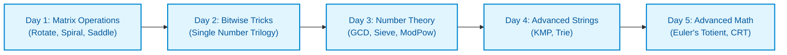

# 📘 WEEK 14: COORDINATE TRANSFORMATIONS, BIT MANIPULATION & NUMBER THEORY

> 🧭 **Navigation:** [← Previous: Week 13](../week_13_backtracking_and_branch_bound/README.md) • [🏠 Curriculum Overview](../README.md) • [📘 Complete Syllabus](../COMPLETE_SYLLABUS.md) • [Next: Week 15 →](../week_15_advanced_strings_flow/README.md)
> 
> 💡 **Instructor Note:** *Week 14 bridges high-level algorithms with physical hardware reality: how 2D matrices map to 1D cache lines, how ALU registers manipulate 64 bits in a single cycle, and how modular arithmetic prevents numerical register overflow in production.*

---

## 🎯 Weekly Mission & Conceptual Focus

Master multi-dimensional coordinate transformations, zero-allocation in-place rotations, boundary-pointer spiral scans, single-cycle bitwise ALU register tricks, Euclidean GCD/LCM, fast binary modular exponentiation, Fermat's modular inverse, KMP string search, Trie prefix trees, Euler's Totient function, and the Chinese Remainder Theorem.

---

## 📅 Day-by-Day Learning Path

| Day | Instructional Module | Focus & Core Objective |
| :--- | :--- | :--- |
| **Day 01** | [Matrix Operations & Coordinate Transformations](Week_14_Day_01_Matrix_Operations_Instructional.md) | In-place 90° rotation (Transpose + Reverse - LC 48), Spiral Matrix 4-boundary scan (LC 54), Staircase saddle-point search (LC 240), Set Matrix Zeroes in-place markers (LC 73). |
| **Day 02** | [Bitwise Operations & Register Tricks](Week_14_Day_02_Bitwise_Operations_Instructional.md) | Single-cycle ALU instructions, Single Number I, II, III (LC 136, 137, 260), Brian Kernighan popcount `n & (n - 1)`, LSB isolation `n & -n`, submask enumeration `(sub - 1) & mask`. |
| **Day 03** | [Number Theory Basics & Modular Exponentiation](Week_14_Day_03_Number_Theory_Basics_Instructional.md) | Euclidean GCD/LCM overflow prevention, Trial division up to $\sqrt{N}$, Sieve of Eratosthenes ($p^2$ start), Fast ModPow in $O(\log e)$ (LC 50), Fermat's Modular Inverse $A^{P-2} \pmod P$. |
| **Day 04** | [Advanced Strings & Pattern Matching](Week_14_Day_04_Advanced_Strings_Instructional.md) | Knuth-Morris-Pratt (KMP) linear scan with zero text rewinding (LC 28), LPS table construction, Prefix Trie (LC 208), Suffix Arrays, and Kasai's LCP algorithm. |
| **Day 05** | [Advanced Number Theory & CRT](Week_14_Day_05_Advanced_Number_Theory_Instructional.md) | Euler's Totient $\phi(N)$, Extended Euclidean Algorithm for composite modular inverses, Chinese Remainder Theorem (CRT) simultaneous solver, Russian Peasant safe multiplication. |

---

## 📚 Consolidated Playbooks & Reference Guides

*   📖 **Comprehensive Week Playbook:** [WEEK_14_FULL_PLAYBOOK.md](WEEK_14_FULL_PLAYBOOK.md) — High-density synthesis of all invariants, theorems, and pattern triggers for this week.
*   📊 **Visual Concepts Playbook (Hybrid):** [Week_14_Visual_Concepts_Playbook_HYBRID.md](Week_14_Visual_Concepts_Playbook_HYBRID.md) — Compact Mermaid diagrams, state transitions, and complexity reference tables.
*   💻 **Production C# Reference (.NET 8/9):** [Week_14_Extended_CSharp_Complete.md](Week_14_Extended_CSharp_Complete.md) — Idiomatic, zero-allocation memory-aware implementations and problem ladders.
*   🐍 **Production Python Reference (Python 3.11+):** [Week_14_Extended_Python_Complete.md](Week_14_Extended_Python_Complete.md) — Clean, pythonic reference implementations for rapid whiteboard prototyping.

---

## 🛠️ The 5 Core Support Files (`support files/`)

Every week is accompanied by five dedicated support files located in the `support files/` subdirectory:

1.  📋 [Daily Progress Checklist](support%20files/Week_14_Daily_Progress_Checklist.md) — Step-by-step accountability tracker for theory, coding, and variants.
2.  🧭 [Weekly Guidelines & Mental Models](support%20files/Week_14_Guidelines.md) — Strategic roadmap, common pitfalls, and conceptual anchors.
3.  🎙️ [Interview Q&A Comprehensive Reference](support%20files/Week_14_Interview_QA_Reference.md) — High-frequency senior technical questions with verbal response frameworks.
4.  🗺️ [Problem-Solving Roadmap](support%20files/Week_14_Problem_Solving_Roadmap.md) — Tier-1 problem progression ladder from warm-up to advanced.
5.  📑 [Summary & Key Concepts Synthesis](support%20files/Week_14_Summary_Key_Concepts.md) — Fast-revision cheat sheet covering all governing invariants and system trade-offs.

---

> 🧭 **Navigation:** [← Previous: Week 13](../week_13_backtracking_and_branch_bound/README.md) • [🏠 Curriculum Overview](../README.md) • [📘 Complete Syllabus](../COMPLETE_SYLLABUS.md) • [Next: Week 15 →](../week_15_advanced_strings_flow/README.md)
