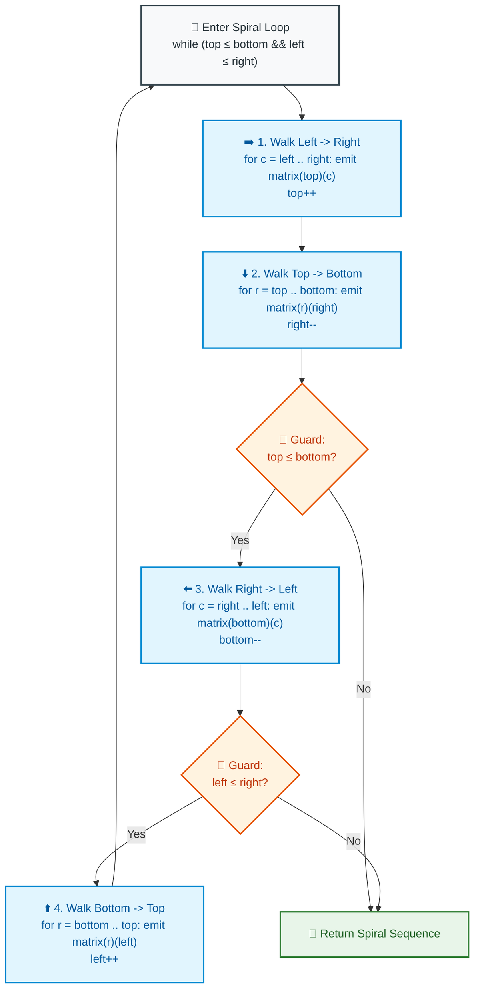

# 📘 WEEK 14 DAY 1: MATRIX OPERATIONS & COORDINATE TRANSFORMATIONS — THE SENIOR PLAYBOOK

> 🧭 **Navigation:** [← Week Overview](README.md) • [📘 Curriculum Syllabus](../COMPLETE_SYLLABUS.md) • [Next Day: Bitwise Operations →](Week_14_Day_02_Bitwise_Operations_Instructional.md)
> 
> 💡 **Instructor Note:** *Matrix problems are beloved by FAANG interviewers because they test whether you understand how multi-dimensional abstractions map to physical 1D cache lines. In this module, we master zero-allocation in-place rotations, boundary-guarded spiral walks, and staircase directional pruning.*

---

## 🎯 LEARNING OBJECTIVES

*By the end of this module, you will be able to:*

- 🎬 **Deconstruct** 2D row-major memory mapping (`Address = Base + (r * W + c) * sizeof(T)`) to explain why column traversals thrash CPU L1 cache lines.
- 🔄 **Rotate** an $N \times N$ matrix 90 degrees clockwise in-place with zero auxiliary memory using the **Transpose + Reverse Rows** decomposition.
- 🌀 **Implement** the **Concentric Boundary Spiral Scan** (LC 54) with ironclad boundary guards preventing duplicate row/column double-counting.
- 🪜 **Execute** the **Staircase Search** (LC 240) in row-and-column-sorted matrices in $O(M + N)$ time starting from the top-right saddle point.
- 💾 **Optimize** Set Matrix Zeroes (LC 73) from $O(M + N)$ auxiliary memory to strict $O(1)$ by repurposing row 0 and column 0 as in-place bit-flags.
- 🛑 **Eliminate** the 4 classic rookie blunders: double-swapping transpose cells, non-square spiral boundary overruns, premature zero-marker corruption, and cache-unfriendly column iterations.
- 🎙️ **Deliver** the exact 3-sentence verbal talk track to explain in-place coordinate reflections in a FAANG interview.
- ⚡ **Ship** production-grade C# (.NET 8/9 with zero allocation) and Python (3.11+) implementations.

---

## 🎬 PILLAR 1: THE 60-SECOND HOOK & EVERYDAY ANALOGIES

### Analogy 1: The Smartphone Photo Rotation & The 1D Memory Tape

Imagine holding your smartphone in portrait orientation. You snap a photo and click "Rotate 90° Clockwise".

In human eyes, the 2D image smoothly turns on its axis.

```
HUMAN PERSPECTIVE (2D Grid):          HARDWARE PERSPECTIVE (1D Memory Bus):
[ A | B | C ]                         [ A | B | C | D | E | F | G | H | I ]
[ D | E | F ]                         └── Row 0 ──┘└── Row 1 ──┘└── Row 2 ──┘
[ G | H | I ]                         Contiguous 64-byte CPU Cache Line!
```

In physical RAM, there is no such thing as a "2D grid"! Hardware memory is a single, flat, continuous strip of byte addresses. To find cell `(r, c)` in a matrix of width `W`:

$$\text{Address}(r, c) = \text{Base} + (r \times W + c) \times \text{ElementSize}$$

When you iterate **across a row** (`col = 0 .. W - 1`), the CPU prefetcher pulls 64 consecutive bytes into L1 cache in a single memory clock cycle. Every lookup is an instant **Cache Hit** (~1 nanosecond)!

When you iterate **down a column** (`row = 0 .. H - 1`), every step jumps `W * ElementSize` bytes across memory, causing repetitive **Cache Misses** and pipeline stalls!

---

### Analogy 2: Rotating a Rubik's Cube Face Without an Extra Table

Suppose you want to rotate a 3x3 Rubik's cube face 90 degrees clockwise:
- **The Junior Approach (Auxiliary Buffer):** Buy a second Rubik's cube, copy the stickers into their new rotated slots (`dest[c][N - 1 - r] = src[r][c]`), and throw the first cube in the trash.
  - Memory: $O(N^2)$ auxiliary allocation! For a 4K image, this allocates 33 Megabytes and triggers garbage collector pauses.
- **The Senior Architect (Geometric Decomposition):** You don't need a second cube! You decompose the 90° clockwise rotation into two simple in-place reflections:
  1. **Diagonal Reflection (Transpose):** Swap elements across the main diagonal ($M[i][j] \leftrightarrow M[j][i]$).
  2. **Horizontal Reflection (Reverse Each Row):** Reverse the elements of each row horizontally!

```text
  INPUT GRID              1. DIAGONAL TRANSPOSE        2. REVERSE EACH ROW
  [ A | B | C ]               [ A | D | G ]              [ G | D | A ]
  [ D | E | F ]     ===>      [ B | E | H ]     ===>     [ H | E | B ]
  [ G | H | I ]               [ C | F | I ]              [ I | F | C ]
                              (Swap j > i)               (Reverse Row)
                                                         ==> 90° CLOCKWISE!
```

Zero extra memory allocated! Strict $O(1)$ auxiliary space!

---

## 🪜 PILLAR 2: THE SCAFFOLDING LADDER & TOY NAPKIN TRACES

Let's master the 4 canonical matrix operations asked in FAANG interviews:

```
                  [THE 4 CANONICAL MATRIX PATTERNS]
                                  │
         ┌────────────────────────┼────────────────────────┐
         ▼                        ▼                        ▼
  [1. ROTATE IMAGE]       [2. SPIRAL MATRIX]      [3. STAIRCASE SEARCH]
  (Transpose + Reverse)   (4 Shrinking Bounds)    (Saddle Point O(M+N))
  LeetCode 48             LeetCode 54             LeetCode 240
```

---

### Scaffold Level 1: Rotate Image (LeetCode 48)

**Problem:** Given an $N \times N$ 2D matrix representing an image, rotate the image by 90 degrees (clockwise) **in-place**.

#### Mathematical Invariant:
- To rotate 90° Clockwise: **Transpose**, then **Reverse each row**.
- To rotate 90° Counter-Clockwise: **Reverse each row**, then **Transpose** (or Transpose, then Reverse each column).

#### Toy Napkin Trace: $N = 3$

```
Initial Matrix:
[ 1, 2, 3 ]
[ 4, 5, 6 ]
[ 7, 8, 9 ]

Step 1: Transpose across main diagonal (swap M[i][j] with M[j][i] ONLY when j > i):
- i = 0: swap (0, 1) and (1, 0) -> swap 2 and 4
         swap (0, 2) and (2, 0) -> swap 3 and 7
- i = 1: swap (1, 2) and (2, 1) -> swap 6 and 8
Matrix after Transpose:
[ 1, 4, 7 ]
[ 2, 5, 8 ]
[ 3, 6, 9 ]

Step 2: Reverse each row horizontally:
- Row 0: [ 1, 4, 7 ] -> [ 7, 4, 1 ]
- Row 1: [ 2, 5, 8 ] -> [ 8, 5, 2 ]
- Row 2: [ 3, 6, 9 ] -> [ 9, 6, 3 ]

Final Rotated Matrix:
[ 7, 4, 1 ]
[ 8, 5, 2 ]
[ 9, 6, 3 ]
Provably identical to 90° clockwise rotation in O(N^2) time and O(1) memory!
```

---

### Scaffold Level 2: Spiral Matrix (LeetCode 54)

**Problem:** Given an $M \times N$ matrix, return all elements of the matrix in spiral order.

#### Core Invariant: The 4 Shrinking Castle Walls
We maintain 4 boundary pointers: `top = 0`, `bottom = M - 1`, `left = 0`, `right = N - 1`.
At each iteration:
1. Walk **Left $\to$ Right** across row `top`, then increment `top++`.
2. Walk **Top $\to$ Bottom** down column `right`, then decrement `right--`.
3. Walk **Right $\to$ Left** across row `bottom` (GUARD: `if (top <= bottom)`), then decrement `bottom--`.
4. Walk **Bottom $\to$ Top** up column `left` (GUARD: `if (left <= right)`), then increment `left++`.

```
Napkin Trace: Matrix 3 x 3
[ 1, 2, 3 ]
[ 4, 5, 6 ]
[ 7, 8, 9 ]

Boundaries: top=0, bottom=2, left=0, right=2

Round 1:
1. Walk Left->Right (row top=0, col 0..2): Emit 1, 2, 3. Shrink top -> top=1.
2. Walk Top->Bottom (col right=2, row 1..2): Emit 6, 9. Shrink right -> right=1.
3. Check top <= bottom (1 <= 2: Yes):
   Walk Right->Left (row bottom=2, col 1..0): Emit 8, 7. Shrink bottom -> bottom=1.
4. Check left <= right (0 <= 1: Yes):
   Walk Bottom->Top (col left=0, row 1..1): Emit 4. Shrink left -> left=1.

Round 2: Boundaries: top=1, bottom=1, left=1, right=1
1. Walk Left->Right (row top=1, col 1..1): Emit 5. Shrink top -> top=2.
2. top (2) > bottom (1) -> Loop terminates!

Output: [ 1, 2, 3, 6, 9, 8, 7, 4, 5 ]
```

---

### Scaffold Level 3: Search a 2D Matrix II (LeetCode 240) — Staircase Pruning

**Problem:** Integers in each row are sorted in ascending from left to right. Integers in each column are sorted in ascending from top to bottom. Search for `target` in $O(M + N)$ time.

#### The Saddle-Point Intuition:
If you start at `(0, 0)`, moving right increases the value, and moving down *also* increases the value. You cannot make a binary decision!
Instead, start at the **Top-Right Corner `(0, N - 1)`**:
- Moving **Left** strictly **decreases** values.
- Moving **Down** strictly **increases** values.

```
At cell (r, c):
- If matrix[r][c] == target -> 🎯 FOUND!
- If matrix[r][c] > target  -> Target CANNOT be in column c! Move LEFT: col--.
- If matrix[r][c] < target  -> Target CANNOT be in row r! Move DOWN: row++.

At every step, you eliminate an ENTIRE row or an ENTIRE column!
Total Steps <= M + N. Time: O(M + N). Space: O(1).
```

---

### 🧠 Pause & Predict Micro-Drill
**Question:** In Spiral Matrix on a non-square matrix of size $1 \times 5$: `[[1, 2, 3, 4, 5]]`, what happens if you omit the `if (top <= bottom)` guard before the Right $\to$ Left walk?
*Take 5 seconds to think.*
-
-
-
**Answer:** Without the guard, after step 1 emits `1, 2, 3, 4, 5` and increments `top = 1` (so `top > bottom`), step 3 would walk backward across row 0 and emit `4, 3, 2, 1` again! The output would contain duplicate elements. The boundary guard is strictly required.

---

## 🎨 PILLAR 3: PRAGMATIC VISUAL MODELS

### Spiral Matrix 4-Boundary Shrinkage Pipeline



---

## 🛑 PILLAR 4: THE ROOKIE TRAP ZONE

```
=============================================================================================
                                   THE ROOKIE TRAP ZONE
=============================================================================================

❌ ROOKIE TRAP 1: The Transpose Double-Swap Reversion
---------------------------------------------------------------------------------------------
Problem: Writing the transpose loop as:
`for (int i = 0; i < n; i++) for (int j = 0; j < n; j++) Swap(matrix[i][j], matrix[j][i]);`
Why it Fails: At (i=0, j=1), you swap (0,1) with (1,0). Later, at (i=1, j=0), you swap them
back again! The matrix returns to its original un-transposed state!
Senior Architect Fix: Only iterate strictly above the diagonal: `for (int j = i + 1; j < n; j++)`.

❌ ROOKIE TRAP 2: Omitting Boundary Guards in Spiral Matrix
---------------------------------------------------------------------------------------------
Problem: Assuming that `top <= bottom && left <= right` at the top of the while-loop is sufficient
for all 4 directional walks.
Why it Fails: Steps 1 and 2 modify `top` and `right`. In single-row or single-column matrices
(e.g., 1 x 4 or 4 x 1), `top` will exceed `bottom` midway through the loop, causing steps 3
and 4 to re-traverse already emitted elements in reverse.
Senior Architect Fix: Always guard Step 3 with `if (top <= bottom)` and Step 4 with `if (left <= right)`.

❌ ROOKIE TRAP 3: Overwriting First Row/Col in Set Matrix Zeroes
---------------------------------------------------------------------------------------------
Problem: Scanning cells and writing zeros into `matrix[0][j]` and `matrix[i][0]` immediately,
without saving whether row 0 and column 0 originally contained zeros.
Why it Fails: The original zero flags get hopelessly mixed up with newly marked zeros,
causing the entire matrix to wipe to all zeros!
Senior Architect Fix: Check row 0 and col 0 first using two booleans `firstRowHasZero` and
`firstColHasZero`. Then use row 0 and col 0 to store interior markers, and update the edges last.

❌ ROOKIE TRAP 4: Allocating an Auxiliary Matrix in In-Place Constraints
---------------------------------------------------------------------------------------------
Problem: Allocating `int[][] copy = new int[n][n]` in LeetCode 48 Rotate Image.
Why it Fails: The problem explicitly states: "You have to rotate the image in-place. Do not
allocate another 2D matrix." The interviewer will fail you immediately.
Senior Architect Fix: Transpose + Reverse achieves true in-place transformation with zero bytes.
=============================================================================================
```

---

## 🎙️ PILLAR 5: 45-MINUTE INTERVIEW TALK TRACK

When solving matrix problems in a FAANG technical interview:

```
[00:00 - 05:00] Clarifying Matrix Dimensions & In-Place Constraints
"Let's clarify the problem constraints:
 1. Is the matrix guaranteed to be square (N x N) or rectangular (M x N)?
 2. Are we required to mutate the matrix in-place with O(1) auxiliary space, or can we return
    a new collection?
 3. For Rotate Image, N is square and in-place is mandatory.
 4. For Search in 2D Matrix II, both rows and columns are sorted independently."

[05:00 - 10:00] Explaining Geometric Reflection (Rotate Image)
"Instead of attempting a four-way corner index rotation which is error-prone, I will decompose
 the 90° clockwise rotation into two simple in-place transformations:
 1. Transpose: Reflect elements across the main diagonal (swap matrix[i][j] with matrix[j][i]
    for j > i).
 2. Horizontal Flip: Reverse each row horizontally using two pointers.
 This is provably equivalent to a 90° clockwise rotation and guarantees zero heap allocations."

[10:00 - 15:00] Explaining Staircase Elimination (Search 2D Matrix II)
"To search in O(M + N) rather than O(M * N) or O(M log N):
 We start at the top-right corner (0, N - 1). This is a saddle point:
 Moving left decreases values; moving down increases values.
 At each step, if the value is greater than target, the entire column can be eliminated (col--).
 If less than target, the entire row can be eliminated (row++).
 We prune one row or column per step, completing in at most M + N steps."

[15:00 - 35:00] Writing Clean, Modular Code
(Write production C# / Python using guard clauses and clean boundaries.)

[35:00 - 40:00] Dry Run on Asymmetric Input
(Trace a 2x3 matrix or 3x3 matrix showing pointer movements.)

[40:00 - 45:00] Complexity Deconstruction
"Rotate Image: O(N^2) time, O(1) space.
 Spiral Matrix: O(M * N) time, O(1) auxiliary space.
 Search 2D Matrix II: O(M + N) time, O(1) space.
 Memory is optimal and zero garbage collection pressure is produced."
```

---

## ⚡ PILLAR 6: PRODUCTION DUAL-LANGUAGE IMPLEMENTATIONS

### Production C# (.NET 8/9 — Zero Allocation & In-Place Transformations)

```csharp
namespace DsaMastery.MatrixOperations;

using System;
using System.Collections.Generic;

public static class MatrixSolvers
{
    // =========================================================================
    // 1. ROTATE IMAGE 90° CLOCKWISE (LeetCode 48)
    // Time: O(N^2) | Space: O(1) In-Place
    // =========================================================================
    public static void Rotate(int[][] matrix)
    {
        ArgumentNullException.ThrowIfNull(matrix);
        int n = matrix.Length;
        if (n <= 1) return;

        // Step 1: Transpose across main diagonal (only swap where j > i)
        for (int i = 0; i < n; i++)
        {
            for (int j = i + 1; j < n; j++)
            {
                (matrix[i][j], matrix[j][i]) = (matrix[j][i], matrix[i][j]);
            }
        }

        // Step 2: Reverse each row horizontally
        for (int i = 0; i < n; i++)
        {
            int left = 0, right = n - 1;
            while (left < right)
            {
                (matrix[i][left], matrix[i][right]) = (matrix[i][right], matrix[i][left]);
                left++;
                right--;
            }
        }
    }

    // =========================================================================
    // 2. SPIRAL MATRIX (LeetCode 54)
    // Time: O(M * N) | Space: O(1) Auxiliary Memory
    // =========================================================================
    public static IList<int> SpiralOrder(int[][] matrix)
    {
        ArgumentNullException.ThrowIfNull(matrix);
        if (matrix.Length == 0 || matrix[0].Length == 0) return [];

        int m = matrix.Length, n = matrix[0].Length;
        var result = new List<int>(m * n);

        int top = 0, bottom = m - 1;
        int left = 0, right = n - 1;

        while (top <= bottom && left <= right)
        {
            // 1. Walk Left to Right along top boundary
            for (int c = left; c <= right; c++)
            {
                result.Add(matrix[top][c]);
            }
            top++;

            // 2. Walk Top to Bottom along right boundary
            for (int r = top; r <= bottom; r++)
            {
                result.Add(matrix[r][right]);
            }
            right--;

            // 3. Walk Right to Left along bottom boundary (guarded)
            if (top <= bottom)
            {
                for (int c = right; c >= left; c--)
                {
                    result.Add(matrix[bottom][c]);
                }
                bottom--;
            }

            // 4. Walk Bottom to Top along left boundary (guarded)
            if (left <= right)
            {
                for (int r = bottom; r >= top; r--)
                {
                    result.Add(matrix[r][left]);
                }
                left++;
            }
        }

        return result;
    }

    // =========================================================================
    // 3. SEARCH A 2D MATRIX II (LeetCode 240) — Staircase Pruning
    // Time: O(M + N) | Space: O(1)
    // =========================================================================
    public static bool SearchMatrix(int[][] matrix, int target)
    {
        ArgumentNullException.ThrowIfNull(matrix);
        if (matrix.Length == 0 || matrix[0].Length == 0) return false;

        int row = 0;
        int col = matrix[0].Length - 1; // Start at top-right saddle point

        while (row < matrix.Length && col >= 0)
        {
            int current = matrix[row][col];
            if (current == target)
            {
                return true; // Target found
            }

            if (current > target)
            {
                col--; // Target cannot be in this column; move Left
            }
            else
            {
                row++; // Target cannot be in this row; move Down
            }
        }

        return false;
    }

    // =========================================================================
    // 4. SET MATRIX ZEROES (LeetCode 73) — In-Place Markers
    // Time: O(M * N) | Space: O(1) In-Place
    // =========================================================================
    public static void SetZeroes(int[][] matrix)
    {
        ArgumentNullException.ThrowIfNull(matrix);
        int m = matrix.Length, n = matrix[0].Length;
        if (m == 0 || n == 0) return;

        bool firstRowHasZero = false;
        bool firstColHasZero = false;

        // Check if first row contains zero
        for (int c = 0; c < n; c++)
        {
            if (matrix[0][c] == 0) { firstRowHasZero = true; break; }
        }

        // Check if first column contains zero
        for (int r = 0; r < m; r++)
        {
            if (matrix[r][0] == 0) { firstColHasZero = true; break; }
        }

        // Use row 0 and col 0 to store interior zero markers
        for (int r = 1; r < m; r++)
        {
            for (int c = 1; c < n; c++)
            {
                if (matrix[r][c] == 0)
                {
                    matrix[r][0] = 0;
                    matrix[0][c] = 0;
                }
            }
        }

        // Zero out interior cells based on markers
        for (int r = 1; r < m; r++)
        {
            for (int c = 1; c < n; c++)
            {
                if (matrix[r][0] == 0 || matrix[0][c] == 0)
                {
                    matrix[r][c] = 0;
                }
            }
        }

        // Zero first row if needed
        if (firstRowHasZero)
        {
            for (int c = 0; c < n; c++) matrix[0][c] = 0;
        }

        // Zero first col if needed
        if (firstColHasZero)
        {
            for (int r = 0; r < m; r++) matrix[r][0] = 0;
        }
    }
}
```

---

### Production Python (3.11+ — Clean, Idiomatic Matrix Operations)

```python
from __future__ import annotations
from typing import List


class MatrixSolvers:
    # =========================================================================
    # 1. ROTATE IMAGE 90° CLOCKWISE (LeetCode 48)
    # Time: O(N^2) | Space: O(1) In-Place
    # =========================================================================
    @staticmethod
    def rotate(matrix: List[List[int]]) -> None:
        if not matrix or len(matrix) <= 1:
            return

        n = len(matrix)

        # Step 1: Transpose across main diagonal
        for i in range(n):
            for j in range(i + 1, n):
                matrix[i][j], matrix[j][i] = matrix[j][i], matrix[i][j]

        # Step 2: Reverse each row horizontally
        for i in range(n):
            matrix[i].reverse()

    # =========================================================================
    # 2. SPIRAL MATRIX (LeetCode 54)
    # Time: O(M * N) | Space: O(1) Auxiliary
    # =========================================================================
    @staticmethod
    def spiral_order(matrix: List[List[int]]) -> List[int]:
        if not matrix or not matrix[0]:
            return []

        result: List[int] = []
        top, bottom = 0, len(matrix) - 1
        left, right = 0, len(matrix[0]) - 1

        while top <= bottom and left <= right:
            # 1. Left to Right
            for c in range(left, right + 1):
                result.append(matrix[top][c])
            top += 1

            # 2. Top to Bottom
            for r in range(top, bottom + 1):
                result.append(matrix[r][right])
            right -= 1

            # 3. Right to Left (guarded)
            if top <= bottom:
                for c in range(right, left - 1, -1):
                    result.append(matrix[bottom][c])
                bottom -= 1

            # 4. Bottom to Top (guarded)
            if left <= right:
                for r in range(bottom, top - 1, -1):
                    result.append(matrix[r][left])
                left += 1

        return result

    # =========================================================================
    # 3. SEARCH A 2D MATRIX II (LeetCode 240) — Staircase Pruning
    # Time: O(M + N) | Space: O(1)
    # =========================================================================
    @staticmethod
    def search_matrix(matrix: List[List[int]], target: int) -> bool:
        if not matrix or not matrix[0]:
            return False

        row = 0
        col = len(matrix[0]) - 1  # Top-right corner

        while row < len(matrix) and col >= 0:
            current = matrix[row][col]
            if current == target:
                return True
            if current > target:
                col -= 1  # Move Left
            else:
                row += 1  # Move Down

        return False
```

---

## 🔬 PERFORMANCE & COMPLEXITY DECONSTRUCTION

| Problem | Time Complexity | Auxiliary Space | Memory Access Pattern | Key Architectural Invariant |
| :--- | :--- | :--- | :--- | :--- |
| **Rotate Image (LC 48)** | `O(N^2)` | `O(1)` In-Place | Sequential row writes after transpose | Transpose + Horizontal Flip = 90° Clockwise |
| **Spiral Matrix (LC 54)** | `O(M * N)` | `O(1)` | Boundary sweeps | 4 shrinking walls with mid-loop guards |
| **Search 2D Matrix II (LC 240)**| `O(M + N)` | `O(1)` | Top-right saddle walk | Saddle-point binary decision (Left vs Down) |
| **Set Matrix Zeroes (LC 73)** | `O(M * N)` | `O(1)` In-Place | Two-pass boundary markers | Reuse row 0 and col 0 as scratch storage |

---

## ⚔️ PRACTICE DRILLS & MASTERY PROBLEMS

| # | Problem | Source | Difficulty | Target Invariant |
| :--- | :--- | :--- | :--- | :--- |
| 1 | Rotate Image | LeetCode 48 | Medium | Transpose + Reverse row |
| 2 | Spiral Matrix | LeetCode 54 | Medium | 4 boundary shrinking pointers |
| 3 | Spiral Matrix II | LeetCode 59 | Medium | Generate grid using boundary spiral |
| 4 | Search a 2D Matrix II | LeetCode 240 | Medium | Top-right staircase elimination |
| 5 | Set Matrix Zeroes | LeetCode 73 | Medium | First row & col in-place markers |
| 6 | Valid Sudoku | LeetCode 36 | Medium | 3 subgrid index math verification |

---

> 🧭 **Navigation:** [← Week Overview](README.md) • [📘 Curriculum Syllabus](../COMPLETE_SYLLABUS.md) • [Next Day: Bitwise Operations →](Week_14_Day_02_Bitwise_Operations_Instructional.md)
