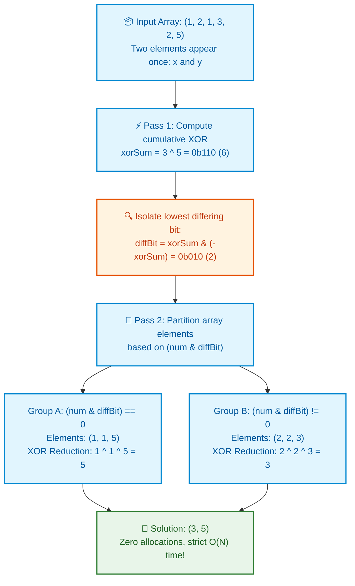

# 📘 WEEK 14 DAY 2: BITWISE OPERATIONS & REGISTER TRICKS — THE SENIOR PLAYBOOK

> 🧭 **Navigation:** [← Previous Day](Week_14_Day_01_Matrix_Operations_Instructional.md) • [🏠 Week Overview](README.md) • [📘 Curriculum Syllabus](../COMPLETE_SYLLABUS.md) • [Next Day: Number Theory Basics →](Week_14_Day_03_Number_Theory_Basics_Instructional.md)
> 
> 💡 **Instructor Note:** *Bit manipulation is the ultimate test of low-level mechanical sympathy. In senior systems interviews, interviewers use bitwise problems to verify if you understand ALU single-cycle execution, two's complement arithmetic, branchless programming, and zero-allocation state compression.*

---

## 🎯 LEARNING OBJECTIVES

*By the end of this module, you will be able to:*

- 🎬 **Deconstruct** the Skyscraper Light Switch panel metaphor to explain bitmasking versus heap-allocated sets.
- ⚡ **Master** the 5 canonical bitwise primitives: `n & (n - 1)`, `n & -n`, `(n >> i) & 1`, `n | (1 << i)`, and `n ^ (1 << i)`.
- 🧮 **Solve** the entire Single Number trilogy: Single Number I (LC 136 - XOR accumulator), Single Number II (LC 137 - Modulo-3 counter), and Single Number III (LC 260 - LSB partition).
- 🔄 **Enumerate** all $2^K$ submasks of a bitmask in strictly decreasing order in a single loop using `sub = (sub - 1) & mask`.
- 🛑 **Avoid** the 4 fatal rookie traps: signed arithmetic shift `>>` sign-extension bugs, Python infinite-width integer sign-bit flips, operator precedence traps (`1 << n - 1`), and zero-check omissions in power-of-two tests.
- 🎙️ **Deliver** the exact 3-sentence verbal script before writing bitwise code in a FAANG interview.
- ⚡ **Ship** production-grade C# (.NET 8/9 using `>>>` unsigned shifts) and Python (3.11+ with 32-bit register masking) implementations.

---

## 🎬 PILLAR 1: THE 60-SECOND HOOK & EVERYDAY ANALOGIES

### Analogy 1: The Skyscraper Light Switch Panel vs. The Excel Spreadsheet

Imagine you are the chief facilities engineer for an 80-story skyscraper in Manhattan. Every night, security needs to check which floors have lights turned on.

- **The Junior Approach (The Excel Spreadsheet / `HashSet<int>`):**
  - Security creates a `HashSet<int>` on the heap.
  - Every time a light turns on, security allocates a hash table node (24 bytes of heap memory, pointer dereferences, collision buckets).
  - To check if Floor 42 is lit, security hashes 42, traverses a linked bucket chain, and risks a CPU cache miss (~50 nanoseconds).
- **The Senior Architect (The Physical Switchboard / 64-bit Register):**
  - All 64 floors are mapped to the 64 individual bits of a single unsigned 64-bit integer (`ulong flags`):
    - Floor 0 = Bit 0 (`1 << 0`)
    - Floor 42 = Bit 42 (`1UL << 42`)
  - To check if Floor 42 is on: `(flags >> 42) & 1`.
  - To toggle Floor 42: `flags ^= (1UL << 42)`.
  - Execution time: **1 CPU clock cycle (~0.3 nanoseconds)!**
  - Memory allocated: **ZERO BYTES ON THE HEAP!**

```
+---------------------------------------------------------------------------------------+
|                               THE BITWISE ADVANTAGE                                   |
+---------------------------------------------------------------------------------------+
|  Hardware ALUs execute bitwise operations (AND, OR, XOR, SHIFT) in a SINGLE CLOCK    |
|  CYCLE. They operate directly inside CPU registers with sub-nanosecond latency,      |
|  completely bypassing memory buses, cache lines, and garbage collection pauses.       |
+---------------------------------------------------------------------------------------+
```

---

### Analogy 2: Two's Complement & The LSB Magic (`n & -n`)

In two's complement arithmetic (the standard for all modern CPUs), how does hardware represent negative numbers?

$$\mathbf{-n = \sim n + 1}$$

Watch what happens to the binary bits of $n = 12$ (`0b00001100`):
1. Invert all bits ($\sim n$): `0b11110011`
2. Add 1 ($\sim n + 1$): `0b11110100`
3. Notice that adding 1 carries all the way up to the **lowest set bit**, flipping trailing zeros back to zero and keeping the lowest set bit as `1`!
4. Perform bitwise AND between $n$ and $-n$:

```text
       n = 12 :    0 0 0 0 1 1 0 0
      -n = -12:    1 1 1 1 0 1 0 0
------------------------------------
  n & -n =  4 :    0 0 0 0 0 1 0 0  ===> ISOLATES LOWEST SET BIT INSTANTLY!
```

In a single ALU cycle, `n & -n` isolates the rightmost `1` bit and clears everything else!

---

## 🪜 PILLAR 2: THE SCAFFOLDING LADDER & TOY NAPKIN TRACES

Let's master the 5 core bitwise operations and the Single Number trilogy:

```
              [THE 5 ESSENTIAL BITWISE PRIMITIVES]
                               │
       ┌───────────────┬───────┴───────┬───────────────┐
       ▼               ▼               ▼               ▼
  [n & (n - 1)]     [n & -n]      [(n >> i) & 1]   [n | (1 << i)]
  Clear Lowest    Isolate Lowest     Test i-th        Set i-th
    Set Bit          Set Bit            Bit             Bit
```

---

### Scaffold Level 1: The Essential Primitives

```text
1. Clear the lowest set bit:
   n & (n - 1)
   Example: n = 12 (0b1100) -> n - 1 = 11 (0b1011) -> 12 & 11 = 8 (0b1000). Cleared!

2. Check if power of two:
   n > 0 && (n & (n - 1)) == 0
   A power of two has EXACTLY one set bit (e.g. 16 = 0b10000). Clearing it yields 0!

3. Brian Kernighan's Popcount (Count Set Bits):
   while (n > 0) { n &= (n - 1); count++; }
   Loop runs exactly K times (where K is the number of 1-bits), not 32 times!

4. Isolate the lowest set bit:
   n & -n
   Example: 12 & -12 = 4 (0b0100).
```

---

### Scaffold Level 2: Single Number I (LeetCode 136) — XOR Cancellation

**Problem:** Every element appears twice except for one unique element. Find that single element in $O(N)$ time and $O(1)$ memory.

#### Core Mathematical Properties of XOR ($\oplus$):
1. **Self-Inversion:** $x \oplus x = 0$ (Any number XORed with itself cancels to 0).
2. **Identity:** $x \oplus 0 = x$.
3. **Commutative & Associative:** Order does not matter!

#### Toy Napkin Trace: `nums = [4, 1, 2, 1, 2]`

```text
Cumulative XOR accumulator:
acc = 0
acc ^= 4 -> 4
acc ^= 1 -> 4 ^ 1
acc ^= 2 -> 4 ^ 1 ^ 2
acc ^= 1 -> 4 ^ (1 ^ 1) ^ 2 = 4 ^ 0 ^ 2 = 4 ^ 2
acc ^= 2 -> 4 ^ (2 ^ 2) = 4 ^ 0 = 4!

Result: 4. All duplicates annihilate each other; only the unique survivor remains!
```

---

### Scaffold Level 3: Single Number III (LeetCode 260) — Two Unique Elements

**Problem:** Every element appears twice except for **two** unique elements ($x$ and $y$). Find both in $O(N)$ time and $O(1)$ space.

#### The Intuition:
1. XOR all numbers together. The result is:
   $$\text{xorSum} = x \oplus y$$
2. Since $x \ne y$, $\text{xorSum} \ne 0$. There must be at least one bit where $x$ and $y$ differ!
3. Isolate the lowest differing bit:
   $$\text{diffBit} = \text{xorSum} \ \& \ (-\text{xorSum})$$
4. Partition the entire array into two groups:
   - Group A: Numbers where `(num & diffBit) == 0`
   - Group B: Numbers where `(num & diffBit) != 0`
5. $x$ and $y$ will fall into **different groups**! All other duplicates will fall into the same group and cancel out. XORing each group independently yields $x$ and $y$!

```
Napkin Trace: nums = [1, 2, 1, 3, 2, 5] (Unique: 3 and 5)
1. Total XOR: 1^2^1^3^2^5 = 3 ^ 5 = 0b011 ^ 0b101 = 0b110 (6)
2. diffBit = 6 & -6 = 2 (0b010) (Bit 1 differs!)
3. Partition:
   - Bit 1 is 0: [ 1, 1, 5 ] -> 1 ^ 1 ^ 5 = 5!
   - Bit 1 is 1: [ 2, 2, 3 ] -> 2 ^ 2 ^ 3 = 3!
Output: [ 3, 5 ]
```

---

### Scaffold Level 4: Submask Enumeration (`sub = (sub - 1) & mask`)

How do you iterate through all subsets of a given bitmask without testing all numbers up to $2^N$?

```csharp
// Enumerates all submasks of 'mask' in strictly decreasing order
int sub = mask;
while (sub > 0)
{
    // Process submask
    sub = (sub - 1) & mask;
}
// Process sub = 0 (empty set)
```

Why it works: Subtracting 1 flips the lowest set bit to 0 and all lower bits to 1. Bitwise ANDing with `mask` immediately eliminates all bits that weren't in `mask`, hopping directly to the next smaller valid submask in $O(1)$!

---

### 🧠 Pause & Predict Micro-Drill
**Question:** In C#, what is the difference between `int x = -16; x >> 2;` versus `(int)((uint)x >>> 2);`?
*Take 5 seconds to think.*
-
-
-
**Answer:** `>>` on signed `int` is an **Arithmetic Right Shift**: it preserves and replicates the negative sign bit (`1`), keeping the number negative! `>>>` (or cast to `uint`) is a **Logical Right Shift**: it fills vacated top bits with zeros (`0`), turning it into a positive number.

---

## 🎨 PILLAR 3: PRAGMATIC VISUAL MODELS

### Single Number III Partitioning Pipeline



---

## 🛑 PILLAR 4: THE ROOKIE TRAP ZONE

```
=============================================================================================
                                   THE ROOKIE TRAP ZONE
=============================================================================================

❌ ROOKIE TRAP 1: The Operator Precedence Trap (`1 << n - 1`)
---------------------------------------------------------------------------------------------
Problem: Writing `int mask = 1 << n - 1;` expecting `(1 << n) - 1`.
Why it Fails: In C# and Python, subtraction `-` has HIGHER operator precedence than bit shift `<<`!
`1 << n - 1` is evaluated as `1 << (n - 1)`, which creates a single bit at position (n - 1),
NOT a mask of n consecutive ones!
Senior Architect Fix: ALWAYS wrap bitwise shift operations in parentheses: `((1 << n) - 1)`.

❌ ROOKIE TRAP 2: Omitting the Zero Guard in Power-of-Two Checks
---------------------------------------------------------------------------------------------
Problem: Checking if a number is a power of two with only: `(n & (n - 1)) == 0`.
Why it Fails: If `n = 0`: `0 & -1 == 0` evaluates to TRUE! 0 is not a power of two!
Senior Architect Fix: Always include the positive boundary check: `n > 0 && (n & (n - 1)) == 0`.

❌ ROOKIE TRAP 3: Python Infinite-Precision Integer Inversion (`~x`)
---------------------------------------------------------------------------------------------
Problem: In Python, writing `~x` expecting a 32-bit inverted unsigned mask.
Why it Fails: Python integers have arbitrary precision (virtual infinite width).
In Python: `~0 = -1`, NOT `0xFFFFFFFF`! Negative numbers have infinite virtual leading 1s.
Senior Architect Fix: Mask with 32-bit hex: `(~x) & 0xFFFFFFFF`.

❌ ROOKIE TRAP 4: Arithmetic Shift Sign-Bit Replication Bug
---------------------------------------------------------------------------------------------
Problem: Using `int >> 1` on negative numbers expecting top bits to fill with zeros.
Why it Fails: Signed right shift `>>` replicates the sign bit (`1`), keeping negative numbers
negative forever and causing infinite loops in bit-counting while-loops.
Senior Architect Fix: In C# .NET 7+, use the unsigned right shift operator `>>>`:
`x >>> 1` or cast to `uint` before shifting.
=============================================================================================
```

---

## 🎙️ PILLAR 5: 45-MINUTE INTERVIEW TALK TRACK

When solving bitwise problems in a FAANG interview, deliver this structured narrative:

```
[00:00 - 05:00] Clarifying Bit-Width & Signedness
"Let's clarify the integer contracts:
 1. What is the bit width of our inputs (32-bit or 64-bit)?
 2. Can inputs be negative? If negative numbers exist, we must guard against signed right
    shift sign-extension bugs.
 3. Are we optimizing for execution speed or memory? Bitwise manipulation runs in a single
    CPU clock cycle and eliminates heap allocations entirely."

[05:00 - 10:00] Deriving the Bit Invariant (Single Number III)
"To find the two unique elements x and y in O(N) time and O(1) memory:
 If we XOR all elements together, identical duplicates cancel out (a ^ a = 0).
 We are left with xorSum = x ^ y.
 Because x != y, at least one bit in xorSum must be 1.
 We isolate this lowest differing bit using diffBit = xorSum & (-xorSum).
 This bit serves as a binary discriminator: in the entire array, x and y will fall into
 different partitions, while all duplicate pairs fall into the same partition.
 A second linear pass reduces each partition independently, yielding x and y."

[10:00 - 15:00] Explaining Overflow & Precedence Defenses
"Notice that in C#, -int.MinValue overflows. To handle edge cases safely, we cast to uint
 or long before computing diffBit. We wrap all shift operations in parentheses to prevent
 subtraction precedence bugs."

[15:00 - 35:00] Coding Implementation
(Write clean, production C# / Python using bitwise operators.)

[35:00 - 40:00] Dry Run & Tracing
(Walk through nums = [1, 2, 1, 3, 2, 5], showing diffBit calculation and partition XORs.)

[40:00 - 45:00] Complexity Deconstruction
"Time Complexity: Exactly two linear passes -> O(N).
 Auxiliary Space: O(1) purely in CPU registers, zero garbage collection pressure.
 This is mathematically optimal for both time and space."
```

---

## ⚡ PILLAR 6: PRODUCTION DUAL-LANGUAGE IMPLEMENTATIONS

### Production C# (.NET 8/9 — Zero Allocation & Unsigned Shift Operators)

```csharp
namespace DsaMastery.BitwiseOperations;

using System;
using System.Collections.Generic;

public static class BitwiseSolvers
{
    // =========================================================================
    // 1. SINGLE NUMBER I (LeetCode 136) — XOR Accumulator
    // Time: O(N) | Space: O(1)
    // =========================================================================
    public static int SingleNumber(int[] nums)
    {
        ArgumentNullException.ThrowIfNull(nums);
        int result = 0;
        foreach (int num in nums)
        {
            result ^= num; // Duplicate pairs cancel out: x ^ x = 0
        }
        return result;
    }

    // =========================================================================
    // 2. SINGLE NUMBER II (LeetCode 137) — Modulo-3 Counter
    // Every element appears 3 times except one.
    // Time: O(N) | Space: O(1)
    // =========================================================================
    public static int SingleNumberII(int[] nums)
    {
        ArgumentNullException.ThrowIfNull(nums);
        int ones = 0, twos = 0;

        foreach (int num in nums)
        {
            // ones tracks bits appearing 1 % 3 times
            // twos tracks bits appearing 2 % 3 times
            ones = (ones ^ num) & ~twos;
            twos = (twos ^ num) & ~ones;
        }

        return ones;
    }

    // =========================================================================
    // 3. SINGLE NUMBER III (LeetCode 260) — Two Unique Elements
    // Time: O(N) | Space: O(1)
    // =========================================================================
    public static int[] SingleNumberIII(int[] nums)
    {
        ArgumentNullException.ThrowIfNull(nums);

        // Step 1: XOR all numbers together -> yields (x ^ y)
        long xorSum = 0;
        foreach (int num in nums)
        {
            xorSum ^= num;
        }

        // Step 2: Isolate the lowest set bit (use long to guard against int.MinValue overflow)
        long diffBit = xorSum & -xorSum;

        // Step 3: Partition and reduce each group
        int x = 0, y = 0;
        foreach (int num in nums)
        {
            if ((num & diffBit) == 0)
            {
                x ^= num;
            }
            else
            {
                y ^= num;
            }
        }

        return [x, y];
    }

    // =========================================================================
    // 4. COUNTING BITS (LeetCode 338) — DP + Brian Kernighan Invariant
    // Time: O(N) | Space: O(N) Output Array
    // =========================================================================
    public static int[] CountBits(int n)
    {
        if (n < 0) return [];
        var ans = new int[n + 1];

        for (int i = 1; i <= n; i++)
        {
            // Invariant: i and (i & (i - 1)) differ by exactly one set bit!
            ans[i] = ans[i & (i - 1)] + 1;
        }

        return ans;
    }

    // =========================================================================
    // 5. REVERSE BITS (LeetCode 190) — 32-Bit Unsigned Logical Shifts
    // Time: O(1) [32 iterations] | Space: O(1)
    // =========================================================================
    public static uint ReverseBits(uint n)
    {
        uint result = 0;
        for (int i = 0; i < 32; i++)
        {
            result = (result << 1) | (n & 1u);
            n >>>= 1; // Unsigned logical right shift (.NET 7+)
        }
        return result;
    }
}
```

---

### Production Python (3.11+ — Clean, Idiomatic Bitwise Operations)

```python
from __future__ import annotations
from typing import List


class BitwiseSolvers:
    # =========================================================================
    # 1. SINGLE NUMBER I (LeetCode 136)
    # Time: O(N) | Space: O(1)
    # =========================================================================
    @staticmethod
    def single_number(nums: List[int]) -> int:
        result = 0
        for num in nums:
            result ^= num
        return result

    # =========================================================================
    # 2. SINGLE NUMBER II (LeetCode 137) — Modulo-3 State Machine
    # Time: O(N) | Space: O(1)
    # =========================================================================
    @staticmethod
    def single_number_ii(nums: List[int]) -> int:
        ones, twos = 0, 0
        for num in nums:
            ones = (ones ^ num) & ~twos
            twos = (twos ^ num) & ~ones

        # Python handles arbitrary precision; convert to 32-bit signed int if negative
        if ones >= 2**31:
            ones -= 2**32
        return ones

    # =========================================================================
    # 3. SINGLE NUMBER III (LeetCode 260)
    # Time: O(N) | Space: O(1)
    # =========================================================================
    @staticmethod
    def single_number_iii(nums: List[int]) -> List[int]:
        xor_sum = 0
        for num in nums:
            xor_sum ^= num

        # Isolate lowest set bit
        diff_bit = xor_sum & -xor_sum

        x, y = 0, 0
        for num in nums:
            if num & diff_bit:
                x ^= num
            else:
                y ^= num

        return [x, y]

    # =========================================================================
    # 4. COUNTING BITS (LeetCode 338)
    # Time: O(N) | Space: O(N) Output Array
    # =========================================================================
    @staticmethod
    def count_bits(n: int) -> List[int]:
        ans = [0] * (n + 1)
        for i in range(1, n + 1):
            ans[i] = ans[i & (i - 1)] + 1
        return ans

    # =========================================================================
    # 5. SUBMASK ENUMERATION (Single Mask Decreasing Loop)
    # Time: O(2^K) where K is number of set bits | Space: O(1)
    # =========================================================================
    @staticmethod
    def enumerate_submasks(mask: int) -> List[int]:
        submasks: List[int] = []
        sub = mask
        while sub > 0:
            submasks.append(sub)
            sub = (sub - 1) & mask
        submasks.append(0)  # Empty set
        return submasks
```

---

## 🔬 PERFORMANCE & COMPLEXITY DECONSTRUCTION

| Problem / Primitive | Time Complexity | Auxiliary Space | Clock Cycles (x86/ARM) | Computational Principle |
| :--- | :--- | :--- | :--- | :--- |
| **Clear Lowest Bit (`n & (n-1)`)** | `O(1)` | `O(1)` | 1 cycle | Two's complement borrow subtraction |
| **Isolate Lowest Bit (`n & -n`)** | `O(1)` | `O(1)` | 1 cycle | Inversion carry propagation |
| **Single Number I (LC 136)** | `O(N)` | `O(1)` | $N$ ALU cycles | XOR self-cancellation ($x \oplus x = 0$) |
| **Single Number II (LC 137)** | `O(N)` | `O(1)` | $4N$ cycles | 2-bit finite state machine modulo 3 |
| **Single Number III (LC 260)** | `O(N)` | `O(1)` | $2N$ cycles | LSB partition boundary split |
| **Submask Enumeration** | `O(2^K)` | `O(1)` | $2^K$ cycles | Algebraic submask step $(s - 1) \ \& \ M$ |

---

## ⚔️ PRACTICE DRILLS & MASTERY PROBLEMS

| # | Problem | Source | Difficulty | Target Bit Invariant |
| :--- | :--- | :--- | :--- | :--- |
| 1 | Single Number | LeetCode 136 | Easy | XOR cancellation accumulator |
| 2 | Number of 1 Bits | LeetCode 191 | Easy | Brian Kernighan `n & (n - 1)` |
| 3 | Counting Bits | LeetCode 338 | Easy | DP recurrence `ans[i] = ans[i & (i-1)] + 1` |
| 4 | Single Number II | LeetCode 137 | Medium | Modulo-3 two-variable bit counters |
| 5 | Single Number III | LeetCode 260 | Medium | LSB isolation partition split |
| 6 | Subsets via Bitmask | LeetCode 78 | Medium | Iterating `mask = 0 .. (1 << N) - 1` |

---

> 🧭 **Navigation:** [← Previous Day](Week_14_Day_01_Matrix_Operations_Instructional.md) • [🏠 Week Overview](README.md) • [📘 Curriculum Syllabus](../COMPLETE_SYLLABUS.md) • [Next Day: Number Theory Basics →](Week_14_Day_03_Number_Theory_Basics_Instructional.md)
