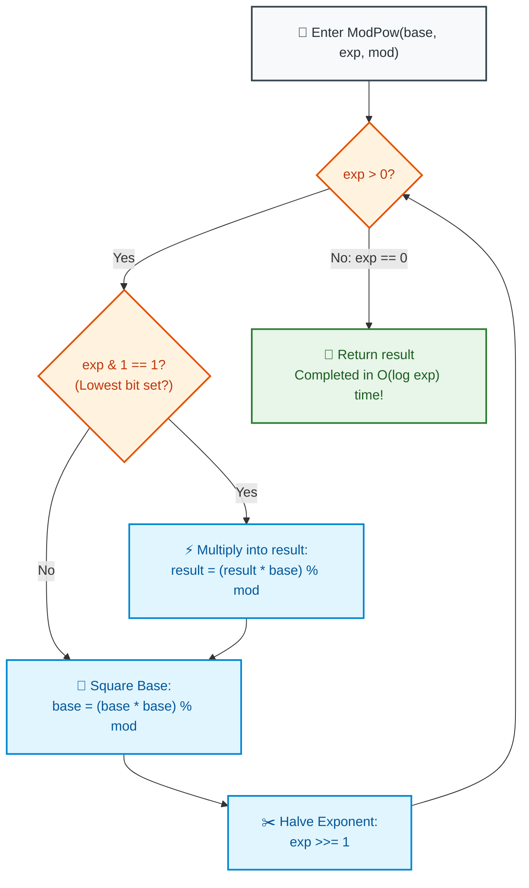

# 📘 WEEK 14 DAY 3: NUMBER THEORY BASICS, GCD, PRIMES & MODULAR EXPONENTIATION — THE SENIOR PLAYBOOK

> 🧭 **Navigation:** [← Previous Day](Week_14_Day_02_Bitwise_Operations_Instructional.md) • [🏠 Week Overview](README.md) • [📘 Curriculum Syllabus](../COMPLETE_SYLLABUS.md) • [Next Day: Advanced Strings →](Week_14_Day_04_Advanced_Strings_Instructional.md)
> 
> 💡 **Instructor Note:** *Number theory problems in FAANG loops test whether you understand mathematical invariants and physical register overflow limits. In this module, we master the Euclidean GCD algorithm, prime generation via the Sieve of Eratosthenes, logarithmic modular exponentiation, and Fermat's modular multiplicative inverse.*

---

## 🎯 LEARNING OBJECTIVES

*By the end of this module, you will be able to:*

- 🎬 **Deconstruct** the 12-Hour Clock face metaphor to explain modular congruence and why standard division fails in modular arithmetic.
- 📐 **Implement** the Euclidean GCD and LCM algorithms with integer overflow prevention (`(a / gcd) * b`).
- ⚡ **Prove** why trial division only needs to inspect numbers up to $\sqrt{N}$ and why the Sieve of Eratosthenes starts composite elimination at $p^2$.
- 🚀 **Compute** modular powers $b^e \pmod M$ in $O(\log e)$ time using binary exponentiation (LC 50 Pow(x, n)).
- 🧮 **Solve** modular division using Fermat's Little Theorem ($A^{-1} \equiv A^{P-2} \pmod P$) for prime moduli like $10^9 + 7$.
- 🛑 **Avoid** the 4 classic rookie blunders: LCM product overflow, negative modulo results in C#/Java, using Fermat on composite moduli, and redundant composite sifting.
- 🎙️ **Deliver** the exact 3-sentence verbal talk track before writing number theory code in a FAANG interview.
- ⚡ **Ship** production-grade C# (.NET 8/9) and Python (3.11+) implementations with zero overflow risk.

---

## 🎬 PILLAR 1: THE 60-SECOND HOOK & EVERYDAY ANALOGIES

### Analogy 1: The 12-Hour Clock Face & Modular Space

Look at the clock on your wall. It reads **9:00 AM**.

What time will it be in **5 hours**?
- Elementary math: $9 + 5 = 14:00$.
- Clock reality: $14 \pmod{12} = \mathbf{2:00\text{ PM}}$!

The number line does not stretch into infinity; it wraps around a circular ring of circumference $M$.

In standard computer systems:
- Addition wraps safely: $(A + B) \pmod M = ((A \pmod M) + (B \pmod M)) \pmod M$
- Multiplication wraps safely: $(A \times B) \pmod M = ((A \pmod M) \times (B \pmod M)) \pmod M$

**BUT WATCH OUT FOR DIVISION:**

$$\mathbf{(A / B) \pmod M \ne ((A \pmod M) / (B \pmod M)) \pmod M}$$

Look at this counterexample:
$$\frac{12}{4} \pmod 5 = 3 \pmod 5 = \mathbf{3}$$
$$(12 \pmod 5) / (4 \pmod 5) = 2 / 4 = \mathbf{0.5\text{ (A fraction! Nonsense in modular arithmetic!)!}}$$

To divide in modular space, you cannot use elementary division. You must multiply by the **Modular Multiplicative Inverse** ($B^{-1}$)!

---

### Analogy 2: Finding Prime Factors (The Rectangle Folding Insight)

Suppose you are given the number **36** and want to check if it's prime. Do you need to test all divisors from 2 up to 35?

Think of 36 as the area of a rectangular carpet:
$$\text{Area} = \text{Width} \times \text{Height} = 36$$

```text
  Pair 1:  1  x 36
  Pair 2:  2  x 18
  Pair 3:  3  x 12
  Pair 4:  4  x  9
  ----------------------------- Sqrt(36) = 6 (THE SADDLE POINT!)
  Pair 5:  6  x  6
  -----------------------------
  Pair 6:  9  x  4  (Duplicate mirror!)
  Pair 7: 12  x  3  (Duplicate mirror!)
  Pair 8: 18  x  2  (Duplicate mirror!)
```

Every factor below $\sqrt{N}$ is paired with a matching factor above $\sqrt{N}$!
If a number has no divisor $\le \sqrt{N}$, it is **physically impossible** for it to have a divisor $> \sqrt{N}$!
Testing up to $\sqrt{N}$ shrinks testing from 1,000,000 steps down to **1,000 steps**!

---

## 🪜 PILLAR 2: THE SCAFFOLDING LADDER & TOY NAPKIN TRACES

Let's master the 4 core number theory pillars:

```
                  [THE 4 NUMBER THEORY PILLARS]
                                │
        ┌───────────────────────┼───────────────────────┐
        ▼                       ▼                       ▼
   [1. EUCLIDEAN GCD]       [2. SIEVE]        [3. FAST MODPOW]
   gcd(a, b) = gcd(b, a%b)  Primes to N       O(log e) squaring
   Lamé: O(log min(a,b))    O(N log log N)    LeetCode 50
```

---

### Scaffold Level 1: Euclidean GCD & Safe LCM

**Theorem:** $\gcd(a, b) = \gcd(b, a \pmod b)$ with base case $\gcd(a, 0) = a$.
The remainder strictly decreases by at least half every two steps ($a \pmod b < a / 2$), guaranteeing logarithmic termination in $O(\log(\min(a, b)))$.

#### Hand Trace: `gcd(48, 18)`
```text
Step 1: gcd(48, 18) = gcd(18, 48 % 18) = gcd(18, 12)
Step 2: gcd(18, 12) = gcd(12, 18 % 12) = gcd(12, 6)
Step 3: gcd(12, 6)  = gcd(6, 12 % 6)   = gcd(6, 0)
Base case b == 0 -> Return 6!
```

#### Safe Least Common Multiple (LCM):
$$\text{lcm}(a, b) = \frac{a \times b}{\gcd(a, b)}$$
> [!WARNING]
> **Overflow Hazard:** If $a = 10^9$ and $b = 10^9$, multiplying $a \times b = 10^{18}$ overflows 32-bit signed integers immediately.
> **Senior Safe Formula:** Divide first! $\mathbf{\text{lcm}(a, b) = (a / \gcd(a, b)) \times b}$.

---

### Scaffold Level 2: Sieve of Eratosthenes — Why Start at $p^2$?

To generate all prime numbers up to $N$:
1. Initialize a boolean array `isPrime` of size $N + 1$ with `true`. Mark 0 and 1 as `false`.
2. For $p = 2, 3, 4, \dots$ while $p^2 \le N$:
   - If `isPrime[p]` is true:
     - Mark all multiples of $p$ as false, **starting from $m = p^2$**!

#### Why start at $p^2$?
- For $p = 5$: Multiples are $5 \times 2 = 10$, $5 \times 3 = 15$, $5 \times 4 = 20$, $5 \times 5 = 25$.
- Notice that 10 was already crossed off by 2 ($2 \times 5$)!
- 15 was already crossed off by 3 ($3 \times 5$)!
- 20 was already crossed off by 2 ($2 \times 10$)!
- The first multiple of $p$ that has **not** yet been eliminated by a smaller prime factor is **$p \times p$**!
Starting at $p^2$ eliminates redundant work and establishes the legendary $O(N \log \log N)$ runtime.

---

### Scaffold Level 3: Fast Modular Exponentiation ($O(\log e)$)

**Problem:** Compute $b^e \pmod M$ where $e = 10^9$. Naive repeated multiplication takes $10^9$ iterations (timeout!).

#### The Binary Exponentiation Invariant:
Represent the exponent $e$ in binary:
$$13 = 8 + 4 + 1 = 0\text{b}1101$$
$$b^{13} = b^8 \times b^4 \times b^1$$

At each step:
- If the lowest bit of $e$ is 1: fold `base` into our running result: `result = (result * base) % M`.
- Square the base: `base = (base * base) % M`.
- Shift $e$ right by 1: `e >>= 1`.

#### Hand Trace: $3^{13} \pmod{10}$ ($e = 13 = \text{0b1101}$)
```text
Start: result = 1, base = 3, exp = 13 (0b1101)

Step 1: exp & 1 == 1 -> result = (1 * 3) % 10 = 3
        base = (3 * 3) % 10 = 9
        exp >>= 1 -> exp = 6 (0b0110)

Step 2: exp & 1 == 0 -> skip result
        base = (9 * 9) % 10 = 81 % 10 = 1
        exp >>= 1 -> exp = 3 (0b0011)

Step 3: exp & 1 == 1 -> result = (3 * 1) % 10 = 3
        base = (1 * 1) % 10 = 1
        exp >>= 1 -> exp = 1 (0b0001)

Step 4: exp & 1 == 1 -> result = (3 * 1) % 10 = 3
        base = (1 * 1) % 10 = 1
        exp >>= 1 -> exp = 0 (Loop finishes!)

Final Answer: 3. Computed in 4 steps instead of 13!
```

---

### Scaffold Level 4: Modular Multiplicative Inverse (Fermat's Little Theorem)

**Theorem:** If $P$ is prime and $\gcd(A, P) = 1$, then:
$$A^{P - 1} \equiv 1 \pmod P$$

Multiply both sides by $A^{-1}$:
$$A^{-1} \equiv A^{P - 2} \pmod P$$

To divide $X$ by $A$ modulo prime $P$:
$$(X / A) \pmod P \equiv (X \times A^{P - 2}) \pmod P$$

This solves modular division for combinations $C(N, K) \pmod{10^9 + 7}$ in $O(\log P)$ time!

---

### 🧠 Pause & Predict Micro-Drill
**Question:** In C#, what is the output of `-7 % 3`?
*Take 5 seconds to think.*
-
-
-
**Answer:** **`-1`**! In C#, Java, and C++, `%` is the **remainder operator**, which preserves the sign of the numerator! In Python, `%` is the **floored modulo operator**, returning `2`. To guarantee non-negative modular values in C#, always normalize: `((val % mod) + mod) % mod`.

---

## 🎨 PILLAR 3: PRAGMATIC VISUAL MODELS

### Fast Binary Exponentiation State Machine



---

## 🛑 PILLAR 4: THE ROOKIE TRAP ZONE

```
=============================================================================================
                                   THE ROOKIE TRAP ZONE
=============================================================================================

❌ ROOKIE TRAP 1: The Intermediate 64-Bit Multiplication Overflow
---------------------------------------------------------------------------------------------
Problem: Computing `(a * b) % mod` in C# where `mod = 3 * 10^9`.
Why it Fails: `a * b` can reach 9 * 10^18, exceeding `long.MaxValue` (9.22 * 10^18).
The product silently overflows into negative numbers, corrupting the modulo remainder!
Senior Architect Fix: When `mod > 2 * 10^9`, use `Int128` in .NET 7/8/9, or Russian Peasant
Safe Multiplication (`O(log b)` additions).

❌ ROOKIE TRAP 2: Applying Fermat's Little Theorem to Composite Moduli
---------------------------------------------------------------------------------------------
Problem: Finding the modular inverse of A modulo 15 using `ModPow(A, 15 - 2, 15)`.
Why it Fails: 15 is NOT prime (15 = 3 * 5)! Fermat's Little Theorem ONLY holds for prime moduli!
Applying it to composite moduli returns completely incorrect mathematical values.
Senior Architect Fix: For composite moduli, use the Extended Euclidean Algorithm to solve
`a * x + m * y = gcd(a, m)`. If `gcd(a, m) != 1`, no inverse exists.

❌ ROOKIE TRAP 3: Negative Remainder Bugs on Subtraction
---------------------------------------------------------------------------------------------
Problem: Computing `(a - b) % mod` in C# where `a = 3, b = 7, mod = 10`.
Why it Fails: `(3 - 7) % 10 = -4 % 10 = -4`. An array indexed at -4 throws an exception!
Senior Architect Fix: Always add `mod` before taking the remainder:
`((a - b) % mod + mod) % mod`.

❌ ROOKIE TRAP 4: Multiplying Before Dividing in LCM
---------------------------------------------------------------------------------------------
Problem: Writing `long lcm = (a * b) / Gcd(a, b);`.
Why it Fails: `a * b` can overflow long integer limits before the division takes place.
Senior Architect Fix: Always divide first: `(a / Gcd(a, b)) * b`.
=============================================================================================
```

---

## 🎙️ PILLAR 5: 45-MINUTE INTERVIEW TALK TRACK

When solving number theory problems in a FAANG interview, deliver this script:

```
[00:00 - 05:00] Clarifying Constraints & Modulus Characteristics
"Let's clarify the numerical bounds:
 1. What is the value of the modulus M? (e.g., 10^9 + 7).
 2. Is M guaranteed to be prime? If prime, we can use Fermat's Little Theorem for O(log M)
    modular division. If composite, we must use the Extended Euclidean Algorithm.
 3. Can intermediate products exceed 64-bit signed integers? If mod <= 10^9, long fits
    the square (10^18 < 9 * 10^18). If mod > 3 * 10^9, we must use Int128 or safe multiplication."

[05:00 - 10:00] Deriving the Binary Exponentiation Invariant
"To compute b^e % M in O(log e) rather than O(e) linear time:
 We represent the exponent e in binary.
 At each step, if the lowest bit is set (exp & 1 == 1), we fold the current base into our
 running result.
 We then square the base and shift exp right by 1.
 The invariant (result * base^exp) % M == constant is preserved throughout, terminating
 in floor(log2(e)) + 1 steps."

[10:00 - 15:00] Sieve Optimization Justification
"When generating primes up to N:
 We only need outer loop trial checks up to sqrt(N).
 For any prime p, all multiples k * p for k < p have already been crossed out by a prime
 factor smaller than p.
 Therefore, we start composite elimination at p * p, achieving O(N log log N) runtime."

[15:00 - 35:00] Coding Implementation
(Write production C# / Python using overflow guards and non-negative modulo normalization.)

[35:00 - 40:00] Dry Run & Bounds Check
(Walk through Gcd(48, 18), ModPow(3, 13, 10), and negative modulo normalization.)

[40:00 - 45:00] Complexity Deconstruction
"Gcd: O(log(min(a, b))) time, O(1) space.
 Sieve: O(N log log N) time, O(N) space.
 ModPow: O(log exp) time, O(1) auxiliary space.
 Fermat Inverse: O(log mod) time, O(1) space."
```

---

## ⚡ PILLAR 6: PRODUCTION DUAL-LANGUAGE IMPLEMENTATIONS

### Production C# (.NET 8/9 — Safe Modular Math & Sieve)

```csharp
namespace DsaMastery.NumberTheory;

using System;

public static class NumberTheorySolvers
{
    // =========================================================================
    // 1. EUCLIDEAN GCD & SAFE LCM
    // Time: O(log(min(a, b))) | Space: O(1)
    // =========================================================================
    public static long Gcd(long a, long b)
    {
        while (b != 0)
        {
            long temp = b;
            b = a % b;
            a = temp;
        }
        return Math.Abs(a);
    }

    public static long Lcm(long a, long b)
    {
        if (a == 0 || b == 0) return 0;
        // Divide first to prevent multiplication overflow
        return Math.Abs((a / Gcd(a, b)) * b);
    }

    // =========================================================================
    // 2. TRIAL DIVISION PRIMALITY TEST
    // Time: O(sqrt(N)) | Space: O(1)
    // =========================================================================
    public static bool IsPrime(long n)
    {
        if (n < 2) return false;
        if (n % 2 == 0) return n == 2;
        if (n % 3 == 0) return n == 3;

        // Step by 6: every prime > 3 is of form 6k +/- 1
        for (long d = 5; d * d <= n; d += 6)
        {
            if (n % d == 0 || n % (d + 2) == 0)
            {
                return false;
            }
        }

        return true;
    }

    // =========================================================================
    // 3. SIEVE OF ERATOSTHENES (Prime Generation)
    // Time: O(N log log N) | Space: O(N)
    // =========================================================================
    public static bool[] Sieve(int limit)
    {
        if (limit < 0) return [];
        var isPrime = new bool[limit + 1];
        Array.Fill(isPrime, true);

        if (limit >= 0) isPrime[0] = false;
        if (limit >= 1) isPrime[1] = false;

        for (int p = 2; (long)p * p <= limit; p++)
        {
            if (isPrime[p])
            {
                // Invariant: start marking at p * p!
                for (int m = p * p; m <= limit; m += p)
                {
                    isPrime[m] = false;
                }
            }
        }

        return isPrime;
    }

    // =========================================================================
    // 4. FAST MODULAR EXPONENTIATION (LeetCode 50 Pow(x, n) Concept)
    // Time: O(log exp) | Space: O(1)
    // =========================================================================
    public static long ModPow(long baseVal, long exp, long mod)
    {
        if (mod <= 0) throw new ArgumentOutOfRangeException(nameof(mod), "Modulus must be positive.");
        if (mod == 1) return 0;

        long result = 1;
        baseVal = ((baseVal % mod) + mod) % mod; // Non-negative normalization

        while (exp > 0)
        {
            if ((exp & 1) == 1)
            {
                result = (long)(((Int128)result * baseVal) % mod);
            }

            baseVal = (long)(((Int128)baseVal * baseVal) % mod);
            exp >>= 1;
        }

        return result;
    }

    // =========================================================================
    // 5. MODULAR INVERSE VIA FERMAT'S LITTLE THEOREM
    // Requires: primeMod is strictly prime, gcd(val, primeMod) == 1.
    // Time: O(log primeMod) | Space: O(1)
    // =========================================================================
    public static long ModularInverse(long val, long primeMod)
    {
        long normalized = ((val % primeMod) + primeMod) % primeMod;
        if (normalized == 0)
        {
            throw new InvalidOperationException("Zero has no modular inverse.");
        }

        // A^(P-2) mod P
        return ModPow(normalized, primeMod - 2, primeMod);
    }
}
```

---

### Production Python (3.11+ — Number Theory Toolkit)

```python
from __future__ import annotations
import math
from typing import List


class NumberTheorySolvers:
    # =========================================================================
    # 1. EUCLIDEAN GCD & SAFE LCM
    # Time: O(log(min(a, b))) | Space: O(1)
    # =========================================================================
    @staticmethod
    def gcd(a: int, b: int) -> int:
        while b != 0:
            a, b = b, a % b
        return abs(a)

    @staticmethod
    def lcm(a: int, b: int) -> int:
        if a == 0 or b == 0:
            return 0
        return abs((a // NumberTheorySolvers.gcd(a, b)) * b)

    # =========================================================================
    # 2. TRIAL DIVISION PRIMALITY TEST
    # Time: O(sqrt(N)) | Space: O(1)
    # =========================================================================
    @staticmethod
    def is_prime(n: int) -> bool:
        if n < 2:
            return False
        if n % 2 == 0:
            return n == 2
        if n % 3 == 0:
            return n == 3

        d = 5
        while d * d <= n:
            if n % d == 0 or n % (d + 2) == 0:
                return False
            d += 6

        return True

    # =========================================================================
    # 3. SIEVE OF ERATOSTHENES
    # Time: O(N log log N) | Space: O(N)
    # =========================================================================
    @staticmethod
    def sieve(limit: int) -> List[bool]:
        if limit < 0:
            return []
        is_prime = [True] * (limit + 1)
        if limit >= 0:
            is_prime[0] = False
        if limit >= 1:
            is_prime[1] = False

        p = 2
        while p * p <= limit:
            if is_prime[p]:
                # Start marking at p * p
                for m in range(p * p, limit + 1, p):
                    is_prime[m] = False
            p += 1

        return is_prime

    # =========================================================================
    # 4. FAST MODULAR EXPONENTIATION
    # Time: O(log exp) | Space: O(1)
    # =========================================================================
    @staticmethod
    def mod_pow(base_val: int, exp: int, mod: int) -> int:
        if mod <= 0:
            raise ValueError("Modulus must be positive.")
        if mod == 1:
            return 0

        result = 1
        base_val = base_val % mod

        while exp > 0:
            if exp & 1:
                result = (result * base_val) % mod
            base_val = (base_val * base_val) % mod
            exp >>= 1

        return result

    # =========================================================================
    # 5. MODULAR INVERSE (Fermat's Little Theorem)
    # Time: O(log prime_mod) | Space: O(1)
    # =========================================================================
    @staticmethod
    def modular_inverse(val: int, prime_mod: int) -> int:
        normalized = val % prime_mod
        if normalized == 0:
            raise ValueError("Zero has no modular inverse.")
        return NumberTheorySolvers.mod_pow(normalized, prime_mod - 2, prime_mod)
```

---

## 🔬 PERFORMANCE & COMPLEXITY DECONSTRUCTION

| Algorithm | Time Complexity | Auxiliary Space | Key Governing Theorem |
| :--- | :--- | :--- | :--- |
| **Euclidean GCD** | `O(log(min(a, b)))` | `O(1)` | Lamé's Theorem (worst case: Fibonacci pairs) |
| **Safe LCM** | `O(log(min(a, b)))` | `O(1)` | Divide before multiply eliminates overflow |
| **Trial Primality** | `O(sqrt(N))` | `O(1)` | Paired divisor symmetry across $\sqrt{N}$ |
| **Sieve of Eratosthenes** | `O(N log log N)` | `O(N)` | Mertens' Second Theorem on harmonic sum of primes |
| **Fast ModPow** | `O(log exp)` | `O(1)` | Binary exponentiation invariant |
| **Fermat Modular Inverse** | `O(log primeMod)` | `O(1)` | Fermat's Little Theorem: $A^{P-1} \equiv 1 \pmod P$ |

---

## ⚔️ PRACTICE DRILLS & MASTERY PROBLEMS

| # | Problem | Source | Difficulty | Target Number Theory Concept |
| :--- | :--- | :--- | :--- | :--- |
| 1 | Count Primes | LeetCode 204 | Medium | Sieve of Eratosthenes |
| 2 | Pow(x, n) | LeetCode 50 | Medium | Fast binary exponentiation with negative powers |
| 3 | Greatest Common Divisor of Strings | LeetCode 1071 | Easy | Euclidean GCD applied to string lengths |
| 4 | Super Pow | LeetCode 372 | Medium | Modular exponentiation with array exponent |
| 5 | Combinations nCr Modulo Prime | Classic | Medium | Precomputed factorials and Fermat modular inverse |

---

> 🧭 **Navigation:** [← Previous Day](Week_14_Day_02_Bitwise_Operations_Instructional.md) • [🏠 Week Overview](README.md) • [📘 Curriculum Syllabus](../COMPLETE_SYLLABUS.md) • [Next Day: Advanced Strings →](Week_14_Day_04_Advanced_Strings_Instructional.md)
