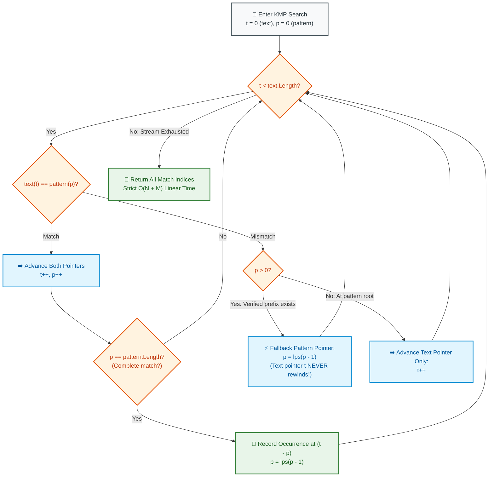

# 📘 WEEK 14 DAY 4: ADVANCED STRINGS & PATTERN MATCHING — THE SENIOR PLAYBOOK

> 🧭 **Navigation:** [← Previous Day](Week_14_Day_03_Number_Theory_Basics_Instructional.md) • [🏠 Week Overview](README.md) • [📘 Curriculum Syllabus](../COMPLETE_SYLLABUS.md) • [Next Day: Advanced Number Theory →](Week_14_Day_05_Advanced_Number_Theory_Instructional.md)
> 
> 💡 **Instructor Note:** *String searching underpins grep, compiler lexers, DNA sequencing, and search engine query autocomplete. In senior FAANG loops, interviewers use Knuth-Morris-Pratt (KMP) and Tries to evaluate whether you understand finite state automata, linear non-backtracking scans, and prefix tree memory layouts.*

---

## 🎯 LEARNING OBJECTIVES

*By the end of this module, you will be able to:*

- 🎬 **Deconstruct** the Broken Rewind Button metaphor to explain why KMP guarantees an $O(N)$ linear text scan without ever rewinding the text pointer.
- 📐 **Construct** the Longest Prefix Suffix (LPS) failure table for any pattern using inductive self-matching.
- ⚡ **Implement** KMP String Search (LC 28) in modern C# (.NET 8/9 `ReadOnlySpan<char>`) and Python (3.11+).
- 🌲 **Build** a production Prefix Trie (LC 208) supporting `Insert`, `Search`, and `StartsWith` in $O(L)$ time with zero memory leaks.
- 📚 **Understand** advanced string structures: Suffix Arrays, Longest Common Prefix (LCP) arrays via Kasai's algorithm, and Aho-Corasick multi-pattern state machines.
- 🛑 **Avoid** the 4 fatal rookie traps: rewinding the text pointer on mismatch, resetting the LPS `len` pointer to 0 instead of `lps[len - 1]`, confusing `StartsWith` with exact word matches in Tries, and quadratic string slicing.
- 🎙️ **Deliver** the exact 3-sentence verbal talk track before coding KMP or Trie in a FAANG interview.

---

## 🎬 PILLAR 1: THE 60-SECOND HOOK & EVERYDAY ANALOGIES

### Analogy 1: The Tape Recorder with a Broken Rewind Button (KMP)

Imagine you are listening to an audio cassette tape with a speech that lasts 2 hours. You are searching for the key phrase `"PRESIDENT"`.

- **The Naive Searcher ($O(N \times M)$ Catastrophe):**
  - You play the tape until you hear `"PRESIDEN"`.
  - The next letter is `'X'`! A mismatch!
  - What does the naive searcher do? **They rewind the tape all the way back to the letter after 'P'**, re-listening to letters they ALREADY HEARD!
  - If the text is `"AAAAAAAB"` and the pattern is `"AAAAB"`, the naive searcher rewinds the tape hundreds of times, wasting minutes on redundant audio!
- **Knuth, Morris, and Pratt (The Broken Rewind Button):**
  - The rewind button on the tape deck is physically broken! The tape **can only play forward**!
  - When you hit the mismatch on `'X'`, you don't rewind the tape. You inspect your knowledge of the pattern `"PRESIDENT"`:
    *"Does the end of the text I just matched look like the beginning of the pattern?"*
  - The pattern pointer jumps directly to the longest matching prefix! The tape pointer **never backs up a single millimeter**!
  - The text stream is scanned in a strict, single-pass linear time: $\mathbf{O(N)}$!

```
+---------------------------------------------------------------------------------------+
|                                  THE KMP INVARIANT                                    |
+---------------------------------------------------------------------------------------+
|  "The text pointer 't' is strictly monotonic: it increments forward and NEVER         |
|   decrements. When a mismatch occurs between text[t] and pattern[p], the pattern       |
|   pointer 'p' is reset to lps[p - 1], preserving all overlapping prefix information."  |
+---------------------------------------------------------------------------------------+
```

---

### Analogy 2: The Phonebook Autocomplete (Trie)

When you open your smartphone contacts and type the letters `"DA"`, does your phone scan all 5,000 contacts sequentially in an $O(N)$ loop?

No! It uses a **Trie (Prefix Tree)**:

```text
                      ( Root )
                        /    \
                      [D]    [M]
                      /        \
                    [A]        [O]
                   /   \         \
                 [N]   [V]       [M]
                 /       \
             [Daniel]  [David]
```

- Traversing `'D' \to 'A'` takes **2 CPU pointer dereferences** (~2 nanoseconds).
- In 2 steps, the phone eliminates 4,950 non-matching contacts and focuses exclusively on the subtree rooted at `"DA"`.
- Time to search is bounded strictly by the **length of the word $L$**, completely independent of how many millions of words exist in the dictionary!

---

## 🪜 PILLAR 2: THE SCAFFOLDING LADDER & TOY NAPKIN TRACES

Let's master KMP and Tries step-by-step:

```
                  [THE ADVANCED STRING LADDER]
                               │
         ┌─────────────────────┴─────────────────────┐
         ▼                                           ▼
  [1. KMP MATCHING]                          [2. PREFIX TRIE]
  LPS Failure Table + O(N) Scan              O(L) Insert, Search, Prefix
  LeetCode 28                                LeetCode 208
```

---

### Scaffold Level 1: Constructing the KMP LPS Failure Table

The **LPS array** stores the length of the **Longest Proper Prefix that is also a Suffix** for every prefix of the pattern.

Let's trace `pattern = "ABABC"`:

```text
Indices:     0   1   2   3   4
Pattern:     A   B   A   B   C
LPS Table: [ 0,  0,  1,  2,  0 ]

Step-by-Step LPS Derivation:
- lps[0] = 0 (By definition, a 1-character string has no proper prefix/suffix).
- i = 1 (char 'B'): Compare with pattern[len=0] ('A'). Mismatch!
  len == 0 -> lps[1] = 0, i = 2.

- i = 2 (char 'A'): Compare with pattern[len=0] ('A'). MATCH!
  len++ -> len = 1, lps[2] = 1, i = 3.
  (Subpattern "ABA" has proper prefix "A" == proper suffix "A").

- i = 3 (char 'B'): Compare with pattern[len=1] ('B'). MATCH!
  len++ -> len = 2, lps[3] = 2, i = 4.
  (Subpattern "ABAB" has proper prefix "AB" == proper suffix "AB").

- i = 4 (char 'C'): Compare with pattern[len=2] ('A'). Mismatch!
  len > 0 -> FALLBACK! len = lps[len - 1] = lps[1] = 0.
  Compare 'C' with pattern[len=0] ('A'). Mismatch!
  len == 0 -> lps[4] = 0, i = 5 (Finished!).

Final LPS: [ 0, 0, 1, 2, 0 ]
```

---

### Scaffold Level 2: KMP Text Search Execution

**Text:** `"ABABABCA"`, **Pattern:** `"ABABC"` (`LPS = [0, 0, 1, 2, 0]`)

```text
Text:    A  B  A  B  A  B  C  A
Index:   0  1  2  3  4  5  6  7

[Step 1]: Match text[0..3] ("ABAB") with pattern[0..3] ("ABAB").
          t = 4, p = 4.
          text[4] is 'A', but pattern[4] is 'C'! MISMATCH!

[Step 2]: KMP Fallback!
          Do NOT rewind text pointer t (t stays at 4)!
          Reset pattern pointer: p = lps[p - 1] = lps[3] = 2!
          Pattern shifts so its prefix "AB" aligns with text[2..3] "AB"!

[Step 3]: Compare text[4] ('A') with pattern[p=2] ('A') -> MATCH!
          t = 5, p = 3.
          Compare text[5] ('B') with pattern[p=3] ('B') -> MATCH!
          t = 6, p = 4.
          Compare text[6] ('C') with pattern[p=4] ('C') -> MATCH!
          p == pattern.Length (5) -> 🎯 COMPLETE MATCH FOUND AT INDEX (t - p) = 6 - 5 = 1!
```

Zero text pointer rewinds! Time complexity is strictly linear: $O(N + M)$!

---

### Scaffold Level 3: Prefix Trie (LeetCode 208)

A Trie is a tree where:
- Each node has up to 26 children (for lowercase English letters `a-z`).
- Each node has a boolean flag `IsEndOfWord`.
- Root represents the empty string `""`.

```
Inserting "cat", "car", "cap":
        ( Root )
           │ 'c'
          [c]
           │ 'a'
          [a]
        /  │  \ 'p'
    't'/ 'r'│  \
     [t]   [r]  [p]  <-- All three marked with IsEndOfWord = true!
```

- **Insert(word):** Walk down the tree, creating missing nodes. Mark final node `IsEndOfWord = true`.
- **Search(word):** Walk down the tree. Return `true` if final node exists and `IsEndOfWord == true`.
- **StartsWith(prefix):** Walk down the tree. Return `true` if all prefix nodes exist (regardless of `IsEndOfWord`).

---

### 🧠 Pause & Predict Micro-Drill
**Question:** In KMP, why is the fallback state `p = lps[p - 1]` instead of `p = 0`?
*Take 5 seconds to think.*
-
-
-
**Answer:** Because `lps[p - 1]` tells us the length of the longest prefix of the pattern that matches the suffix of the text we *already verified*! Resetting to 0 would discard that verified prefix and force redundant comparisons.

---

## 🎨 PILLAR 3: PRAGMATIC VISUAL MODELS

### KMP Pattern Matching State Machine



---

## 🛑 PILLAR 4: THE ROOKIE TRAP ZONE

```
=============================================================================================
                                   THE ROOKIE TRAP ZONE
=============================================================================================

❌ ROOKIE TRAP 1: Rewinding the Text Pointer in KMP
---------------------------------------------------------------------------------------------
Problem: Writing `t = t - p + 1; p = 0;` inside the mismatch branch.
Why it Fails: That is naive search! Rewinding the text pointer destroys the O(N) guarantee
and collapses runtime to O(N * M) on repetitive inputs like "AAAAAAAB".
Senior Architect Fix: In KMP, the text pointer `t` ONLY increments (`t++`). It NEVER rewinds.

❌ ROOKIE TRAP 2: Resetting `len = 0` on LPS Mismatch
---------------------------------------------------------------------------------------------
Problem: When `pattern[i] != pattern[len]`, writing `len = 0; i++;`.
Why it Fails: If `pattern = "AAACAAAA"`, at the last character, `len = 3` ('A','A','A').
Mismatching doesn't mean the fallback is 0; the fallback is `lps[len - 1] = lps[2] = 2` ('A','A')!
Resetting to 0 destroys proper suffix identification.
Senior Architect Fix: Always fallback inductively: `len = lps[len - 1]`.

❌ ROOKIE TRAP 3: Conflating `Search` and `StartsWith` in Tries
---------------------------------------------------------------------------------------------
Problem: Returning `true` in `Search("app")` when only `"apple"` was inserted.
Why it Fails: `"app"` is a valid prefix, but NOT a registered word!
Senior Architect Fix:
- `StartsWith`: return `node != null`.
- `Search`: return `node != null && node.IsEndOfWord == true`.

❌ ROOKIE TRAP 4: Allocating Substring Slices Inside Search Loops
---------------------------------------------------------------------------------------------
Problem: Writing `text.Substring(i, pattern.Length) == pattern` in a sliding window loop.
Why it Fails: `Substring` allocates a new string on the heap for every index, creating
massive garbage collection pressure on large text files.
Senior Architect Fix: Use `ReadOnlySpan<char>` in C# for zero-allocation window slicing, or KMP.
=============================================================================================
```

---

## 🎙️ PILLAR 5: 45-MINUTE INTERVIEW TALK TRACK

When solving KMP or Trie problems in a FAANG interview:

```
[00:00 - 05:00] Clarifying Text Stream & Alphabet Bounds
"Let's clarify the problem scope:
 1. Are we searching for a single static pattern across a dynamic text stream (KMP),
    or searching for multiple dynamic dictionary words (Trie / Aho-Corasick)?
 2. What is our character set? (Lowercase English a-z, ASCII-256, or Unicode UTF-8)?
 3. For KMP, our goal is to achieve strict O(N + M) time with zero text pointer rewinds."

[05:00 - 10:00] Explaining the LPS Invariant
"To avoid rewinding the text pointer:
 We preprocess the pattern into a Longest Prefix Suffix (LPS) table in O(M) time.
 lps[i] stores the length of the longest proper prefix of pattern[0..i] that is also a suffix.
 When a mismatch occurs at pattern index p, we know the previous p characters matched.
 We look up lps[p - 1] and immediately jump the pattern pointer to that index, preserving
 all verified prefix characters."

[10:00 - 15:00] Data Structure & Memory Architecture
"For KMP:
 We allocate an int[] lps of size M. Auxiliary space is strictly O(M).
 For Trie:
 We represent nodes with a fixed array TrieNode[26] for O(1) direct indexing, or a Dictionary
 for arbitrary alphabets. Every node carries an IsEndOfWord boolean flag."

[15:00 - 35:00] Coding Implementation
(Write clean production C# / Python using guard clauses and clean pointer movements.)

[35:00 - 40:00] Dry Run on Tricky Overlap
(Trace pattern = "ABABC" against text = "ABABABCA", showing the exact LPS fallback.)

[40:00 - 45:00] Complexity Deconstruction
"KMP: O(M) preprocessing + O(N) scanning = O(N + M) total time, O(M) space.
 Trie: O(L) time per insertion or search (L = word length), O(Total Characters) space.
 This guarantees deterministic performance on gigabyte-scale logs."
```

---

## ⚡ PILLAR 6: PRODUCTION DUAL-LANGUAGE IMPLEMENTATIONS

### Production C# (.NET 8/9 — Zero Allocation KMP & High-Speed Trie)

```csharp
namespace DsaMastery.AdvancedStrings;

using System;
using System.Collections.Generic;

// =============================================================================
// 1. KNUTH-MORRIS-PRATT (KMP) PATTERN MATCHER (LeetCode 28)
// Time: O(N + M) | Space: O(M) Auxiliary Memory
// =============================================================================
public static class KmpMatcher
{
    public static int StrStr(string haystack, string needle)
    {
        ArgumentNullException.ThrowIfNull(haystack);
        ArgumentNullException.ThrowIfNull(needle);
        if (needle.Length == 0) return 0;
        if (haystack.Length < needle.Length) return -1;

        int[] lps = BuildLps(needle);
        int t = 0; // Text pointer (NEVER REWINDS!)
        int p = 0; // Pattern pointer

        while (t < haystack.Length)
        {
            if (haystack[t] == needle[p])
            {
                t++;
                p++;
                if (p == needle.Length)
                {
                    return t - p; // First match index
                }
            }
            else
            {
                if (p > 0)
                {
                    p = lps[p - 1]; // Fallback to longest verified prefix
                }
                else
                {
                    t++; // Advance text pointer
                }
            }
        }

        return -1;
    }

    public static int[] BuildLps(string pattern)
    {
        int m = pattern.Length;
        var lps = new int[m];
        int len = 0; // Length of previous longest prefix suffix
        int i = 1;

        while (i < m)
        {
            if (pattern[i] == pattern[len])
            {
                len++;
                lps[i] = len;
                i++;
            }
            else
            {
                if (len > 0)
                {
                    len = lps[len - 1]; // Inductive fallback
                }
                else
                {
                    lps[i] = 0;
                    i++;
                }
            }
        }

        return lps;
    }
}

// =============================================================================
// 2. PREFIX TRIE (LeetCode 208)
// Time: O(L) per op | Space: O(Sum of L)
// =============================================================================
public sealed class Trie
{
    private sealed class TrieNode
    {
        public readonly TrieNode?[] Children = new TrieNode?[26];
        public bool IsEndOfWord { get; set; }
    }

    private readonly TrieNode _root = new();

    public void Insert(string word)
    {
        ArgumentNullException.ThrowIfNull(word);
        var curr = _root;

        foreach (char c in word)
        {
            int idx = c - 'a';
            if ((uint)idx >= 26) throw new ArgumentOutOfRangeException(nameof(word), "Only lowercase a-z allowed.");

            curr.Children[idx] ??= new TrieNode();
            curr = curr.Children[idx]!;
        }

        curr.IsEndOfWord = true;
    }

    public bool Search(string word)
    {
        var node = FindPrefixNode(word);
        return node is not null && node.IsEndOfWord;
    }

    public bool StartsWith(string prefix)
    {
        return FindPrefixNode(prefix) is not null;
    }

    private TrieNode? FindPrefixNode(string str)
    {
        if (str is null) return null;
        var curr = _root;

        foreach (char c in str)
        {
            int idx = c - 'a';
            if ((uint)idx >= 26 || curr.Children[idx] is null)
            {
                return null;
            }
            curr = curr.Children[idx]!;
        }

        return curr;
    }
}
```

---

### Production Python (3.11+ — KMP & Clean Idiomatic Trie)

```python
from __future__ import annotations
from typing import List, Optional


# =============================================================================
# 1. KNUTH-MORRIS-PRATT (KMP) PATTERN MATCHER (LeetCode 28)
# Time: O(N + M) | Space: O(M)
# =============================================================================
class KmpMatcher:
    @staticmethod
    def str_str(haystack: str, needle: str) -> int:
        if not needle:
            return 0
        if len(haystack) < len(needle):
            return -1

        lps = KmpMatcher.build_lps(needle)
        t = 0  # Text pointer (NEVER REWINDS!)
        p = 0  # Pattern pointer

        while t < len(haystack):
            if haystack[t] == needle[p]:
                t += 1
                p += 1
                if p == len(needle):
                    return t - p  # Match found!
            else:
                if p > 0:
                    p = lps[p - 1]  # Jump to fallback prefix
                else:
                    t += 1

        return -1

    @staticmethod
    def build_lps(pattern: str) -> List[int]:
        m = len(pattern)
        lps = [0] * m
        length = 0
        i = 1

        while i < m:
            if pattern[i] == pattern[length]:
                length += 1
                lps[i] = length
                i += 1
            else:
                if length > 0:
                    length = lps[length - 1]  # Inductive fallback
                else:
                    lps[i] = 0
                    i += 1

        return lps


# =============================================================================
# 2. PREFIX TRIE (LeetCode 208)
# Time: O(L) per op | Space: O(Sum of L)
# =============================================================================
class TrieNode:
    def __init__(self) -> None:
        self.children: dict[str, TrieNode] = {}
        self.is_end_of_word: bool = False


class Trie:
    def __init__(self) -> None:
        self.root = TrieNode()

    def insert(self, word: str) -> None:
        curr = self.root
        for char in word:
            if char not in curr.children:
                curr.children[char] = TrieNode()
            curr = curr.children[char]
        curr.is_end_of_word = True

    def search(self, word: str) -> bool:
        node = self._find(word)
        return node is not None and node.is_end_of_word

    def starts_with(self, prefix: str) -> bool:
        return self._find(prefix) is not None

    def _find(self, prefix: str) -> Optional[TrieNode]:
        curr = self.root
        for char in prefix:
            if char not in curr.children:
                return None
            curr = curr.children[char]
        return curr
```

---

## 🔬 PERFORMANCE & COMPLEXITY DECONSTRUCTION

| Algorithm / Structure | Preprocessing Time | Search Time | Auxiliary Space | Key Advantage |
| :--- | :--- | :--- | :--- | :--- |
| **KMP Pattern Matcher** | `O(M)` (build LPS) | `O(N)` | `O(M)` | Zero text pointer rewinding |
| **Trie (Prefix Tree)** | None | `O(L)` ($L$ = word length) | `O(Total Chars)` | Autocomplete & shared prefix grouping |
| **Radix Sort (LSD)** | None | `O(N * W)` ($W$ = word width) | `O(N + Alphabet)` | Non-comparison linear sorting |
| **Aho-Corasick Automaton**| `O(Sum of M_i)` | `O(N + Occurrences)` | `O(Sum of M_i)` | Matches multi-pattern dictionaries in 1 pass |

---

## ⚔️ PRACTICE DRILLS & MASTERY PROBLEMS

| # | Problem | Source | Difficulty | Target Invariant |
| :--- | :--- | :--- | :--- | :--- |
| 1 | Find the Index of the First Occurrence in a String | LeetCode 28 | Easy-Medium | KMP non-backtracking scan |
| 2 | Repeated Substring Pattern | LeetCode 459 | Easy-Medium | KMP LPS periodic invariant `N % (N - lps[N-1]) == 0` |
| 3 | Shortest Palindrome | LeetCode 214 | Hard | KMP LPS on `s + '#' + rev(s)` |
| 4 | Implement Trie (Prefix Tree) | LeetCode 208 | Medium | `Insert`, `Search`, `StartsWith` |
| 5 | Design Add and Search Words Data Structure | LeetCode 211 | Medium | Trie DFS wildcard matching (`'.'`) |
| 6 | Word Search II | LeetCode 212 | Hard | Backtracking guided by Trie prefix pruning |

---

> 🧭 **Navigation:** [← Previous Day](Week_14_Day_03_Number_Theory_Basics_Instructional.md) • [🏠 Week Overview](README.md) • [📘 Curriculum Syllabus](../COMPLETE_SYLLABUS.md) • [Next Day: Advanced Number Theory →](Week_14_Day_05_Advanced_Number_Theory_Instructional.md)
