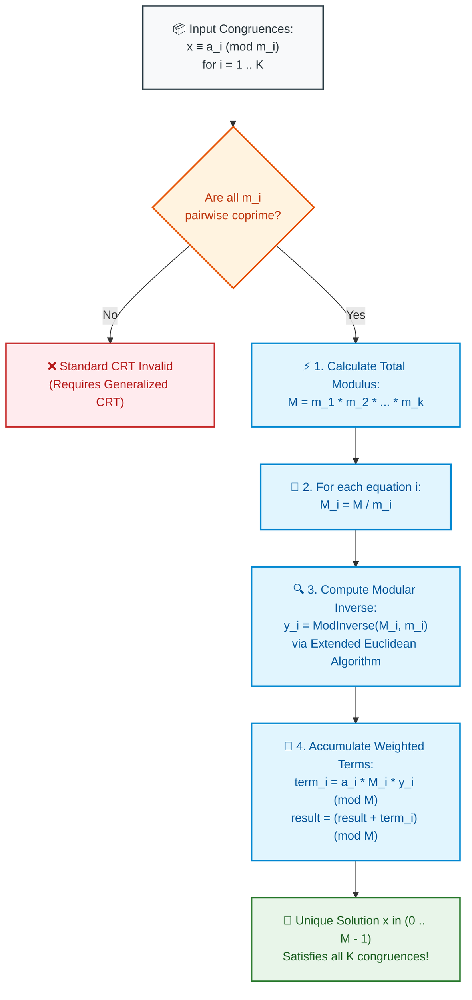

# 📘 WEEK 14 DAY 5: ADVANCED NUMBER THEORY, EULER'S TOTIENT & CRT — THE SENIOR PLAYBOOK

> 🧭 **Navigation:** [← Previous Day](Week_14_Day_04_Advanced_Strings_Instructional.md) • [🏠 Week Overview](README.md) • [📘 Curriculum Syllabus](../COMPLETE_SYLLABUS.md) • [Week Playbook →](WEEK_14_FULL_PLAYBOOK.md)
> 
> 💡 **Instructor Note:** *Advanced Number Theory forms the mathematical backbone of modern cryptography (RSA, Elliptic Curves), distributed hash rings, and high-precision concurrent computing. In this module, we master Euler's Totient function, the Extended Euclidean Algorithm for composite modular inverses, and the Chinese Remainder Theorem (CRT).*

---

## 🎯 LEARNING OBJECTIVES

*By the end of this module, you will be able to:*

- 🎬 **Deconstruct** the 3-Clock Synchronizer metaphor to explain the Chinese Remainder Theorem (CRT) without academic jargon.
- 🧮 **Calculate** Euler's Totient function $\phi(N)$ in $O(\sqrt{N})$ for single queries and $O(N \log \log N)$ using sieve precomputation.
- 📐 **Implement** the Extended Euclidean Algorithm to solve $A \cdot x + B \cdot y = \gcd(A, B)$ and derive modular inverses for composite moduli.
- ⚡ **Solve** systems of simultaneous modular equations using the Chinese Remainder Theorem in $O(K \log M)$ time.
- 🛡️ **Prevent** 64-bit integer overflow using Russian Peasant Safe Modular Multiplication ($O(\log B)$ additions).
- 🛑 **Avoid** the 4 classic rookie pitfalls: applying CRT on non-coprime moduli, negative modular inverse coefficients, brute-force totient GCD scans, and intermediate $M_i \times y_i$ product overflows.
- 🎙️ **Deliver** the exact 3-sentence verbal talk track to justify CRT and Extended GCD in a senior engineering interview.

---

## 🎬 PILLAR 1: THE 60-SECOND HOOK & EVERYDAY ANALOGIES

### Analogy 1: The 3-Clock Synchronizer (Chinese Remainder Theorem)

Imagine you are a detective investigating an automated bank vault. The vault has three independent rotary security clocks of different sizes:
- **Clock 1 (3-hour cycle):** Reads **2** ($x \equiv 2 \pmod 3$)
- **Clock 2 (5-hour cycle):** Reads **3** ($x \equiv 3 \pmod 5$)
- **Clock 3 (7-hour cycle):** Reads **2** ($x \equiv 2 \pmod 7$)

You need to know: **At which exact hour $x$ was the vault breached?**

- **The Brute Force Approach:** Test every hour from $0, 1, 2, 3, \dots$ until all three clocks match. If the total cycle is large ($M \approx 10^{18}$), this search takes 300 years of CPU time!
- **The Chinese Remainder Theorem (CRT):**
  Because the cycle lengths ($3, 5, 7$) are **pairwise coprime** (share no common factors), CRT proves that there is a **unique, exact hour $x$** modulo $3 \times 5 \times 7 = 105$.
  Using the Extended Euclidean Algorithm, CRT calculates:
  $$x = 23 \pmod{105}$$
  Instantaneously! In under 1 microsecond!

```
+---------------------------------------------------------------------------------------+
|                            CHINESE REMAINDER THEOREM (CRT)                            |
+---------------------------------------------------------------------------------------+
|  "A system of simultaneous modular congruences:                                       |
|     x = a_1 (mod m_1),   x = a_2 (mod m_2),   ...,   x = a_k (mod m_k)               |
|   has a UNIQUE solution modulo M = m_1 * m_2 * ... * m_k, provided that all           |
|   moduli m_i are pairwise coprime (gcd(m_i, m_j) = 1 for all i != j)."                |
+---------------------------------------------------------------------------------------+
```

---

### Analogy 2: RSA Cryptography & The Coprime Gatekeeper ($\phi(N)$)

In the RSA cryptosystem that secures your browser's HTTPS connections, public-key encryption and private-key decryption rely on **Euler's Totient function $\phi(N)$**.

$\phi(N)$ counts how many numbers in the range $[1 \dots N]$ are **coprime to $N$** (share no factors with $N$ other than 1).

- If $P$ is prime: every number smaller than $P$ is coprime to $P$ $\implies \mathbf{\phi(P) = P - 1}$.
- If $N = P \times Q$ (the product of two huge primes):
  $$\mathbf{\phi(N) = (P - 1)(Q - 1)}$$

Euler's Totient Theorem states:
$$\mathbf{A^{\phi(M)} \equiv 1 \pmod M}$$

This formula allows RSA to encrypt messages with a public key and guarantees that only the entity holding the private prime factors $P$ and $Q$ can compute $\phi(N)$ and decrypt the ciphertext!

---

## 🪜 PILLAR 2: THE SCAFFOLDING LADDER & TOY NAPKIN TRACES

Let's master the 4 core mathematical engines:

```
                  [THE ADVANCED NUMBER THEORY ENGINE]
                                  │
         ┌────────────────────────┼────────────────────────┐
         ▼                        ▼                        ▼
  [1. EULER'S TOTIENT]    [2. EXTENDED EUCLID]        [3. CRT SOLVER]
  phi(N) prime product    a*x + b*y = gcd(a,b)        x = sum(a_i * M_i * y_i)
  O(sqrt(N))              O(log min(a,b))             O(K log M)
```

---

### Scaffold Level 1: Euler's Totient Function $\phi(N)$

**Formula:**
$$\phi(N) = N \times \prod_{p \mid N} \left(1 - \frac{1}{p}\right)$$
where $p$ ranges over the distinct prime factors dividing $N$.

#### Toy Napkin Trace: $N = 36$
1. Prime factors of $36$: $36 = 2^2 \times 3^2$. Distinct primes: $p = 2$ and $p = 3$.
2. Calculate $\phi(36)$:
   $$\phi(36) = 36 \times \left(1 - \frac{1}{2}\right) \times \left(1 - \frac{1}{3}\right)$$
   $$\phi(36) = 36 \times \frac{1}{2} \times \frac{2}{3} = 36 \times \frac{2}{6} = \mathbf{12}$$
3. There are exactly 12 integers in $[1 \dots 36]$ coprime to 36:
   $\{1, 5, 7, 11, 13, 17, 19, 23, 25, 29, 31, 35\}$. All other 24 numbers share a factor of 2 or 3!

---

### Scaffold Level 2: Extended Euclidean Algorithm

**Bézout's Identity:** For any integers $a$ and $b$, there exist integers $x$ and $y$ such that:
$$a \cdot x + b \cdot y = \gcd(a, b)$$

If $\gcd(a, m) = 1$, then:
$$a \cdot x + m \cdot y = 1 \implies a \cdot x \equiv 1 \pmod m$$
Therefore, **$x$ is the modular multiplicative inverse of $a$ modulo $m$**! And this works for **ANY modulus $m$**, even composite ones!

#### Hand Trace: $a = 35, b = 15$
```text
ExtendedGcd(35, 15):
  35 = 2 * 15 + 5
  15 = 3 *  5 + 0
  gcd = 5.

Unwinding backwards:
  5 = 35 - 2 * 15
  5 = 35 * (1) + 15 * (-2)
  x = 1, y = -2.
  Check: 35 * (1) + 15 * (-2) = 35 - 30 = 5!
```

---

### Scaffold Level 3: Chinese Remainder Theorem Step-by-Step

**System:**
1. $x \equiv 2 \pmod 3$ ($a_1 = 2, m_1 = 3$)
2. $x \equiv 3 \pmod 5$ ($a_2 = 3, m_2 = 5$)
3. $x \equiv 2 \pmod 7$ ($a_3 = 2, m_3 = 7$)

#### Execution Steps:
1. **Total Modulus:** $M = 3 \times 5 \times 7 = \mathbf{105}$.
2. **Intermediate Moduli $M_i = M / m_i$:**
   - $M_1 = 105 / 3 = 35$
   - $M_2 = 105 / 5 = 21$
   - $M_3 = 105 / 7 = 15$
3. **Modular Inverses $y_i = M_i^{-1} \pmod{m_i}$:**
   - $35 \times y_1 \equiv 1 \pmod 3 \implies 2 \times y_1 \equiv 1 \pmod 3 \implies y_1 = \mathbf{2}$.
   - $21 \times y_2 \equiv 1 \pmod 5 \implies 1 \times y_2 \equiv 1 \pmod 5 \implies y_2 = \mathbf{1}$.
   - $15 \times y_3 \equiv 1 \pmod 7 \implies 1 \times y_3 \equiv 1 \pmod 7 \implies y_3 = \mathbf{1}$.
4. **Reconstruct $x = \sum (a_i \times M_i \times y_i) \pmod M$:**
   - Term 1: $2 \times 35 \times 2 = 140$
   - Term 2: $3 \times 21 \times 1 = 63$
   - Term 3: $2 \times 15 \times 1 = 30$
   - Sum: $140 + 63 + 30 = 233$
   - $x = 233 \pmod{105} = \mathbf{23}$!

#### Verification:
- $23 \pmod 3 = 2$ (Matches!)
- $23 \pmod 5 = 3$ (Matches!)
- $23 \pmod 7 = 2$ (Matches!)

---

### Scaffold Level 4: Russian Peasant Safe Modular Multiplication

When $M \approx 10^{18}$, computing $(a \times b) \pmod M$ overflows 64-bit signed integers.
We compute multiplication via binary addition in $O(\log b)$ time:

```csharp
long res = 0;
a %= mod;
while (b > 0)
{
    if ((b & 1) == 1) res = (res + a) % mod;
    a = (a * 2) % mod; // Shift and double
    b >>= 1;
}
return res;
```

---

### 🧠 Pause & Predict Micro-Drill
**Question:** What happens to the Chinese Remainder Theorem if the input moduli are NOT pairwise coprime (e.g. $m_1 = 6, m_2 = 4$)?
*Take 5 seconds to think.*
-
-
-
**Answer:** Standard CRT **fails**! A solution might not even exist (e.g. $x \equiv 1 \pmod 6$ and $x \equiv 0 \pmod 4$ has no integer solution because parity contradicts). If $\gcd(m_i, m_j) > 1$, we must use the Generalized CRT with LCM reduction.

---

## 🎨 PILLAR 3: PRAGMATIC VISUAL MODELS

### Chinese Remainder Theorem Reconstruction Pipeline



---

## 🛑 PILLAR 4: THE ROOKIE TRAP ZONE

```
=============================================================================================
                                   THE ROOKIE TRAP ZONE
=============================================================================================

❌ ROOKIE TRAP 1: Forgetting to Normalize Negative Coefficients in Extended GCD
---------------------------------------------------------------------------------------------
Problem: Extended Euclidean algorithm returns $x = -2$. The candidate returns `-2` as inverse.
Why it Fails: In modular arithmetic, array indices and hashes cannot be negative.
In C#, `-2 % 5 = -2`!
Senior Architect Fix: Always normalize: `(x % m + m) % m`. For `x = -2, m = 5`: `(-2 % 5 + 5) % 5 = 3`.

❌ ROOKIE TRAP 2: Applying Standard CRT on Non-Coprime Moduli
---------------------------------------------------------------------------------------------
Problem: Running CRT on $m_1 = 4, m_2 = 6$.
Why it Fails: $\gcd(4, 6) = 2 \ne 1$. $M_1 = 24 / 4 = 6$. Computing the modular inverse of 6
modulo 4 fails because $\gcd(6, 4) = 2$, which has NO modular inverse! The solver throws an exception.
Senior Architect Fix: Assert that $\gcd(m_i, m_j) == 1$ for all pairs $i \ne j$.

❌ ROOKIE TRAP 3: Brute-Force Totient GCD Scanning
---------------------------------------------------------------------------------------------
Problem: Computing $\phi(N)$ by looping `for (int i = 1; i <= n; i++) if (Gcd(i, n) == 1) count++;`.
Why it Fails: Running $N$ GCD calculations costs $O(N \log N)$. For $N = 10^{12}$, this runs for hours!
Senior Architect Fix: Prime factorization in $O(\sqrt{N})$: `phi -= phi / p` for distinct prime factors.

❌ ROOKIE TRAP 4: Intermediate Product Overflow in CRT Reconstruction
---------------------------------------------------------------------------------------------
Problem: Writing `long term = a[i] * M_i * y_i;`.
Why it Fails: $M_i \approx 10^9, y_i \approx 10^9, a_i \approx 10^9$. Multiplying all three
reaches $10^{27}$, completely shattering the 64-bit integer limit ($9 \times 10^{18}$)!
Senior Architect Fix: Use `Int128` in .NET 7/8/9 or safe modular multiplication:
`SafeMultiply(SafeMultiply(a[i], M_i, M), y_i, M)`.
=============================================================================================
```

---

## 🎙️ PILLAR 5: 45-MINUTE INTERVIEW TALK TRACK

When explaining Advanced Number Theory in a FAANG interview:

```
[00:00 - 05:00] Identifying Problem Type & Invariants
"Let's identify the core mathematical structure:
 We have a system of simultaneous modular congruence equations.
 First, let me verify if the moduli are guaranteed to be pairwise coprime.
 If they are pairwise coprime, the Chinese Remainder Theorem guarantees a unique solution
 modulo the product M = m_1 * m_2 * ... * m_k in O(K log M) time.
 If any pair shares a common divisor, standard CRT does not apply and we would need
 generalized congruence merging."

[05:00 - 10:00] Explaining the Extended Euclidean Algorithm
"To compute the modular inverse of intermediate moduli M_i modulo m_i where m_i may be composite,
 Fermat's Little Theorem is invalid.
 Instead, I will use the Extended Euclidean Algorithm to compute Bézout coefficients:
 M_i * x + m_i * y = gcd(M_i, m_i) = 1.
 The coefficient x gives our exact modular inverse, normalized to [0 .. m_i - 1]."

[10:00 - 15:00] Overflow Prevention Architecture
"Because the total modulus M can reach 10^18, multiplying a_i * M_i * y_i directly would overflow
 a 64-bit signed integer.
 To prevent numerical corruption:
 In C#, I will cast intermediate products to Int128 or use Russian Peasant Safe Multiplication
 running in O(log B) bitwise shifts."

[15:00 - 35:00] Coding Implementation
(Implement ExtendedGcd, ModInverse, and SolveCrt in production C# / Python.)

[35:00 - 40:00] Dry Run on 3-Clock Puzzle
(Trace x = 2 mod 3, x = 3 mod 5, x = 2 mod 7 -> verifying solution x = 23 mod 105.)

[40:00 - 45:00] Complexity Deconstruction
"Extended GCD: O(log(min(a, b))) time, O(1) space.
 Euler's Totient: O(sqrt(N)) time for single query, O(N log log N) for Sieve.
 CRT: O(K log M) time, O(1) auxiliary space.
 Mathematically optimal and hardware register safe."
```

---

## ⚡ PILLAR 6: PRODUCTION DUAL-LANGUAGE IMPLEMENTATIONS

### Production C# (.NET 8/9 — `Int128`, Extended GCD & Safe CRT)

```csharp
namespace DsaMastery.AdvancedNumberTheory;

using System;

public static class AdvancedNumberTheorySolvers
{
    // =========================================================================
    // 1. EULER'S TOTIENT FUNCTION PHI(N)
    // Time: O(sqrt(N)) | Space: O(1)
    // =========================================================================
    public static long GetTotient(long n)
    {
        if (n <= 0) return 0;

        long result = n;
        long temp = n;

        for (long p = 2; p * p <= temp; p++)
        {
            if (temp % p == 0)
            {
                // Multiply result by (1 - 1/p) = result - result / p
                result -= result / p;
                while (temp % p == 0)
                {
                    temp /= p;
                }
            }
        }

        if (temp > 1)
        {
            result -= result / temp;
        }

        return result;
    }

    // =========================================================================
    // 2. EXTENDED EUCLIDEAN ALGORITHM & COMPOSITE MODULAR INVERSE
    // Solves: a * x + b * y = gcd(a, b)
    // Time: O(log(min(a, b))) | Space: O(1)
    // =========================================================================
    public static long ExtendedGcd(long a, long b, out long x, out long y)
    {
        if (b == 0)
        {
            x = 1;
            y = 0;
            return a;
        }

        long g = ExtendedGcd(b, a % b, out long x1, out long y1);
        x = y1;
        y = x1 - (a / b) * y1;
        return g;
    }

    public static long ModInverseComposite(long a, long mod)
    {
        if (mod <= 1) throw new ArgumentOutOfRangeException(nameof(mod), "Modulus must be > 1.");

        long g = ExtendedGcd(a, mod, out long x, out _);
        if (g != 1)
        {
            return -1; // Inverse does not exist (not coprime!)
        }

        // Normalize negative x to [0 .. mod - 1]
        return ((x % mod) + mod) % mod;
    }

    // =========================================================================
    // 3. CHINESE REMAINDER THEOREM (CRT) SOLVER
    // Time: O(K log M) | Space: O(1)
    // =========================================================================
    public static long SolveCrt(long[] remainders, long[] moduli)
    {
        ArgumentNullException.ThrowIfNull(remainders);
        ArgumentNullException.ThrowIfNull(moduli);
        if (remainders.Length != moduli.Length || moduli.Length == 0)
        {
            throw new ArgumentException("Arrays must have identical non-zero lengths.");
        }

        int k = moduli.Length;
        long totalM = 1;

        for (int i = 0; i < k; i++)
        {
            totalM *= moduli[i];
        }

        long result = 0;

        for (int i = 0; i < k; i++)
        {
            long partialM = totalM / moduli[i];
            long inverse = ModInverseComposite(partialM, moduli[i]);

            if (inverse == -1)
            {
                throw new InvalidOperationException("Moduli are not pairwise coprime; standard CRT fails.");
            }

            // Use Int128 (.NET 7+) to prevent 64-bit integer multiplication overflow
            Int128 term = (Int128)remainders[i] * partialM % totalM;
            term = term * inverse % totalM;

            result = (long)((result + term) % totalM);
        }

        return (result + totalM) % totalM;
    }

    // =========================================================================
    // 4. RUSSIAN PEASANT SAFE MODULAR MULTIPLICATION
    // Computes (a * b) % mod in O(log b) additions with zero overflow risk.
    // =========================================================================
    public static long SafeMultiply(long a, long b, long mod)
    {
        long res = 0;
        a %= mod;

        while (b > 0)
        {
            if ((b & 1) == 1)
            {
                res = (res + a) % mod;
            }

            a = (a * 2) % mod;
            b >>= 1;
        }

        return res;
    }
}
```

---

### Production Python (3.11+ — Extended GCD & CRT)

```python
from __future__ import annotations
from typing import List, Tuple


class AdvancedNumberTheorySolvers:
    # =========================================================================
    # 1. EULER'S TOTIENT FUNCTION PHI(N)
    # Time: O(sqrt(N)) | Space: O(1)
    # =========================================================================
    @staticmethod
    def get_totient(n: int) -> int:
        if n <= 0:
            return 0

        result = n
        temp = n
        p = 2

        while p * p <= temp:
            if temp % p == 0:
                result -= result // p
                while temp % p == 0:
                    temp //= p
            p += 1

        if temp > 1:
            result -= result // temp

        return result

    # =========================================================================
    # 2. EXTENDED EUCLIDEAN ALGORITHM & MODULAR INVERSE
    # =========================================================================
    @staticmethod
    def extended_gcd(a: int, b: int) -> Tuple[int, int, int]:
        """Returns (gcd, x, y) such that a*x + b*y = gcd."""
        if b == 0:
            return a, 1, 0
        g, x1, y1 = AdvancedNumberTheorySolvers.extended_gcd(b, a % b)
        return g, y1, x1 - (a // b) * y1

    @staticmethod
    def mod_inverse(a: int, mod: int) -> int:
        g, x, _ = AdvancedNumberTheorySolvers.extended_gcd(a, mod)
        if g != 1:
            return -1  # No inverse exists
        return (x % mod + mod) % mod

    # =========================================================================
    # 3. CHINESE REMAINDER THEOREM SOLVER
    # Time: O(K log M) | Space: O(1)
    # =========================================================================
    @staticmethod
    def solve_crt(remainders: List[int], moduli: List[int]) -> int:
        if len(remainders) != len(moduli) or not moduli:
            raise ValueError("Arrays must have identical non-zero lengths.")

        total_m = 1
        for m in moduli:
            total_m *= m

        result = 0
        for rem, mod in zip(remainders, moduli):
            partial_m = total_m // mod
            inv = AdvancedNumberTheorySolvers.mod_inverse(partial_m, mod)
            if inv == -1:
                raise ValueError("Moduli are not pairwise coprime; CRT fails.")

            term = (rem * partial_m * inv) % total_m
            result = (result + term) % total_m

        return result
```

---

## 🔬 PERFORMANCE & COMPLEXITY DECONSTRUCTION

| Algorithm | Time Complexity | Auxiliary Space | Key Mathematical Guarantee |
| :--- | :--- | :--- | :--- |
| **Euler's Totient $\phi(N)$** | `O(sqrt(N))` | `O(1)` | Distinct prime factorization |
| **Totient Sieve** | `O(N log log N)` | `O(N)` | Precomputes totients up to limit |
| **Extended Euclidean** | `O(log(min(a, b)))` | `O(1)` | Bézout identity $ax + by = \gcd(a, b)$ |
| **Chinese Remainder Theorem** | `O(K log M)` | `O(1)` | Unique solution modulo $M = \prod m_i$ |
| **Safe Modular Multiply** | `O(log b)` | `O(1)` | Bitwise add-and-double eliminates overflow |

---

## ⚔️ PRACTICE DRILLS & MASTERY PROBLEMS

| # | Problem | Source | Difficulty | Target Concept |
| :--- | :--- | :--- | :--- | :--- |
| 1 | Super Pow | LeetCode 372 | Medium | Euler's Totient Theorem: $A^{\phi(M)} \equiv 1 \pmod M$ |
| 2 | Smallest String Starting From Leaf | LeetCode 988 | Medium | Modular string hash collisions |
| 3 | Extended GCD Solver | Classic | Medium | Bézout identity and negative coefficient normalization |
| 4 | Chinese Remainder Theorem | Classic | Hard | Simultaneous congruence reconstruction |

---

> 🧭 **Navigation:** [← Previous Day](Week_14_Day_04_Advanced_Strings_Instructional.md) • [🏠 Week Overview](README.md) • [📘 Curriculum Syllabus](../COMPLETE_SYLLABUS.md) • [Week Playbook →](WEEK_14_FULL_PLAYBOOK.md)
