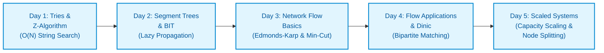

# 📘 WEEK 15: ADVANCED STRINGS, RANGE QUERIES & NETWORK FLOW

> 🧭 **Navigation:** [← Previous: Week 14](../week_14_matrix_backtracking_bits/README.md) • [🏠 Curriculum Overview](../README.md) • [📘 Complete Syllabus](../COMPLETE_SYLLABUS.md) • [Next: Week 16 →](../week_16_advanced_data_structures/README.md)
> 
> 💡 **Instructor Note:** *Week 15 covers the pinnacle of advanced algorithmic infrastructure: linear string matching via Tries & the Z-Algorithm, dynamic interval updates via Segment Trees with Lazy Propagation, and maximum network flow reductions via Edmonds-Karp, Dinic's Algorithm, and the Min-Cut Theorem.*

---

## 🎯 Weekly Mission & Conceptual Focus

Master prefix retrieval trees (Tries), the rightmost matching window Z-Algorithm, logarithmic interval range queries (Segment Trees & Binary Indexed Trees / Fenwick), the "Sticky Note" Lazy Propagation architecture, residual network graphs, augmenting path discovery, Dinic's level-graph blocking flow, and bipartite matching reductions.

---

## 📅 Day-by-Day Learning Path

| Day | Instructional Module | Focus & Core Objective |
| :--- | :--- | :--- |
| **Day 01** | [Advanced String Structures: Tries & Z-Algorithm](Week_15_Day_01_Z_Algorithm_And_Advanced_String_Matching_Instructional.md) | Prefix Trees with zero-leak bottom-up pruning, phonebook autocomplete, Z-algorithm linear matching window $[L, R]$, and string periodicity. |
| **Day 02** | [Range Queries: Segment Trees & Fenwick Trees](Week_15_Day_02_Segment_Trees_Range_Queries_Instructional.md) | Binary Indexed Trees ($i \ \& \ -i$ LSB interval ladder), Segment Trees in 1D array ($4N$), and the "Post-It Note" Lazy Propagation architecture. |
| **Day 03** | [Network Flow Fundamentals: Edmonds-Karp & Min-Cut](Week_15_Day_03_Network_Flow_Basics_Instructional.md) | Physical intuition of residual graphs (forward capacity vs backward undo flow), BFS augmenting path termination in $O(V \cdot E^2)$, and Max-Flow Min-Cut duality. |
| **Day 04** | [Network Flow Applications: Dinic & Bipartite Matching](Week_15_Day_04_Network_Flow_Applications_Instructional.md) | Dinic's two-phase level graph DAG + DFS blocking flow with dead-end elimination ($ptr$ array), $O(E \sqrt{V})$ unit networks, and Maximum Bipartite Matching. |
| **Day 05** | [Scaled Network Flow Systems & Capacity Scaling](Week_15_Day_05_Design_Patterns_Extensions_Instructional.md) | Capacity scaling thresholding ($\Delta = 2^k$) in $O(E \log U)$, node-splitting transformations for vertex capacity bottlenecks, and multi-constraint routing. |

---

## 📚 Consolidated Playbooks & Reference Guides

*   📖 **Comprehensive Week Playbook:** [WEEK_15_FULL_PLAYBOOK.md](WEEK_15_FULL_PLAYBOOK.md) — High-density synthesis of all invariants, theorems, and pattern triggers for this week.
*   📊 **Visual Concepts Playbook (Hybrid):** [Week_15_Visual_Concepts_Playbook_HYBRID.md](Week_15_Visual_Concepts_Playbook_HYBRID.md) — Compact Mermaid diagrams, state transitions, and complexity reference tables.
*   💻 **Production C# Reference (.NET 8/9):** [Week_15_Extended_CSharp_Complete.md](Week_15_Extended_CSharp_Complete.md) — Idiomatic, zero-allocation memory-aware implementations and problem ladders.
*   🐍 **Production Python Reference (Python 3.11+):** [Week_15_Extended_Python_Complete.md](Week_15_Extended_Python_Complete.md) — Clean, pythonic reference implementations for rapid whiteboard prototyping.

---

## 🛠️ The 5 Core Support Files (`support files/`)

Every week is accompanied by five dedicated support files located in the `support files/` subdirectory:

1.  📋 [Daily Progress Checklist](support%20files/Week_15_Daily_Progress_Checklist.md) — Step-by-step accountability tracker for theory, coding, and variants.
2.  🧭 [Weekly Guidelines & Mental Models](support%20files/Week_15_Guidelines.md) — Strategic roadmap, common pitfalls, and conceptual anchors.
3.  🎙️ [Interview Q&A Comprehensive Reference](support%20files/Week_15_Interview_QA_Reference.md) — High-frequency senior technical questions with verbal response frameworks.
4.  🗺️ [Problem-Solving Roadmap](support%20files/Week_15_Problem_Solving_Roadmap.md) — Tier-1 problem progression ladder from warm-up to advanced.
5.  📑 [Summary & Key Concepts Synthesis](support%20files/Week_15_Summary_Key_Concepts.md) — Fast-revision cheat sheet covering all governing invariants and system trade-offs.

---

> 🧭 **Navigation:** [← Previous: Week 14](../week_14_matrix_backtracking_bits/README.md) • [🏠 Curriculum Overview](../README.md) • [📘 Complete Syllabus](../COMPLETE_SYLLABUS.md) • [Next: Week 16 →](../week_16_advanced_data_structures/README.md)
