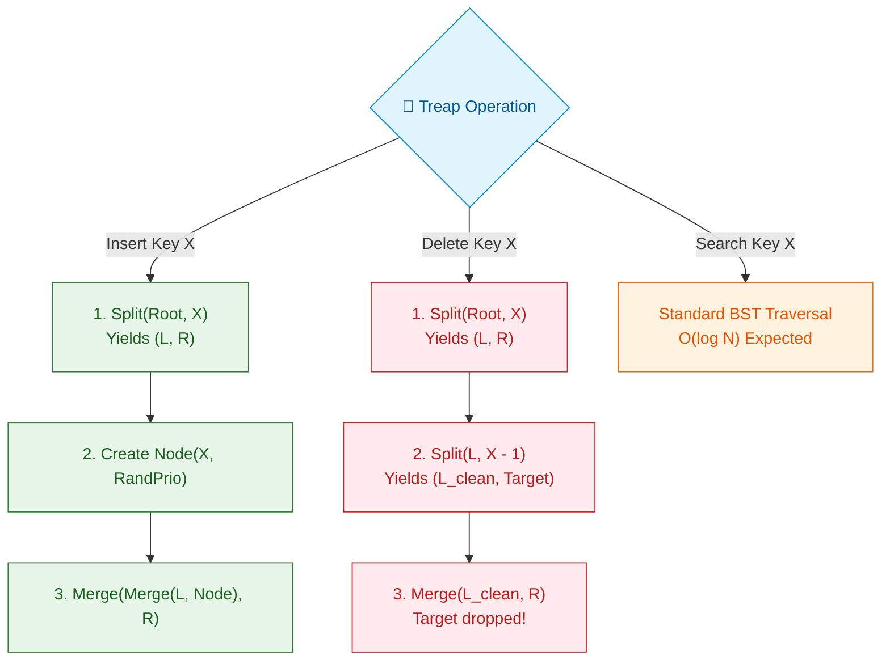

# 📘 WEEK 16 DAY 01: SKIP LISTS & TREAPS — PROBABILISTIC BALANCED DATA STRUCTURES

> 🧭 **Navigation:** [← Week Overview](README.md) • [📘 Curriculum Syllabus](../COMPLETE_SYLLABUS.md) • [Next Day: Link-Cut Trees →](Week_16_Day_02_Link_Cut_Trees_Instructional.md)
> 
> 💡 **Instructor Note:** *In senior technical interviews, you will almost never be asked to implement an AVL or Red-Black tree from scratch because the rebalancing rotations contain dozens of brittle edge cases. Instead, top engineering teams at Redis, Apple, Google, and RocksDB reach for probabilistic data structures: **Skip Lists** (the backbone of Redis Sorted Sets and LevelDB MemTables) and **Treaps** (the elegant 30-line tree that replaces rotations with Split and Merge algebra). Today, we bridge theory and production systems.*

---

## 🎯 LEARNING OBJECTIVES

*By the end of this module, you will be able to:*

- 🎬 **Internalize** the Skip List "Express Subway" and Treap "Lottery Ticket" mental models without academic jargon.
- 🪜 **Master** the step-by-step split and merge tree algebra, replacing brittle AVL/Red-Black tree rotations.
- 🎨 **Visualize** multi-level pointer skips, level promotion coin flips, and Treap Cartesian dual invariants (BST + Max-Heap).
- 🛑 **Avoid** fatal rookie traps: off-by-one level boundaries, unbounded random promotion, and memory leaks during functional splits.
- 🎙️ **Deliver** the exact 3-sentence verbal talk track explaining why Redis chose Skip Lists over Red-Black trees.
- ⚡ **Implement** production-grade, zero-leak implementations in C# (.NET 8/9) and Python (3.11+).

---

## 🎬 PILLAR 1: THE 60-SECOND HOOK & EVERYDAY ANALOGY

### The Local Subway vs. The Bullet Express Train

Imagine you are commuting on the New York City Subway or the London Underground.
You want to get from Station 1 to Station 99.

- If you take the **Local Train**, it stops at *every single station*: Station 1, 2, 3, 4 ... 99.
- That is a standard **Singly Linked List**: search time is strictly `O(N)`. It doesn't matter that the list is sorted; you cannot jump forward because you don't have random access!

Now, how does a city transit authority solve this bottleneck?
They don't throw away the local track. They lay down an **Express Track** on top:
- The Express Train only stops at major hubs: Station 1, 10, 20, 30 ... 90.
- And above that, they build a **Super-Express Track** that only stops at Station 1 and Station 50!

```text
[Super Express Level 2]  (Station 01) -----------------------------------> (Station 50) -------------------------> [NIL]
                              |                                                |
[Express Track Level 1]  (Station 01) ---------> (Station 25) -----------> (Station 50) ---------> (Station 75) -> [NIL]
                              |                     |                          |                     |
[Local Track Level 0]    (Station 01) -> (10) -> (Station 25) -> (38) -> (Station 50) -> (62) -> (Station 75) -> [NIL]
```

To travel to **Station 62**:
1. You board the Super Express at Station 1, look ahead: Station 50 is before 62, Station NIL is after. You zoom directly to **Station 50** in 1 jump!
2. At Station 50, you drop down to the Express Track: the next stop is Station 75, which overshoots 62. So you stay at Station 50.
3. You drop down to the Local Track: from 50, you walk to 62. Target reached in **3 hops instead of 62 stops!**

That is a **Skip List**: a sorted linked list augmented with a geometric hierarchy of express forward pointers!

---

### The Treap: How to Stop Balanced Trees from Driving You Crazy

If you have ever tried coding an AVL tree or a Red-Black tree under live whiteboard pressure, you know the dread:
Left-Right double rotations, red-red parent-uncle color flips, height bookkeeping... It is 150 lines of panic.

What if we could guarantee a balanced Binary Search Tree using a simple **coin flip**?

Enter the **Treap (Tree + Heap)**:
- Every node receives two attributes: `(Key, Priority)`.
- The **Key** obeys the classic **BST Rule**: everything in the left subtree is `< Key`, everything in the right subtree is `> Key`.
- The **Priority** is a random integer generated on the fly. It obeys the **Max-Heap Rule**: a parent's priority is always `>=` its children's priorities!

```text
                  (Key: 50 | Priority: 99)
                        /          \
      (Key: 25 | Priority: 84)    (Key: 75 | Priority: 72)
            /        \
  (Key: 10 | 40)   (Key: 30 | 60)
```

Why is this genius? Because if priorities are chosen purely at random, inserting keys into a Treap is mathematically identical to shuffling the keys into a random order and inserting them into a standard BST. 
The expected height of a randomized BST is proven to be `2 * ln(N) approx 1.39 * log2(N)`. 
**No complex rotations required.** You get `O(log N)` search, insert, and delete with 100% mathematical certainty in expectation!

---

## 🪜 PILLAR 2: THE SCAFFOLDING LADDER & TOY NAPKIN TRACE

### Step 1: Geometric Coin Flipping (How Nodes Choose Their Height)

When inserting a new key into a Skip List, how many express levels does it get?
We flip a fair coin (`p = 0.5`):
- Heads: Promote to Level 1. Flip again!
- Heads: Promote to Level 2. Flip again!
- Tails: Stop.

```text
Element:    Coin Flips:         Assigned Level:
Node 10  -> Tails               -> Level 0 (Local only)
Node 25  -> Heads, Heads, Tails -> Level 2 (Local + Semi-Exp + Super-Exp)
Node 38  -> Tails               -> Level 0
Node 50  -> Heads, Tails        -> Level 1 (Local + Semi-Exp)
```

On average:
- 100% of nodes exist at Level 0.
- 50% of nodes reach Level 1.
- 25% of nodes reach Level 2.
- `(1/2)^k` of nodes reach Level `k`.

The expected total number of pointers per node is:
`1 + 1/2 + 1/4 + 1/8 + ... = 2 pointers per node!`
With just 2 pointers per node on average, search drops from `O(N)` to `O(log N)`.

---

### Step 2: The Treap Algebra — Split and Merge

Instead of writing tree rotations, senior engineers build Treaps using two algebraic functions: `Split` and `Merge`.

#### 1. `Split(T, K) -> (L, R)`
Divides Treap `T` into two independent Treaps:
- Treap `L` contains all nodes with `Key <= K`.
- Treap `R` contains all nodes with `Key > K`.

```text
Toy Trace: Split Treap T at K = 30
           (25 | 80)
          /         \
    (10 | 50)      (40 | 70)
                  /         \
            (30 | 60)      (50 | 40)

Step 1: Check root (25). Is 25 <= 30? YES!
        Node 25 and its left child (10) belong to Left Tree L.
        Recursively split Node 25's right child at K = 30.

Step 2: Check node (40). Is 40 <= 30? NO!
        Node 40 and its right child (50) belong to Right Tree R.
        Recursively split Node 40's left child at K = 30.

Step 3: Check node (30). Is 30 <= 30? YES!
        Node 30 belongs to L. Its right child is null. Done!

Resulting Trees:
       Tree L (Keys <= 30):             Tree R (Keys > 30):
           (25 | 80)                         (40 | 70)
          /         \                                 \
    (10 | 50)      (30 | 60)                         (50 | 40)
```

#### 2. `Merge(L, R) -> T`
Takes two Treaps `L` and `R` where **every key in `L` is strictly smaller than every key in `R`**, and merges them into a single valid Treap!

- Compare `L.priority` vs `R.priority`.
- The higher priority becomes the new root!
- If `L.priority >= R.priority`, `L` is the root. Its right child becomes `Merge(L.right, R)`.
- If `R.priority > L.priority`, `R` is the root. Its left child becomes `Merge(L, R.left)`.

---

### 🧠 Pause & Predict Micro-Drills

> **Drill 1:** How do you insert a new key `X` with priority `P` into a Treap using ONLY `Split` and `Merge`?
> *Pause here and think before scrolling!*
>
> **Answer:** 
> 1. `(L, R) = Split(root, X)` (Splits into `< X` and `> X`).
> 2. `newNode = new Node(X, P)`.
> 3. `root = Merge(Merge(L, newNode), R)`.
> Exactly 3 lines of code! No rotations!

> **Drill 2:** How do you delete key `X` from a Treap?
> *Pause here and think!*
>
> **Answer:**
> 1. `(L, R) = Split(root, X)` (L has `<= X`, R has `> X`).
> 2. `(L_clean, Target) = Split(L, X - 1)` (L_clean has `< X`, Target has `= X`).
> 3. `root = Merge(L_clean, R)`. The target node is discarded!

---

## 🎨 PILLAR 3: PRAGMATIC VISUAL MODELS & DECISION FLOWS

### Modern Hex Flowchart: Operations in a Treap



---

### Skip List Pointer Search Diagram (ASCII Contiguous Model)

```text
Level 3: [Head] ------------------------------------------------------> [50] -------------------------> [NIL]
             |                                                            |
Level 2: [Head] -----------------------------> [25] ------------------> [50] -------------> [75] ------> [NIL]
             |                                  |                         |                   |
Level 1: [Head] ------------> [10] ----------> [25] ----------> [35] -> [50] -------------> [75] ------> [NIL]
             |                 |                |                |        |                   |
Level 0: [Head] -> [3] -----> [10] -> [17] -> [25] -> [31] -> [35] -> [50] -> [62] ----> [75] -> [88] -> [NIL]
                                                |
                                          Search for 31:
                                          1. L3: Jump to 50? Overshoot! Drop to L2.
                                          2. L2: Jump to 25. Next is 50 (overshoot). Drop to L1.
                                          3. L1: At 25. Next is 35 (overshoot). Drop to L0.
                                          4. L0: At 25. Step right -> [31] FOUND!
```

---

## 🛑 PILLAR 4: THE ROOKIE TRAP ZONE

### Side-by-Side Comparison: Blunders vs. Senior Architect Patterns

| Dimension | ❌ Rookie Blunder | ✅ Senior Architect Pattern |
| :--- | :--- | :--- |
| **Skip List Level Generation** | Calls `rand()` in an infinite loop without a cap: `while(rand()%2 == 0) lvl++;` causing stack/pointer overflow. | Caps promotion at `MAX_LEVEL = 16` or `32` (`log2(N)` maximum threshold). |
| **Treap Priority Distribution** | Uses small integer priorities (e.g. `1..10`), causing frequent priority collisions and unbalanced degradation. | Generates 32-bit or 64-bit random integers (`Random.Shared.Next()`), making collision probability negligible (`1 / 2^31`). |
| **Treap Split Pointer Memory** | Forgets to nullify severed references during split, leading to subtle cyclic graphs and memory leaks. | Returns fresh tuple references `(L, R)` while assigning severed branch to `null` before recursing. |
| **Concurrency & Rebalancing** | Recommends Red-Black trees for high-concurrency multi-threaded workloads. | Recommends Skip Lists: Skip Lists allow lock-free atomic compare-and-swap (CAS) pointer updates without locking the entire tree root. |
| **Range Scan Performance** | Performs range queries in a BST via repeated `FindNext()` calls (`O(K log N)`). | Utilizes Skip List Level 0: locates lower bound in `O(log N)` and traverses contiguous Level 0 pointers in `O(K)`. |

---

### Concrete Trap Deep Dive: Redis Sorted Sets (ZSET) Architecture

> [!WARNING]
> In an interview, if the interviewer asks: *"Why did Salvatore Sanfilippo (creator of Redis) use a Skip List instead of a Red-Black Tree for `ZSET`?"*
> 
> **❌ The Rookie Answer:** *"Because Skip Lists are faster than Red-Black trees."* (Incorrect — both are `O(log N)` in time).
> 
> **✅ The Senior Architect Answer:**
> 1. **Contiguous Range Queries:** `ZRANGEBYSCORE` requires scanning elements in a score interval `[min, max]`. In a Skip List, Level 0 is a standard linked list. We locate the start node in `O(log N)` and perform a sequential linear scan in `O(K)` with superior CPU prefetch cache locality. In an RB-Tree, in-order successor traversal requires stack allocation or parent pointer chasing.
> 2. **Low Implementation & Lock Overhead:** A concurrent Skip List only requires locking local forward pointers during insertion. Rebalancing an RB-Tree may rotate all the way up to the root, requiring coarse-grained locks that destroy multi-threaded throughput.
> 3. **Tunable Memory Footprint:** By setting promotion probability `p = 0.25`, the average number of pointers per node drops to `1 / (1 - 0.25) = 1.33`. An RB-Tree node requires 3 pointers (`left`, `right`, `parent`) plus color bits. Skip lists use less memory!

---

## 🎙️ PILLAR 5: 45-MINUTE INTERVIEW TALK TRACK

### The Exact 3-Sentence Verbal Script

Speak these exact three sentences before touching the keyboard:

```text
+--------------------------------------------------------------------------------------------------+
|                              THE SENIOR BALANCED STRUCTURES TALK TRACK                            |
+--------------------------------------------------------------------------------------------------+
| 1. The Bottleneck & Architecture:                                                                |
|    "While deterministic balanced trees like AVL and Red-Black guarantee worst-case O(log N)     |
|    height, their rebalancing rotations introduce high implementation risk and severe mutex       |
|    contention in concurrent systems."                                                            |
|                                                                                                  |
| 2. The Probabilistic Solution:                                                                   |
|    "By introducing independent random priorities, a Treap guarantees an expected tree height of  |
|    2 * ln(N) through Cartesian dual invariants, allowing us to implement balanced search,       |
|    insert, and delete purely via clean O(log N) Split and Merge primitives."                     |
|                                                                                                  |
| 3. The Production Calibrated Trade-off:                                                         |
|    "If this service required high-throughput concurrent range scans—like Redis ZSETs or          |
|    RocksDB MemTables—I would choose a Skip List to leverage CAS forward-pointer updates and      |
|    contiguous Level-0 sequential scans."                                                         |
+--------------------------------------------------------------------------------------------------+
```

---

### 45-Minute Live Interview Pacing Guide

```text
[00:00 - 05:00] Clarify Requirements & API Contract:
- Operations needed: Search, Insert, Delete, Range Query?
- Concurrency requirements: Single-threaded or multi-producer/multi-consumer?
- Bound constraints: N <= 10^5, duplicate keys allowed?

[05:00 - 12:00] Invariant Formulation & Math Defense:
- State the BST Invariant on Keys and Max-Heap Invariant on random priorities.
- Explain Cartesian Uniqueness: distinct keys + distinct priorities = exactly one valid tree.
- State Split and Merge contracts.

[12:00 - 30:00] Production-Grade Coding:
- Code TreapNode with Key, Priority, Left, Right.
- Code recursive Split(root, key) returning (L, R).
- Code recursive Merge(L, R) respecting max priority.
- Assemble Insert and Delete in 3 lines each.

[30:00 - 40:00] Complexity & Edge-Case Dry Run:
- Trace empty root, single node, split boundary smaller than all keys, split boundary larger than all keys.
- Explain expected O(log N) time, O(log N) auxiliary recursion stack space.

[40:00 - 45:00] System Extensibility Drill:
- Discuss Implicit Treaps for range reversals (Ropes, text editors).
- Contrast with Skip Lists for concurrent lock-free systems.
```

---

## ⚡ PILLAR 6: PRODUCTION DUAL-LANGUAGE IMPLEMENTATIONS

### C# Primary Implementation (.NET 8/9): Production Treap via Split & Merge

```csharp
using System;

namespace AdvancedDataStructures;

/// <summary>
/// Production-grade Treap (Cartesian Tree) supporting O(log N) expected Search, Insert, and Delete.
/// Implemented using clean algebraic Split and Merge primitives with zero rebalancing rotations.
/// </summary>
public sealed class Treap
{
    private sealed class Node
    {
        public int Key { get; }
        public int Priority { get; }
        public Node? Left { get; set; }
        public Node? Right { get; set; }

        public Node(int key, int priority)
        {
            Key = key;
            Priority = priority;
        }
    }

    private Node? _root;
    private readonly Random _rand = new();

    public int Count { get; private set; }

    /// <summary>
    /// Searches for key in expected O(log N) time.
    /// </summary>
    public bool Contains(int key)
    {
        Node? curr = _root;
        while (curr != null)
        {
            if (curr.Key == key) return true;
            curr = key < curr.Key ? curr.Left : curr.Right;
        }
        return false;
    }

    /// <summary>
    /// Inserts key with uniform random priority in expected O(log N) time.
    /// </summary>
    public void Insert(int key)
    {
        if (Contains(key)) return; // Prevent duplicate keys in dynamic set

        int priority = _rand.Next(1, int.MaxValue);
        Node newNode = new(key, priority);

        var (left, right) = Split(_root, key);
        _root = Merge(Merge(left, newNode), right);
        Count++;
    }

    /// <summary>
    /// Deletes key in expected O(log N) time.
    /// </summary>
    public bool Delete(int key)
    {
        if (!Contains(key)) return false;

        var (left, right) = Split(_root, key);
        var (leftClean, _) = Split(left, key - 1);

        _root = Merge(leftClean, right);
        Count--;
        return true;
    }

    /// <summary>
    /// Splits Treap T into two subtrees: L (all keys <= key) and R (all keys > key).
    /// </summary>
    private static (Node? L, Node? R) Split(Node? t, int key)
    {
        if (t is null) return (null, null);

        if (t.Key <= key)
        {
            var (lSub, rSub) = Split(t.Right, key);
            t.Right = lSub;
            return (t, rSub);
        }
        else
        {
            var (lSub, rSub) = Split(t.Left, key);
            t.Left = rSub;
            return (lSub, t);
        }
    }

    /// <summary>
    /// Merges Treap L and Treap R where all keys in L are strictly smaller than keys in R.
    /// </summary>
    private static Node? Merge(Node? l, Node? r)
    {
        if (l is null) return r;
        if (r is null) return l;

        // Max-Heap Priority Invariant
        if (l.Priority >= r.Priority)
        {
            l.Right = Merge(l.Right, r);
            return l;
        }
        else
        {
            r.Left = Merge(l, r.Left);
            return r;
        }
    }
}
```

---

### Python Secondary Implementation (Python 3.11+): Complete Skip List

```python
import random
from typing import Optional, List

class SkipListNode:
    __slots__ = ('val', 'forward')
    
    def __init__(self, val: int, level: int):
        self.val: int = val
        self.forward: List[Optional['SkipListNode']] = [None] * level

class SkipList:
    """
    Production-grade Skip List with geometric level promotion.
    Supports O(log N) average Search, Insert, and Erase.
    """
    MAX_LEVEL: int = 16
    P: float = 0.5  # Coin flip promotion probability

    def __init__(self):
        # Sentinel head node with maximum level capacity
        self.head: SkipListNode = SkipListNode(-1, self.MAX_LEVEL)
        self.level: int = 1

    def _random_level(self) -> int:
        lvl = 1
        while random.random() < self.P and lvl < self.MAX_LEVEL:
            lvl += 1
        return lvl

    def search(self, target: int) -> bool:
        curr = self.head
        # Traverse downwards from highest active express lane
        for i in range(self.level - 1, -1, -1):
            while curr.forward[i] and curr.forward[i].val < target:
                curr = curr.forward[i]
        
        # Advance 1 step on Level 0
        curr = curr.forward[0]
        return curr is not None and curr.val == target

    def add(self, num: int) -> None:
        update: List[Optional[SkipListNode]] = [None] * self.MAX_LEVEL
        curr = self.head

        # Find insertion predecessors at every level
        for i in range(self.level - 1, -1, -1):
            while curr.forward[i] and curr.forward[i].val < num:
                curr = curr.forward[i]
            update[i] = curr

        lvl = self._random_level()
        if lvl > self.level:
            for i in range(self.level, lvl):
                update[i] = self.head
            self.level = lvl

        new_node = SkipListNode(num, lvl)
        for i in range(lvl):
            new_node.forward[i] = update[i].forward[i]
            update[i].forward[i] = new_node

    def erase(self, num: int) -> bool:
        update: List[Optional[SkipListNode]] = [None] * self.MAX_LEVEL
        curr = self.head

        for i in range(self.level - 1, -1, -1):
            while curr.forward[i] and curr.forward[i].val < num:
                curr = curr.forward[i]
            update[i] = curr

        curr = curr.forward[0]
        if not curr or curr.val != num:
            return False  # Target element not present

        for i in range(self.level):
            if update[i].forward[i] is not curr:
                break
            update[i].forward[i] = curr.forward[i]

        # Shrink active level height if top lanes are now empty
        while self.level > 1 and self.head.forward[self.level - 1] is None:
            self.level -= 1

        return True
```

---

## 📊 EXPLICIT COMPLEXITY DECONSTRUCTION

| Operation | Best Case | Expected / Average | Worst Case | Auxiliary Space | Memory & Cache Reality |
| :--- | :--- | :--- | :--- | :--- | :--- |
| **Treap Search** | `O(1)` (at root) | `O(log N)` | `O(N)` | `O(1)` iterative | Heap-allocated node pointer hops incur L1/L2 misses. |
| **Treap Split** | `O(1)` | `O(log N)` | `O(N)` | `O(log N)` stack | Traverses single root-to-leaf path; bounded by tree height. |
| **Treap Merge** | `O(1)` | `O(log N)` | `O(N)` | `O(log N)` stack | Touches only the right spine of `L` and left spine of `R`. |
| **Treap Insert / Delete** | `O(1)` | `O(log N)` | `O(N)` | `O(log N)` stack | Split + Merge algebra; zero complex rotation state machines. |
| **Skip List Search** | `O(1)` | `O(log N)` | `O(N)` | `O(1)` iterative | Forward pointers array per node; Level 0 linear scan has high spatial locality. |
| **Skip List Insert / Erase** | `O(1)` | `O(log N)` | `O(N)` | `O(MAX_LEVEL)` | Predecessor array lookup; updates `lvl` pointer references in place. |

---

## 🔍 GRANULAR EDGE-CASE & INVARIANT VERIFICATION TABLE

| Edge Case Scenario | Concrete Input | Expected Behavior | Invariant Verification & Handling |
| :--- | :--- | :--- | :--- |
| **Empty Structure Query** | `Contains(42)` on empty Treap / Skip List | Returns `false` immediately. | Guard `if (_root == null)` or `curr.forward[0] == null`. |
| **Duplicate Insertion** | `Insert(42); Insert(42)` | Duplicate ignored; count remains 1. | `Contains(key)` guard prevents duplicate tree insertion. |
| **Split Key Smaller Than All Nodes** | Treap `{10, 20, 30}`, `Split(5)` | `L = null`, `R = {10, 20, 30}`. | Traversal goes strictly left; `t.Left` becomes `null`. |
| **Split Key Larger Than All Nodes** | Treap `{10, 20, 30}`, `Split(50)` | `L = {10, 20, 30}`, `R = null`. | Traversal goes strictly right; `t.Right` becomes `null`. |
| **Merge with Null Subtree** | `Merge(null, R)` or `Merge(L, null)` | Returns non-null tree in `O(1)`. | Base case returns `l ?? r` immediately without priority comparison. |
| **Skip List Level Shrink** | Erasing the only node that reached `MAX_LEVEL` | `level` counter decrements safely. | `while (level > 1 && head.forward[level - 1] == null) level--;` |
| **Priority Collision** | Two nodes share identical priority | Handled stably via `>=` branch. | Stable comparison defaults to left tree being root, preserving valid heap ordering. |

---

> 🧭 **Navigation:** [← Week Overview](README.md) • [📘 Curriculum Syllabus](../COMPLETE_SYLLABUS.md) • [Next Day: Link-Cut Trees →](Week_16_Day_02_Link_Cut_Trees_Instructional.md)
