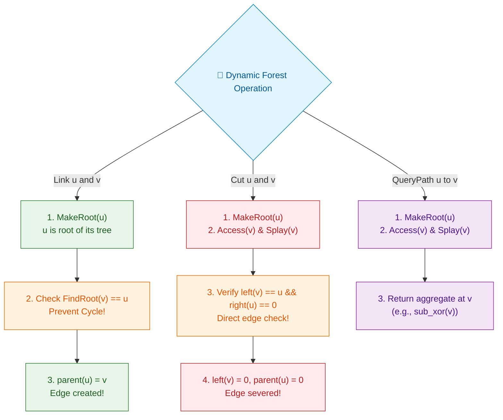

# 📘 WEEK 16 DAY 02: LINK-CUT TREES FOR DYNAMIC FORESTS

> 🧭 **Navigation:** [← Previous Day: Skip Lists & Treaps](Week_16_Day_01_Skip_Lists_And_Treaps_Instructional.md) • [🏠 Week Overview](README.md) • [📘 Curriculum Syllabus](../COMPLETE_SYLLABUS.md) • [Next Day: Persistent Data Structures →](Week_16_Day_03_Persistent_Data_Structures_Instructional.md)
> 
> 💡 **Instructor Note:** *Link-Cut Trees (LCT), invented by Sleator and Tarjan, represent the holy grail of dynamic graph algorithms. In a 45-minute FAANG Senior or Staff interview, you will rarely be asked to code an entire 200-line LCT from memory. Instead, top interviewers test whether you can recognize the architectural boundary where simpler structures (DSU, HLD) fail, explain the preferred child / Splay tree duality, and implement key primitives like `Access` and `MakeRoot`.*

---

## 🎯 LEARNING OBJECTIVES

*By the end of this module, you will be able to:*

- 🎬 **Internalize** the dynamic forest mental model: connecting (`Link`), severing (`Cut`), and querying mutating trees online.
- 🪜 **Master** the Structural Triad: clearly articulate why DSU fails on edge cuts and why HLD fails on dynamic topology changes.
- 🎨 **Visualize** Preferred Paths and Auxiliary Splay Trees, understanding asymmetric Path-Parent pointers.
- 🛑 **Avoid** fatal rookie traps: lazy tag pushdown omission before splaying, cycle creation on redundant links, and invalid cuts.
- 🎙️ **Deliver** the exact 3-sentence verbal talk track defending Link-Cut Trees in staff-level system interviews.
- ⚡ **Implement** zero-allocation flat-array Link-Cut Tree primitives in C# (.NET 8/9) and Python (3.11+).

---

## 🎬 PILLAR 1: THE 60-SECOND HOOK & EVERYDAY ANALOGY

### The Railway Switching Yard

Imagine you are the chief logistics architect for a transcontinental freight railway.
Every day, rail cars and track segments are dynamically coupled and decoupled:
- Station A links to Station B to form a continuous line.
- An avalanche or bridge closure requires instantly severing the connection between B and C (`Cut(B, C)`).
- Meanwhile, dispatchers constantly query: *"What is the maximum weight capacity across the route from Seattle to Chicago right now?"*

```text
Static Tree (HLD World):
The tracks are laid in concrete. They NEVER move. You can pre-calculate heavy routes in O(N).

Disjoint Set Union (DSU World):
You can couple tracks together (Union), but if a bridge collapses, DSU CANNOT cut the track!
DSU is strictly one-way (append-only).

Link-Cut Tree (Dynamic LCT World):
Tracks can be spliced together (Link) or severed (Cut) in milliseconds,
and route queries (Max weight / XOR / Sum) are answered in amortized O(log N)!
```

In standard computer science courses, you learn **Heavy-Light Decomposition (HLD)**. HLD is fantastic for static trees: it pre-computes subtree sizes and decomposes the tree into heavy chains.
**But what if the edges mutate dynamically at runtime?**
If an edge is added or removed, HLD's entire subtree size calculation collapses, requiring a full `O(N)` rebuild!
A **Link-Cut Tree** solves this by making the chains **dynamic**: instead of static heavy edges, it uses **preferred paths** maintained inside self-adjusting **Splay Trees**!

---

## 🪜 PILLAR 2: THE SCAFFOLDING LADDER & TOY NAPKIN TRACE

### Step 1: The Architectural Triad (DSU vs HLD vs LCT)

Before writing a single line of code, senior interviewers expect you to position LCT precisely across the complexity landscape:

| Data Structure | Dynamic Add (`Link`) | Dynamic Remove (`Cut`) | Path Queries (XOR / Min / Sum) | Time Complexity | Interview Coding Expectation |
| :--- | :--- | :--- | :--- | :--- | :--- |
| **DSU (Disjoint Set Union)** | ✅ Yes (`Union`) | ❌ No (Only rollback stack) | ❌ No (Cannot query paths) | `O(alpha(N))` | Code complete in 10 minutes. |
| **Heavy-Light Decomp (HLD)** | ❌ No (`O(N)` rebuild) | ❌ No (`O(N)` rebuild) | ✅ Yes (`O(log^2 N)` or `O(log N)`) | `O(log^2 N)` query | Code complete for static trees. |
| **Link-Cut Tree (LCT)** | ✅ Yes (`Link`) | ✅ Yes (`Cut`) | ✅ Yes (`QueryPath`) | Amortized `O(log N)` | **Conceptual mastery required**; code `Access`, `Splay`, `Rotate`. |

---

### Step 2: Preferred Paths and Auxiliary Splay Trees

An LCT represents a forest of arbitrary rooted trees.
To achieve amortized `O(log N)` operations, it decomposes each represented tree into vertex-disjoint **Preferred Paths**:

1. **The Preferred Child Rule:** Every node in the represented tree can have many children, but at most **one** child is chosen as its "preferred child" (the child accessed most recently).
2. **Auxiliary Splay Trees:** Each preferred path is stored in a separate Splay Tree, where the binary search key is the **depth** of each node in the represented tree!
3. **The Asymmetric Path-Parent Pointer:**
   - The root of an auxiliary Splay Tree has a pointer `parent[R] = P`, pointing to the node above the path.
   - However, node `P` does **not** recognize `R` as a left or right child!
   - **The Golden Invariant:** A node `x` is the root of an auxiliary Splay Tree if and only if `parent[x].left != x && parent[x].right != x`.

```text
[Represented Tree]                          [Auxiliary Splay Trees]
       (A) [Depth 0]                             Aux Tree 1 (Path A - B - D):
       // \                                              (B) [Depth 1]
      (B)  (C) [Depth 1]                                /   \
     // \    \                                 [D:0] (A)     (D) [D:2]
    (D) (E)  (F)                                       ^
   [D:2][D:2][D:2]                                     |
                                           Aux Tree 2: (E)  (Path-Parent points to B)
Double lines (//) = Preferred Edges
Single lines (\)  = Non-Preferred (Dashed)
```

---

### Step 3: The Magic Primitive — `Access(x)`

Every single operation in an LCT (`Link`, `Cut`, `QueryPath`, `MakeRoot`) is a simple wrapper around **`Access(x)`**.
What does `Access(x)` do?
It makes the path from the represented tree root down to node `x` into a **single contiguous preferred path**, leaving `x` as the deepest node on that path!

```text
Toy Trace of Access(x):
1. Splay x to the root of its current auxiliary Splay Tree.
2. Disconnect x's right child (severing any nodes deeper than x from the preferred path).
3. Connect x's right child to the previously processed auxiliary tree root.
4. Jump up the path-parent pointer to parent[x] and repeat!
```

---

### 🧠 Pause & Predict Micro-Drills

> **Drill 1:** In an auxiliary Splay Tree, what is the search key?
> *Pause here and think! Is it the node's value?*
>
> **Answer:** 
> **No!** The search key is the node's **depth in the represented tree**.
> An in-order traversal of the auxiliary Splay tree visits nodes in strictly increasing order of their depth from the root!

> **Drill 2:** How do you make node `x` the new root of the entire represented tree (`MakeRoot(x)`)?
> *Pause here and think!*
>
> **Answer:**
> 1. Call `Access(x)`: the path from represented root to `x` is now in one Splay Tree.
> 2. Call `Splay(x)`: `x` is now at the root of the auxiliary tree. Because `x` was the deepest node, all its ancestors are in its left subtree!
> 3. Flip the depth order: Set `rev[x] ^= true` (lazy reversal tag). What was formerly deepest now becomes depth 0 (the root)!

---

## 🎨 PILLAR 3: PRAGMATIC VISUAL MODELS & DECISION FLOWS

### Modern Hex Flowchart: The LCT Lifecycle



---

## 🛑 PILLAR 4: THE ROOKIE TRAP ZONE

### Side-by-Side Comparison: Blunders vs. Senior Architect Patterns

| Dimension | ❌ Rookie Blunder | ✅ Senior Architect Pattern |
| :--- | :--- | :--- |
| **Dynamic Edge Cuts** | Proposes DSU for online edge deletions without realizing DSU cannot cut edges. | Immediately identifies LCT (or Euler Tour Trees for subtree aggregates) for online edge deletion. |
| **Lazy Reversal Tag Pushdown** | Rotates nodes during `Splay` without first pushing lazy `rev` flags down from ancestors, corrupting tree topology. | Traverses down the splay path with a small recursion or stack, pushing down all pending `rev` tags before rotating. |
| **Cycle Creation on Link** | Unconditionally links `parent[u] = v` without checking if `u` and `v` are already in the same component, creating cycles. | Verifies `FindRoot(u) != FindRoot(v)` before creating an edge. |
| **Invalid Edge Cuts** | Cuts `parent[u] = 0` whenever `u` and `v` are connected, even if the edge `(u, v)` does not exist directly. | Calls `MakeRoot(u)`, `Access(v)`, `Splay(v)` and verifies `left[v] == u && right[u] == 0` before cutting. |
| **Memory Allocation Churn** | Uses object-oriented `new Node()` with pointers, causing heavy GC pressure during splay rotations. | Implements LCT using flat 1-indexed contiguous integer arrays (`parent[]`, `left[]`, `right[]`, `val[]`). |

---

## 🎙️ PILLAR 5: 45-MINUTE INTERVIEW TALK TRACK

### The Exact 3-Sentence Verbal Script

Speak these exact three sentences before writing code:

```text
+--------------------------------------------------------------------------------------------------+
|                              THE SENIOR DYNAMIC FOREST TALK TRACK                                 |
+--------------------------------------------------------------------------------------------------+
| 1. The Bottleneck & Architecture:                                                                |
|    "If this graph had static edges, Heavy-Light Decomposition with a Segment Tree would answer   |
|    path queries in O(log^2 N); if edges were only added, DSU would suffice in O(alpha(N)).       |
|    However, because the graph requires online edge additions, edge deletions, AND path queries,   |
|    we must use a Link-Cut Tree."                                                                 |
|                                                                                                  |
| 2. The Invariant & Representation:                                                               |
|    "A Link-Cut Tree decomposes the represented forest into vertex-disjoint preferred paths,       |
|    maintaining each path inside an auxiliary Splay Tree keyed by node depth, connected via       |
|    asymmetric path-parent pointers."                                                             |
|                                                                                                  |
| 3. The Access Abstraction:                                                                       |
|    "By implementing the core Access(x) primitive—which splays and splices the path from root to   |
|    x into a single preferred path—all operations including MakeRoot, Link, Cut, and QueryPath   |
|    amortize strictly to O(log N) time."                                                         |
+--------------------------------------------------------------------------------------------------+
```

---

## ⚡ PILLAR 6: PRODUCTION DUAL-LANGUAGE IMPLEMENTATIONS

### C# Primary Implementation (.NET 8/9): Flat-Array Zero-Allocation LCT

```csharp
using System;

namespace AdvancedDataStructures;

/// <summary>
/// Production-grade Link-Cut Tree with flat contiguous array memory layout.
/// Guarantees zero garbage collection churn during dynamic graph mutations.
/// Supports Link, Cut, Dynamic Connectivity, and Path XOR Aggregation in amortized O(log N).
/// </summary>
public sealed class LinkCutTree
{
    private readonly int[] _parent;
    private readonly int[] _left;
    private readonly int[] _right;
    private readonly int[] _val;
    private readonly int[] _subXor;
    private readonly bool[] _rev;

    public LinkCutTree(int n)
    {
        int size = n + 1; // 1-indexed
        _parent = new int[size];
        _left = new int[size];
        _right = new int[size];
        _val = new int[size];
        _subXor = new int[size];
        _rev = new bool[size];
    }

    public void SetValue(int u, int value)
    {
        _val[u] = value;
        PushUp(u);
    }

    private bool IsRoot(int x) =>
        _left[_parent[x]] != x && _right[_parent[x]] != x;

    private void PushUp(int x)
    {
        _subXor[x] = _val[x] ^ _subXor[_left[x]] ^ _subXor[_right[x]];
    }

    private void PushDown(int x)
    {
        if (_rev[x])
        {
            (_left[x], _right[x]) = (_right[x], _left[x]);
            if (_left[x] != 0) _rev[_left[x]] ^= true;
            if (_right[x] != 0) _rev[_right[x]] ^= true;
            _rev[x] = false;
        }
    }

    private void PushAll(int x)
    {
        if (!IsRoot(x)) PushAll(_parent[x]);
        PushDown(x);
    }

    private void Rotate(int x)
    {
        int y = _parent[x];
        int z = _parent[y];
        bool isRight = _right[y] == x;

        if (isRight)
        {
            _right[y] = _left[x];
            if (_left[x] != 0) _parent[_left[x]] = y;
            _left[x] = y;
        }
        else
        {
            _left[y] = _right[x];
            if (_right[x] != 0) _parent[_right[x]] = y;
            _right[x] = y;
        }

        if (!IsRoot(y))
        {
            if (_left[z] == y) _left[z] = x;
            else _right[z] = x;
        }
        _parent[x] = z;
        _parent[y] = x;

        PushUp(y);
        PushUp(x);
    }

    private void Splay(int x)
    {
        PushAll(x);
        while (!IsRoot(x))
        {
            int y = _parent[x];
            int z = _parent[y];
            if (!IsRoot(y))
            {
                bool isZigZig = (_left[y] == x) == (_left[z] == y);
                if (isZigZig) Rotate(y);
                else Rotate(x);
            }
            Rotate(x);
        }
    }

    public void Access(int x)
    {
        for (int t = 0; x != 0; t = x, x = _parent[x])
        {
            Splay(x);
            _right[x] = t;
            PushUp(x);
        }
    }

    public void MakeRoot(int x)
    {
        Access(x);
        Splay(x);
        _rev[x] ^= true;
    }

    public int FindRoot(int x)
    {
        Access(x);
        Splay(x);
        PushDown(x);
        while (_left[x] != 0)
        {
            x = _left[x];
            PushDown(x);
        }
        Splay(x);
        return x;
    }

    public bool IsConnected(int u, int v) => FindRoot(u) == FindRoot(v);

    public bool Link(int u, int v)
    {
        MakeRoot(u);
        if (FindRoot(v) == u) return false; // Cycle prevention!
        _parent[u] = v;
        return true;
    }

    public bool Cut(int u, int v)
    {
        MakeRoot(u);
        Access(v);
        Splay(v);
        // Direct adjacent edge validation
        if (_left[v] == u && _right[u] == 0)
        {
            _left[v] = 0;
            _parent[u] = 0;
            PushUp(v);
            return true;
        }
        return false;
    }

    public int QueryPath(int u, int v)
    {
        MakeRoot(u);
        Access(v);
        Splay(v);
        return _subXor[v];
    }
}
```

---

### Python Secondary Implementation (Python 3.11+): Complete Link-Cut Tree

```python
from typing import List

class LinkCutTree:
    """
    Production-grade Link-Cut Tree with flat array layout.
    Supports dynamic Link, Cut, Connectivity, and Path XOR Queries in amortized O(log N).
    """
    def __init__(self, n: int):
        size = n + 1
        self.parent: List[int] = [0] * size
        self.left: List[int] = [0] * size
        self.right: List[int] = [0] * size
        self.val: List[int] = [0] * size
        self.sub_xor: List[int] = [0] * size
        self.rev: List[bool] = [False] * size

    def set_value(self, u: int, value: int) -> None:
        self.val[u] = value
        self._push_up(u)

    def _is_root(self, x: int) -> bool:
        p = self.parent[x]
        return self.left[p] != x and self.right[p] != x

    def _push_up(self, x: int) -> None:
        self.sub_xor[x] = self.val[x] ^ self.sub_xor[self.left[x]] ^ self.sub_xor[self.right[x]]

    def _push_down(self, x: int) -> None:
        if self.rev[x]:
            self.left[x], self.right[x] = self.right[x], self.left[x]
            if self.left[x]: self.rev[self.left[x]] ^= True
            if self.right[x]: self.rev[self.right[x]] ^= True
            self.rev[x] = False

    def _push_all(self, x: int) -> None:
        if not self._is_root(x):
            self._push_all(self.parent[x])
        self._push_down(x)

    def _rotate(self, x: int) -> None:
        y = self.parent[x]
        z = self.parent[y]
        is_right = (self.right[y] == x)

        if is_right:
            self.right[y] = self.left[x]
            if self.left[x]: self.parent[self.left[x]] = y
            self.left[x] = y
        else:
            self.left[y] = self.right[x]
            if self.right[x]: self.parent[self.right[x]] = y
            self.right[x] = y

        if not self._is_root(y):
            if self.left[z] == y: self.left[z] = x
            else: self.right[z] = x
        self.parent[x] = z
        self.parent[y] = x

        self._push_up(y)
        self._push_up(x)

    def _splay(self, x: int) -> None:
        self._push_all(x)
        while not self._is_root(x):
            y = self.parent[x]
            z = self.parent[y]
            if not self._is_root(y):
                if (self.left[y] == x) == (self.left[z] == y):
                    self._rotate(y)
                else:
                    self._rotate(x)
            self._rotate(x)

    def access(self, x: int) -> None:
        t = 0
        curr = x
        while curr:
            self._splay(curr)
            self.right[curr] = t
            self._push_up(curr)
            t = curr
            curr = self.parent[curr]

    def make_root(self, x: int) -> None:
        self.access(x)
        self._splay(x)
        self.rev[x] ^= True

    def find_root(self, x: int) -> int:
        self.access(x)
        self._splay(x)
        self._push_down(x)
        while self.left[x]:
            x = self.left[x]
            self._push_down(x)
        self._splay(x)
        return x

    def is_connected(self, u: int, v: int) -> bool:
        return self.find_root(u) == self.find_root(v)

    def link(self, u: int, v: int) -> bool:
        self.make_root(u)
        if self.find_root(v) == u:
            return False  # Prevent cycle
        self.parent[u] = v
        return True

    def cut(self, u: int, v: int) -> bool:
        self.make_root(u)
        self.access(v)
        self._splay(v)
        if self.left[v] == u and self.right[u] == 0:
            self.left[v] = 0
            self.parent[u] = 0
            self._push_up(v)
            return True
        return False

    def query_path(self, u: int, v: int) -> int:
        self.make_root(u)
        self.access(v)
        self._splay(v)
        return self.sub_xor[v]
```

---

## 📊 EXPLICIT COMPLEXITY DECONSTRUCTION

| Operation | Amortized Time | Worst-Case Single Op | Auxiliary Space | Invariant Mechanism |
| :--- | :--- | :--- | :--- | :--- |
| **`Access(x)`** | `O(log N)` | `O(N)` | `O(log N)` stack | Switches preferred edges; bounded by Sleator-Tarjan potential function. |
| **`Splay(x)`** | `O(log N)` | `O(N)` | `O(log N)` stack | Double-rotation zig-zig / zig-zag cuts path length in half. |
| **`MakeRoot(x)`** | `O(log N)` | `O(N)` | `O(log N)` stack | Calls `Access(x)` + `Splay(x)` + flips `rev` flag in `O(1)`. |
| **`Link(x, y)`** | `O(log N)` | `O(N)` | `O(log N)` stack | `MakeRoot(x)` + pointer link `parent[x] = y`. |
| **`Cut(x, y)`** | `O(log N)` | `O(N)` | `O(log N)` stack | `MakeRoot(x)` + `Access(y)` + unlinks `left[y]`. |
| **`QueryPath(u, v)`** | `O(log N)` | `O(N)` | `O(log N)` stack | Aggregates sub-XOR stored at the root of the splay tree. |

---

## 🔍 GRANULAR EDGE-CASE & INVARIANT VERIFICATION TABLE

| Edge Case Scenario | Concrete Input | Expected Behavior | Invariant Verification & Handling |
| :--- | :--- | :--- | :--- |
| **Cycle Prevention on Link** | `Link(1, 2)` when `1` and `2` connected | Abort without creating cycle; returns `false`. | Guard `if (FindRoot(v) == u) return false;`. |
| **Cut Non-Existent Edge** | `Cut(1, 4)` where `1` and `4` in separate components | No mutation; returns `false`. | `left[v] == u` condition fails safely. |
| **Cut Indirect Path Edge** | `1-2-3-4`, calling `Cut(1, 4)` | No mutation; only direct adjacent edge severed. | `Splay(4)` leaves `left[4] == 3`, not `1`. Cut is safely rejected. |
| **Single Node Path Query** | `QueryPath(3, 3)` | Returns `val[3]`. | `MakeRoot(3); Access(3); Splay(3)` leaves `3` as splay root with no left or right child. |
| **Multiple Root Inversions** | Consecutive `MakeRoot(x); MakeRoot(y)` | Tree maintains valid depths. | Lazy tag `rev[x] ^= true` cascades down during `_push_all` on splay path traversal. |
| **Memory Locality on Flat Arrays** | 100,000 nodes, 1-indexed | Zero GC allocations during queries. | Flat contiguous arrays (`int[]`) avoid heap object fragmentation. |

---

> 🧭 **Navigation:** [← Previous Day: Skip Lists & Treaps](Week_16_Day_01_Skip_Lists_And_Treaps_Instructional.md) • [🏠 Week Overview](README.md) • [📘 Curriculum Syllabus](../COMPLETE_SYLLABUS.md) • [Next Day: Persistent Data Structures →](Week_16_Day_03_Persistent_Data_Structures_Instructional.md)
