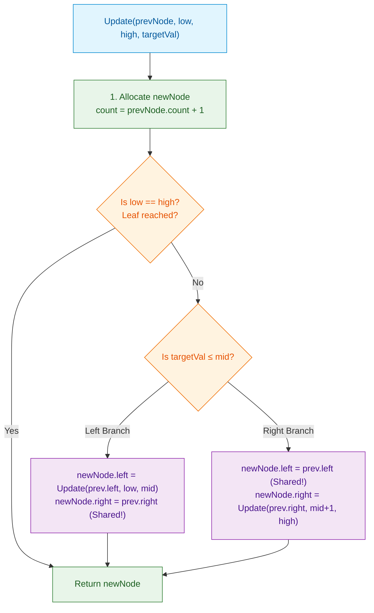

# 📘 WEEK 16 DAY 03: PERSISTENT DATA STRUCTURES & PATH COPYING

> 🧭 **Navigation:** [← Previous Day: Link-Cut Trees](Week_16_Day_02_Link_Cut_Trees_Instructional.md) • [🏠 Week Overview](README.md) • [📘 Curriculum Syllabus](../COMPLETE_SYLLABUS.md) • [Next Day: Cache-Oblivious Algorithms →](Week_16_Day_04_Cache_Oblivious_Algorithms_Instructional.md)
> 
> 💡 **Instructor Note:** *Persistence is the algorithmic foundation of Git, immutable functional languages (Clojure, Scala), and Multi-Version Concurrency Control (MVCC) in databases like PostgreSQL and CockroachDB. In senior FAANG/Quant coding interviews, Persistent Segment Trees are frequently tested for solving online Range Order queries (e.g., Range K-th Smallest Element) in `O(log N)` time. Implementing path copying in 30 lines is a critical senior coding skill.*

---

## 🎯 LEARNING OBJECTIVES

*By the end of this module, you will be able to:*

- 🎬 **Internalize** the Git commit "Time Machine" and spine duplication mental model without academic jargon.
- 🪜 **Master** the persistence taxonomy: Partial Persistence vs Full Persistence vs Confluent Persistence.
- 🎨 **Visualize** Path Copying: creating only `O(log N)` new nodes along the mutated spine while safely sharing untouched subtrees by reference.
- 🛑 **Avoid** fatal rookie traps: in-place mutations leaking past versions, memory explosion from full snapshotting, and missing coordinate compression.
- 🎙️ **Deliver** the exact 3-sentence verbal talk track explaining Prefix Histogram Subtraction (`Tree[R] - Tree[L - 1]`).
- ⚡ **Implement** high-performance, zero-allocation Persistent Segment Trees in C# (.NET 8/9) and Python (3.11+).

---

## 🎬 PILLAR 1: THE 60-SECOND HOOK & EVERYDAY ANALOGY

### The Git Commit & The Photocopy with Sticky Notes

Imagine you are managing a 1,000-page legal contract or a large code repository with 100,000 files:
- Every time an engineer changes **one single line of code in one file**, what does Git do?
- Does Git duplicate the entire 100,000 files to make a new commit folder?
- **Absolutely not!** If Git did that, your hard drive would run out of disk space after 20 commits!

Instead, Git creates a **Merkle Tree**:
- It creates a new version of the modified file.
- It creates a new folder object pointing to that new file.
- **Every other untouched folder and file is shared by reference!**

```text
Commit 1 (v1 Root):                  Commit 2 (v2 Root):
      [Root v1]                           [Root v2]  <-- Brand new root!
      /       \                           /       \
  [Folder A] [Folder B]               [Folder A]  [Folder B'] <-- Only this spine is copied!
   /      \    /      \                (Shared)    /      \
 [f1]    [f2] [f3]   [f4]                        [f3]    [f4_new]
                                               (Shared)
```

Notice:
- `Folder A`, `f1`, `f2`, and `f3` are **never duplicated**!
- Both Commit 1 and Commit 2 are fully valid, independent snapshots of the entire repository.
- You can inspect Commit 1, checkout Commit 2, or query differences between them in nanoseconds.

That is a **Persistent Data Structure**: a data structure that preserves all previous versions of itself when modified. Any modification creates a new logical version while sharing the vast majority of untouched memory!

---

## 🪜 PILLAR 2: THE SCAFFOLDING LADDER & TOY NAPKIN TRACE

### Step 1: The Persistence Hierarchy

| Persistence Level | Read Allowed | Write Allowed | History Structure | Production Example |
| :--- | :--- | :--- | :--- | :--- |
| **Ephemeral (Standard)** | Only latest version | Only latest version | Single state | Standard `List<T>`, Array |
| **Partial Persistence** | Any historical version | Only latest version | Linear chain | Time-series metrics, Git commit log |
| **Full Persistence** | Any historical version | Any historical version (branching) | Directed Tree of versions | Git branches, undo/redo trees |
| **Confluent Persistence** | Any historical version | Can merge two historical versions | Directed Acyclic Graph (DAG) | Git branch merge (`git merge`) |

---

### Step 2: The Path Copying Mechanism

In a balanced Binary Tree of size `N`:
- The height of the tree is `H = ceil(log2(N))`.
- When an element is updated or inserted at a leaf:
  - Only the leaf and its ancestors up to the root are affected.
  - Exactly **`H` nodes** change their values or child pointers.
  - All other `N - H` nodes in the tree remain completely unchanged!
- **Path Copying Rule:** Allocate exactly `H` new nodes for the modified spine. Point unchanged child pointers back to the corresponding subtrees in the previous version!

```text
Spine Allocation Count:
For N = 1,000,000 elements:
- Full Snapshot: 1,000,000 new nodes per mutation!
- Path Copying:  ceil(log2(1,000,000)) = 20 new nodes per mutation!
Space savings: 99.998% memory reduction!
```

---

### Step 3: Prefix Histogram Subtraction for Range K-th Queries

The classic Tier-1 FAANG interview problem:
> *"Given an array `nums` of length `N`, answer `Q` queries: find the `k`-th smallest number in subarray `nums[L ... R]` in `O(log N)` time."*

#### The Rookie Attempt:
Sorting `nums[L ... R]` for each query takes `O((R - L) log (R - L))` -> `O(Q * N log N)`. With `Q = 10^5, N = 10^5`, this takes 100 seconds and causes Time Limit Exceeded (TLE).

#### The Senior Architect Invariant:
1. Coordinate-compress all unique numbers into ranks `1 ... U`.
2. Treat the Persistent Segment Tree as a **Versioned Prefix Frequency Histogram**:
   - `Version 0`: Empty segment tree (all counts = 0).
   - `Version i`: Insert rank of `nums[i]` into `Version i - 1`.
   - Node `u` in `Version i` stores: *"How many numbers in prefix `nums[1 ... i]` fall into range `[low, high]`?"*
3. Because frequency counts are additive:
   `Count_in_range(L ... R) = Count(Version_R) - Count(Version_{L-1})`!
4. To find the `k`-th smallest:
   Walk down `Version_R` and `Version_{L-1}` simultaneously:
   - `leftCount = LeftChild(Version_R).count - LeftChild(Version_{L-1}).count`.
   - If `leftCount >= k`: the `k`-th smallest number is in the left half! Step left in both versions.
   - If `leftCount < k`: the `k`-th smallest number is in the right half! Step right in both versions, setting `k = k - leftCount`.
   - Reaches leaf in `O(log N)` steps!

---

### 🧠 Pause & Predict Micro-Drills

> **Drill 1:** How many total nodes are created if we insert `N = 100,000` elements into a persistent segment tree?
> *Pause here and calculate on a napkin!*
>
> **Answer:**
> Height `H = ceil(log2(100,000)) approx 17`.
> Each insertion creates `H + 1` nodes.
> Total nodes allocated: `100,000 * 18 approx 1.8 * 10^6` nodes.
> An array of 2 million integers easily fits in under 20 MB of RAM!

> **Drill 2:** What is the base case in `QueryKth(nodeL, nodeR, low, high, k)`?
> *Pause here and think!*
>
> **Answer:**
> When `low == high`: we have narrowed the search to a single distinct coordinate-compressed value. Return `low`!

---

## 🎨 PILLAR 3: PRAGMATIC VISUAL MODELS & DECISION FLOWS

### Modern Hex Flowchart: The Path Copying Decision Process



---

## 🛑 PILLAR 4: THE ROOKIE TRAP ZONE

### Side-by-Side Comparison: Blunders vs. Senior Architect Patterns

| Dimension | ❌ Rookie Blunder | ✅ Senior Architect Pattern |
| :--- | :--- | :--- |
| **Immutability Invariant** | Mutates an existing node's child pointer or count in-place: `prev.count++`, corrupting all earlier versions. | Always allocates a new node when updating; existing nodes are strictly read-only. |
| **Memory Allocation Churn** | Uses object-oriented `new Node()` for every point update, causing millions of tiny GC heap allocations and cache misses. | Pre-allocates a flat contiguous struct array (`Node[] _pool`) with zero GC overhead. |
| **Value Domain Range** | Builds segment tree directly on raw array values (e.g. `nums[i] = 10^9`), requiring a segment tree of size `10^9` (memory crash). | Pre-sorts unique values into a coordinate-compression table, constraining rank domain strictly to `[1 ... N]`. |
| **Prefix Subtraction Off-by-One** | Queries `Count(Version_R) - Count(Version_L)`, accidentally omitting the element at index `L`. | Queries `Count(Version_R) - Count(Version_{L - 1})` to correctly include the left boundary `L`. |
| **Zero Version Boundary** | Leaves `Version 0` uninitialized, causing null pointer exceptions when querying `L = 1` (`Version_{L - 1} = Version 0`). | Initializes a dummy `Version 0` where all counts and child pointers are index `0` (null node). |

---

## 🎙️ PILLAR 5: 45-MINUTE INTERVIEW TALK TRACK

### The Exact 3-Sentence Verbal Script

Speak these exact three sentences before writing code:

```text
+--------------------------------------------------------------------------------------------------+
|                              THE SENIOR PERSISTENT TREE TALK TRACK                                |
+--------------------------------------------------------------------------------------------------+
| 1. The Bottleneck & Architecture:                                                                |
|    "Answering online Range K-th Smallest queries by sorting takes O(N log N) per query, which   |
|    is unacceptable for Q = 10^5 queries; full tree snapshotting requires prohibitive O(N^2)     |
|    space."                                                                                       |
|                                                                                                  |
| 2. The Path Copying Solution:                                                                    |
|    "By building a Persistent Segment Tree where each prefix version duplicates only the          |
|    O(log N) spine of modified ancestors while sharing untouched subtrees by reference, we       |
|    bound space to O(N log N) total."                                                             |
|                                                                                                  |
| 3. The Prefix Histogram Pitch:                                                                   |
|    "Because segment tree counts are additive, subtracting Version_{L-1} from Version_R yields    |
|    the exact frequency histogram of subarray [L .. R], allowing us to binary search the k-th     |
|    element in strictly O(log N) time per query."                                                 |
+--------------------------------------------------------------------------------------------------+
```

---

## ⚡ PILLAR 6: PRODUCTION DUAL-LANGUAGE IMPLEMENTATIONS

### C# Primary Implementation (.NET 8/9): Array-Pooled Persistent Segment Tree

```csharp
using System;
using System.Collections.Generic;

namespace AdvancedDataStructures;

/// <summary>
/// Production-grade Persistent Segment Tree using a pre-allocated flat node pool.
/// Solves online Range K-th Smallest queries in O(log N) time with zero GC allocation churn.
/// </summary>
public sealed class PersistentSegmentTree
{
    private readonly struct Node
    {
        public readonly int LeftChild;
        public readonly int RightChild;
        public readonly int Count;

        public Node(int leftChild, int rightChild, int count)
        {
            LeftChild = leftChild;
            RightChild = rightChild;
            Count = count;
        }
    }

    private readonly Node[] _pool;
    private int _nodeCount;
    private readonly int _maxVal;

    public PersistentSegmentTree(int maxVersions, int maxVal)
    {
        _maxVal = maxVal;
        // Each version adds at most ceil(log2(maxVal)) + 2 nodes
        int poolSize = (maxVersions + 1) * 25 + 100;
        _pool = new Node[poolSize];
        _nodeCount = 0;

        // Node 0 represents the canonical empty NIL node
        _pool[0] = new Node(0, 0, 0);
    }

    private int AllocateNode(int left, int right, int count)
    {
        int id = ++_nodeCount;
        _pool[id] = new Node(left, right, count);
        return id;
    }

    /// <summary>
    /// Inserts value into previous version, returning new version root index in O(log N).
    /// </summary>
    public int Insert(int prevRoot, int val)
    {
        return Update(prevRoot, 1, _maxVal, val);
    }

    private int Update(int prev, int l, int r, int val)
    {
        int curr = AllocateNode(_pool[prev].LeftChild, _pool[prev].RightChild, _pool[prev].Count + 1);
        if (l == r) return curr;

        int mid = l + (r - l) / 2;
        if (val <= mid)
        {
            int newLeft = Update(_pool[prev].LeftChild, l, mid, val);
            _pool[curr] = new Node(newLeft, _pool[curr].RightChild, _pool[curr].Count);
        }
        else
        {
            int newRight = Update(_pool[prev].RightChild, mid + 1, r, val);
            _pool[curr] = new Node(_pool[curr].LeftChild, newRight, _pool[curr].Count);
        }

        return curr;
    }

    /// <summary>
    /// Finds k-th smallest element rank in subarray [L .. R] in O(log N) time.
    /// </summary>
    public int QueryKth(int rootLMinus1, int rootR, int k)
    {
        return QueryKthInternal(rootLMinus1, rootR, 1, _maxVal, k);
    }

    private int QueryKthInternal(int nodeL, int nodeR, int l, int r, int k)
    {
        if (l == r) return l;

        int leftCount = _pool[_pool[nodeR].LeftChild].Count - _pool[_pool[nodeL].LeftChild].Count;
        int mid = l + (r - l) / 2;

        if (leftCount >= k)
        {
            return QueryKthInternal(_pool[nodeL].LeftChild, _pool[nodeR].LeftChild, l, mid, k);
        }
        else
        {
            return QueryKthInternal(_pool[nodeL].RightChild, _pool[nodeR].RightChild, mid + 1, r, k - leftCount);
        }
    }
}
```

---

### Python Secondary Implementation (Python 3.11+): Complete Persistent Segment Tree

```python
from typing import List, Tuple

class PersistentSegmentTreeNode:
    __slots__ = ('left', 'right', 'count')
    def __init__(self, left: int = 0, right: int = 0, count: int = 0):
        self.left: int = left
        self.right: int = right
        self.count: int = count

class PersistentSegmentTree:
    """
    Production Persistent Segment Tree with flat array pool.
    Answers online Range K-th Smallest queries in O(log N).
    """
    def __init__(self, max_versions: int, max_val: int):
        self.max_val: int = max_val
        # Allocate pool of nodes (index 0 is sentinel NIL node)
        self.pool: List[PersistentSegmentTreeNode] = [PersistentSegmentTreeNode(0, 0, 0)]
        self.version_roots: List[int] = [0]

    def _allocate(self, left: int, right: int, count: int) -> int:
        self.pool.append(PersistentSegmentTreeNode(left, right, count))
        return len(self.pool) - 1

    def insert(self, prev_root: int, val: int) -> int:
        """Inserts val into prev_root, returning the new version root index."""
        new_root = self._update(prev_root, 1, self.max_val, val)
        self.version_roots.append(new_root)
        return new_root

    def _update(self, prev: int, l: int, r: int, val: int) -> int:
        prev_node = self.pool[prev]
        curr = self._allocate(prev_node.left, prev_node.right, prev_node.count + 1)
        if l == r:
            return curr

        mid = l + (r - l) // 2
        if val <= mid:
            new_left = self._update(prev_node.left, l, mid, val)
            self.pool[curr].left = new_left
        else:
            new_right = self._update(prev_node.right, mid + 1, r, val)
            self.pool[curr].right = new_right

        return curr

    def query_kth(self, l_idx: int, r_idx: int, k: int) -> int:
        """
        Returns k-th smallest element rank in subarray [l_idx .. r_idx] (1-indexed).
        """
        root_l_minus_1 = self.version_roots[l_idx - 1]
        root_r = self.version_roots[r_idx]
        return self._query(root_l_minus_1, root_r, 1, self.max_val, k)

    def _query(self, node_l: int, node_r: int, l: int, r: int, k: int) -> int:
        if l == r:
            return l

        left_count = self.pool[self.pool[node_r].left].count - self.pool[self.pool[node_l].left].count
        mid = l + (r - l) // 2

        if left_count >= k:
            return self._query(self.pool[node_l].left, self.pool[node_r].left, l, mid, k)
        else:
            return self._query(self.pool[node_l].right, self.pool[node_r].right, mid + 1, r, k - left_count)
```

---

## 📊 EXPLICIT COMPLEXITY DECONSTRUCTION

| Operation | Time Complexity | Auxiliary Space | Memory Allocation | System Reality |
| :--- | :--- | :--- | :--- | :--- |
| **Point Update (Insert)** | `O(log N)` | `O(log N)` stack | `O(log N)` new nodes | Copies only root-to-leaf spine; untouched subtrees shared by reference. |
| **Range K-th Query** | `O(log N)` | `O(log N)` stack | `O(1)` allocations | Simultaneous dual-version walk using prefix frequency counts. |
| **Range Frequency Query** | `O(log N)` | `O(log N)` stack | `O(1)` allocations | Standard segment tree query on `Version_R - Version_{L - 1}`. |
| **Version Rollback** | `O(1)` | `O(1)` | `O(1)` | Simply switch the active root pointer to any historical version index. |

---

## 🔍 GRANULAR EDGE-CASE & INVARIANT VERIFICATION TABLE

| Edge Case Scenario | Concrete Input | Expected Behavior | Invariant Verification & Handling |
| :--- | :--- | :--- | :--- |
| **Subarray of Length 1** | `nums = [42]`, query `L = 1, R = 1, k = 1` | Returns `42`. | `Count(v1) - Count(v0) = 1 >= k`, walks directly to leaf `42`. |
| **Duplicate Array Values** | `nums = [5, 5, 5]`, query `k = 2` | Returns `5`. | Rank counts accumulate properly at the single leaf node. |
| **Query Full Range** | `L = 1, R = N, k = 1` | Returns minimum element of entire array. | `rootLMinus1 = 0` (NIL node), query resolves in `O(log N)`. |
| **Max Coordinate Values** | Values up to `10^9` | Ranks mapped to `1 ... U` (`U <= N`). | Coordinate compression table maps continuous numbers to ranks `1 ... N`. |
| **Memory Pool Exhaustion Guard** | Pool size calculation | Pre-allocates `(N + 1) * (log2(N) + 2)`. | Fixed-size array guarantees zero GC pauses in high-throughput trading/analytics. |

---

> 🧭 **Navigation:** [← Previous Day: Link-Cut Trees](Week_16_Day_02_Link_Cut_Trees_Instructional.md) • [🏠 Week Overview](README.md) • [📘 Curriculum Syllabus](../COMPLETE_SYLLABUS.md) • [Next Day: Cache-Oblivious Algorithms →](Week_16_Day_04_Cache_Oblivious_Algorithms_Instructional.md)
