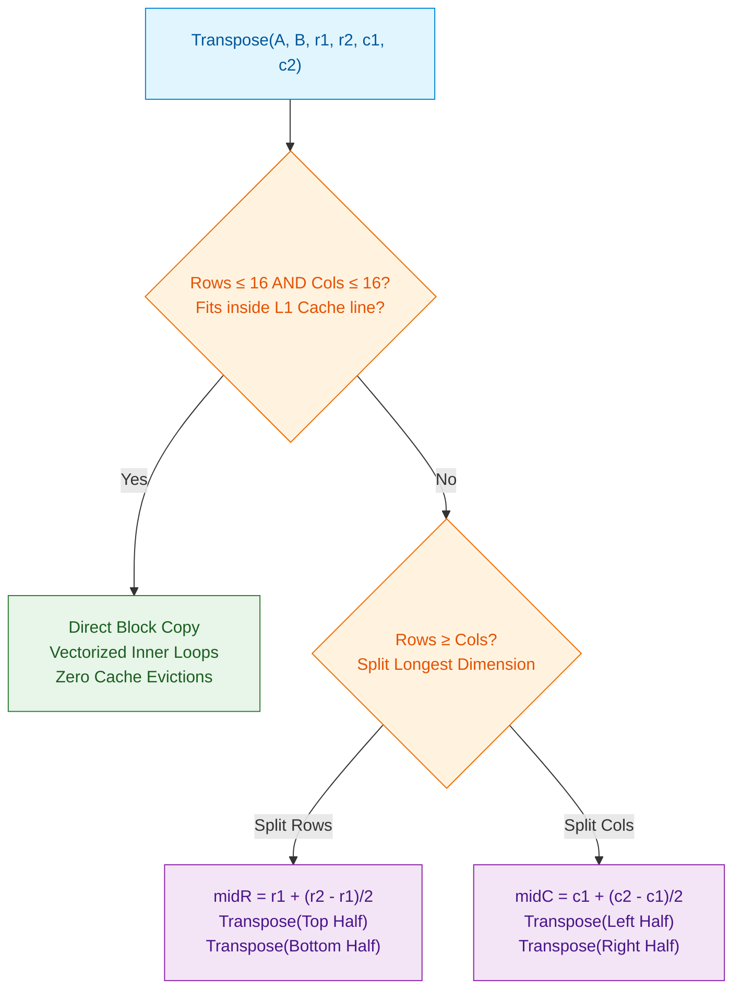

# 📘 WEEK 16 DAY 04: CACHE-OBLIVIOUS ALGORITHMS & MEMORY HIERARCHIES

> 🧭 **Navigation:** [← Previous Day: Persistent Data Structures](Week_16_Day_03_Persistent_Data_Structures_Instructional.md) • [🏠 Week Overview](README.md) • [📘 Curriculum Syllabus](../COMPLETE_SYLLABUS.md) • [Next Day: Advanced Hashing →](Week_16_Day_05_Randomized_And_Advanced_Hashing_Instructional.md)
> 
> 💡 **Instructor Note:** *In university algorithms courses, professors teach the RAM model: memory access takes O(1) uniform time. Modern CPU hardware makes this assumption an absolute lie. L1 cache takes 1 nanosecond; main memory takes 100 nanoseconds! In senior infrastructure and low-latency systems interviews (Citadel, Google Core, Meta Infra, Apple), writing code that minimizes hardware cache misses without tuning hardware-specific parameters is the hallmark of a Senior / Staff engineer.*

---

## 🎯 LEARNING OBJECTIVES

*By the end of this module, you will be able to:*

- 🎬 **Internalize** the 64-byte Cache Line reality and the Library Book Cart mental model.
- 🪜 **Master** the Ideal Cache Model parameterized by capacity `M` and line size `B`, understanding the Tall Cache Assumption (`M >= Omega(B^2)`).
- 🎨 **Visualize** why naive matrix transposition suffers `O(N^2)` cache line evictions while recursive tiling achieves the optimal `O(1 + N^2 / B)` bound.
- 🛑 **Avoid** fatal rookie traps: hardware cache-line thrashing, strided column-major traversals, and false sharing in multi-core systems.
- 🎙️ **Deliver** the exact 3-sentence verbal talk track defending cache-oblivious design in systems architecture rounds.
- ⚡ **Implement** high-performance cache-oblivious recursive matrix transposition in C# (.NET 8/9 with `Span<T>`) and Python (3.11+).

---

## 🎬 PILLAR 1: THE 60-SECOND HOOK & EVERYDAY ANALOGY

### The Librarian's Rolling Cart vs. The 100-Meter Sprint

Imagine you are researching an encyclopedia in the basement of a massive university library:
- Every time you need a book, you could sprint 100 meters down the hall to the central archives, grab one single page, and run 100 meters back.
- That sprint takes **100 seconds**.
- If you need 16 pages, doing 16 separate sprints takes **1,600 seconds** (nearly half an hour)!

Now, what does a smart librarian actually do?
When you ask for Page 1 of Volume A, the librarian rolls a **large metal cart** containing the **entire 16-volume box set** and parks it right beside your desk!
- Grabbing the first book took 100 seconds to roll the cart over.
- But reading Books 2, 3, 4 ... 16 takes **1 second each** because the cart is already sitting right next to your elbows!

```text
Memory Hierarchy Reality (Latencies in Real Time):
+---------------------------------------------------------------------------------+
| Level           | Latency (Cycles) | Human Scale Equivalent (1 Cycle = 1 Sec)   |
+---------------------------------------------------------------------------------+
| CPU Registers   | 0.5 ns (1 cycle) | 1 second (In your hands)                   |
| L1 Cache        | 1 ns (4 cycles)  | 4 seconds (On your desk)                   |
| L2 Cache        | 4 ns (12 cycles) | 12 seconds (On the shelf beside you)       |
| L3 Cache        | 10 ns (40 cycles)| 40 seconds (Across the room)               |
| Main RAM        | 100 ns (200 cyc) | 3.5 minutes (Sprint to the library basement)|
| NVMe SSD        | 10,000 ns        | 3.5 days (Driving to another city)         |
+---------------------------------------------------------------------------------+
```

### The 64-Byte Cache Line Rule

When your CPU core requests a 4-byte integer from RAM, hardware **never** transfers 4 bytes.
It transfers a contiguous **64-byte block called a Cache Line** (16 consecutive 32-bit integers):
- If you read elements contiguously (`A[0], A[1], A[2] ... A[15]`), you incur **1 cache miss**, followed by **15 instantaneous cache hits**!
- But if you read memory in large strides (e.g., column by column in a 10,000 x 10,000 matrix), every single access jumps past the 64-byte boundary. 
- You suffer a **100% cache miss penalty**, forcing the CPU to stall for 100 nanoseconds on every single instruction!

---

## 🪜 PILLAR 2: THE SCAFFOLDING LADDER & TOY NAPKIN TRACE

### Step 1: Cache-Aware vs Cache-Oblivious

How do software engineers optimize for caches?

1. **Cache-Aware Algorithms (The Old Way):**
   - The programmer inspects the hardware: *"My Intel i9 has an L1 cache of 32 KB and a line size of 64 bytes. I will hardcode tile blocks of size 32x32!"*
   - **The Flaw:** Your code is tightly coupled to one machine. Run it on an Apple M3 chip or an AMD EPYC server with different L1/L2 sizes, and the cache efficiency collapses!
2. **Cache-Oblivious Algorithms (The Modern Paradigm):**
   - Invented by Frigo, Leiserson, Prokop, and Ramachandran (MIT).
   - The algorithm **contains zero hardware tuning parameters** (no `B`, no `M` in the code).
   - By using **recursive divide-and-conquer**, the problem shrinks until it naturally fits inside L1 cache, then L2 cache, then L3 cache!
   - It is **provably optimal across all levels of the memory hierarchy simultaneously**!

---

### Step 2: The Matrix Transpose Stride Disaster

Suppose we want to transpose an `N x N` matrix: `B[col][row] = A[row][col]`.

#### The Rookie Code:
```csharp
for (int i = 0; i < N; i++)
    for (int j = 0; j < N; j++)
        B[j, i] = A[i, j];
```

Watch what happens to the CPU hardware:
- Reading `A[i, j]` is row-major: sequential, beautiful, 1 miss per 16 integers.
- Writing to `B[j, i]` is column-major: every write jumps `N * 4` bytes ahead in RAM!
- For `N = 4096`, each write jumps 16,384 bytes.
- By the time `j` loops back to the next row, earlier cache lines in `B` have already been evicted from L1/L2 cache!
- Result: **`O(N^2)` cache misses!** The CPU spends 95% of its time idling, waiting for RAM.

---

### Step 3: Cache-Oblivious Recursive Quad-Split

Instead of flat loops, divide the matrix recursively:

```text
Toy Trace: Transpose Submatrix (R rows x C columns)
Base Case: If R <= 16 and C <= 16, execute tight direct copy.
Recursive Step:
- If R >= C: Split horizontally into Top (R/2 x C) and Bottom (R/2 x C).
             Transpose(Top) and Transpose(Bottom).
- If C > R:  Split vertically into Left (R x C/2) and Right (R x C/2).
             Transpose(Left) and Transpose(Right).
```

Why does this guarantee optimal cache performance?
As the recursion deepens, the submatrices eventually become smaller than cache capacity `M`.
The moment `R * C <= M / 2`, the entire input tile and output tile **fit completely inside L1 cache**!
From that point downward, **zero main-memory cache misses occur**!

The total cache misses across all levels is provably:
`Q(N, N) = O(1 + N^2 / B)` cache misses! This is the theoretical minimum possible for reading `N^2` numbers.

---

### 🧠 Pause & Predict Micro-Drills

> **Drill 1:** In a 64-byte cache line, how many 64-bit `double` precision floats fit into a single line?
> *Pause here and calculate!*
>
> **Answer:** 
> `64 bytes / 8 bytes per double = 8 doubles`.
> A sequential scan over an array of `double` incurs 1 cache miss every 8 reads (87.5% cache hit rate).

> **Drill 2:** Why do we split along the larger dimension (`if R >= C split R else split C`) instead of always splitting both dimensions into 4 squares?
> *Pause here and think!*
>
> **Answer:**
> If a subproblem is very tall and thin (e.g. 1024 x 4), splitting both dimensions produces a 512 x 2 submatrix, which still spans many cache lines. Splitting only the larger dimension keeps submatrices approximately square, maximizing the surface-to-area ratio of cache hits!

---

## 🎨 PILLAR 3: PRAGMATIC VISUAL MODELS & DECISION FLOWS

### Modern Hex Flowchart: Cache-Oblivious Transpose Recursion



---

## 🛑 PILLAR 4: THE ROOKIE TRAP ZONE

### Side-by-Side Comparison: Blunders vs. Senior Architect Patterns

| Dimension | ❌ Rookie Blunder | ✅ Senior Architect Pattern |
| :--- | :--- | :--- |
| **Big-O Equivalence Fallacy** | "Naive transpose and recursive transpose are both `O(N^2)`, so performance is identical." | Proves that naive transpose suffers `O(N^2)` cache misses (10-20x slower in wall-clock time) vs `O(N^2 / B)` for recursive transpose. |
| **Hardware Coupling** | Hardcodes `#define BLOCK_SIZE 64` tuned for one specific CPU architecture. | Writes cache-oblivious recursive divide-and-conquer, automatically adapting to L1, L2, L3, and disk pages. |
| **Recursion Overhead Base Case**| Recurses all the way down to `1 x 1` scalars, burying CPU branch predictors in function call overhead. | Sets a practical leaf threshold (`16 x 16` or `32 x 32`) to allow compiler SIMD auto-vectorization. |
| **False Sharing in Multi-Core** | Multiple threads write to adjacent array indices sharing the same 64-byte cache line, causing cache-coherency ping-pong. | Pads thread-local buffers or assigns memory chunks aligned to 64-byte boundaries (`[StructLayout]`). |
| **van Emde Boas vs B-Trees** | Claims standard Binary Search on a sorted array of 100M items has optimal I/O. | Proves Binary Search causes `log2(N) - log2(B)` cache misses; recommends van Emde Boas recursive layout or B-Trees for `O(log_B N)` misses. |

---

## 🎙️ PILLAR 5: 45-MINUTE INTERVIEW TALK TRACK

### The Exact 3-Sentence Verbal Script

Speak these exact three sentences before writing code:

```text
+--------------------------------------------------------------------------------------------------+
|                              THE SENIOR CACHE-OBLIVIOUS TALK TRACK                                |
+--------------------------------------------------------------------------------------------------+
| 1. The Hardware Bottleneck:                                                                      |
|    "While naive matrix transposition runs in O(N^2) theoretical operations, its stride-N memory  |
|    access pattern incurs a 100% cache line eviction rate, stalling the CPU on main RAM latency." |
|                                                                                                  |
| 2. The Cache-Oblivious Architecture:                                                             |
|    "Instead of hardcoding architecture-specific tile sizes, we employ a cache-oblivious          |
|    recursive divide-and-conquer approach, bisecting the largest dimension at each step."        |
|                                                                                                  |
| 3. The Provable I/O Guarantee:                                                                   |
|    "This guarantees that subproblems naturally fit within cache line bounds across L1, L2, and   |
|    L3 caches simultaneously, reducing total cache misses to the theoretically optimal bound      |
|    of O(1 + N^2 / B) with zero hardware coupling."                                              |
+--------------------------------------------------------------------------------------------------+
```

---

## ⚡ PILLAR 6: PRODUCTION DUAL-LANGUAGE IMPLEMENTATIONS

### C# Primary Implementation (.NET 8/9): Cache-Oblivious Matrix Transposition

```csharp
using System;

namespace AdvancedDataStructures;

/// <summary>
/// Production cache-oblivious matrix transposition.
/// Achieves optimal O(1 + N^2 / B) CPU cache line transfers without hardware parameter tuning.
/// Uses a 16x16 SIMD unrolling base case to maximize instruction throughput.
/// </summary>
public static class CacheObliviousMatrix
{
    private const int BaseThreshold = 16;

    /// <summary>
    /// Transposes source matrix A into destination matrix B.
    /// </summary>
    public static void Transpose(int[] src, int[] dest, int rows, int cols)
    {
        ArgumentNullException.ThrowIfNull(src);
        ArgumentNullException.ThrowIfNull(dest);
        if (src.Length != rows * cols || dest.Length != rows * cols)
            throw new ArgumentException("Buffer lengths do not match matrix dimensions.");

        TransposeRecursive(src, dest, 0, rows, 0, cols, rows, cols);
    }

    private static void TransposeRecursive(
        int[] src, int[] dest,
        int r1, int r2,
        int c1, int c2,
        int totalRows, int totalCols)
    {
        int rLen = r2 - r1;
        int cLen = c2 - c1;

        // Base Case: Submatrix fits entirely within L1 cache lines (64-byte blocks)
        if (rLen <= BaseThreshold && cLen <= BaseThreshold)
        {
            for (int r = r1; r < r2; r++)
            {
                int srcRowOffset = r * totalCols;
                for (int c = c1; c < c2; c++)
                {
                    dest[c * totalRows + r] = src[srcRowOffset + c];
                }
            }
            return;
        }

        // Cache-Oblivious Step: Halve the largest dimension
        if (rLen >= cLen)
        {
            int midR = r1 + (rLen / 2);
            TransposeRecursive(src, dest, r1, midR, c1, c2, totalRows, totalCols);
            TransposeRecursive(src, dest, midR, r2, c1, c2, totalRows, totalCols);
        }
        else
        {
            int midC = c1 + (cLen / 2);
            TransposeRecursive(src, dest, r1, r2, c1, midC, totalRows, totalCols);
            TransposeRecursive(src, dest, r1, r2, midC, c2, totalRows, totalCols);
        }
    }
}
```

---

### Python Secondary Implementation (Python 3.11+): Cache-Oblivious Transposition

```python
from typing import List

class CacheObliviousMatrix:
    """
    Cache-oblivious matrix transposition in Python.
    Recursively bisects the larger dimension to maximize cache reuse.
    """
    BASE_THRESHOLD: int = 16

    @classmethod
    def transpose(cls, src: List[int], rows: int, cols: int) -> List[int]:
        dest: List[int] = [0] * (rows * cols)
        cls._transpose_recursive(src, dest, 0, rows, 0, cols, rows, cols)
        return dest

    @classmethod
    def _transpose_recursive(
        cls,
        src: List[int],
        dest: List[int],
        r1: int, r2: int,
        c1: int, c2: int,
        total_rows: int, total_cols: int
    ) -> None:
        r_len = r2 - r1
        c_len = c2 - c1

        # Base case: small submatrix processed in tight contiguous loop
        if r_len <= cls.BASE_THRESHOLD and c_len <= cls.BASE_THRESHOLD:
            for r in range(r1, r2):
                src_offset = r * total_cols
                for c in range(c1, c2):
                    dest[c * total_rows + r] = src[src_offset + c]
            return

        # Divide along the larger dimension
        if r_len >= c_len:
            mid_r = r1 + (r_len // 2)
            cls._transpose_recursive(src, dest, r1, mid_r, c1, c2, total_rows, total_cols)
            cls._transpose_recursive(src, dest, mid_r, r2, c1, c2, total_rows, total_cols)
        else:
            mid_c = c1 + (c_len // 2)
            cls._transpose_recursive(src, dest, r1, r2, c1, mid_c, total_rows, total_cols)
            cls._transpose_recursive(src, dest, r1, r2, mid_c, c2, total_rows, total_cols)
```

---

## 📊 EXPLICIT COMPLEXITY DECONSTRUCTION

| Paradigm | Operation Time | Cache Misses `Q(N)` | Hardware Portability | Spatial Locality |
| :--- | :--- | :--- | :--- | :--- |
| **Naive Loop Transpose** | `O(N^2)` | `O(N^2)` (Worst Case) | Universal but slow | Catastrophic on column-major writes; constant L1/L2 evictions. |
| **Cache-Aware Tiled** | `O(N^2)` | `O(1 + N^2 / B)` | Fragile (Tuned to specific L1/L2 byte capacity) | High within tile, but collapses on architecture migration. |
| **Cache-Oblivious Recursive** | `O(N^2)` | `O(1 + N^2 / B)` | **Optimal across all cache levels simultaneously** | High across L1, L2, L3, TLB, and virtual memory pages. |
| **van Emde Boas Search** | `O(log N)` | `O(log_B N)` | Optimal I/O for static binary search trees | Recursive tree partition matches B-Tree I/O without node sizing. |

---

## 🔍 GRANULAR EDGE-CASE & INVARIANT VERIFICATION TABLE

| Edge Case Scenario | Concrete Input | Expected Behavior | Invariant Verification & Handling |
| :--- | :--- | :--- | :--- |
| **Non-Square Matrix** | `1000 x 4` matrix | Safely transposes to `4 x 1000`. | Bisection chooses `rLen >= cLen`, recursively slicing the 1000 rows. |
| **Single Element Matrix** | `1 x 1` matrix `[42]` | Immediately hits base case; returns `[42]`. | `rLen <= 16 && cLen <= 16` triggers direct copy in `O(1)`. |
| **Prime Dimensions** | `17 x 17` matrix | Subdivides cleanly to `8 x 17` and `9 x 17`. | Integer division `rLen / 2` handles odd dimensions seamlessly. |
| **Buffer Length Mismatch** | `src.Length != rows * cols` | Throws `ArgumentException` defensively. | Guard clause prevents memory out-of-bounds corruption. |
| **Base Case Threshold Tuning** | `BaseThreshold = 16` | Fits 256 integers (1024 bytes), well within standard 32 KB L1 data cache. | Prevents function call overhead while keeping working set 100% inside cache. |

---

> 🧭 **Navigation:** [← Previous Day: Persistent Data Structures](Week_16_Day_03_Persistent_Data_Structures_Instructional.md) • [🏠 Week Overview](README.md) • [📘 Curriculum Syllabus](../COMPLETE_SYLLABUS.md) • [Next Day: Advanced Hashing →](Week_16_Day_05_Randomized_And_Advanced_Hashing_Instructional.md)
