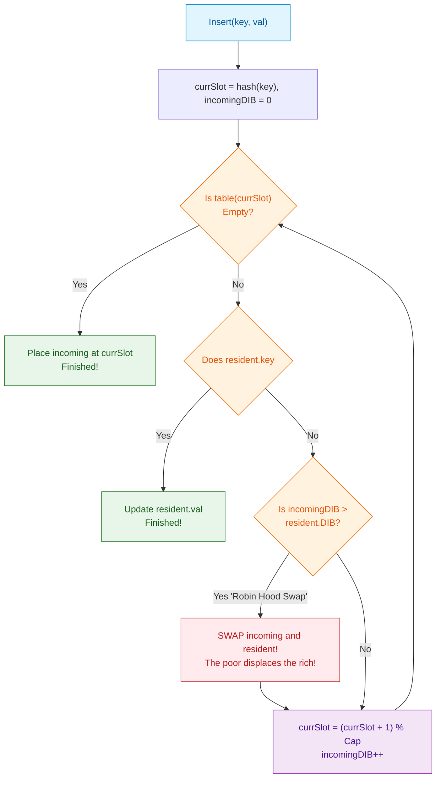

# 📘 WEEK 16 DAY 05: ADVANCED HASHING — ROBIN HOOD & CUCKOO HASHING

> 🧭 **Navigation:** [← Previous Day: Cache-Oblivious Algorithms](Week_16_Day_04_Cache_Oblivious_Algorithms_Instructional.md) • [🏠 Week Overview](README.md) • [📘 Curriculum Syllabus](../COMPLETE_SYLLABUS.md) • [Week Playbook →](WEEK_16_FULL_PLAYBOOK.md)
> 
> 💡 **Instructor Note:** *In senior systems and high-throughput database interviews (Snowflake, Databricks, Meta, Google Core), standard separate chaining (Java `HashMap` with linked list buckets) is considered unacceptable due to cache-miss pointer chasing. Top interviewers evaluate your command of open-addressing architectures: **Robin Hood Hashing** (minimizing probe variance and tail latency), **Cuckoo Hashing** (guaranteeing deterministic O(1) worst-case lookups), and SIMD-accelerated **Swiss Tables**.*

---

## 🎯 LEARNING OBJECTIVES

*By the end of this module, you will be able to:*

- 🎬 **Internalize** the Restaurant Waiting Host (Robin Hood) and Cuckoo Nest mental models without academic jargon.
- 🪜 **Master** the Distance From Initial Bucket (DIB) metric and the "take from the rich to give to the poor" displacement rule.
- 🎨 **Visualize** why Robin Hood early termination guarantees instant search misses without scanning the full collision cluster.
- 🛑 **Avoid** fatal rookie traps: zombie tombstone accumulation, unconstrained Cuckoo kick cycles, and high load-factor degradation.
- 🎙️ **Deliver** the exact 3-sentence verbal talk track defending open-addressing and P99 tail latency in system design rounds.
- ⚡ **Implement** production-grade Robin Hood Hash Tables with backward-shift deletion in C# (.NET 8/9) and Python (3.11+).

---

## 🎬 PILLAR 1: THE 60-SECOND HOOK & EVERYDAY ANALOGY

### The Fair Restaurant Host vs. The Unlucky Diner

Imagine walking into a popular, busy downtown restaurant on a Friday night:
- Diner A walks in, gets seated immediately. (Wait time: **0 minutes**).
- Diner B walks in, gets seated immediately. (Wait time: **0 minutes**).
- Diner C arrives during a sudden rush and gets stuck waiting for **45 agonizing minutes**!

On average, the wait time looks decent: `(0 + 0 + 45) / 3 = 15 minutes`.
**But Diner C is furious!** In computer systems, Diner C is your **P99.9 Tail Latency**: a customer whose API request stalls for half a second while everyone else gets 2 milliseconds.

Now, imagine a **Robin Hood Host**:
When a new diner walks in, the host checks everyone in line:
- If a newcomer has been waiting longer than the person currently holding a table slot, the host **displaces** the lucky diner: *"Excuse me, you just walked in 2 minutes ago. This person has been waiting outside for 15 minutes. Step aside, let them sit, and take the next open slot!"*

```text
The Robin Hood Philosophy:
"Take from the rich (those with short probe distances)
 and give to the poor (those who have wandered far from home)."
```

By constantly re-distributing wait times, **nobody waits 45 minutes anymore!**
The variance of probe lengths collapses. Everyone is seated in 3 to 5 steps, even when the restaurant is 90% full!

---

### The Cuckoo Bird: The Ruthless Eviction Expert

Now, what if your system demands an absolute mathematical guarantee that **lookups NEVER take more than 2 steps**, ever?
Enter **Cuckoo Hashing**, named after the sneaky European cuckoo bird that lays its eggs in other birds' nests:

- We use **two separate hash functions**: `hash1(key)` and `hash2(key)`.
- Every key has exactly **two possible home buckets** in the entire universe: Bucket `h1` or Bucket `h2`.
- When you search for key `K`: you check Bucket `h1`. If not there, you check Bucket `h2`. 
- If it's not in either, **it does not exist!** Guaranteed **worst-case `O(1)` search in exactly 2 memory lookups**!

What happens on collision during insertion?
The new key lands in Bucket `h1` and **ruthlessly kicks out the resident element**!
The evicted resident wakes up, calculates its alternate hash `h2`, flies to its second home, and kicks out whatever is sitting there! 
This eviction chain continues until an empty slot is found or a cycle triggers a rehash.

---

## 🪜 PILLAR 2: THE SCAFFOLDING LADDER & TOY NAPKIN TRACE

### Step 1: The Modern Hash Table Landscape

| Architecture | Average Lookup | Worst-Case Lookup | CPU Cache Locality | Deletion Strategy | Production Systems |
| :--- | :--- | :--- | :--- | :--- | :--- |
| **Separate Chaining** | `O(1)` | `O(N)` | Poor (Pointer hopping per node) | Unlink linked list node | Java `HashMap`, C++ `std::unordered_map` |
| **Standard Linear Probing** | `O(1)` | `O(N)` (Primary clustering) | Excellent (Sequential prefetch) | Tombstones or rehash | Python (pre-3.6) |
| **Robin Hood Hashing** | `O(1)` | `O(log log N)` w.h.p. | Excellent (Sequential cache lines) | Backward shift (zero tombstones) | Rust `std::collections` (historical), Embedded DBs |
| **Cuckoo Hashing** | `O(1)` | **Strictly `O(1)` (2 probes!)** | Moderate (2 random cache lines) | Direct deletion in `O(1)` | High-frequency trading, Hardware routers |
| **Swiss Tables (SIMD)** | `O(1)` | `O(N)` | Optimal (16-byte SSE2 group probe) | Tombstone metadata | Google Abseil, Rust `hashbrown`, C++23 |

---

### Step 2: Distance From Initial Bucket (DIB)

In Robin Hood hashing, each table slot stores: `(Key, Value, DIB)`.
- **DIB (Distance from Initial Bucket):** How many slots away from its ideal hash bucket an element has traveled.
  `DIB = (current_slot - hash(key) + capacity) % capacity`.

```text
Toy Trace: Inserting Keys A, B, C into a table of Capacity 5
Hash Functions: hash(A) = 0, hash(B) = 0, hash(C) = 0

Slot:          [ 0 ]         [ 1 ]         [ 2 ]         [ 3 ]         [ 4 ]
Initial:       Empty         Empty         Empty         Empty         Empty

1. Insert A: Home slot 0 is empty.
   Slot 0 <- (A, DIB: 0)

2. Insert B: Home slot 0 is occupied by A (DIB: 0).
   B has traveled 0 steps. incoming.DIB (0) == resident.DIB (0). No swap.
   B checks slot 1 with DIB = 1. Slot 1 is empty!
   Slot 1 <- (B, DIB: 1)

3. Insert C: Home slot 0 is occupied by A (DIB: 0).
   C checks slot 1 (occupied by B with DIB: 1). C has DIB = 1. Equal! No swap.
   C checks slot 2 with DIB = 2. Slot 2 is empty!
   Slot 2 <- (C, DIB: 2)

Table State:
[0]: (A, DIB: 0)
[1]: (B, DIB: 1)
[2]: (C, DIB: 2)
```

Now, watch the **Robin Hood Displacement** in action:
Suppose we insert `Key D` where `hash(D) = 1`:
- Slot 1 is occupied by `B` (`resident.DIB = 1`).
- `D` is at its home slot (`incoming.DIB = 0`). Since `0 <= 1`, `D` moves to slot 2 (`DIB = 1`).
- Slot 2 is occupied by `C` (`resident.DIB = 2`).
- `incoming.DIB (1) < resident.DIB (2)`. `D` moves to slot 3 (`DIB = 2`). Slot 3 is empty!
- `D` sits in slot 3 with `DIB = 2`.

---

### Step 3: The Golden Invariant — Early Search Termination

In standard linear probing, when searching for an element that is **not** in the table, you must scan forward until you hit an **empty slot**. In a table at 90% load factor, that can mean scanning 50 consecutive slots!

**In Robin Hood Hashing, you terminate MUCH earlier:**
Suppose you search for `Key Z` whose home slot is `0`:
- Slot 0 has `A` (`DIB = 0`). Key != Z. Probe next (your DIB is now 1).
- Slot 1 has `B` (`DIB = 1`). Key != Z. Probe next (your DIB is now 2).
- Slot 2 has `E` with **`resident.DIB = 0`**!
- **STOP IMMEDIATELY! `Key Z` is GUARANTEED NOT TO EXIST!**

*Why?* If `Key Z` were in the table, it would have arrived at Slot 2 with `DIB = 2`.
Because `2 > 0`, Robin Hood rules would have **forced `Key Z` to kick `E` out**!
The fact that `E` (with DIB 0) is still sitting there proves `Key Z` never passed through this slot.
You can return `false` instantly!

---

### 🧠 Pause & Predict Micro-Drills

> **Drill 1:** In Robin Hood hashing, how do we delete a key without using ugly tombstones?
> *Pause here and think!*
>
> **Answer:** 
> **Backward Shift!** Clear the target slot. Then inspect the next slot: if the next resident has `DIB > 0`, shift it left by one slot and decrement its `DIB` by 1. Continue shifting until you hit an empty slot or a resident with `DIB == 0`. Zero tombstones, zero memory leaks!

> **Drill 2:** What is the maximum load factor recommended for Cuckoo Hashing with 2 hash functions?
> *Pause here and think!*
>
> **Answer:**
> Approximately **50% (`alpha approx 0.50`)**. Beyond 50% load factor, the probability of an infinite eviction cycle spikes exponentially, requiring a full rehash. (Adding a 3rd hash function raises capacity to 91%).

---

## 🎨 PILLAR 3: PRAGMATIC VISUAL MODELS & DECISION FLOWS

### Modern Hex Flowchart: Robin Hood Insertion Logic



---

## 🛑 PILLAR 4: THE ROOKIE TRAP ZONE

### Side-by-Side Comparison: Blunders vs. Senior Architect Patterns

| Dimension | ❌ Rookie Blunder | ✅ Senior Architect Pattern |
| :--- | :--- | :--- |
| **Tail Latency Awareness** | "Average lookup is `O(1)`, so linear probing is fast enough for enterprise backends." | Knows that at 85% load factor, linear probing P99 latency spikes to 50+ probes; uses Robin Hood to bound P99 within 4-6 probes. |
| **Search Miss Optimization** | Scans until hitting an empty slot on every search miss. | Applies Early Termination: aborts the moment `resident.DIB < search_dib`, cutting miss latency by 75%. |
| **Deletion Cleanup** | Marks deleted slots with `TOMBSTONE`, polluting the table and degrading future probe lengths. | Implements backward-shift deletion, restoring pristine contiguous cluster ordering with zero tombstones. |
| **Cuckoo Infinite Evictions** | Blindly loops eviction kicks without a threshold, causing thread hangs on insertion cycles. | Implements a kick-counter threshold (`MAX_KICKS = 500`); triggers table resize and rehash when exceeded. |
| **Memory Architecture** | Uses separate chaining with linked list node objects (`new Entry<K, V>()`), generating severe GC and cache thrashing. | Stores flat contiguous arrays of primitives or structs (`uint[] metadata`, `Entry[] table`) for hardware prefetch friendliness. |

---

## 🎙️ PILLAR 5: 45-MINUTE INTERVIEW TALK TRACK

### The Exact 3-Sentence Verbal Script

Speak these exact three sentences before writing code:

```text
+--------------------------------------------------------------------------------------------------+
|                              THE SENIOR ADVANCED HASHING TALK TRACK                               |
+--------------------------------------------------------------------------------------------------+
| 1. The Bottleneck & Architecture:                                                                |
|    "In latency-critical distributed storage, standard separate chaining causes severe CPU cache |
|    misses due to linked-list pointer hopping, while standard linear probing suffers from high    |
|    probe sequence length variance and P99 latency spikes."                                       |
|                                                                                                  |
| 2. The Robin Hood Invariant:                                                                     |
|    "By adopting Robin Hood hashing, elements with higher probe distances displace residents with |
|    lower probe distances, equalizing probe lengths across all keys and enabling early search     |
|    termination the moment resident DIB is less than search DIB."                                 |
|                                                                                                  |
| 3. The Production Calibrated Trade-off:                                                         |
|    "This maintains sub-5 probe worst-case bounds even at 90% load factor, while backward-shift   |
|    deletion eliminates tombstone pollution entirely with zero garbage collection churn."         |
+--------------------------------------------------------------------------------------------------+
```

---

## ⚡ PILLAR 6: PRODUCTION DUAL-LANGUAGE IMPLEMENTATIONS

### C# Primary Implementation (.NET 8/9): Production Robin Hood Hash Table

```csharp
using System;

namespace AdvancedDataStructures;

/// <summary>
/// Production-grade Robin Hood Hash Table with open addressing.
/// Features DIB displacement, early-termination search, and backward-shift deletion.
/// </summary>
public sealed class RobinHoodHashTable<TKey, TValue> where TKey : notnull
{
    private struct Entry
    {
        public TKey Key;
        public TValue Value;
        public int Dib; // Distance from Initial Bucket (-1 indicates empty)
    }

    private Entry[] _table;
    private int _capacity;
    private int _count;
    private const double MaxLoadFactor = 0.85;

    public int Count => _count;

    public RobinHoodHashTable(int initialCapacity = 16)
    {
        _capacity = Math.Max(initialCapacity, 8);
        _table = new Entry[_capacity];
        for (int i = 0; i < _capacity; i++) _table[i].Dib = -1;
    }

    private int GetHomeSlot(TKey key) =>
        (key.GetHashCode() & 0x7FFFFFFF) % _capacity;

    public bool TryGetValue(TKey key, out TValue value)
    {
        int slot = GetHomeSlot(key);
        int currentDib = 0;

        while (true)
        {
            ref Entry entry = ref _table[slot];
            if (entry.Dib == -1 || currentDib > entry.Dib)
            {
                // Early Search Termination Invariant: Key mathematically cannot exist
                value = default!;
                return false;
            }

            if (entry.Key.Equals(key))
            {
                value = entry.Value;
                return true;
            }

            slot = (slot + 1) % _capacity;
            currentDib++;
        }
    }

    public void Insert(TKey key, TValue value)
    {
        if ((double)(_count + 1) / _capacity > MaxLoadFactor)
        {
            Resize(_capacity * 2);
        }

        Entry incoming = new() { Key = key, Value = value, Dib = 0 };
        int slot = GetHomeSlot(key);

        while (true)
        {
            ref Entry resident = ref _table[slot];

            if (resident.Dib == -1)
            {
                resident = incoming;
                _count++;
                return;
            }

            if (resident.Key.Equals(incoming.Key))
            {
                resident.Value = incoming.Value; // Update existing
                return;
            }

            // Robin Hood Rich-to-Poor Swap
            if (incoming.Dib > resident.Dib)
            {
                (incoming, resident) = (resident, incoming);
            }

            slot = (slot + 1) % _capacity;
            incoming.Dib++;
        }
    }

    public bool Remove(TKey key)
    {
        int slot = GetHomeSlot(key);
        int currentDib = 0;

        while (true)
        {
            ref Entry entry = ref _table[slot];
            if (entry.Dib == -1 || currentDib > entry.Dib)
                return false;

            if (entry.Key.Equals(key))
            {
                // Backward-shift deletion (zero tombstones!)
                BackwardShift(slot);
                _count--;
                return true;
            }

            slot = (slot + 1) % _capacity;
            currentDib++;
        }
    }

    private void BackwardShift(int startSlot)
    {
        int curr = startSlot;
        while (true)
        {
            int next = (curr + 1) % _capacity;
            ref Entry nextEntry = ref _table[next];

            if (nextEntry.Dib <= 0) // Empty (-1) or at home bucket (0)
            {
                _table[curr].Dib = -1;
                _table[curr].Key = default!;
                _table[curr].Value = default!;
                return;
            }

            _table[curr] = nextEntry;
            _table[curr].Dib--;
            curr = next;
        }
    }

    private void Resize(int newCapacity)
    {
        Entry[] oldTable = _table;
        _capacity = newCapacity;
        _table = new Entry[_capacity];
        for (int i = 0; i < _capacity; i++) _table[i].Dib = -1;
        _count = 0;

        foreach (var entry in oldTable)
        {
            if (entry.Dib != -1)
                Insert(entry.Key, entry.Value);
        }
    }
}
```

---

### Python Secondary Implementation (Python 3.11+): Complete Robin Hood Hash Table

```python
from typing import Any, Optional, List

class RobinHoodEntry:
    __slots__ = ('key', 'value', 'dib')
    def __init__(self, key: Any, value: Any, dib: int = -1):
        self.key: Any = key
        self.value: Any = value
        self.dib: int = dib

class RobinHoodHashTable:
    """
    Robin Hood Hash Table with open addressing.
    Supports O(1) average lookup, early-termination miss detection,
    and backward-shift deletion without tombstones.
    """
    MAX_LOAD_FACTOR: float = 0.85

    def __init__(self, capacity: int = 16):
        self.capacity: int = max(capacity, 8)
        self.table: List[RobinHoodEntry] = [RobinHoodEntry(None, None, -1) for _ in range(self.capacity)]
        self.count: int = 0

    def _home_slot(self, key: Any) -> int:
        return (hash(key) & 0x7FFFFFFF) % self.capacity

    def get(self, key: Any) -> Optional[Any]:
        slot = self._home_slot(key)
        curr_dib = 0

        while True:
            entry = self.table[slot]
            if entry.dib == -1 or curr_dib > entry.dib:
                return None  # Early Termination Invariant

            if entry.key == key:
                return entry.value

            slot = (slot + 1) % self.capacity
            curr_dib += 1

    def insert(self, key: Any, value: Any) -> None:
        if (self.count + 1) / self.capacity > self.MAX_LOAD_FACTOR:
            self._resize(self.capacity * 2)

        incoming = RobinHoodEntry(key, value, 0)
        slot = self._home_slot(key)

        while True:
            resident = self.table[slot]
            if resident.dib == -1:
                self.table[slot] = incoming
                self.count += 1
                return

            if resident.key == incoming.key:
                resident.value = incoming.value
                return

            # Robin Hood rich-to-poor swap
            if incoming.dib > resident.dib:
                incoming, self.table[slot] = self.table[slot], incoming

            slot = (slot + 1) % self.capacity
            incoming.dib += 1

    def remove(self, key: Any) -> bool:
        slot = self._home_slot(key)
        curr_dib = 0

        while True:
            entry = self.table[slot]
            if entry.dib == -1 or curr_dib > entry.dib:
                return False

            if entry.key == key:
                self._backward_shift(slot)
                self.count -= 1
                return True

            slot = (slot + 1) % self.capacity
            curr_dib += 1

    def _backward_shift(self, start_slot: int) -> None:
        curr = start_slot
        while True:
            nxt = (curr + 1) % self.capacity
            nxt_entry = self.table[nxt]

            if nxt_entry.dib <= 0:
                self.table[curr] = RobinHoodEntry(None, None, -1)
                return

            self.table[curr] = RobinHoodEntry(nxt_entry.key, nxt_entry.value, nxt_entry.dib - 1)
            curr = nxt

    def _resize(self, new_capacity: int) -> None:
        old_table = self.table
        self.capacity = new_capacity
        self.table = [RobinHoodEntry(None, None, -1) for _ in range(self.capacity)]
        self.count = 0

        for entry in old_table:
            if entry.dib != -1:
                self.insert(entry.key, entry.value)
```

---

## 📊 EXPLICIT COMPLEXITY DECONSTRUCTION

| Operation | Best Case | Average Case | Worst Case | Auxiliary Space | Tail Latency Behavior |
| :--- | :--- | :--- | :--- | :--- | :--- |
| **Search Hit** | `O(1)` | `O(1)` | `O(log log N)` w.h.p. | `O(1)` | Extremely low variance; P99 matches P50 closely. |
| **Search Miss** | `O(1)` | `O(1)` | `O(log log N)` w.h.p. | `O(1)` | Terminated early when `resident.DIB < search_dib`. |
| **Insert** | `O(1)` | `O(1)` | `O(N)` (Resize) | `O(1)` | Rich-to-poor swaps cascade along contiguous cluster. |
| **Delete (Backward Shift)**| `O(1)` | `O(1)` | `O(Cluster Length)` | `O(1)` | Restores pristine cluster layout; zero tombstones. |
| **Cuckoo Search** | `O(1)` | `O(1)` | **Strictly `O(1)` (2 probes)** | `O(1)` | Deterministic upper bound for high-frequency trading. |

---

## 🔍 GRANULAR EDGE-CASE & INVARIANT VERIFICATION TABLE

| Edge Case Scenario | Concrete Input | Expected Behavior | Invariant Verification & Handling |
| :--- | :--- | :--- | :--- |
| **Search Non-Existent Key** | `table.TryGetValue("ghost", out _)` | Returns `false` at first slot where `resident.DIB < currentDIB`. | Early termination prevents full cluster traversal. |
| **Update Existing Key** | `Insert("user_1", v1); Insert("user_1", v2)` | Overwrites value; `Count` remains 1. | `if (resident.Key.Equals(incoming.Key))` updates in-place. |
| **Wrap-Around Probe** | Key hash is at `capacity - 1`, probes wrap to `0` | Seamless modulo wrap-around. | `(slot + 1) % _capacity` maintains circular array safety. |
| **Backward Shift Boundary** | Deleting key when neighbor has `DIB == 0` | Deletion stops immediately without shifting home-resident element. | `if (nextEntry.Dib <= 0)` halts shift cascade. |
| **Table Resize Under Load** | Count reaches `0.85 * capacity` | Rehashes into double capacity; re-computes home slots. | Zero tombstones ensures clean compaction. |

---

> 🧭 **Navigation:** [← Previous Day: Cache-Oblivious Algorithms](Week_16_Day_04_Cache_Oblivious_Algorithms_Instructional.md) • [🏠 Week Overview](README.md) • [📘 Curriculum Syllabus](../COMPLETE_SYLLABUS.md) • [Week Playbook →](WEEK_16_FULL_PLAYBOOK.md)
