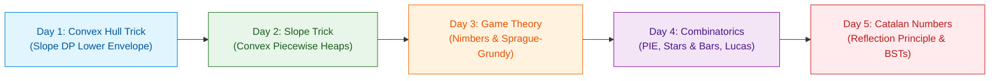

# 📘 WEEK 17: ADVANCED ALGORITHMS & DYNAMIC PROGRAMMING OPTIMIZATION — THE QUANT & SENIOR MASTERCLASS

> 🧭 **Navigation:** [← Previous: Week 16](../week_16_advanced_data_structures/README.md) • [🏠 Curriculum Overview](../README.md) • [📘 Complete Syllabus](../COMPLETE_SYLLABUS.md) • [Next: Week 18 →](../week_18_probabilistic_ds_systems/README.md)

---

## 🎯 WEEKLY MISSION & CONCEPTUAL HOOK

Welcome to **Week 17: Advanced Algorithms & DP Optimization**!
In entry-level technical interviews, dynamic programming stops at simple 2D tables (`dp[i][j]`).
In Senior, Staff, and Quantitative Trading engineering interviews (Citadel, Jane Street, Jump, Google Core, Meta Infra), interviewers expect you to break the quadratic barrier:
**How do you reduce `O(N^2)` quadratic dynamic programming transitions to `O(N log N)` or strictly `O(N)`?**

This week, we master the five elite algorithmic paradigms:
1. **Convex Hull Trick (CHT):** Converting quadratic DP cross-products (`m_j * x_i + b_j`) into a lower convex envelope of lines, evaluating transitions in amortized `O(1)` via zero-float deques.
2. **Slope Trick:** Tracking continuous piecewise linear convex functions purely through their slope inflection points using dual priority queues, solving continuous DP in `O(N log N)`.
3. **Combinatorial Game Theory & Nimbers:** How the Sprague-Grundy theorem and the MEX operator reduce complex multi-player DAG games to bitwise XOR Nim-sums.
4. **Combinatorics & Counting:** Solving non-negative integer partitions via Stars & Bars, alternating sets via Inclusion-Exclusion (PIE), and computing combinations on massive coordinates (`N <= 10^18`) via Lucas' Theorem.
5. **Catalan Numbers:** Unifying balanced parentheses, unique BSTs, polygon triangulations, and non-intersecting chords under André's Reflection Principle.

---

## 📅 DAY-BY-DAY MASTERCLASS MODULES

| Day | Instructional Module | Core Architecture & Paradigm | Production / Interview Target |
| :--- | :--- | :--- | :--- |
| **Day 01** | [Convex Hull Trick DP Optimization](Week_17_Day_01_Convex_Hull_Trick_DP_Optimization_Instructional.md) | Linear Lower Envelopes & Integer Cross-Multiplication | Citadel / Jane Street Quant DP, Batch Shipping Cost |
| **Day 02** | [Slope Trick](Week_17_Day_02_Slope_Trick_Instructional.md) | Dual Priority Queue Inflection Tracking | Make Array Non-Decreasing, Continuous Loss Minima |
| **Day 03** | [Game Theory & Nimbers](Week_17_Day_03_Game_Theory_Nimbers_Instructional.md) | Sprague-Grundy Theorem & XOR Nim-Sums | Two-Player Impartial Games, Graph DAG Token Moves |
| **Day 04** | [Combinatorics & Counting](Week_17_Day_04_Combinatorics_And_Counting_Instructional.md) | Stars & Bars, PIE, and Lucas' Theorem (`N <= 10^18`) | Resource Partitioning, Constrained Permutations |
| **Day 05** | [Catalan Numbers & Advanced Counting](Week_17_Day_05_Catalan_Numbers_And_Advanced_Counting_Instructional.md) | André's Reflection Principle & Closed-Form Recurrences | Unique BSTs (LC 96), Valid Parentheses (LC 22) |

---

## 📚 CONSOLIDATED PLAYBOOKS & REFERENCE GUIDES

*   📖 **Comprehensive Week Playbook:** [WEEK_17_FULL_PLAYBOOK.md](WEEK_17_FULL_PLAYBOOK.md) — Synthesis of all invariants, theorems, and pattern triggers.
*   📊 **Visual Concepts Playbook (Hybrid):** [Week_17_Visual_Concepts_Playbook_HYBRID.md](Week_17_Visual_Concepts_Playbook_HYBRID.md) — Compact Mermaid state diagrams and complexity reference tables.
*   💻 **Production C# Reference (.NET 8/9):** [Week_17_Extended_CSharp_Complete.md](Week_17_Extended_CSharp_Complete.md) — Zero-allocation, memory-aware implementations and problem ladders.
*   🐍 **Production Python Reference (Python 3.11+):** [Week_17_Extended_Python_Complete.md](Week_17_Extended_Python_Complete.md) — Clean, pythonic reference implementations for rapid whiteboard prototyping.

---

## 🛠️ THE 5 CORE SUPPORT FILES (`support files/`)

1.  📋 [Daily Progress Checklist](support%20files/Week_17_Daily_Progress_Checklist.md) — Step-by-step accountability tracker for theory, coding, and variants.
2.  🧭 [Weekly Guidelines & Mental Models](support%20files/Week_17_Guidelines.md) — Strategic roadmap, common pitfalls, and conceptual anchors.
3.  🎙️ [Interview Q&A Comprehensive Reference](support%20files/Week_17_Interview_QA_Reference.md) — High-frequency senior technical questions with verbal response frameworks.
4.  🗺️ [Problem-Solving Roadmap](support%20files/Week_17_Problem_Solving_Roadmap.md) — Tier-1 problem progression ladder from warm-up to advanced.
5.  📑 [Summary & Key Concepts Synthesis](support%20files/Week_17_Summary_Key_Concepts.md) — Fast-revision cheat sheet covering all governing invariants and system trade-offs.

---

> 🧭 **Navigation:** [← Previous: Week 16](../week_16_advanced_data_structures/README.md) • [🏠 Curriculum Overview](../README.md) • [📘 Complete Syllabus](../COMPLETE_SYLLABUS.md) • [Next: Week 18 →](../week_18_probabilistic_ds_systems/README.md)
