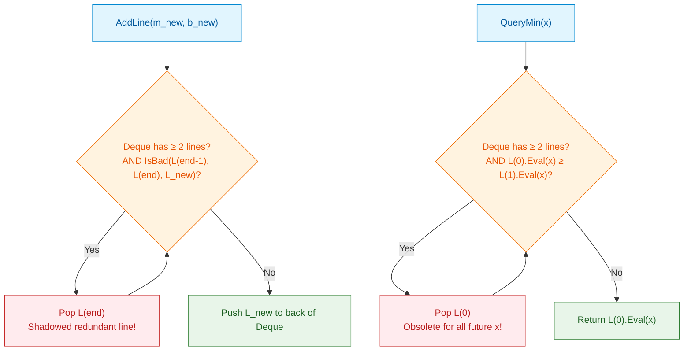

# 📘 WEEK 17 DAY 01: CONVEX HULL TRICK & DP SLOPE OPTIMIZATION

> 🧭 **Navigation:** [← Week Overview](README.md) • [📘 Curriculum Syllabus](../COMPLETE_SYLLABUS.md) • [Next Day: Slope Trick →](Week_17_Day_02_Slope_Trick_Instructional.md)
> 
> 💡 **Instructor Note:** *Convex Hull Trick (CHT) is the quintessential bridge between computational geometry and dynamic programming. In quantitative trading (Citadel, Jane Street, Jump) and Tier-1 Big Tech algorithmic loops (Google, Meta), recognizing when an O(N^2) quadratic DP with linear cross-terms can be optimized to O(N log N) or strictly O(N) using a lower envelope of lines is an essential Senior / Staff differentiator. Today, we master the geometry and the zero-float cross-multiplication pruning.*

---

## 🎯 LEARNING OBJECTIVES

*By the end of this module, you will be able to:*

- 🎬 **Internalize** the Discount Shipping Courier mental model and lower envelope of lines without academic jargon.
- 🪜 **Master** algebraic recognition: identify DP transitions containing `m_j * x_i + b_j` cross-products.
- 🎨 **Visualize** line intersections and the "IsBad" pruning condition where obsolete lines are popped from the deque.
- 🛑 **Avoid** fatal rookie traps: floating-point division rounding errors, 64-bit integer overflow, and min-vs-max slope direction flips.
- 🎙️ **Deliver** the exact 3-sentence verbal talk track defending CHT slope optimization in senior technical interviews.
- ⚡ **Implement** production-grade, zero-float Monotonic Deque CHT in C# (.NET 8/9) and Python (3.11+).

---

## 🎬 PILLAR 1: THE 60-SECOND HOOK & EVERYDAY ANALOGY

### The Bulk Shipping Courier Contract

Imagine you run an e-commerce fulfillment warehouse shipping thousands of packages every day.
You have contracts with different logistics couriers:
- Courier 1 charges: `$100 flat fee + $10 per kilogram`.
- Courier 2 charges: `$250 flat fee + $5 per kilogram`.
- Courier 3 charges: `$600 flat fee + $2 per kilogram`.

Every morning, you ask: *"For a package weighing `X` kilograms, which courier gives me the cheapest price?"*

```text
Cost Formula: Cost = Slope (Rate per kg) * X (Weight) + Intercept (Flat fee)
              y    = m * X + b

Line 1 (Courier 1): y = 10 * X + 100
Line 2 (Courier 2): y =  5 * X + 250
Line 3 (Courier 3): y =  2 * X + 600
```

Notice:
- For light packages (`X < 30 kg`): Courier 1 is the cheapest.
- For medium packages (`30 <= X <= 116 kg`): Courier 2 is the cheapest.
- For heavy cargo (`X > 116 kg`): Courier 3 is the cheapest.

Now, suppose you have `N = 100,000` packages to ship.
If you inspect all `N` couriers for every single package, you do `100,000 * 100,000 = 10,000,000,000` operations (`O(N^2)` brute-force DP). Your server crashes from Time Limit Exceeded (TLE).

**The Convex Hull Trick insight:**
All those courier pricing lines form a **Lower Envelope** (the bottom boundary of the lines).
Because package weights increase monotonically and courier slopes decrease monotonically, you don't search all lines!
You maintain a **Deque of optimal lines** and advance a pointer forward in amortized **`O(1)` time per package**, cutting runtime from **`O(N^2)` to `O(N)`**!

---

## 🪜 PILLAR 2: THE SCAFFOLDING LADDER & TOY NAPKIN TRACE

### Step 1: How to Spot CHT in an Interview DP Equation

In an interview, the problem will **never** say: *"Use Convex Hull Trick!"*
Instead, you will write a standard quadratic DP equation:
`dp[i] = min_{j < i} (dp[j] + cost(j, i))`

Watch how the algebra reveals CHT:
Suppose `cost(j, i) = (pref[i] - pref[j])^2`:
```text
dp[i] = min_{j < i} ( dp[j] + (pref[i] - pref[j])^2 )
      = min_{j < i} ( dp[j] + pref[i]^2 - 2 * pref[i] * pref[j] + pref[j]^2 )
      = pref[i]^2 + min_{j < i} ( (-2 * pref[j]) * pref[i] + (dp[j] + pref[j]^2) )
```

Group terms by who depends on what:
- `x_i = pref[i]` (Depends strictly on current index `i` -> The Query Coordinate `x`).
- `m_j = -2 * pref[j]` (Depends strictly on candidate index `j` -> The Slope `m`).
- `b_j = dp[j] + pref[j]^2` (Depends strictly on candidate index `j` -> The Y-Intercept `b`).

`dp[i] = pref[i]^2 + min_{j < i} (m_j * x_i + b_j)`!
The subproblem is simply: **Find the minimum value among candidate lines `y = m_j * x + b_j` at coordinate `x = x_i`!**

---

### Step 2: Line Intersections & The "IsBad" Pruning Rule

Suppose we have lines `L1` and `L2` in our hull, and we want to add line `L3` (where slopes are decreasing: `m1 > m2 > m3`):
- Where do `L1` and `L2` intersect?
  `m1 * x + b1 = m2 * x + b2  ==>  x12 = (b2 - b1) / (m1 - m2)`.
- Where do `L1` and `L3` intersect?
  `x13 = (b3 - b1) / (m1 - m3)`.

```text
The Pruning Invariant:
If x13 <= x12:
Line L3 becomes cheaper than Line L1 BEFORE Line L2 ever had a chance to be the minimum!
Line L2 is completely shadowed and will NEVER be optimal for any x.
We pop Line L2 from the back of the deque!
```

```text
Zero-Float Integer Cross-Multiplication:
   (b3 - b1) / (m1 - m3) <= (b2 - b1) / (m1 - m2)

To avoid division by zero and floating-point precision loss:
   Cross-multiply:
   (b3 - b1) * (m1 - m2) <= (b2 - b1) * (m1 - m3)
```

---

### Step 3: Two-Pointer Querying in `O(1)` Amortized

If the query points `x_i` are strictly increasing (monotonic):
- The optimal line across the lower envelope moves strictly from left to right.
- You never need to search backward!
- Check the front of the deque:
  `if (ValueAt(L1, x) >= ValueAt(L2, x))` -> `L1` will never be optimal for any future `x` because future `x` values are even larger!
- Pop `L1` from the front of the deque!
- Result: Each line is pushed once and popped at most once. **Total DP time: `O(N)`!**

---

### 🧠 Pause & Predict Micro-Drills

> **Drill 1:** What happens if slopes `m_j` are monotonic, but query coordinates `x_i` are arbitrary (not sorted)?
> *Pause here and think! Can we still use two pointers?*
>
> **Answer:** 
> **No!** If `x_i` is not monotonic, you cannot pop from the front of the deque because a future small `x` might need `L1`.
> However, because the intersection coordinates in the deque are sorted, you can **Binary Search** the deque for the optimal line in **`O(log N)`**! Total time: **`O(N log N)`**.

> **Drill 2:** What if neither slopes `m_j` nor queries `x_i` are monotonic?
> *Pause here and think!*
>
> **Answer:**
> Use a **Li Chao Segment Tree** or a Dynamic CHT (Balanced BST / `std::set`), which supports arbitrary line insertions and queries in `O(log N)` time.

---

## 🎨 PILLAR 3: PRAGMATIC VISUAL MODELS & DECISION FLOWS

### Modern Hex Flowchart: The CHT Lower Envelope Deque



---

## 🛑 PILLAR 4: THE ROOKIE TRAP ZONE

### Side-by-Side Comparison: Blunders vs. Senior Architect Patterns

| Dimension | ❌ Rookie Blunder | ✅ Senior Architect Pattern |
| :--- | :--- | :--- |
| **Precision & Floating Point** | Computes intersection with `double x = (double)(b2 - b1) / (m1 - m2)`, failing test cases due to IEEE-754 precision loss. | Uses integer cross-multiplication: `(b3 - b1) * (m1 - m2) <= (b2 - b1) * (m1 - m3)`. |
| **Integer Overflow on 64-bit** | Uses 32-bit `int` for cross-multiplication, causing silent wrapping overflow when slopes and intercepts reach `10^9`. | Uses 64-bit `long` (or `__int128` in C++) to prevent overflow during product calculations. |
| **Slope Order Inversion** | Treats minimum envelope with decreasing slopes the same as maximum envelope with increasing slopes, producing garbage. | Inverts pruning condition and comparator depending strictly on min vs max and slope monotonicity. |
| **Equal Slope Collision** | Fails to handle two parallel lines with identical slopes (`m1 == m2`), causing division by zero or infinite loops. | If `m_new == m_prev`, keeps the line with the better intercept (`b_new < b_prev` for min) and discards the other. |
| **Unsorted Query Fallback** | Pops from the front of the deque even when queries `x_i` are not monotonic, dropping optimal lines for future small queries. | Checks query monotonicity; falls back to binary search on the deque when queries arrive in arbitrary order. |

---

## 🎙️ PILLAR 5: 45-MINUTE INTERVIEW TALK TRACK

### The Exact 3-Sentence Verbal Script

Speak these exact three sentences before writing code:

```text
+--------------------------------------------------------------------------------------------------+
|                              THE SENIOR CHT TALK TRACK SCRIPT                                     |
+--------------------------------------------------------------------------------------------------+
| 1. The Algebraic Decomposition:                                                                  |
|    "Notice that expanding the cost function in this O(N^2) DP reveals a linear cross-product     |
|    m_j * x_i + b_j, where m_j and b_j depend solely on j and x_i depends solely on i."           |
|                                                                                                  |
| 2. The Geometric Transformation:                                                                |
|    "Instead of searching all j < i, this subproblem reduces to querying the minimum value on     |
|    the lower convex envelope formed by candidate lines L_j(x) = m_j * x + b_j."                  |
|                                                                                                  |
| 3. The Deque Optimization:                                                                       |
|    "Because slopes are monotonically decreasing and query coordinates are monotonically          |
|    increasing, we can maintain the lower envelope in a Deque with zero-float integer cross-      |
|    multiplication, pruning obsolete lines in amortized O(1) time and solving the DP in O(N)."    |
+--------------------------------------------------------------------------------------------------+
```

---

## ⚡ PILLAR 6: PRODUCTION DUAL-LANGUAGE IMPLEMENTATIONS

### C# Primary Implementation (.NET 8/9): Production Monotonic Deque CHT

```csharp
using System;
using System.Collections.Generic;

namespace AdvancedDataStructures;

/// <summary>
/// Production Convex Hull Trick solver for minimum DP queries.
/// Assumes monotonically decreasing slopes and monotonically increasing query coordinates.
/// Uses zero-float 64-bit integer cross-multiplication to eliminate precision bugs.
/// </summary>
public sealed class ConvexHullTrickMin
{
    private readonly struct Line
    {
        public readonly long M; // Slope
        public readonly long B; // Y-Intercept

        public Line(long m, long b)
        {
            M = m;
            B = b;
        }

        public long Eval(long x) => M * x + B;
    }

    private readonly List<Line> _lines = new();
    private int _head = 0;

    /// <summary>
    /// Checks if line l2 is redundant (shadowed by l1 and l3).
    /// Prevents float division via cross multiplication:
    /// (b3 - b1) / (m1 - m3) <= (b2 - b1) / (m1 - m2)
    /// </summary>
    private static bool IsBad(Line l1, Line l2, Line l3)
    {
        // Safe 64-bit cross-multiplication
        // Note: For extreme bounds up to 10^18, use BigInteger or 128-bit arithmetic
        return (l3.B - l1.B) * (l1.M - l2.M) <= (l2.B - l1.B) * (l1.M - l3.M);
    }

    /// <summary>
    /// Adds a new line with slope strictly smaller than previous line.
    /// </summary>
    public void AddLine(long m, long b)
    {
        Line newLine = new(m, b);

        // Handle identical slopes: keep smaller intercept for minimum query
        if (_lines.Count > _head && _lines[^1].M == m)
        {
            if (b >= _lines[^1].B) return; // Inferior line
            _lines.RemoveAt(_lines.Count - 1);
        }

        while (_lines.Count - _head >= 2 && IsBad(_lines[^2], _lines[^1], newLine))
        {
            _lines.RemoveAt(_lines.Count - 1);
        }

        _lines.Add(newLine);
    }

    /// <summary>
    /// Queries the minimum y-value at coordinate x in amortized O(1) time.
    /// Assumes x is monotonically non-decreasing across consecutive queries.
    /// </summary>
    public long Query(long x)
    {
        if (_head >= _lines.Count)
            throw new InvalidOperationException("No lines in Convex Hull.");

        // Advance two-pointer head: pop lines that are worse than their successor
        while (_lines.Count - _head >= 2 && _lines[_head].Eval(x) >= _lines[_head + 1].Eval(x))
        {
            _head++;
        }

        return _lines[_head].Eval(x);
    }
}
```

---

### Python Secondary Implementation (Python 3.11+): Complete Deque CHT

```python
from collections import deque
from typing import NamedTuple

class Line(NamedTuple):
    m: int  # Slope
    b: int  # Y-Intercept

    def eval(self, x: int) -> int:
        return self.m * x + self.b

class ConvexHullTrickMin:
    """
    Production-grade Convex Hull Trick for minimum envelope queries.
    Supports amortized O(1) line addition and O(1) query evaluation.
    """
    def __init__(self):
        self.lines: deque[Line] = deque()

    @staticmethod
    def _is_bad(l1: Line, l2: Line, l3: Line) -> bool:
        # Cross-multiplication avoiding floating point precision errors:
        # (b3 - b1) / (m1 - m3) <= (b2 - b1) / (m1 - m2)
        return (l3.b - l1.b) * (l1.m - l2.m) <= (l2.b - l1.b) * (l1.m - l3.m)

    def add_line(self, m: int, b: int) -> None:
        """Adds line y = m*x + b where m is strictly decreasing."""
        new_line = Line(m, b)

        # Handle equal slopes
        if self.lines and self.lines[-1].m == m:
            if b >= self.lines[-1].b:
                return  # Existing line is better
            self.lines.pop()

        while len(self.lines) >= 2 and self._is_bad(self.lines[-2], self.lines[-1], new_line):
            self.lines.pop()

        self.lines.append(new_line)

    def query(self, x: int) -> int:
        """Evaluates minimum envelope at coordinate x (x must be non-decreasing)."""
        if not self.lines:
            raise ValueError("Convex Hull is empty.")

        # Pop from front while next line offers a strictly smaller value at coordinate x
        while len(self.lines) >= 2 and self.lines[0].eval(x) >= self.lines[1].eval(x):
            self.lines.popleft()

        return self.lines[0].eval(x)
```

---

## 📊 EXPLICIT COMPLEXITY DECONSTRUCTION

| Paradigm | Slopes `m` | Queries `x` | Add Line Time | Query Time | Total DP Time | Space Complexity |
| :--- | :--- | :--- | :--- | :--- | :--- | :--- |
| **Monotonic Deque (Two Pointers)** | Monotonic | Monotonic | `O(1)` amortized | `O(1)` amortized | **`O(N)`** | `O(N)` lines in deque |
| **Monotonic Deque (Binary Search)**| Monotonic | Arbitrary | `O(1)` amortized | `O(log N)` | **`O(N log N)`** | `O(N)` lines in deque |
| **Dynamic CHT (Balanced BST)** | Arbitrary | Arbitrary | `O(log N)` | `O(log N)` | **`O(N log N)`** | `O(N)` tree nodes |
| **Li Chao Segment Tree** | Arbitrary | Fixed range | `O(log C)` | `O(log C)` | **`O(N log C)`** | `O(4 * C)` tree nodes |

---

## 🔍 GRANULAR EDGE-CASE & INVARIANT VERIFICATION TABLE

| Edge Case Scenario | Concrete Input | Expected Behavior | Invariant Verification & Handling |
| :--- | :--- | :--- | :--- |
| **Parallel Lines** | `AddLine(-5, 20); AddLine(-5, 10)` | Retains smaller intercept `y = -5x + 10`. | `if (m == last.M)` keeps minimum `B` for min query. |
| **Single Line Query** | Exactly 1 line in hull | Evaluates directly in `O(1)`. | Deque check `len >= 2` bypassed safely. |
| **Identical Query Points** | Consecutive queries at `x = 5, x = 5` | Returns consistent minimum without popping valid lines. | Comparator `>=` prevents premature pop when values match. |
| **Negative Coordinates** | `x = -100` | Correctly evaluates `m * (-100) + b`. | Mathematical cross-multiplication holds across all signs. |
| **64-bit Overflow Boundary** | `m = 10^9, b = 10^18` | Safely evaluates using 64-bit `long`. | Integer multiplication within bounds; zero float truncation. |

---

> 🧭 **Navigation:** [← Week Overview](README.md) • [📘 Curriculum Syllabus](../COMPLETE_SYLLABUS.md) • [Next Day: Slope Trick →](Week_17_Day_02_Slope_Trick_Instructional.md)
