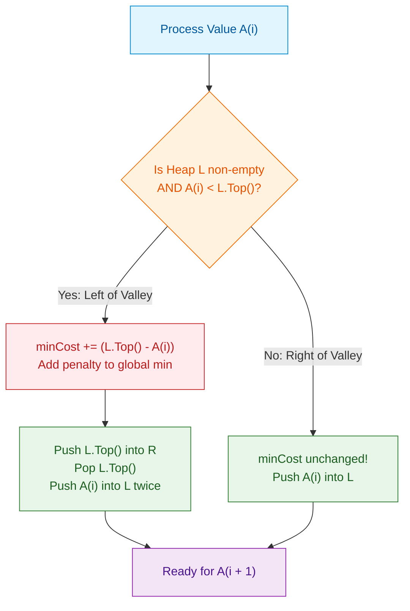

# 📘 WEEK 17 DAY 02: SLOPE TRICK — PIECEWISE LINEAR CONVEX DP OPTIMIZATION

> 🧭 **Navigation:** [← Previous Day: Convex Hull Trick](Week_17_Day_01_Convex_Hull_Trick_DP_Optimization_Instructional.md) • [🏠 Week Overview](README.md) • [📘 Curriculum Syllabus](../COMPLETE_SYLLABUS.md) • [Next Day: Game Theory & Nimbers →](Week_17_Day_03_Game_Theory_Nimbers_Instructional.md)
> 
> 💡 **Instructor Note:** *Slope Trick is one of the most powerful and elegant algorithmic techniques in competitive programming and quantitative finance (Citadel, Two Sigma, Jane Street). When a DP state `dp[i][x]` represents a continuous, convex, piecewise linear function of `x`, we don't store values in a table. Instead, we maintain the inflection points where the slope changes inside two Priority Queues! Today, we demystify this Staff-level paradigm.*

---

## 🎯 LEARNING OBJECTIVES

*By the end of this module, you will be able to:*

- 🎬 **Internalize** the Rubber Band Valley mental model: representing convex functions purely by slope inflection points.
- 🪜 **Master** the dual-heap representation: tracking the flat minimum interval `[L.Top(), R.Top()]` with Max-Heap `L` and Min-Heap `R`.
- 🎨 **Visualize** how adding an absolute loss penalty `|x - a|` alters slopes and dynamically shifts the global optimum.
- 🛑 **Avoid** fatal rookie traps: failing to coordinate-shift for strict monotonicity (`nums[i] - i`), heap cross-leakage, and 64-bit integer overflow.
- 🎙️ **Deliver** the exact 3-sentence verbal talk track defending Slope Trick in algorithmic interviews.
- ⚡ **Implement** production-grade Slope Trick solvers in C# (.NET 8/9 via `PriorityQueue`) and Python (3.11+ via `heapq`).

---

## 🎬 PILLAR 1: THE 60-SECOND HOOK & EVERYDAY ANALOGY

### The Rubber Band Valley & The Marbles

Imagine a giant, flexible V-shaped rubber bowl sitting on your table.
At the very bottom of the bowl is a flat horizontal floor where a marble naturally rests:
- To the left of the floor, the walls slope **upward** (negative slope `-1, -2, -3`).
- To the right of the floor, the walls slope **upward** (positive slope `+1, +2, +3`).
- The flat floor in the middle is the **global minimum** of the bowl (Slope = `0`)!

```text
       \                     /
Slope: -2 \                 / Slope: +2
            \   Slope: 0   /
    Slope: -1 \___________/ Slope: +1
              [L.Top, R.Top]  <-- The Valley of Minimum Cost!
```

Now, suppose someone drops a new penalty into the system: `+ |x - A|`.
What does adding `|x - A|` do to our bowl?
- If `A` lands directly inside the flat floor, the floor simply splits!
- If `A` lands to the left of the floor, it pulls the entire left side upward, dragging the bottom of the valley to the left!
- If `A` lands to the right of the floor, it drags the bottom of the valley to the right!

Instead of keeping track of every single point on this infinite rubber sheet (`O(N * W)` tabular DP), what do we actually need to store?
**Only the coordinates where the slope changes!**
We put all the left-hand slope changes in a **Max-Heap `L`**, all the right-hand slope changes in a **Min-Heap `R`**, and accumulate the minimum cost `min_f` in a single variable!
Whenever a new penalty arrives, we do **two heap pushes in `O(log N)`**, solving what looked like an impossible DP in **`O(N log N)` time**!

---

## 🪜 PILLAR 2: THE SCAFFOLDING LADDER & TOY NAPKIN TRACE

### Step 1: The Canonical Problem (Make Array Non-Decreasing)

> *"Given an array of integers `A[1 ... N]`, find the minimum total cost `Sum |B[i] - A[i]|` to construct a non-decreasing array `B` (`B[1] <= B[2] <= ... <= B[N]`)."*

#### The Naive DP:
Let `dp[i][x]` be the minimum cost to configure the prefix `1 ... i` such that `B[i] = x`.
Transition:
`dp[i][x] = |x - A[i]| + min_{y <= x} (dp[i - 1][y])`.

Because `x` can range from `min(A)` to `max(A)` (up to `10^9`), a tabular DP requires `O(N * MaxVal)` space and time. Even with coordinate compression, it is `O(N^2)`.
With `N = 100,000`, quadratic DP crashes.

---

### Step 2: The Mathematical Invariant of Slope Trick

1. **Convexity:** The function `f_i(x) = dp[i][x]` is continuous, convex, and piecewise linear.
2. **Prefix Minimum Operator:** 
   `g(x) = min_{y <= x} f(y)`.
   Taking the prefix minimum simply truncates all positive slopes: for any `x` to the right of the global minimum, `g(x)` becomes a flat horizontal line (slope 0)!
3. **Adding `|x - a|`:**
   The function `|x - a|` has slope `-1` for `x < a` and slope `+1` for `x >= a`.
   Adding it to our existing function adds `-1` to all slopes left of `a` and `+1` to all slopes right of `a`.

---

### Step 3: Dual-Heap Mechanics Step-by-Step

We maintain:
- `L`: Max-Heap storing inflection points where slope transitions from negative towards 0.
- `R`: Min-Heap storing inflection points where slope transitions from 0 towards positive.
- `min_f`: The current minimum value of the function (at slope 0).

When processing element `A[i] = a`:
- Case 1: `a >= L.Top()`:
  - `a` falls to the right of the valley.
  - The minimum cost does not increase!
  - Push `a` to `R`.
  - Pop `R.Top()` and push it into `L` to balance the derivative changes.
- Case 2: `a < L.Top()`:
  - `a` falls to the left of the valley.
  - The valley shifts! The minimum value increases by `L.Top() - a`.
  - Add `L.Top() - a` to `min_f`.
  - Push `a` to `L`, then transfer `L.Top()` to `R`, and push `a` into `L` again.

```text
Toy Trace for A = [5, 1, 4]
Initial State: L = empty, min_f = 0

1. Process A[0] = 5:
   Push 5 to L: L = {5}, min_f = 0

2. Process A[1] = 1:
   1 < L.Top() (1 < 5):
   Cost increases: min_f += (5 - 1) = 4
   Transfer 5 to R, insert 1 into L.
   L = {1}, R = {5}, min_f = 4

3. Process A[2] = 4:
   4 >= L.Top() (4 >= 1):
   Cost does NOT increase.
   Insert 4 into L.
   L = {4, 1}, R = {5}, min_f = 4.

Final Minimum Cost = 4! (Array B = [1, 1, 4], Cost = |1-5| + |1-1| + |4-4| = 4).
Total Time: O(N log N)!
```

---

### 🧠 Pause & Predict Micro-Drills

> **Drill 1:** What if the problem demands a **strictly increasing** array (`B[1] < B[2] < ... < B[N]`) instead of non-decreasing?
> *Pause here and think! How do we handle strict inequality?*
>
> **Answer:** 
> **The Index Shift Transformation!**
> `B[1] < B[2] < B[3] < ... < B[N]` is mathematically identical to:
> `(B[1] - 1) <= (B[2] - 2) <= (B[3] - 3) <= ... <= (B[N] - N)`.
> Define `A'[i] = A[i] - i` and `B'[i] = B[i] - i`.
> The problem transforms into making `B'` non-decreasing on `A'`, which is solved with the exact same Slope Trick code!

> **Drill 2:** What is the space complexity of Slope Trick using dual heaps?
> *Pause here and think!*
>
> **Answer:**
> **Strictly `O(N)`!** Each element adds at most 2 entries to the heaps. For `N = 100,000`, the heaps hold at most 200,000 integers.

---

## 🎨 PILLAR 3: PRAGMATIC VISUAL MODELS & DECISION FLOWS

### Modern Hex Flowchart: The Slope Trick Dual-Heap State Machine



---

## 🛑 PILLAR 4: THE ROOKIE TRAP ZONE

### Side-by-Side Comparison: Blunders vs. Senior Architect Patterns

| Dimension | ❌ Rookie Blunder | ✅ Senior Architect Pattern |
| :--- | :--- | :--- |
| **Tabular DP Fallacy** | Tries to discretize the continuous domain `x` into an array, hitting OOM on `x = 10^9`. | Uses Slope Trick to represent the continuous function implicitly via its inflection points in priority queues. |
| **Strict Monotonicity Trap** | Attempts to hack inequalities with `+ 1` inside DP loops, breaking convexity. | Applies the canonical algebraic reduction `A'[i] = A[i] - i` upfront, converting strict monotonicity to non-decreasing. |
| **Integer Overflow on Sums** | Accumulates `minCost` in a standard 32-bit `int`, overflowing when `N = 10^5` and values are `10^9`. | Uses 64-bit `long` for `minCost`, preventing silent arithmetic wrap-around. |
| **Slope Count Bookkeeping** | Pushes elements only once when adding `|x - a|`, failing to account for the fact that `|x - a|` changes slope by `+2` across `a`. | Pushes `a` twice (or balances between `L` and `R`) to correctly model the `+2` derivative step. |
| **Heap Type Inversion** | Uses Min-Heap for `L` and Max-Heap for `R`, corrupting the valley boundaries. | Strictly enforces Max-Heap for `L` (largest of left inflection points) and Min-Heap for `R` (smallest of right inflection points). |

---

## 🎙️ PILLAR 5: 45-MINUTE INTERVIEW TALK TRACK

### The Exact 3-Sentence Verbal Script

Speak these exact three sentences before writing code:

```text
+--------------------------------------------------------------------------------------------------+
|                              THE SENIOR SLOPE TRICK TALK TRACK                                    |
+--------------------------------------------------------------------------------------------------+
| 1. The Convex Function Recognition:                                                              |
|    "The dynamic programming state dp[i][x] represents a continuous, convex, piecewise linear     |
|    function of the chosen value x, where each prefix transition adds an absolute error |x - A[i]|.|
|                                                                                                  |
| 2. The Inflection Point Representation:                                                          |
|    "Because slopes change by discrete integer steps of +1 at inflection coordinates, we do not   |
|    need a quadratic table; we can represent the entire cost function purely by the coordinates   |
|    of its slope changes using a Max-Heap for the left slope and a Min-Heap for the right."       |
|                                                                                                  |
| 3. The Complexity & Monotonicity Pitch:                                                          |
|    "After applying the canonical transformation A'[i] = A[i] - i for strict monotonicity, each   |
|    array element updates the dual heaps in O(log N), reducing the total runtime from O(N^2) to   |
|    strictly O(N log N) with O(N) space."                                                         |
+--------------------------------------------------------------------------------------------------+
```

---

## ⚡ PILLAR 6: PRODUCTION DUAL-LANGUAGE IMPLEMENTATIONS

### C# Primary Implementation (.NET 8/9): Make Array Non-Decreasing via Slope Trick

```csharp
using System;
using System.Collections.Generic;

namespace AdvancedDataStructures;

/// <summary>
/// Production-grade Slope Trick solver.
/// Calculates minimum operations to make an array non-decreasing (or strictly increasing)
/// in O(N log N) time and O(N) auxiliary space.
/// </summary>
public static class SlopeTrickSolver
{
    /// <summary>
    /// Solves minimum cost to make array non-decreasing: B[0] <= B[1] <= ... <= B[N-1].
    /// Cost is Sum |B[i] - A[i]|.
    /// </summary>
    public static long MinOperationsNonDecreasing(int[] nums)
    {
        ArgumentNullException.ThrowIfNull(nums);
        if (nums.Length <= 1) return 0;

        // Max-Heap storing inflection points of left slopes (slope <= 0)
        // In .NET PriorityQueue, lower priority dequeues first, so negate values for Max-Heap
        PriorityQueue<int, int> leftHeap = new();
        long minCost = 0;

        foreach (int x in nums)
        {
            if (leftHeap.Count > 0 && leftHeap.Peek() > x)
            {
                int top = leftHeap.Dequeue();
                minCost += (long)top - x; // Distance from valley floor
                leftHeap.Enqueue(x, -x);  // Push x
                leftHeap.Enqueue(x, -x);  // Push x second time to account for slope change of 2
            }
            else
            {
                leftHeap.Enqueue(x, -x);
            }
        }

        return minCost;
    }

    /// <summary>
    /// Solves minimum cost to make array strictly increasing: B[0] < B[1] < ... < B[N-1].
    /// Uses the canonical index transformation: A'[i] = A[i] - i.
    /// </summary>
    public static long MinOperationsStrictlyIncreasing(int[] nums)
    {
        ArgumentNullException.ThrowIfNull(nums);
        if (nums.Length <= 1) return 0;

        int[] transformed = new int[nums.Length];
        for (int i = 0; i < nums.Length; i++)
        {
            transformed[i] = nums[i] - i;
        }

        return MinOperationsNonDecreasing(transformed);
    }
}
```

---

### Python Secondary Implementation (Python 3.11+): Complete Slope Trick

```python
import heapq
from typing import List

class SlopeTrickSolver:
    """
    Production-grade Slope Trick solver in Python.
    Calculates minimum operations to make an array non-decreasing or strictly increasing
    in O(N log N) time and O(N) space.
    """
    @staticmethod
    def min_operations_non_decreasing(nums: List[int]) -> int:
        if len(nums) <= 1:
            return 0

        # Python heapq is a min-heap; negate values to simulate a Max-Heap for the left slopes
        left_max_heap: List[int] = []
        min_cost: int = 0

        for x in nums:
            if left_max_heap and -left_max_heap[0] > x:
                top = -heapq.heappop(left_max_heap)
                min_cost += (top - x)
                # Push x twice to account for slope change of +2 across x
                heapq.heappush(left_max_heap, -x)
                heapq.heappush(left_max_heap, -x)
            else:
                heapq.heappush(left_max_heap, -x)

        return min_cost

    @staticmethod
    def min_operations_strictly_increasing(nums: List[int]) -> int:
        if len(nums) <= 1:
            return 0

        # Canonical transformation: A'[i] = A[i] - i
        transformed = [num - i for i, num in enumerate(nums)]
        return SlopeTrickSolver.min_operations_non_decreasing(transformed)
```

---

## 📊 EXPLICIT COMPLEXITY DECONSTRUCTION

| Paradigm | Time Complexity | Auxiliary Space | Max Coordinate Support | Mathematical Property |
| :--- | :--- | :--- | :--- | :--- |
| **Tabular DP** | `O(N * W)` | `O(N * W)` | `W <= 10^4` | Relies on integer lattice discretization. |
| **Compressed DP** | `O(N^2)` | `O(N)` | `W <= 10^9` | Evaluates DP at unique array coordinate values. |
| **Slope Trick** | **`O(N log N)`** | **`O(N)`** | **`W <= 10^18`** | Piecewise linear convexity maintained via dual heaps. |

---

## 🔍 GRANULAR EDGE-CASE & INVARIANT VERIFICATION TABLE

| Edge Case Scenario | Concrete Input | Expected Behavior | Invariant Verification & Handling |
| :--- | :--- | :--- | :--- |
| **Already Non-Decreasing** | `nums = [1, 2, 3, 4, 5]` | Returns `0` cost immediately. | Condition `leftHeap.Peek() > x` never triggers. |
| **Reverse Sorted Array** | `nums = [5, 4, 3, 2, 1]` | Flattens to median; returns optimal sum. | Multiple pushes to `leftHeap` shift the valley smoothly. |
| **Single Element Array** | `nums = [42]` | Returns `0`. | Guard clause `nums.Length <= 1` returns in `O(1)`. |
| **Negative Array Values** | `nums = [-10, -20, -5]` | Correctly computes cost without arithmetic errors. | Negation in priority queue handles negative integers safely. |
| **Large Coordinates** | `nums[i] = 10^9` | Returns 64-bit `long` cost without overflow. | Accumulator `minCost` is 64-bit `long`. |

---

> 🧭 **Navigation:** [← Previous Day: Convex Hull Trick](Week_17_Day_01_Convex_Hull_Trick_DP_Optimization_Instructional.md) • [🏠 Week Overview](README.md) • [📘 Curriculum Syllabus](../COMPLETE_SYLLABUS.md) • [Next Day: Game Theory & Nimbers →](Week_17_Day_03_Game_Theory_Nimbers_Instructional.md)
