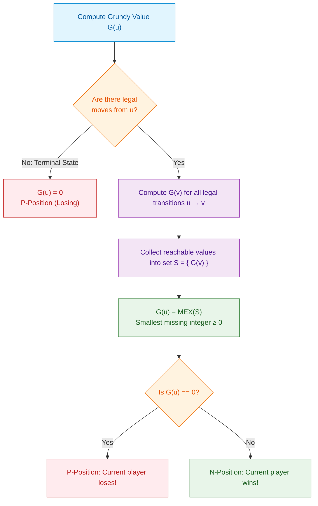

# 📘 WEEK 17 DAY 03: COMBINATORIAL GAME THEORY — NIMBERS & THE SPRAGUE-GRUNDY THEOREM

> 🧭 **Navigation:** [← Previous Day: Slope Trick](Week_17_Day_02_Slope_Trick_Instructional.md) • [🏠 Week Overview](README.md) • [📘 Curriculum Syllabus](../COMPLETE_SYLLABUS.md) • [Next Day: Combinatorics & Counting →](Week_17_Day_04_Combinatorics_And_Counting_Instructional.md)
> 
> 💡 **Instructor Note:** *Combinatorial Game Theory often seems like black magic to junior engineers because two players taking turns with piles of stones can look like an intractable minimax decision tree of O(2^N) states. But through Charles Bouton's discovery and the Sprague-Grundy Theorem, every impartial turn-based game under normal play is isomorphic to a game of Nim, solved in O(1) or O(N) using bitwise XOR! Today, we master Nim-Sums and the MEX operator.*

---

## 🎯 LEARNING OBJECTIVES

*By the end of this module, you will be able to:*

- 🎬 **Internalize** the Matchstick Game and the Bitwise XOR Nim-Sum mental model without academic jargon.
- 🪜 **Master** P-positions (Previous Player / Losing) vs N-positions (Next Player / Winning) states.
- 🎨 **Visualize** the Sprague-Grundy function `G(u) = MEX({G(v) : u -> v})` across game state Directed Acyclic Graphs (DAGs).
- 🛑 **Avoid** fatal rookie traps: exponential minimax recursion, confusion between normal and misère play, and off-by-one MEX set computations.
- 🎙️ **Deliver** the exact 3-sentence verbal talk track defending Sprague-Grundy equivalence in technical interviews.
- ⚡ **Implement** production-grade Nim and Sprague-Grundy solvers in C# (.NET 8/9) and Python (3.11+).

---

## 🎬 PILLAR 1: THE 60-SECOND HOOK & EVERYDAY ANALOGY

### The Two-Player Matchstick Game & The XOR Mind Reader

Imagine you and a friend are playing a game with piles of matchsticks on a coffee table:
- There are 3 piles of matchsticks: Pile A has **3**, Pile B has **4**, Pile C has **5**.
- Players take turns. On your turn, you can take **any number of matchsticks (at least 1)** from **any single pile**.
- The player who takes the very last matchstick wins (Normal Play convention).

If you try to map out every possible turn using Minimax, you get an explosive decision tree with thousands of branches:
*"If I take 2 from Pile A, then they could take 3 from Pile B, but if they take 1 from Pile C..."* Your head spins!

Now, watch what a math professor or senior engineer does in **2 seconds**:
They don't think about turns at all. They convert the pile sizes to binary and compute the **Bitwise XOR Sum (Nim-Sum)**:

```text
Pile A: 3  -->  0 1 1  (binary)
Pile B: 4  -->  1 0 0  (binary)
Pile C: 5  -->  1 0 1  (binary)
-----------------------------
XOR Sum:        0 1 0  = 2  (Non-zero!)
```

The professor smiles and says: *"Because the XOR sum is not zero, Player 1 is mathematically guaranteed to win with optimal play. If you move first, you will win every single time!"*

Why? Because the XOR sum acts like an energy balance. 
Any state with `XOR Sum != 0` can **always** be transitioned to `XOR Sum == 0`.
And from `XOR Sum == 0`, **any legal move you make will always leave the XOR sum != 0**!
You can force your opponent to receive `0` on every single turn until they are handed the ultimate zero: zero matchsticks left!

---

## 🪜 PILLAR 2: THE SCAFFOLDING LADDER & TOY NAPKIN TRACE

### Step 1: P-Positions vs N-Positions

In impartial combinatorial games, every game state is either:
1. **P-Position (Previous Player Wins / Current Player Loses):**
   - The player who just moved (previous) has secured a win.
   - The player whose turn it is right now is in a **losing state**.
   - **Terminal State:** A state with 0 legal moves is a P-position.
   - Any move from a P-position leads **exclusively to an N-position**.
2. **N-Position (Next Player Wins / Current Player Wins):**
   - The player whose turn it is right now has at least one winning move.
   - There exists **at least one move** leading to a P-position!

```text
The Winning Strategy:
- If you start at an N-position: make the move that drops the game into a P-position for your opponent.
- Your opponent has no choice but to return an N-position to you.
- You repeat this until your opponent is stuck at the terminal state with no moves left!
```

---

### Step 2: Bouton's Theorem for Nim

> **Bouton's Theorem (1901):**
> In a game of Nim with pile sizes `[x_1, x_2, ..., x_k]`, the state is:
> - A **P-position (Losing)** if and only if `x_1 ^ x_2 ^ ... ^ x_k == 0`.
> - An **N-position (Winning)** if and only if `x_1 ^ x_2 ^ ... ^ x_k != 0`.

#### How to Find the Winning Move:
1. Compute `S = x_1 ^ x_2 ^ ... ^ x_k`.
2. Find the most significant bit (MSB) of `S`.
3. Find any pile `x_i` that has a `1` at that MSB (such a pile is guaranteed to exist).
4. Reduce pile `x_i` to `x_i' = x_i ^ S` (since the MSB of `x_i` is 1, `x_i ^ S < x_i`, so this is a valid reduction).
5. The new XOR sum becomes `S ^ x_i ^ (x_i ^ S) = 0`!

---

### Step 3: The Sprague-Grundy Theorem & MEX

What if the game is **not** Nim?
What if the game is:
- Moving a coin on a graph DAG?
- Taking stones where you can only take 1, 3, or 4 stones?
- Splitting a pile into two non-empty piles?

The **Sprague-Grundy Theorem** proves that **ANY** impartial game under normal play is mathematically equivalent to a Nim pile of size `G(u)`, where `G(u)` is the **Grundy Value (Nimber)**!

#### The Minimum Excluded Value (MEX):
`MEX(S)` is the smallest non-negative integer **NOT** present in set `S`:
- `MEX({}) = 0`
- `MEX({1, 2, 3}) = 0` (0 is missing!)
- `MEX({0, 1, 2, 4}) = 3` (3 is missing!)

#### The Sprague-Grundy Function:
For any state `u` in a game DAG:
`G(u) = MEX({ G(v) : there is a legal move from u to v })`.

- If `u` has no legal moves (terminal state): `G(u) = MEX({}) = 0`.
- An independent composite game `G = G_1 + G_2 + ... + G_k` has Grundy value:
  `G(Composite) = G(G_1) ^ G(G_2) ^ ... ^ G(G_k)`!
- Player 1 wins if and only if `G(Composite) != 0`!

---

### 🧠 Pause & Predict Micro-Drills

> **Drill 1:** Suppose you can only remove 1, 2, or 3 stones from a single pile of size `N`. What is the Grundy value `G(N)`?
> *Pause here and calculate for N = 0, 1, 2, 3, 4!*
>
> **Answer:** 
> - `G(0) = MEX({}) = 0`
> - `G(1) = MEX({G(0)}) = MEX({0}) = 1`
> - `G(2) = MEX({G(0), G(1)}) = MEX({0, 1}) = 2`
> - `G(3) = MEX({G(0), G(1), G(2)}) = MEX({0, 1, 2}) = 3`
> - `G(4) = MEX({G(1), G(2), G(3)}) = MEX({1, 2, 3}) = 0`!
> Notice the pattern: `G(N) = N % 4`! (This is LeetCode 292: Nim Game).
> Player 1 wins if and only if `N % 4 != 0`.

> **Drill 2:** What is the difference between Normal Play and Misère Play?
> *Pause here and think!*
>
> **Answer:**
> In **Normal Play**, the player who makes the last move wins (the player with no moves loses).
> In **Misère Play**, the player forced to take the last stone loses! In Nim, Misère play is identical to Normal play until all remaining piles have size 1, at which point you take enough to leave an odd number of size-1 piles for your opponent.

---

## 🎨 PILLAR 3: PRAGMATIC VISUAL MODELS & DECISION FLOWS

### Modern Hex Flowchart: Sprague-Grundy Evaluation



---

## 🛑 PILLAR 4: THE ROOKIE TRAP ZONE

### Side-by-Side Comparison: Blunders vs. Senior Architect Patterns

| Dimension | ❌ Rookie Blunder | ✅ Senior Architect Pattern |
| :--- | :--- | :--- |
| **Search Paradigm** | Writes an exponential Minimax recursion tree `O(2^N)` for impartial games with independent sub-games. | Uses the Sprague-Grundy Theorem: computes Grundy value for sub-games in `O(N)` and XORs them in `O(1)`. |
| **MEX Definition Off-by-One** | Defines MEX as the minimum value in set `S` (`min(S)`), completely destroying Grundy values. | Defines MEX as the smallest non-negative integer **missing** from `S` (`MEX({0, 1, 3}) = 2`). |
| **Terminal Condition** | Assigns `G(terminal) = -1` or `null`, failing base cases. | Assigns `G(terminal) = MEX({}) = 0` (0 is the smallest missing non-negative integer). |
| **Composite Games** | Attempts to model all piles simultaneously in a multidimensional DP: `dp[p1][p2][p3]`. | Evaluates each pile independently as `G(p_i)` and computes the composite Grundy value via `G(p1) ^ G(p2) ^ G(p3)`. |
| **Partisan vs Impartial Confusion**| Attempts to apply Nim-sums to Chess or Checkers where players have different allowed pieces (Partisan Games). | Recognizes that Sprague-Grundy applies strictly to **Impartial Games** (both players have identical allowed moves from any state). |

---

## 🎙️ PILLAR 5: 45-MINUTE INTERVIEW TALK TRACK

### The Exact 3-Sentence Verbal Script

Speak these exact three sentences before writing code:

```text
+--------------------------------------------------------------------------------------------------+
|                              THE SENIOR GAME THEORY TALK TRACK                                    |
+--------------------------------------------------------------------------------------------------+
| 1. The Game Characterization:                                                                    |
|    "Because both players have identical legal moves from any state, this is an impartial game    |
|    under normal play, which can be modeled as a Directed Acyclic Graph of game states."          |
|                                                                                                  |
| 2. The Sprague-Grundy Invariant:                                                                 |
|    "By the Sprague-Grundy Theorem, each independent sub-game is isomorphic to a single Nim pile  |
|    whose size equals the MEX of the Grundy values of all reachable next states."                 |
|                                                                                                  |
| 3. The Nim-Sum Synthesis:                                                                        |
|    "The composite game is won by Player 1 if and only if the bitwise XOR sum of all sub-game     |
|    Grundy values is non-zero, allowing us to determine the winning strategy in O(N) instead     |
|    of exponential minimax search."                                                               |
+--------------------------------------------------------------------------------------------------+
```

---

## ⚡ PILLAR 6: PRODUCTION DUAL-LANGUAGE IMPLEMENTATIONS

### C# Primary Implementation (.NET 8/9): Nim & Sprague-Grundy Solver

```csharp
using System;
using System.Collections.Generic;

namespace AdvancedDataStructures;

/// <summary>
/// Production Combinatorial Game Theory solver.
/// Evaluates Nim games, winning moves, and Sprague-Grundy values for impartial games.
/// </summary>
public static class GameTheorySolver
{
    /// <summary>
    /// Evaluates if Player 1 has a winning strategy in standard Nim.
    /// Returns true if XOR sum != 0.
    /// </summary>
    public static bool CanWinNim(ReadOnlySpan<int> piles)
    {
        int xorSum = 0;
        foreach (int pile in piles)
        {
            xorSum ^= pile;
        }
        return xorSum != 0;
    }

    /// <summary>
    /// Finds the optimal winning move in standard Nim.
    /// Returns (pileIndex, newPileSize) that hands a 0-XOR state to the opponent.
    /// </summary>
    public static (int PileIndex, int NewSize)? FindWinningMove(int[] piles)
    {
        ArgumentNullException.ThrowIfNull(piles);
        int xorSum = 0;
        foreach (int p in piles) xorSum ^= p;

        if (xorSum == 0) return null; // Losing state (P-position); no guaranteed winning move

        for (int i = 0; i < piles.Length; i++)
        {
            int targetSize = piles[i] ^ xorSum;
            if (targetSize < piles[i])
            {
                return (i, targetSize);
            }
        }

        return null;
    }

    /// <summary>
    /// Computes the Sprague-Grundy value G(n) where a player can remove any count in allowedMoves.
    /// Uses memoization to avoid redundant subproblem evaluations.
    /// </summary>
    public static int ComputeGrundy(int n, int[] allowedMoves, int[] memo)
    {
        if (n == 0) return 0;
        if (memo[n] != -1) return memo[n];

        HashSet<int> reachableGrundy = new();
        foreach (int move in allowedMoves)
        {
            if (n >= move)
            {
                reachableGrundy.Add(ComputeGrundy(n - move, allowedMoves, memo));
            }
        }

        // Compute MEX (Minimum Excluded Value)
        int mex = 0;
        while (reachableGrundy.Contains(mex))
        {
            mex++;
        }

        return memo[n] = mex;
    }
}
```

---

### Python Secondary Implementation (Python 3.11+): Complete Game Theory Solver

```python
from typing import List, Tuple, Optional

class GameTheorySolver:
    """
    Production Game Theory Solver in Python.
    Calculates Nim-sums, winning moves, and Sprague-Grundy MEX values.
    """
    @staticmethod
    def can_win_nim(piles: List[int]) -> bool:
        """Returns True if Player 1 has a winning strategy (XOR sum != 0)."""
        xor_sum = 0
        for pile in piles:
            xor_sum ^= pile
        return xor_sum != 0

    @staticmethod
    def find_winning_move(piles: List[int]) -> Optional[Tuple[int, int]]:
        """
        Finds a move (pile_index, new_pile_size) that transitions the game
        into a P-position (XOR sum == 0) for the opponent.
        """
        xor_sum = 0
        for pile in piles:
            xor_sum ^= pile

        if xor_sum == 0:
            return None  # Current player is in a losing state

        for i, pile in enumerate(piles):
            target_size = pile ^ xor_sum
            if target_size < pile:
                return (i, target_size)

        return None

    @staticmethod
    def compute_grundy(n: int, allowed_moves: List[int], memo: Optional[List[int]] = None) -> int:
        """
        Computes the Grundy value G(n) using the Sprague-Grundy Theorem and MEX.
        """
        if memo is None:
            memo = [-1] * (n + 1)
        if n == 0:
            return 0
        if memo[n] != -1:
            return memo[n]

        reachable_nimbers = set()
        for move in allowed_moves:
            if n >= move:
                reachable_nimbers.add(GameTheorySolver.compute_grundy(n - move, allowed_moves, memo))

        # MEX: Smallest non-negative integer not in reachable_nimbers
        mex = 0
        while mex in reachable_nimbers:
            mex += 1

        memo[n] = mex
        return mex
```

---

## 📊 EXPLICIT COMPLEXITY DECONSTRUCTION

| Paradigm | Number of Piles | Allowed Moves | Time Complexity | Auxiliary Space | Strategy |
| :--- | :--- | :--- | :--- | :--- | :--- |
| **Standard Nim** | `K` piles | Any count from 1 pile | **`O(K)`** | `O(1)` | Direct bitwise XOR sum of all pile sizes. |
| **Sub-game Nimber** | Single pile `N` | Fixed set `M` moves | **`O(N * |M|)`** | `O(N)` memo table | MEX evaluation over reachable transition states. |
| **Composite Game** | `K` sub-games | Custom transitions | **`O(K * N * |M|)`** | `O(N)` | Compute `G(p_i)` for each sub-game, then XOR. |
| **Minimax Brute Force**| Any | Any | `O(B^D)` (Exponential) | `O(D)` stack | Catastrophic without Nimber decomposition. |

---

## 🔍 GRANULAR EDGE-CASE & INVARIANT VERIFICATION TABLE

| Edge Case Scenario | Concrete Input | Expected Behavior | Invariant Verification & Handling |
| :--- | :--- | :--- | :--- |
| **All Empty Piles** | `piles = [0, 0, 0]` | Returns `false` (P-position). | `xorSum == 0`, player has no legal moves. |
| **Single Pile of Size N** | `piles = [42]` | Returns `true`; winning move is `(0, 0)`. | Takes entire pile in 1 turn, leaving 0 for opponent. |
| **Two Equal Piles** | `piles = [7, 7]` | Returns `false` (`7 ^ 7 == 0`). | Symmetric copycat strategy guarantees Player 2 wins. |
| **MEX with Missing Zero** | Reachable Grundy values = `{1, 2, 3}` | Returns `0`. | `0` is the smallest missing non-negative integer. |
| **Unbounded Pile Sizes** | `piles[i] = 10^9` | Evaluates XOR in `O(1)` without overflow. | 32-bit and 64-bit integer XOR holds safely. |

---

> 🧭 **Navigation:** [← Previous Day: Slope Trick](Week_17_Day_02_Slope_Trick_Instructional.md) • [🏠 Week Overview](README.md) • [📘 Curriculum Syllabus](../COMPLETE_SYLLABUS.md) • [Next Day: Combinatorics & Counting →](Week_17_Day_04_Combinatorics_And_Counting_Instructional.md)
