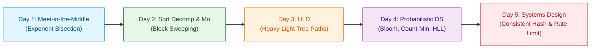

# 📘 WEEK 18: COMPETITIVE PROGRAMMING DEEP DIVE & ALGORITHMIC SYSTEMS DESIGN — THE STAFF ENGINEER MASTERCLASS

> 🧭 **Navigation:** [← Previous: Week 17](../week_17_advanced_graphs_hld_fft/README.md) • [🏠 Curriculum Overview](../README.md) • [📘 Complete Syllabus](../COMPLETE_SYLLABUS.md) • [Next: Week 19 →](../week_19_mock_interviews_mastery/README.md)

---

## 🎯 WEEKLY MISSION & CONCEPTUAL HOOK

Welcome to **Week 18: Competitive Programming Deep Dive & Algorithmic Systems Design**!
At the Staff and Principal engineering level (Google L6, Meta E6, Stripe, Cloudflare, Citadel), interviews test your ability to bridge high-level system architecture with low-level algorithmic mechanics:
**How do you handle billions of operations and petabytes of throughput when naive algorithms and exact memory structures completely collapse?**

This week, we master five powerhouse techniques that unite advanced algorithms and distributed infrastructure:
1. **Meet-in-the-Middle:** Exponent bisection transforming intractable `O(2^N)` exponential search into `O(N * 2^(N/2))` across massive coordinate bounds (`N in [30, 46], target <= 10^14`).
2. **Square Root Decomposition & Mo's Algorithm:** Chunking contiguous arrays into `sqrt(N)` blocks to solve offline non-invertible range queries in `O((N + Q) * sqrt(N))` with serpentine sorting.
3. **Heavy-Light Decomposition (HLD):** Decomposing arbitrary tree topologies into `log2(N)` heavy chains, mapped directly onto 1D Segment Trees for `O(log^2 N)` path queries.
4. **Probabilistic Data Structures:** Compressing billion-key datasets into megabytes of RAM using Bloom Filters (zero false negatives), Count-Min Sketch (frequency estimation), and HyperLogLog (12 KB unique visitor counts).
5. **Algorithmic Systems Design:** Production Consistent Hashing with virtual nodes to eliminate cache stampedes, and Sliding Window Counter rate limiters to protect downstream services.

---

## 📅 DAY-BY-DAY MASTERCLASS MODULES

| Day | Instructional Module | Core Architecture & Paradigm | Production / Interview Target |
| :--- | :--- | :--- | :--- |
| **Day 01** | [Meet In The Middle](Week_18_Day_01_Meet_In_The_Middle_Instructional.md) | Exponent Bisection & Two-Pointer Reconciliation | LeetCode 1755 Closest Subsequence Sum, Subset Knapsack |
| **Day 02** | [Square Root Decomposition & Mo](Week_18_Day_02_Square_Root_Decomposition_Instructional.md) | Sqrt Block Chunking & Offline Serpentine Ordering | Distinct Elements in Range, Subarray Frequencies |
| **Day 03** | [Heavy Light Decomposition](Week_18_Day_03_Heavy_Light_Decomposition_Instructional.md) | 2-DFS Tree Linearization & 1D Segment Tree Mapping | Tree Path Sums, Subtree Mutations, Dynamic Network Routing |
| **Day 04** | [Probabilistic Data Structures](Week_18_Day_04_Probabilistic_Data_Structures_Instructional.md) | Bloom Filters, Count-Min Sketch & HyperLogLog | RocksDB SSTable Filters, Twitter Trends, Redis HyperLogLog |
| **Day 05** | [Algorithmic Systems Design](Week_18_Day_05_Algorithmic_Systems_Design_Instructional.md) | Consistent Hash Ring (Virtual Nodes) & Rate Limiting | Cloudflare API Throttling, Cassandra & DynamoDB Sharding |

---

## 📚 CONSOLIDATED PLAYBOOKS & REFERENCE GUIDES

*   📖 **Comprehensive Week Playbook:** [WEEK_18_FULL_PLAYBOOK.md](WEEK_18_FULL_PLAYBOOK.md) — Synthesis of all invariants, theorems, and pattern triggers.
*   📊 **Visual Concepts Playbook (Hybrid):** [Week_18_Visual_Concepts_Playbook_HYBRID.md](Week_18_Visual_Concepts_Playbook_HYBRID.md) — Compact Mermaid state diagrams and complexity reference tables.
*   💻 **Production C# Reference (.NET 8/9):** [Week_18_Extended_CSharp_Complete.md](Week_18_Extended_CSharp_Complete.md) — Zero-allocation, memory-aware implementations and problem ladders.
*   🐍 **Production Python Reference (Python 3.11+):** [Week_18_Extended_Python_Complete.md](Week_18_Extended_Python_Complete.md) — Clean, pythonic reference implementations for rapid whiteboard prototyping.

---

## 🛠️ THE 5 CORE SUPPORT FILES (`support files/`)

1.  📋 [Daily Progress Checklist](support%20files/Week_18_Daily_Progress_Checklist.md) — Step-by-step accountability tracker for theory, coding, and variants.
2.  🧭 [Weekly Guidelines & Mental Models](support%20files/Week_18_Guidelines.md) — Strategic roadmap, common pitfalls, and conceptual anchors.
3.  🎙️ [Interview Q&A Comprehensive Reference](support%20files/Week_18_Interview_QA_Reference.md) — High-frequency senior technical questions with verbal response frameworks.
4.  🗺️ [Problem-Solving Roadmap](support%20files/Week_18_Problem_Solving_Roadmap.md) — Tier-1 problem progression ladder from warm-up to advanced.
5.  📑 [Summary & Key Concepts Synthesis](support%20files/Week_18_Summary_Key_Concepts.md) — Fast-revision cheat sheet covering all governing invariants and system trade-offs.

---

> 🧭 **Navigation:** [← Previous: Week 17](../week_17_advanced_graphs_hld_fft/README.md) • [🏠 Curriculum Overview](../README.md) • [📘 Complete Syllabus](../COMPLETE_SYLLABUS.md) • [Next: Week 19 →](../week_19_mock_interviews_mastery/README.md)
