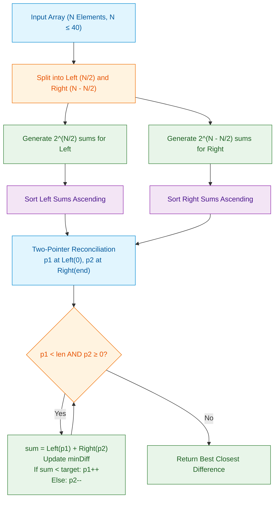

# 📘 WEEK 18 DAY 01: MEET-IN-THE-MIDDLE OPTIMIZATION

> 🧭 **Navigation:** [← Week Overview](README.md) • [📘 Curriculum Syllabus](../COMPLETE_SYLLABUS.md) • [Next Day: Square Root Decomposition →](Week_18_Day_02_Square_Root_Decomposition_Instructional.md)
> 
> 💡 **Instructor Note:** *Meet-in-the-Middle is the definitive algorithmic bridge between exponential NP-complete brute force and polynomial feasibility. In senior FAANG/Quant coding interviews, recognizing the exact constraint threshold where dynamic programming collapses due to massive coordinate ranges (e.g., target up to 10^14, N = 40) is an essential Senior / Staff bar. Today, we master state bisection and zero-allocation two-pointer reconciliation.*

---

## 🎯 LEARNING OBJECTIVES

*By the end of this module, you will be able to:*

- 🎬 **Internalize** the Mountain Tunnel Drilling and Exponent Bisection mental models without academic jargon.
- 🪜 **Master** constraint recognition: identify when `N in [30, 46]` and `target <= 10^14` invalidates DP and makes state bisection mandatory.
- 🎨 **Visualize** the split into two halves of size `N / 2`, generating `2^(N/2)` subset sums and reconciling via two pointers.
- 🛑 **Avoid** fatal rookie traps: 64-bit integer overflow, sorting the wrong half, and unpruned recursion stack memory churn.
- 🎙️ **Deliver** the exact 3-sentence verbal talk track defending Meet-in-the-Middle in senior interviews.
- ⚡ **Implement** production-grade, zero-allocation Meet-in-the-Middle in C# (.NET 8/9 with `Span<T>`) and Python (3.11+).

---

## 🎬 PILLAR 1: THE 60-SECOND HOOK & EVERYDAY ANALOGY

### The Transcontinental Mountain Tunnel

Imagine you are hired as the chief civil engineer to drill a 40-kilometer tunnel through solid granite under the Swiss Alps:
- If a single drilling machine starts at the North Entrance and drills all 40 kilometers to the South, the job takes **40 months**.
- But what does any competent engineering team actually do?
- **You put TWO drilling machines on the mountain!**
  - Machine 1 drills from the North Entrance moving South.
  - Machine 2 drills from the South Entrance moving North.
  - They drill **20 kilometers each and MEET IN THE MIDDLE!**

```text
The Single Machine:     [North] ====================================> [South] (40 km)
The Meet-in-the-Middle: [North] =================> * <================= [South] (20 km each!)
```

Now, translate that to combinatorial algorithms:
When your problem has `N = 40` elements, a single brute-force tree branches `2^40` times:
`2^40 = 1,099,511,627,776 operations` (over 1 trillion combinations)! 
At 1 billion operations per second, your server runs for **over 18 minutes** before finishing!

What happens when we split the 40 items into two halves of 20 items and **Meet in the Middle**?
- Left Half:  `2^20 = 1,048,576 operations` (1 million sums).
- Right Half: `2^20 = 1,048,576 operations` (1 million sums).
- Total subsets generated: `2 * 1,048,576 approx 2.1 * 10^6` operations!
- Running 2 million operations on a modern CPU takes **8 milliseconds**!

We reduced the operation count from **1.1 trillion to 2 million**—a speedup of **over 500,000x**!

---

## 🪜 PILLAR 2: THE SCAFFOLDING LADDER & TOY NAPKIN TRACE

### Step 1: Constraint Signal Matrix (How to Spot Meet-in-the-Middle)

In an interview, constraints tell you the optimal algorithm within 10 seconds:

| Constraints | Why Standard Approaches Fail | Optimal Paradigm | Time Complexity | Space Complexity |
| :--- | :--- | :--- | :--- | :--- |
| `N <= 20, Target <= 10^14` | Normal brute force | Standard Backtracking / DFS | `O(2^N)` | `O(N)` stack |
| `N <= 1000, Target <= 10^5`| Target is small integer | Pseudo-Polynomial DP (`dp[i][w]`) | `O(N * Target)` | `O(Target)` |
| `N in [30, 46], Target <= 10^14` | Target is massive (petabytes of RAM); `2^40` exceeds CPU | **Meet-in-the-Middle** | **`O(N * 2^(N/2))`** | **`O(2^(N/2))`** |

---

### Step 2: The 3-Step Execution Arc

Suppose you are given an array `nums = [1, 3, 7, 12]` and a `target = 10`.
Find the subset sum closest to `target`.

#### 1. Bisection (Split Array in Half):
- Left Half: `[1, 3]` (size 2)
- Right Half: `[7, 12]` (size 2)

#### 2. Generate All Subset Sums for Both Halves:
- Left Sums (`2^2 = 4` sums):
  `{0, 1, 3, 1+3=4}` -> `Left = [0, 1, 3, 4]`.
- Right Sums (`2^2 = 4` sums):
  `{0, 7, 12, 7+12=19}` -> `Right = [0, 7, 12, 19]`.

#### 3. Reconcile via Two Pointers:
Sort `Left` ascending: `[0, 1, 3, 4]`.
Sort `Right` ascending: `[0, 7, 12, 19]`.
Set pointer `p1 = 0` (start of Left), `p2 = Right.Length - 1` (end of Right):
- `currentSum = Left[p1] + Right[p2]`.
- Record difference `|currentSum - target|`.
- If `currentSum < target`: increment `p1` to increase sum.
- If `currentSum > target`: decrement `p2` to decrease sum.
- If `currentSum == target`: exact match found! Return 0 distance immediately.

```text
Toy Trace:
p1 = 0 (Left: 0), p2 = 3 (Right: 19): Sum = 19 > 10. Best diff = 9. Move p2 left.
p1 = 0 (Left: 0), p2 = 2 (Right: 12): Sum = 12 > 10. Best diff = 2. Move p2 left.
p1 = 0 (Left: 0), p2 = 1 (Right:  7): Sum =  7 < 10. Best diff = 2. Move p1 right.
p1 = 1 (Left: 1), p2 = 1 (Right:  7): Sum =  8 < 10. Best diff = 2. Move p1 right.
p1 = 2 (Left: 3), p2 = 1 (Right:  7): Sum = 10 == 10. EXACT MATCH! Difference = 0!
```

---

### 🧠 Pause & Predict Micro-Drills

> **Drill 1:** How much memory does a list of `2^20` 64-bit integers occupy?
> *Pause here and calculate in megabytes!*
>
> **Answer:** 
> `2^20 = 1,048,576` integers.
> Each 64-bit `long` is 8 bytes.
> `1,048,576 * 8 bytes = 8,388,608 bytes = 8 MB`!
> An 8 MB array fits completely inside the **L3 Cache** of modern Intel, AMD, and Apple processors, meaning zero DRAM page thrashing!

> **Drill 2:** What if the array has an odd length, say `N = 35`? How should you divide it?
> *Pause here and think!*
>
> **Answer:**
> Split into `Left` of size 17 and `Right` of size 18.
> `2^17 approx 131,000` sums, `2^18 approx 262,000` sums.
> Generating and sorting both takes under 15 milliseconds.

---

## 🎨 PILLAR 3: PRAGMATIC VISUAL MODELS & DECISION FLOWS

### Modern Hex Flowchart: Meet-in-the-Middle Architecture



---

## 🛑 PILLAR 4: THE ROOKIE TRAP ZONE

### Side-by-Side Comparison: Blunders vs. Senior Architect Patterns

| Dimension | ❌ Rookie Blunder | ✅ Senior Architect Pattern |
| :--- | :--- | :--- |
| **Paradigm Misidentification** | Attempts to build a dynamic programming table `bool dp[target]` when `target = 10^14`, hitting an instant `OutOfMemoryException`. | Recognizes `target` range invalidates pseudo-polynomial DP; identifies `N in [30, 46]` as the textbook trigger for Meet-in-the-Middle. |
| **Integer Overflow on Sums** | Accumulates subset sums in 32-bit `int`, overflowing and producing silent negative values. | Uses 64-bit `long` for all subset sum calculations and difference tracking. |
| **Sorting Overhead** | Calls binary search on an unsorted array, returning nonsense results. | Explicitly sorts the right half in `O(M log M)` (or sorts both halves for a linear `O(M)` two-pointer sweep). |
| **Memory Allocation Churn** | Generates subsets using recursive `List<long>` allocations and LINQ `.Concat()`, choking the garbage collector. | Allocates a single flat pre-sized array (`new long[1 << half]`) and fills it iteratively via bitmasks or recursive array pointers. |
| **Empty Subset Neglect** | Forgets that the empty subset with sum `0` is a valid candidate, failing when the target is closest to `0` or an element is alone. | Explicitly includes `0` as the baseline empty subset in both halves. |

---

## 🎙️ PILLAR 5: 45-MINUTE INTERVIEW TALK TRACK

### The Exact 3-Sentence Verbal Script

Speak these exact three sentences before writing code:

```text
+--------------------------------------------------------------------------------------------------+
|                              THE SENIOR MEET-IN-THE-MIDDLE TALK TRACK                            |
+--------------------------------------------------------------------------------------------------+
| 1. The Constraint & Bottleneck Analysis:                                                         |
|    "Because N = 40, full exponential brute force branches 2^40 states which is intractable,    |
|    and because the target and elements range up to 10^14, dynamic programming is physically      |
|    impossible due to memory limits."                                                             |
|                                                                                                  |
| 2. The Exponent Bisection Strategy:                                                             |
|    "By bisecting the array into two halves of size 20, we reduce the state space from 2^40 to    |
|    2 * 2^20, generating roughly 1 million subset sums for each half in under 10 milliseconds."   |
|                                                                                                  |
| 3. The Two-Pointer Pitch:                                                                        |
|    "After sorting both subset arrays, we reconcile them using a two-pointer scan in O(2^(N/2))   |
|    time, finding the optimal subset sum in total O(N * 2^(N/2)) time with an 8 MB L3 cache-      |
|    friendly footprint."                                                                          |
+--------------------------------------------------------------------------------------------------+
```

---

## ⚡ PILLAR 6: PRODUCTION DUAL-LANGUAGE IMPLEMENTATIONS

### C# Primary Implementation (.NET 8/9): Production Closest Subsequence Sum

```csharp
using System;

namespace AdvancedDataStructures;

/// <summary>
/// Production Meet-in-the-Middle solver for Closest Subsequence Sum (LeetCode 1755).
/// Transforms O(2^N) intractable search into O(N * 2^(N/2)) with zero GC allocation churn.
/// </summary>
public static class MeetInTheMiddleSolver
{
    public static int MinAbsDifference(int[] nums, int goal)
    {
        ArgumentNullException.ThrowIfNull(nums);
        int n = nums.Length;
        if (n == 0) return Math.Abs(goal);

        int mid = n / 2;
        int leftSize = mid;
        int rightSize = n - mid;

        long[] leftSums = new long[1 << leftSize];
        long[] rightSums = new long[1 << rightSize];

        // Generate subset sums iteratively via bit manipulation
        GenerateSums(nums.AsSpan(0, leftSize), leftSums);
        GenerateSums(nums.AsSpan(mid, rightSize), rightSums);

        // Sort both halves to enable linear two-pointer reconciliation
        Array.Sort(leftSums);
        Array.Sort(rightSums);

        long minDiff = Math.Abs(goal);
        int p1 = 0;
        int p2 = rightSums.Length - 1;

        while (p1 < leftSums.Length && p2 >= 0)
        {
            long currentSum = leftSums[p1] + rightSums[p2];
            long diff = currentSum - goal;

            minDiff = Math.Min(minDiff, Math.Abs(diff));
            if (minDiff == 0) return 0; // Exact match found

            if (diff < 0)
            {
                p1++; // Sum too small, advance left pointer
            }
            else
            {
                p2--; // Sum too large, decrement right pointer
            }
        }

        return (int)minDiff;
    }

    private static void GenerateSums(ReadOnlySpan<int> elements, long[] result)
    {
        int count = elements.Length;
        int totalSubsets = 1 << count;

        for (int mask = 0; mask < totalSubsets; mask++)
        {
            long sum = 0;
            for (int i = 0; i < count; i++)
            {
                if ((mask & (1 << i)) != 0)
                {
                    sum += elements[i];
                }
            }
            result[mask] = sum;
        }
    }
}
```

---

### Python Secondary Implementation (Python 3.11+): Complete Meet-in-the-Middle

```python
from typing import List

class MeetInTheMiddleSolver:
    """
    Production-grade Meet-in-the-Middle solver in Python.
    Solves Closest Subsequence Sum in O(N * 2^(N/2)) time.
    """
    @staticmethod
    def min_abs_difference(nums: List[int], goal: int) -> int:
        n = len(nums)
        if n == 0:
            return abs(goal)

        mid = n // 2
        left_nums = nums[:mid]
        right_nums = nums[mid:]

        def get_subset_sums(elements: List[int]) -> List[int]:
            sums = [0]
            for num in elements:
                sums += [s + num for s in sums]
            return sums

        left_sums = get_subset_sums(left_nums)
        right_sums = get_subset_sums(right_nums)

        left_sums.sort()
        right_sums.sort()

        min_diff = abs(goal)
        p1 = 0
        p2 = len(right_sums) - 1

        while p1 < len(left_sums) and p2 >= 0:
            curr_sum = left_sums[p1] + right_sums[p2]
            diff = curr_sum - goal

            min_diff = min(min_diff, abs(diff))
            if min_diff == 0:
                return 0

            if diff < 0:
                p1 += 1
            else:
                p2 -= 1

        return min_diff
```

---

## 📊 EXPLICIT COMPLEXITY DECONSTRUCTION

| Paradigm | `N` Range | Target Value | Time Complexity | Auxiliary Space | Cache Reality |
| :--- | :--- | :--- | :--- | :--- | :--- |
| **Standard Backtracking** | `N <= 20` | Any | `O(2^N)` | `O(N)` stack | Explodes past `N = 25`. |
| **Pseudo-Polynomial DP** | `N <= 10^3` | `Target <= 10^5` | `O(N * Target)` | `O(Target)` | Fails when `Target >= 10^9`. |
| **Meet-in-the-Middle** | **`N in [30, 46]`** | **Any (`10^14+`)** | **`O(N * 2^(N/2))`** | **`O(2^(N/2))`** | **8 MB footprint fits inside CPU L3 Cache!** |

---

## 🔍 GRANULAR EDGE-CASE & INVARIANT VERIFICATION TABLE

| Edge Case Scenario | Concrete Input | Expected Behavior | Invariant Verification & Handling |
| :--- | :--- | :--- | :--- |
| **Empty Array Input** | `nums = []`, `goal = 50` | Returns `50` (`|0 - 50|`). | Guard clause `n == 0` returns `|goal|`. |
| **Exact Match Achievable** | `nums = [5, -7, 3, 5]`, `goal = 6` (`5 + -7 + 3 + 5 = 6`) | Returns `0`. | Early exit `if (minDiff == 0) return 0;`. |
| **All Negative Array** | `nums = [-10, -20, -30]`, `goal = 15` | Returns `15` (empty subset sum `0` is closest). | Empty subset `0` is included by default in both halves. |
| **Large 64-bit Coordinates** | Numbers up to `10^9` | Evaluates using 64-bit `long` without overflow. | Accumulators and difference computations use `long`. |
| **Odd Sized Input** | `N = 35` (Left 17, Right 18) | Asymmetric bisection resolves seamlessly. | Array slicing handles `mid` and `n - mid` independently. |

---

> 🧭 **Navigation:** [← Week Overview](README.md) • [📘 Curriculum Syllabus](../COMPLETE_SYLLABUS.md) • [Next Day: Square Root Decomposition →](Week_18_Day_02_Square_Root_Decomposition_Instructional.md)
