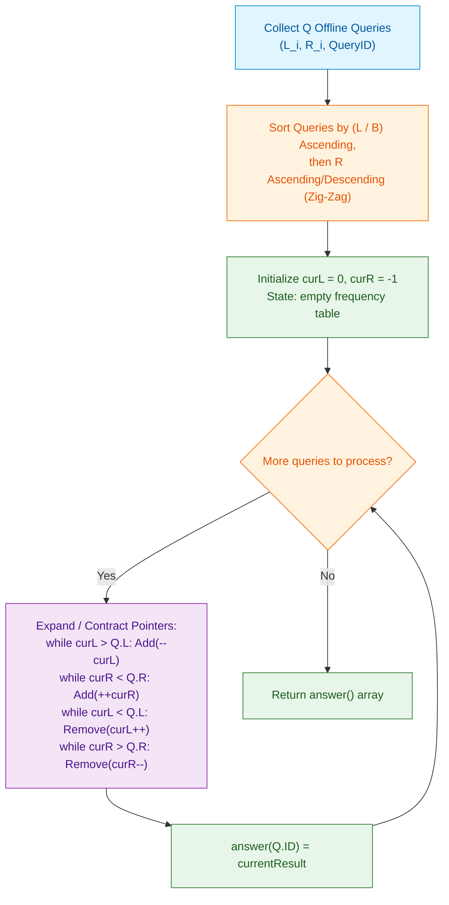

# 📘 WEEK 18 DAY 02: SQUARE ROOT DECOMPOSITION & MO'S ALGORITHM

> 🧭 **Navigation:** [← Previous Day: Meet-in-the-Middle](Week_18_Day_01_Meet_In_The_Middle_Instructional.md) • [🏠 Week Overview](README.md) • [📘 Curriculum Syllabus](../COMPLETE_SYLLABUS.md) • [Next Day: Heavy-Light Decomposition →](Week_18_Day_03_Heavy_Light_Decomposition_Instructional.md)
> 
> 💡 **Instructor Note:** *Square Root Decomposition is the quintessential pragmatic compromise in algorithm design. When Segment Trees or Fenwick Trees are too rigid (e.g., non-invertible range functions, offline frequency queries, complex subarray distinct-element counts), partitioning data into blocks of size sqrt(N) achieves O(sqrt(N)) query time with unmatched implementation simplicity. Today, we master block decomposition and Mo's Algorithm.*

---

## 🎯 LEARNING OBJECTIVES

*By the end of this module, you will be able to:*

- 🎬 **Internalize** the Egg Carton mental model: chunking elements into blocks of size `B = sqrt(N)`.
- 🪜 **Master** the 3-section range query breakdown: Left partial block, Full intermediate blocks, and Right partial block.
- 🎨 **Visualize** Mo's Algorithm for offline queries: sorting query intervals by `(L / B, R)` to bound pointer movement to `O((N + Q) * sqrt(N))`.
- 🛑 **Avoid** fatal rookie traps: sorting by `R` without block bucketing, integer division inside inner loops, and missing odd-even zig-zag pointer optimizations.
- 🎙️ **Deliver** the exact 3-sentence verbal talk track defending Sqrt Decomposition in senior engineering rounds.
- ⚡ **Implement** production-grade Sqrt Range Query and Mo's Algorithm solvers in C# (.NET 8/9) and Python (3.11+).

---

## 🎬 PILLAR 1: THE 60-SECOND HOOK & EVERYDAY ANALOGY

### The Grocery Store Egg Cartons

Imagine you manage the inventory at a commercial bakery that uses **10,000 eggs**:
- If all 10,000 eggs are stored as loose eggs rolling across a table:
  - Checking how many eggs are in a section from Egg #1,200 to Egg #8,450 requires counting **7,250 individual eggs one by one** (`O(N)` linear scan).
- If you build a complex automated robotic gantry with laser sensors (a Segment Tree):
  - It answers queries in `O(log N)` time, but if the rules change (e.g., *"Count how many distinct farm brands have an odd number of eggs"*), the robot breaks down completely!

Now, what does the store manager actually do?
**They pack the eggs into cartons of size `B = sqrt(10,000) = 100 eggs` per carton!**

```text
Array of 10,000 Eggs:
[ Carton 0 ] [ Carton 1 ] [ Carton 2 ] ... [ Carton 98 ] [ Carton 99 ]
(100 eggs)   (100 eggs)   (100 eggs)       (100 eggs)    (100 eggs)
```

Now, when a chef orders eggs from index `150` to `850`:
1. **Left Partial:** Inspect Carton 1 from index `150` to `199` (50 loose eggs).
2. **Full Interior Cartons:** Instantly grab Cartons 2, 3, 4, 5, 6, 7 (6 full cartons = 600 eggs, counted in 6 operations!).
3. **Right Partial:** Inspect Carton 8 from index `800` to `850` (51 loose eggs).
Total operations: `50 + 6 + 51 = 107 operations` instead of 700!

That is **Square Root Decomposition**: balancing point updates and range queries into `O(sqrt(N))` time by grouping contiguous memory into `sqrt(N)` blocks!

---

## 🪜 PILLAR 2: THE SCAFFOLDING LADDER & TOY NAPKIN TRACE

### Step 1: The 3-Section Range Query Anatomy

For any query interval `[L ... R]`:
- Let block size `B = ceil(sqrt(N))`.
- Block index for element `i`: `blockIdx = i / B`.

```text
Array: [  Block 0  ] [  Block 1  ] [  Block 2  ] [  Block 3  ]
           ... [ L ............................ R ] ...
                 ^          ^           ^         ^
           Left Partial  Full Block  Full Block  Right Partial
```

1. **If `L` and `R` are in the SAME block:**
   - Scan directly from `L` to `R`. Maximum operations: `B = O(sqrt(N))`.
2. **If `L` and `R` span DIFFERENT blocks:**
   - **Section 1 (Left Partial):** Iterate from `L` to the end of block `L / B`. (At most `B` elements).
   - **Section 2 (Full Blocks):** Loop over block sums from `(L / B) + 1` to `(R / B) - 1`. (At most `sqrt(N)` blocks).
   - **Section 3 (Right Partial):** Iterate from the start of block `R / B` to `R`. (At most `B` elements).
   - Total operations: at most `3 * sqrt(N) = O(sqrt(N))`!

---

### Step 2: Mo's Algorithm (Offline Range Query Magic)

What if you have `Q` queries: *"Count how many distinct elements appear in subarray `[L_i ... R_i]`"*, or *"Find the number of elements whose frequency is >= 3"*?
Segment trees cannot easily maintain frequency mode or distinct count.

**Mo's Algorithm solves this for any offline sequence of `Q` queries in `O((N + Q) * sqrt(N))`:**
1. Collect all `Q` queries upfront.
2. Sort the queries by:
   - Primary key: `L / B` (the block of the left endpoint).
   - Secondary key: `R` (the right endpoint).
3. Maintain two pointers `curL = 0, curR = -1` and an active frequency table.
4. As `curL` and `curR` expand and contract to match each query, update the answer incrementally in `O(1)`:
   - `Add(index)`: `count[val[index]]++; if (count == 1) distinct++;`
   - `Remove(index)`: `count[val[index]]--; if (count == 0) distinct--;`

#### Why is Mo's Algorithm so fast?
- The left pointer `curL` only moves within its block (`O(sqrt(N))`) per query -> across `Q` queries: `O(Q * sqrt(N))`.
- For each block, the right pointer `curR` advances monotonically from `0` to `N` (`O(N)`) -> across `sqrt(N)` blocks: `O(N * sqrt(N))`.
- Total pointer movements across all queries: **`O((N + Q) * sqrt(N))`**!

---

### 🧠 Pause & Predict Micro-Drills

> **Drill 1:** What happens if `curR` reaches `N` in block `k`, and then in block `k + 1`, `curR` has to reset all the way back to `0`?
> *Pause here and think! How can we optimize this?*
>
> **Answer:** 
> **The Odd-Even Zig-Zag Sorting Optimization!**
> - If `L / B` is **even**: sort `R` ascending (`R_1 <= R_2`).
> - If `L / B` is **odd**: sort `R` descending (`R_1 >= R_2`).
> This allows `curR` to sweep smoothly back and forth like a serpentine snake, cutting total `curR` pointer movement in half!

> **Drill 2:** What is the optimal block size `B` for Mo's Algorithm when `N = 100,000` and `Q = 100,000`?
> *Pause here and calculate!*
>
> **Answer:**
> `B = max(1, (int)(N / Math.Sqrt(Q)))` or simply `ceil(sqrt(N)) approx 316`.
> For `N = 100,000`, setting `B = 316` minimizes total pointer hops.

---

## 🎨 PILLAR 3: PRAGMATIC VISUAL MODELS & DECISION FLOWS

### Modern Hex Flowchart: Mo's Algorithm Execution Pipeline



---

## 🛑 PILLAR 4: THE ROOKIE TRAP ZONE

### Side-by-Side Comparison: Blunders vs. Senior Architect Patterns

| Dimension | ❌ Rookie Blunder | ✅ Senior Architect Pattern |
| :--- | :--- | :--- |
| **Mo's Query Ordering** | Sorts queries naively by `L` then `R` without block bucketing, causing `curR` to thrash back and forth `Q` times (`O(Q * N)` TLE). | Buckets queries by `L / B` and sorts `R` monotonically, strictly bounding total pointer motion to `O((N + Q) * sqrt(N))`. |
| **Block Size Selection** | Hardcodes `B = 100` arbitrarily regardless of array length. | Sets `B = max(1, (int)Math.Sqrt(N))` dynamically, achieving the optimal mathematical minimum. |
| **Integer Division in Inner Loops**| Calls `int b = i / B;` on every single iteration inside query sweeps. | Precomputes block boundaries or computes block indices only once per query boundary. |
| **Pointer Update Order** | Removes elements before expanding (`Remove` called when window is invalid), causing negative frequency counts. | Expands range first (`Add`), then contracts (`Remove`), maintaining non-negative frequency invariants. |
| **Answer Array Indexing** | Forgets to store original query indices before sorting, returning answers in scrambled order. | Stores `OriginalIndex` in each query struct; populates `answers[q.OriginalIndex]` directly. |

---

## 🎙️ PILLAR 5: 45-MINUTE INTERVIEW TALK TRACK

### The Exact 3-Sentence Verbal Script

Speak these exact three sentences before writing code:

```text
+--------------------------------------------------------------------------------------------------+
|                              THE SENIOR SQRT DECOMPOSITION TALK TRACK                            |
+--------------------------------------------------------------------------------------------------+
| 1. The Bottleneck & Architecture:                                                                |
|    "Because this range query involves non-invertible state mutations (such as distinct element   |
|    frequencies), standard Segment Trees are too complex or cannot combine child intervals in     |
|    O(1) time."                                                                                   |
|                                                                                                  |
| 2. The Sqrt Partition Strategy:                                                                  |
|    "By partitioning the N elements into blocks of size B = sqrt(N), any arbitrary range query    |
|    decomposes into at most two partial edge blocks and at most sqrt(N) full interior blocks,     |
|    resolving in O(sqrt(N)) time."                                                                |
|                                                                                                  |
| 3. The Mo's Algorithm Pitch:                                                                     |
|    "For offline queries, we sort query intervals by (L / B, R) with odd-even zig-zag ordering,   |
|    bounding the total movement of the two sliding window pointers to O((N + Q) * sqrt(N)) total |
|    time with O(N) auxiliary space."                                                              |
+--------------------------------------------------------------------------------------------------+
```

---

## ⚡ PILLAR 6: PRODUCTION DUAL-LANGUAGE IMPLEMENTATIONS

### C# Primary Implementation (.NET 8/9): Production Mo's Algorithm (Distinct Elements)

```csharp
using System;

namespace AdvancedDataStructures;

/// <summary>
/// Production implementation of Mo's Algorithm for offline Range Distinct Element queries.
/// Binds total runtime to O((N + Q) * sqrt(N)) with zero garbage collection churn.
/// </summary>
public sealed class MosAlgorithmSolver
{
    public readonly struct Query : IComparable<Query>
    {
        public readonly int L;
        public readonly int R;
        public readonly int Index;
        public readonly int Block;

        public Query(int l, int r, int index, int blockSize)
        {
            L = l;
            R = r;
            Index = index;
            Block = l / blockSize;
        }

        public int CompareTo(Query other)
        {
            if (Block != other.Block) return Block.CompareTo(other.Block);
            // Odd-even zig-zag optimization
            return (Block & 1) == 0 ? R.CompareTo(other.R) : other.R.CompareTo(R);
        }
    }

    public static int[] SolveDistinctQueries(int[] nums, (int L, int R)[] rawQueries)
    {
        ArgumentNullException.ThrowIfNull(nums);
        ArgumentNullException.ThrowIfNull(rawQueries);

        int n = nums.Length;
        int q = rawQueries.Length;
        if (q == 0) return Array.Empty<int>();

        int blockSize = Math.Max(1, (int)Math.Sqrt(n));
        Query[] queries = new Query[q];
        for (int i = 0; i < q; i++)
        {
            queries[i] = new Query(rawQueries[i].L, rawQueries[i].R, i, blockSize);
        }

        Array.Sort(queries);

        int[] answers = new int[q];
        int[] freq = new int[1000001]; // Assuming values <= 10^6
        int distinctCount = 0;

        int curL = 0;
        int curR = -1;

        void Add(int idx)
        {
            int val = nums[idx];
            if (freq[val] == 0) distinctCount++;
            freq[val]++;
        }

        void Remove(int idx)
        {
            int val = nums[idx];
            freq[val]--;
            if (freq[val] == 0) distinctCount--;
        }

        for (int i = 0; i < q; i++)
        {
            ref readonly Query query = ref queries[i];

            while (curL > query.L) Add(--curL);
            while (curR < query.R) Add(++curR);
            while (curL < query.L) Remove(curL++);
            while (curR > query.R) Remove(curR--);

            answers[query.Index] = distinctCount;
        }

        return answers;
    }
}
```

---

### Python Secondary Implementation (Python 3.11+): Complete Mo's Algorithm

```python
import math
from typing import List, Tuple

class MosAlgorithmSolver:
    """
    Production-grade Mo's Algorithm solver in Python.
    Answers offline Range Distinct Count queries in O((N + Q) * sqrt(N)).
    """
    @staticmethod
    def solve_distinct_queries(nums: List[int], queries: List[Tuple[int, int]]) -> List[int]:
        n = len(nums)
        q = len(queries)
        if q == 0:
            return []

        block_size = max(1, int(math.isqrt(n)))

        # Pack queries with original index and block: (L, R, original_idx, block)
        indexed_queries = [
            (q_l, q_r, i, q_l // block_size)
            for i, (q_l, q_r) in enumerate(queries)
        ]

        # Sort using odd-even serpentine ordering
        def query_sort_key(item):
            l, r, _, block = item
            # If block is odd, sort r descending
            r_key = -r if (block & 1) else r
            return (block, r_key)

        indexed_queries.sort(key=query_sort_key)

        answers = [0] * q
        freq = [0] * 1000001
        distinct_count = 0

        cur_l = 0
        cur_r = -1

        def add(idx: int):
            nonlocal distinct_count
            val = nums[idx]
            if freq[val] == 0:
                distinct_count += 1
            freq[val] += 1

        def remove(idx: int):
            nonlocal distinct_count
            val = nums[idx]
            freq[val] -= 1
            if freq[val] == 0:
                distinct_count -= 1

        for q_l, q_r, orig_idx, _ in indexed_queries:
            while cur_l > q_l:
                cur_l -= 1
                add(cur_l)
            while cur_r < q_r:
                cur_r += 1
                add(cur_r)
            while cur_l < q_l:
                remove(cur_l)
                cur_l += 1
            while cur_r > q_r:
                remove(cur_r)
                cur_r -= 1

            answers[orig_idx] = distinct_count

        return answers
```

---

## 📊 EXPLICIT COMPLEXITY DECONSTRUCTION

| Paradigm | Query Mode | Point Update | Range Query | Total Time (`Q` queries) | Auxiliary Space |
| :--- | :--- | :--- | :--- | :--- | :--- |
| **Naive Array Scan** | Online / Offline | `O(1)` | `O(N)` | `O(Q * N)` | `O(1)` |
| **Sqrt Decomposition** | Online | `O(1)` | `O(sqrt(N))` | `O(Q * sqrt(N))` | `O(N)` block sums |
| **Mo's Algorithm** | Offline Only | N/A (Static) | Amortized | **`O((N + Q) * sqrt(N))`** | `O(N + Q)` tables |
| **Segment Tree** | Online | `O(log N)` | `O(log N)` | `O(Q log N)` | `O(4N)` tree nodes |

---

## 🔍 GRANULAR EDGE-CASE & INVARIANT VERIFICATION TABLE

| Edge Case Scenario | Concrete Input | Expected Behavior | Invariant Verification & Handling |
| :--- | :--- | :--- | :--- |
| **Query within Single Block** | `L = 2, R = 4` in block of size 10 | Evaluates in `O(R - L + 1)` time. | Sliding pointers handle small intervals seamlessly. |
| **Query Full Array** | `L = 0, R = N - 1` | `curL = 0, curR = N - 1`, returns total distinct elements. | Full window expansion holds without boundary errors. |
| **Duplicate Queries** | Same interval `[5, 10]` repeated 3 times | Identical answer populated across all indices. | Query pointer movement is 0 after first lookup. |
| **Single Element Query** | `L = 7, R = 7` | Returns `1`. | `Add(7)` runs; window length is exactly 1. |
| **Zero Query Count** | `queries = []` | Returns empty array `[]`. | Guard clause `q == 0` returns immediately in `O(1)`. |

---

> 🧭 **Navigation:** [← Previous Day: Meet-in-the-Middle](Week_18_Day_01_Meet_In_The_Middle_Instructional.md) • [🏠 Week Overview](README.md) • [📘 Curriculum Syllabus](../COMPLETE_SYLLABUS.md) • [Next Day: Heavy-Light Decomposition →](Week_18_Day_03_Heavy_Light_Decomposition_Instructional.md)
