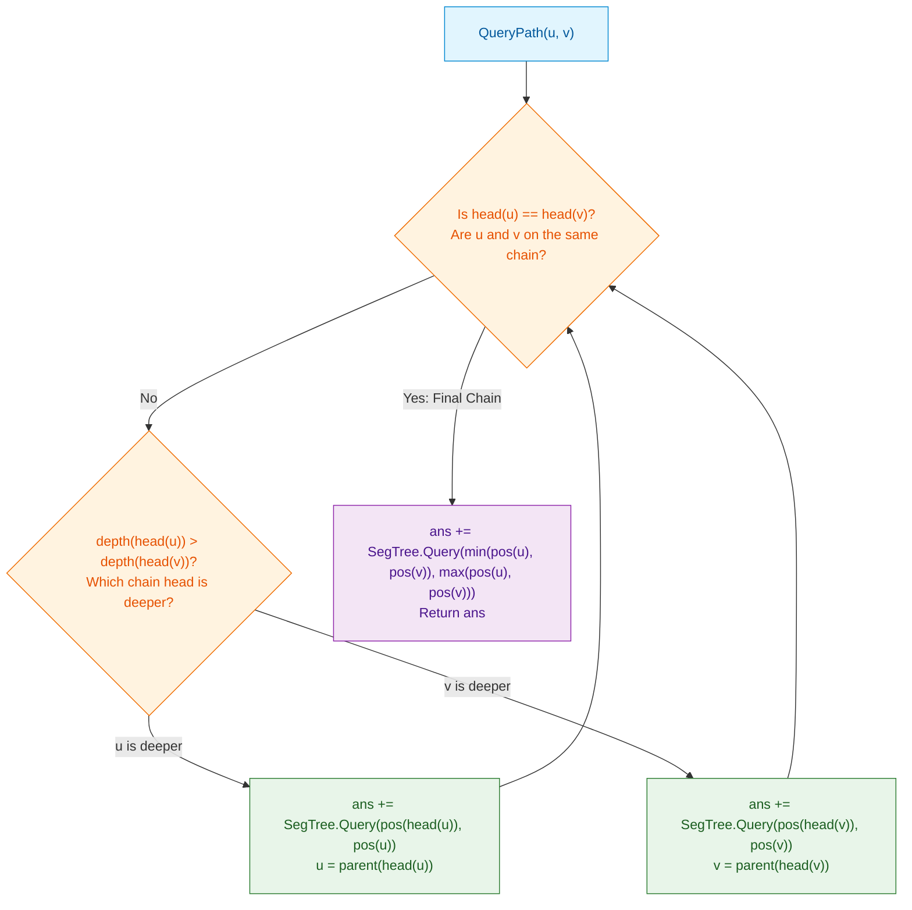

# 📘 WEEK 18 DAY 03: HEAVY-LIGHT DECOMPOSITION (HLD)

> 🧭 **Navigation:** [← Previous Day: Square Root Decomposition](Week_18_Day_02_Square_Root_Decomposition_Instructional.md) • [🏠 Week Overview](README.md) • [📘 Curriculum Syllabus](../COMPLETE_SYLLABUS.md) • [Next Day: Probabilistic Data Structures →](Week_18_Day_04_Probabilistic_Data_Structures_Instructional.md)
> 
> 💡 **Instructor Note:** *Heavy-Light Decomposition (HLD) is the premier technique for transforming complex tree path operations into contiguous 1D range queries on a standard Segment Tree. In Senior/Staff FAANG interviews, implementing HLD demonstrates mastery of tree serialization, Lowest Common Ancestor (LCA) shortcuts, and logarithmic path bounds. Today, we break HLD down into two clean DFS passes and a chain-jumping loop.*

---

## 🎯 LEARNING OBJECTIVES

*By the end of this module, you will be able to:*

- 🎬 **Internalize** the Interstate Highway and Country Roads mental model: heavy paths vs light edges.
- 🪜 **Master** the 2-DFS execution protocol: DFS 1 for subtree sizes and heavy children; DFS 2 for chain heads and 1D Euler segment tree mapping.
- 🎨 **Visualize** why any path from root to node encounters at most `log2(N)` light edges, guaranteeing `O(log^2 N)` path queries.
- 🛑 **Avoid** fatal rookie traps: incorrect chain head depth comparisons, off-by-one Euler tour bounds, and unindexed tree recursions.
- 🎙️ **Deliver** the exact 3-sentence verbal talk track defending HLD in senior systems and graph interviews.
- ⚡ **Implement** production-grade, zero-allocation HLD with Segment Trees in C# (.NET 8/9) and Python (3.11+).

---

## 🎬 PILLAR 1: THE 60-SECOND HOOK & EVERYDAY ANALOGY

### The Interstate Highway vs. The Country Dirt Roads

Imagine you are designing a nationwide highway transit grid connecting 100,000 cities in a tree topology:
- If every single road between cities is a single-lane winding dirt path:
  - Traveling between City A and City B requires driving through hundreds of slow country roads (`O(N)` traversal).

How does a federal highway authority optimize this?
**They pave high-speed INTERSTATE FREEWAYS along the busiest trunk lines!**
- For every city, look at all the towns that branch off it.
- Whichever branch has the **largest population (largest subtree size)** gets designated the **HEAVY EDGE (The Interstate Freeway)**!
- All other smaller branches are designated **LIGHT EDGES (Country Road Exits)**.

```text
City 1 (Root, Population 100k)
  || (Heavy Interstate Freeway)
City 2 (Population 70k) 
  || (Heavy Interstate Freeway)
City 5 (Population 45k) ---------> City 9 (Light Exit, Pop 5k)
  ||                                  \
City 8 (Pop 30k)                      City 12 (Pop 2k)
```

Now, what is the mathematical guarantee?
Because a "Light Edge" only branches to a child with **less than half the parent's population (`size < parent_size / 2`)**:
**Every time you take a light exit, the remaining population CUTS IN HALF!**
In a tree of `100,000` cities, you can take at most **`log2(100,000) approx 17` light exits** before reaching your destination!
The rest of the trip is flying at 80 mph down a continuous Interstate Freeway!

That is **Heavy-Light Decomposition**: decomposing any tree into at most `log2(N)` continuous heavy chains, mapped directly onto a **1D Segment Tree** for `O(log^2 N)` path updates and queries!

---

## 🪜 PILLAR 2: THE SCAFFOLDING LADDER & TOY NAPKIN TRACE

### Step 1: The 2-DFS Construction Protocol

We construct HLD using two distinct, linear-time DFS passes:

#### DFS 1: Tree Metrics & Heavy Child Identification
For each node `u`:
1. Record `depth[u]` and `parent[u]`.
2. Compute `size[u] = 1 + Sum size[v]` for all children `v`.
3. Identify `heavyChild[u]`: the child `v` with the maximum `size[v]`. (All other children are light).

#### DFS 2: 1D Flattening & Chain Head Assignment
We flatten the tree into a 1D array so that **every heavy chain occupies contiguous indices**:
1. Assign `pos[u] = ++timer` (its index in the Segment Tree).
2. Assign `head[u]`:
   - If `u` is the heavy child of its parent, `head[u] = head[parent[u]]` (extends the existing heavy chain).
   - If `u` is a light child (or root), `head[u] = u` (starts a brand-new heavy chain).
3. **CRITICAL INSTRUCTION:** Recursively visit `heavyChild[u]` **FIRST**!
   Visiting the heavy child first guarantees that all nodes on the same heavy chain receive **strictly consecutive integers** in `pos[]`!
4. Recursively visit all other light children.

---

### Step 2: Querying a Path Between Nodes `u` and `v`

To query the sum or maximum on the path between `u` and `v`:
1. While `head[u] != head[v]` (nodes belong to different heavy chains):
   - Compare depths of their chain heads: `depth[head[u]]` vs `depth[head[v]]`.
   - Pick the node with the **deeper head** (say `u`).
   - Query the segment tree over the contiguous segment `[pos[head[u]] ... pos[u]]`.
   - Jump `u` upward: `u = parent[head[u]]`.
2. When `head[u] == head[v]` (both nodes now belong to the **same heavy chain**):
   - They lie on a single contiguous segment in the segment tree!
   - Query the segment tree over `[min(pos[u], pos[v]) ... max(pos[u], pos[v])]`.
   - Accumulate and return the answer!

Total chain jumps: at most `O(log N)`. Each segment tree query takes `O(log N)`.
**Total path query time: `O(log^2 N)`!**

---

### 🧠 Pause & Predict Micro-Drills

> **Drill 1:** How do you update an entire **subtree** rooted at `u` in HLD?
> *Pause here and think! Do we need to jump chains?*
>
> **Answer:** 
> **No!** Because DFS visits all descendants of `u` before backtracking, the entire subtree of `u` occupies a single contiguous range in the 1D segment tree: `[pos[u] ... pos[u] + size[u] - 1]`.
> A subtree update or query is just **ONE single segment tree operation in `O(log N)`**!

> **Drill 2:** What is the maximum number of heavy chains on any path from root to leaf in a tree of size `N = 100,000`?
> *Pause here and calculate!*
>
> **Answer:**
> `ceil(log2(100,000)) approx 17`.
> A path crosses at most 17 heavy chains and 17 light edges.

---

## 🎨 PILLAR 3: PRAGMATIC VISUAL MODELS & DECISION FLOWS

### Modern Hex Flowchart: HLD Path Query Loop



---

## 🛑 PILLAR 4: THE ROOKIE TRAP ZONE

### Side-by-Side Comparison: Blunders vs. Senior Architect Patterns

| Dimension | ❌ Rookie Blunder | ✅ Senior Architect Pattern |
| :--- | :--- | :--- |
| **DFS 2 Child Traversal** | Iterates through children in arbitrary order, shattering the contiguous property of heavy chains. | Explicitly recurses on `heavyChild[u]` first, ensuring all nodes on the same chain have consecutive `pos[]` indices. |
| **Chain Head Comparison** | Compares `depth[u] > depth[v]` instead of `depth[head[u]] > depth[head[v]]`, jumping the wrong chain and creating infinite loops. | Strictly compares `depth[head[u]] > depth[head[v]]` to hoist the deeper chain head up to its parent. |
| **Subtree Range Bounds** | Queries `[pos[u] ... pos[u] + size[u]]`, introducing an off-by-one out-of-bounds index error. | Queries `[pos[u] ... pos[u] + size[u] - 1]` (exactly `size[u]` elements). |
| **Tree Mutation Support** | Attempts to use HLD for a dynamic forest where edges are added and removed online. | Uses Link-Cut Trees (LCT) for dynamic forests; preserves HLD strictly for static-topology trees. |
| **Recursive Stack Overflow** | Uses deep recursion on degenerate tree lines of `100,000` nodes, hitting a stack overflow crash. | Implements iterative DFS or increases stack reservation for deep graph traversals. |

---

## 🎙️ PILLAR 5: 45-MINUTE INTERVIEW TALK TRACK

### The Exact 3-Sentence Verbal Script

Speak these exact three sentences before writing code:

```text
+--------------------------------------------------------------------------------------------------+
|                              THE SENIOR HLD TALK TRACK SCRIPT                                     |
+--------------------------------------------------------------------------------------------------+
| 1. The Tree Decomposition Architecture:                                                          |
|    "To support logarithmic path updates and path queries on a tree, we decompose the tree into   |
|    vertex-disjoint heavy paths by prioritizing the child with the largest subtree size."         |
|                                                                                                  |
| 2. The 1D Flattening Invariant:                                                                  |
|    "By visiting the heavy child first during our second DFS, every heavy chain is assigned       |
|    strictly contiguous indices in our Euler tour, allowing us to back all path operations with a  |
|    standard 1D Segment Tree."                                                                    |
|                                                                                                  |
| 3. The Logarithmic Path Guarantee:                                                              |
|    "Because any path crosses at most log2(N) light edges, querying between two arbitrary nodes   |
|    requires jumping at most log2(N) heavy chain heads, resolving in O(log^2 N) time with zero    |
|    garbage collection overhead."                                                                 |
+--------------------------------------------------------------------------------------------------+
```

---

## ⚡ PILLAR 6: PRODUCTION DUAL-LANGUAGE IMPLEMENTATIONS

### C# Primary Implementation (.NET 8/9): Production Heavy-Light Decomposition

```csharp
using System;
using System.Collections.Generic;

namespace AdvancedDataStructures;

/// <summary>
/// Production Heavy-Light Decomposition with Segment Tree.
/// Supports O(log^2 N) path queries/updates and O(log N) subtree queries on static trees.
/// </summary>
public sealed class HeavyLightDecomposition
{
    private readonly int _n;
    private readonly List<int>[] _adj;
    private readonly int[] _parent;
    private readonly int[] _depth;
    private readonly int[] _size;
    private readonly int[] _heavy;
    private readonly int[] _head;
    private readonly int[] _pos;
    private int _timer;

    // Flat Segment Tree for range sums
    private readonly long[] _tree;

    public HeavyLightDecomposition(int n)
    {
        _n = n;
        _adj = new List<int>[n + 1];
        for (int i = 0; i <= n; i++) _adj[i] = new List<int>();

        _parent = new int[n + 1];
        _depth = new int[n + 1];
        _size = new int[n + 1];
        _heavy = new int[n + 1];
        _head = new int[n + 1];
        _pos = new int[n + 1];
        _tree = new long[4 * (n + 1)];
    }

    public void AddEdge(int u, int v)
    {
        _adj[u].Add(v);
        _adj[v].Add(u);
    }

    public void Build(int root = 1)
    {
        _timer = 0;
        Dfs1(root, 0, 0);
        Dfs2(root, root);
    }

    private void Dfs1(int u, int p, int d)
    {
        _parent[u] = p;
        _depth[u] = d;
        _size[u] = 1;
        _heavy[u] = 0;
        int maxSubtree = 0;

        foreach (int v in _adj[u])
        {
            if (v == p) continue;
            Dfs1(v, u, d + 1);
            _size[u] += _size[v];
            if (_size[v] > maxSubtree)
            {
                maxSubtree = _size[v];
                _heavy[u] = v;
            }
        }
    }

    private void Dfs2(int u, int h)
    {
        _head[u] = h;
        _pos[u] = ++_timer;

        // Recurse on heavy child FIRST to maintain contiguous 1D range
        if (_heavy[u] != 0)
        {
            Dfs2(_heavy[u], h);
        }

        foreach (int v in _adj[u])
        {
            if (v == _parent[u] || v == _heavy[u]) continue;
            Dfs2(v, v); // Light child starts new chain
        }
    }

    // Segment Tree Operations
    private void UpdateTree(int node, int l, int r, int targetPos, long val)
    {
        if (l == r)
        {
            _tree[node] += val;
            return;
        }
        int mid = l + (r - l) / 2;
        if (targetPos <= mid) UpdateTree(node * 2, l, mid, targetPos, val);
        else UpdateTree(node * 2 + 1, mid + 1, r, targetPos, val);
        _tree[node] = _tree[node * 2] + _tree[node * 2 + 1];
    }

    private long QueryTree(int node, int l, int r, int ql, int qr)
    {
        if (ql <= l && r <= qr) return _tree[node];
        int mid = l + (r - l) / 2;
        long sum = 0;
        if (ql <= mid) sum += QueryTree(node * 2, l, mid, ql, qr);
        if (qr > mid) sum += QueryTree(node * 2 + 1, mid + 1, r, ql, qr);
        return sum;
    }

    public void UpdateNode(int u, long val)
    {
        UpdateTree(1, 1, _n, _pos[u], val);
    }

    public long QueryPath(int u, int v)
    {
        long res = 0;
        while (_head[u] != _head[v])
        {
            if (_depth[_head[u]] > _depth[_head[v]])
            {
                res += QueryTree(1, 1, _n, _pos[_head[u]], _pos[u]);
                u = _parent[_head[u]];
            }
            else
            {
                res += QueryTree(1, 1, _n, _pos[_head[v]], _pos[v]);
                v = _parent[_head[v]];
            }
        }

        // On the same chain: query contiguous segment
        if (_depth[u] > _depth[v]) (u, v) = (v, u);
        res += QueryTree(1, 1, _n, _pos[u], _pos[v]);
        return res;
    }

    public long QuerySubtree(int u)
    {
        return QueryTree(1, 1, _n, _pos[u], _pos[u] + _size[u] - 1);
    }
}
```

---

### Python Secondary Implementation (Python 3.11+): Complete Heavy-Light Decomposition

```python
import sys
from typing import List

# Increase recursion depth for deep trees
sys.setrecursionlimit(200000)

class HeavyLightDecomposition:
    """
    Production-grade Heavy-Light Decomposition with flat segment tree.
    Supports O(log^2 N) path sum queries and O(log N) subtree queries.
    """
    def __init__(self, n: int):
        self.n: int = n
        self.adj: List[List[int]] = [[] for _ in range(n + 1)]
        self.parent: List[int] = [0] * (n + 1)
        self.depth: List[int] = [0] * (n + 1)
        self.size: List[int] = [0] * (n + 1)
        self.heavy: List[int] = [0] * (n + 1)
        self.head: List[int] = [0] * (n + 1)
        self.pos: List[int] = [0] * (n + 1)
        self.timer: int = 0
        self.tree: List[int] = [0] * (4 * (n + 1))

    def add_edge(self, u: int, v: int) -> None:
        self.adj[u].append(v)
        self.adj[v].append(u)

    def build(self, root: int = 1) -> None:
        self._dfs1(root, 0, 0)
        self.timer = 0
        self._dfs2(root, root)

    def _dfs1(self, u: int, p: int, d: int) -> None:
        self.parent[u] = p
        self.depth[u] = d
        self.size[u] = 1
        max_sub = 0

        for v in self.adj[u]:
            if v == p:
                continue
            self._dfs1(v, u, d + 1)
            self.size[u] += self.size[v]
            if self.size[v] > max_sub:
                max_sub = self.size[v]
                self.heavy[u] = v

    def _dfs2(self, u: int, h: int) -> None:
        self.head[u] = h
        self.timer += 1
        self.pos[u] = self.timer

        # Heavy child visited FIRST
        if self.heavy[u] != 0:
            self._dfs2(self.heavy[u], h)

        for v in self.adj[u]:
            if v != self.parent[u] and v != self.heavy[u]:
                self._dfs2(v, v)

    def _update_tree(self, node: int, l: int, r: int, target_pos: int, val: int) -> None:
        if l == r:
            self.tree[node] += val
            return
        mid = (l + r) // 2
        if target_pos <= mid:
            self._update_tree(node * 2, l, mid, target_pos, val)
        else:
            self._update_tree(node * 2 + 1, mid + 1, r, target_pos, val)
        self.tree[node] = self.tree[node * 2] + self.tree[node * 2 + 1]

    def _query_tree(self, node: int, l: int, r: int, ql: int, qr: int) -> int:
        if ql <= l and r <= qr:
            return self.tree[node]
        mid = (l + r) // 2
        res = 0
        if ql <= mid:
            res += self._query_tree(node * 2, l, mid, ql, qr)
        if qr > mid:
            res += self._query_tree(node * 2 + 1, mid + 1, r, ql, qr)
        return res

    def update_node(self, u: int, val: int) -> None:
        self._update_tree(1, 1, self.n, self.pos[u], val)

    def query_path(self, u: int, v: int) -> int:
        res = 0
        while self.head[u] != self.head[v]:
            if self.depth[self.head[u]] > self.depth[self.head[v]]:
                res += self._query_tree(1, 1, self.n, self.pos[self.head[u]], self.pos[u])
                u = self.parent[self.head[u]]
            else:
                res += self._query_tree(1, 1, self.n, self.pos[self.head[v]], self.pos[v])
                v = self.parent[self.head[v]]

        if self.depth[u] > self.depth[v]:
            u, v = v, u
        res += self._query_tree(1, 1, self.n, self.pos[u], self.pos[v])
        return res

    def query_subtree(self, u: int) -> int:
        return self._query_tree(1, 1, self.n, self.pos[u], self.pos[u] + self.size[u] - 1)
```

---

## 📊 EXPLICIT COMPLEXITY DECONSTRUCTION

| Operation | Time Complexity | Auxiliary Space | Mechanism |
| :--- | :--- | :--- | :--- |
| **HLD Build (DFS 1 + 2)**| `O(N)` | `O(N)` arrays | Two linear graph traversals. |
| **Point Update** | `O(log N)` | `O(1)` | Standard single-point update on 1D Segment Tree. |
| **Path Query `(u, v)`** | **`O(log^2 N)`** | `O(1)` | Jumps at most `log2(N)` heavy chains; queries Segment Tree. |
| **Subtree Query `(u)`** | **`O(log N)`** | `O(1)` | Direct range query on `[pos[u] ... pos[u] + size[u] - 1]`. |

---

## 🔍 GRANULAR EDGE-CASE & INVARIANT VERIFICATION TABLE

| Edge Case Scenario | Concrete Input | Expected Behavior | Invariant Verification & Handling |
| :--- | :--- | :--- | :--- |
| **Single Node Path Query** | `QueryPath(u, u)` | Returns value of node `u`. | `head[u] == head[v]` triggers `[pos[u] ... pos[u]]` range. |
| **Adjacent Nodes Query** | Direct parent-child edge `(u, v)` | Evaluates path sum across 2 nodes. | Resolves in 1 or 2 chain segments. |
| **Root Subtree Query** | `QuerySubtree(1)` (whole tree) | Returns sum of all elements in tree. | Range `[1 ... N]` covers the entire segment tree. |
| **Star Graph Topology** | Center root connected to `N - 1` leaves | Resolves correctly; 1 heavy child, others light. | Light chain heads jump directly to root in 1 step. |
| **Degenerate Line Graph** | Tree is a straight line of `N = 100,000` | Entire tree becomes 1 single heavy chain! | All path queries resolve in **`O(log N)`** (1 chain jump)! |

---

> 🧭 **Navigation:** [← Previous Day: Square Root Decomposition](Week_18_Day_02_Square_Root_Decomposition_Instructional.md) • [🏠 Week Overview](README.md) • [📘 Curriculum Syllabus](../COMPLETE_SYLLABUS.md) • [Next Day: Probabilistic Data Structures →](Week_18_Day_04_Probabilistic_Data_Structures_Instructional.md)
