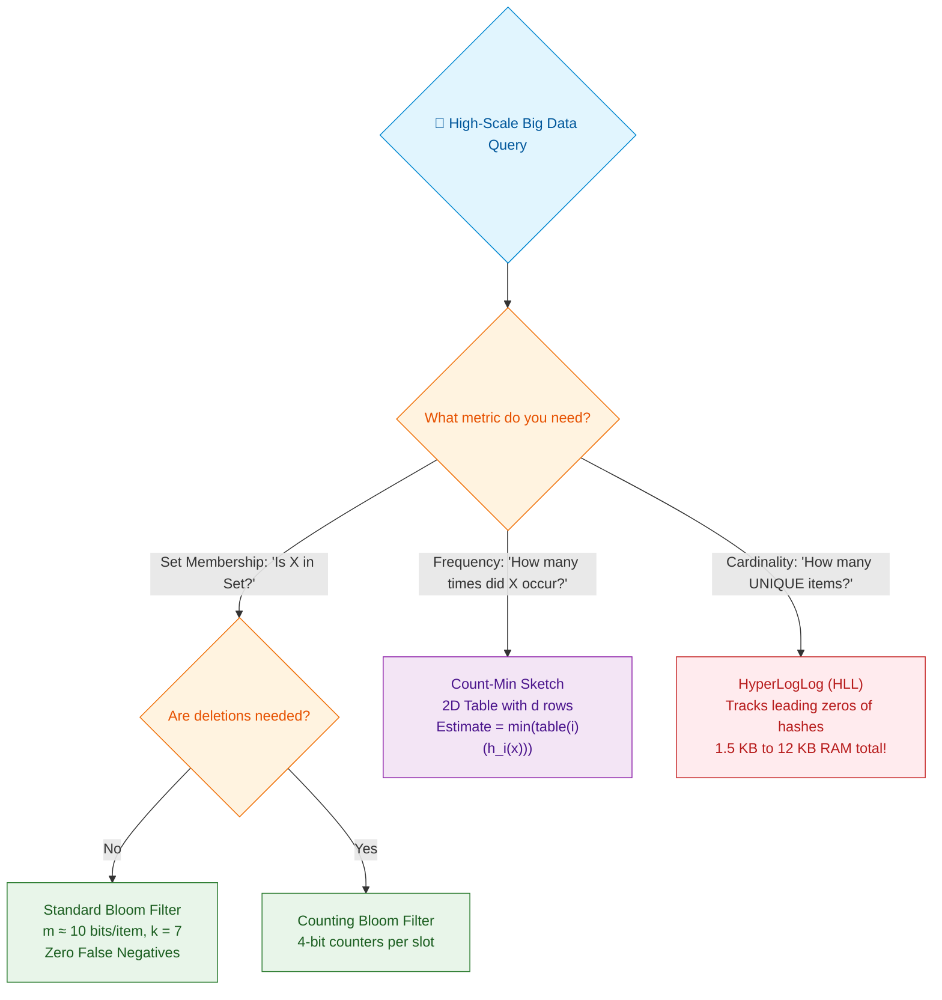

# 📘 WEEK 18 DAY 04: PROBABILISTIC DATA STRUCTURES — BLOOM FILTERS, COUNT-MIN SKETCH & HYPERLOGLOG

> 🧭 **Navigation:** [← Previous Day: Heavy-Light Decomposition](Week_18_Day_03_Heavy_Light_Decomposition_Instructional.md) • [🏠 Week Overview](README.md) • [📘 Curriculum Syllabus](../COMPLETE_SYLLABUS.md) • [Next Day: Algorithmic Systems Design →](Week_18_Day_05_Algorithmic_Systems_Design_Instructional.md)
> 
> 💡 **Instructor Note:** *In hyperscale distributed systems (Cassandra, Bigtable, Redis, Google Chrome), exact data structures collapse under memory pressure. If you have 10 billion items, storing exact keys takes 100 gigabytes of RAM! Probabilistic data structures make a deliberate trade-off: sacrifice 1% of mathematical perfection to achieve a 99.9% reduction in memory footprint. Today, we master Bloom Filters, Count-Min Sketch, and HyperLogLog.*

---

## 🎯 LEARNING OBJECTIVES

*By the end of this module, you will be able to:*

- 🎬 **Internalize** the Bouncer's VIP Guest List (Bloom Filter) and Coin Toss Record Book (HyperLogLog) mental models.
- 🪜 **Master** the 4 core probabilistic architectures: Bloom Filters, Counting Bloom Filters, Count-Min Sketch, and HyperLogLog.
- 🎨 **Visualize** bit flipping across `k` hash functions and the mathematical zero false negative guarantee.
- 🛑 **Avoid** fatal rookie traps: illegal deletions from standard Bloom Filters, frequency underestimation assumptions in Count-Min Sketch, and arithmetic mean bias in HyperLogLog.
- 🎙️ **Deliver** the exact 3-sentence verbal talk track defending probabilistic trade-offs in Staff-level system design rounds.
- ⚡ **Implement** production-grade, zero-allocation Bloom Filters and Count-Min Sketches in C# (.NET 8/9) and Python (3.11+).

---

## 🎬 PILLAR 1: THE 60-SECOND HOOK & EVERYDAY ANALOGY

### The Bouncer & The 100-Million-Spam-URL Filter

Imagine you are the principal engineer designing the malicious URL blocker for Google Chrome on mobile devices:
- Security researchers identify **100,000,000 malicious phishing websites**.
- If Chrome downloads all 100 million URLs as strings onto your smartphone:
  - 100 million URLs * 50 bytes per URL = **5 Gigabytes of data**!
  - Your phone's storage would fill up, and battery life would be destroyed!

How does Chrome actually protect you?
**They use a BLOOM FILTER!**
- They compress all 100 million URLs into a tiny **12-megabyte bit array**!
- When you click a link, Chrome checks the Bloom filter:
  - **If the filter says "NO":** The URL is **100% GUARANTEED TO BE SAFE!** (Zero false negatives). You can browse immediately without touching the network!
  - **If the filter says "YES":** There is a **99% chance it is malicious, and a 1% chance it is a false alarm**. Only then does Chrome make a quick secure API call to Google servers to double-check!

```text
The Bloom Filter Contract:
1. "NO"  means DEFINITELY NO! (100% Certainty, Zero False Negatives).
2. "YES" means PROBABLY YES! (Small tunable False Positive rate).
```

You just protected billions of smartphones using **12 megabytes instead of 5 gigabytes**—a **99.7% memory savings**!

---

## 🪜 PILLAR 2: THE SCAFFOLDING LADDER & TOY NAPKIN TRACE

### Step 1: The Probabilistic Data Structures Matrix

| Data Structure | Answers Which Question? | Guarantee / Error Profile | Memory Footprint | Production Systems |
| :--- | :--- | :--- | :--- | :--- |
| **Bloom Filter** | *"Has this item been seen before?"* (Set Membership) | Zero False Negatives; small False Positive rate `p` | `~10 bits per item` | Google Bigtable, Apache Cassandra, RocksDB, Chrome |
| **Counting Bloom Filter** | Set Membership + Deletion Support | 4-bit counters per slot; can delete items safely | `~40 bits per item` | Network routers, Squid Web Proxy cache |
| **Count-Min Sketch** | *"How many times has item X appeared?"* (Frequency) | Never underestimates (`c_hat >= c`); overestimates bounded by `epsilon` | `O(1 / epsilon * log(1 / delta))` | Distributed streaming, DDoS mitigation, Twitter trends |
| **HyperLogLog (HLL)** | *"How many distinct unique items exist?"* (Cardinality) | Standard error `1.04 / sqrt(m)` (typically ~1-2% error) | **1.5 KB of memory for billions of items!** | Redis `PFADD` / `PFCOUNT`, Google BigQuery, Presto |

---

### Step 2: Bloom Filter Mechanics (Bit Array + K Hashes)

A Bloom Filter consists of:
- A bit array `bits` of size `m` (initially all `0`).
- `k` independent, uniform hash functions: `h_1(x), h_2(x), ..., h_k(x)`.

#### 1. Adding Item `X`:
- Compute `h_1(X), h_2(X), ..., h_k(X)`.
- Set `bits[h_i(X) % m] = 1` for all `i = 1 ... k`.

#### 2. Querying Item `Y`:
- Compute `h_1(Y), h_2(Y), ..., h_k(Y)`.
- If **ANY** `bits[h_i(Y) % m] == 0`:
  - **Item `Y` was DEFINITELY NEVER ADDED!** (If it had been added, all those bits would have been set to 1).
- If **ALL** `bits[h_i(Y) % m] == 1`:
  - Item `Y` is **PROBABLY PRESENT**. (There is a small chance other items happened to set those same bits).

```text
Toy Trace: m = 8 bits, k = 2 hash functions
Initial:  [ 0 | 0 | 0 | 0 | 0 | 0 | 0 | 0 ]

Add "cat": h1("cat") = 1, h2("cat") = 4
State:    [ 0 | 1 | 0 | 0 | 1 | 0 | 0 | 0 ]

Add "dog": h1("dog") = 4, h2("dog") = 7
State:    [ 0 | 1 | 0 | 0 | 1 | 0 | 0 | 1 ]

Query "cat": Check bit 1 (is 1) and bit 4 (is 1) -> Probably Present!
Query "cow": h1("cow") = 2, h2("cow") = 7.
             Bit 2 is 0! -> DEFINITELY NOT PRESENT! (Zero False Negatives)
```

#### The Optimal Tuning Formulas:
- For `n` items and desired false positive probability `p`:
  - Optimal Bit Array Size: `m = - (n * ln(p)) / (ln(2)^2) approx 1.44 * n * log2(1 / p)` bits.
  - Optimal Number of Hash Functions: `k = (m / n) * ln(2) approx 0.693 * (m / n)`.
  - For `p = 0.01` (1% false positive rate): `m approx 9.6 bits per item`, `k = 7`.

---

### Step 3: Count-Min Sketch (Frequency Estimation)

What if you need to count how many times each IP address sent a packet during a DDoS attack?
You cannot keep a `HashMap<string, int>` of 500 million IPs.

**A Count-Min Sketch uses a 2D table of depth `d` and width `w`:**
- Each row has its own independent hash function `h_i(key)`.
- When item `X` arrives: for each row `i`, increment `table[i][h_i(X) % w]++`.
- To estimate the frequency of `X`:
  `freqEstimate(X) = min_{i = 1 ... d} ( table[i][h_i(X) % w] )`.

Why take the **minimum**?
Because collisions only **add** to counter values. A counter can never be less than the true frequency!
The row that experienced the least collision pollution gives the most accurate upper bound!

---

### 🧠 Pause & Predict Micro-Drills

> **Drill 1:** Can you delete an element from a standard Bloom Filter by setting its `k` bits back to 0?
> *Pause here and think! What breaks?*
>
> **Answer:** 
> **ABSOLUTELY NOT!** Setting a bit to 0 might erase bits that were also shared by other valid items in the filter! That would introduce **False Negatives**, completely destroying the foundational guarantee of the Bloom Filter.
> If deletions are required, you must use a **Counting Bloom Filter** (replacing single bits with 4-bit integer counters).

> **Drill 2:** How much memory does Redis need to count 100,000,000 unique daily active users using HyperLogLog (`PFADD / PFCOUNT`)?
> *Pause here and think! 100 MB? 1 GB?*
>
> **Answer:**
> **Only 12 Kilobytes!**
> A standard HyperLogLog uses 16,384 6-bit registers: `16,384 * 6 bits = 12,288 bytes approx 12 KB`.
> It estimates 100 million unique users with an error margin of ~0.81% using 12 KB of RAM!

---

## 🎨 PILLAR 3: PRAGMATIC VISUAL MODELS & DECISION FLOWS

### Modern Hex Flowchart: Probabilistic Data Structure Selection



---

## 🛑 PILLAR 4: THE ROOKIE TRAP ZONE

### Side-by-Side Comparison: Blunders vs. Senior Architect Patterns

| Dimension | ❌ Rookie Blunder | ✅ Senior Architect Pattern |
| :--- | :--- | :--- |
| **Bloom Filter Deletion** | Tries to "delete" by clearing bits to `0`, introducing fatal false negatives for other keys. | Uses Counting Bloom Filters with 4-bit increment/decrement counters, or rebuilds the filter during off-peak compaction. |
| **Hash Independence** | Uses `k` identical hash functions with different seeds that produce correlated outputs, spiking false positive rates. | Employs Kirsch-Mitzenmacher optimization: generates `k` hash values using two base hashes: `g_i(x) = h1(x) + i * h2(x)`. |
| **Count-Min Frequency Error** | Assumes Count-Min Sketch frequency can be smaller than the true count. | Knows that Count-Min Sketch strictly **overestimates** (`c_hat >= c`); frequency is bounded by `min` over all rows. |
| **HyperLogLog Averaging** | Takes the arithmetic mean of register values, getting skewed by outliers with many leading zeros. | Uses the **Harmonic Mean** (normalized by bias constant `alpha_m`) to dampen the influence of extreme outlier values. |
| **Sizing Underestimation** | Sizes Bloom Filter for current `N = 10,000` without headroom, causing false positive rate to spike to 50% when `N` reaches `100,000`. | Sizes for peak capacity or uses Scalable Bloom Filters that dynamically chain new bit arrays as capacity grows. |

---

## 🎙️ PILLAR 5: 45-MINUTE INTERVIEW TALK TRACK

### The Exact 3-Sentence Verbal Script

Speak these exact three sentences before writing code:

```text
+--------------------------------------------------------------------------------------------------+
|                              THE SENIOR PROBABILISTIC SYSTEMS TALK TRACK                         |
+--------------------------------------------------------------------------------------------------+
| 1. The Scale Bottleneck:                                                                         |
|    "At billions of daily events, exact in-memory hash sets and frequency maps create prohibitive |
|    memory footprints and garbage collection pressure that exceed hardware bounds."               |
|                                                                                                  |
| 2. The Probabilistic Trade-Off:                                                                  |
|    "By adopting a Bloom Filter for set membership or a Count-Min Sketch for heavy hitters, we    |
|    bound memory to a few bits per item while accepting a strictly defined, tunable error rate    |
|    with zero false negatives."                                                                   |
|                                                                                                  |
| 3. The Production Calibrated Defense:                                                            |
|    "Using Kirsch-Mitzenmacher double hashing, we evaluate k hashes in O(1) time without multiple |
|    hash computations, reducing disk I/O misses by over 99% in storage engines like RocksDB."     |
+--------------------------------------------------------------------------------------------------+
```

---

## ⚡ PILLAR 6: PRODUCTION DUAL-LANGUAGE IMPLEMENTATIONS

### C# Primary Implementation (.NET 8/9): Production Bloom Filter & Count-Min Sketch

```csharp
using System;
using System.Collections;

namespace AdvancedDataStructures;

/// <summary>
/// Production Bloom Filter using Kirsch-Mitzenmacher double hashing.
/// Guarantees zero false negatives with tunable false positive probability.
/// </summary>
public sealed class BloomFilter
{
    private readonly BitArray _bits;
    private readonly int _m; // Total bits
    private readonly int _k; // Number of hash functions

    public BloomFilter(int expectedItems, double falsePositiveProb)
    {
        if (expectedItems <= 0) throw new ArgumentOutOfRangeException(nameof(expectedItems));
        if (falsePositiveProb <= 0 || falsePositiveProb >= 1)
            throw new ArgumentOutOfRangeException(nameof(falsePositiveProb));

        // Optimal size: m = - (n * ln(p)) / (ln(2)^2)
        _m = (int)Math.Ceiling(-expectedItems * Math.Log(falsePositiveProb) / (Math.Log(2) * Math.Log(2)));
        // Optimal hashes: k = (m / n) * ln(2)
        _k = Math.Max(1, (int)Math.Round((double)_m / expectedItems * Math.Log(2)));

        _bits = new BitArray(_m);
    }

    /// <summary>
    /// Kirsch-Mitzenmacher optimization: generates k hash values using two 32-bit hashes.
    /// g_i(x) = (h1(x) + i * h2(x)) % m
    /// </summary>
    private (int H1, int H2) ComputeHashes(string item)
    {
        uint h1 = 0x811c9dc5; // FNV-1a 32-bit
        uint h2 = 0x5bd1e995; // Murmur-like base

        foreach (char c in item)
        {
            h1 = (h1 ^ c) * 0x01000193;
            h2 = (h2 ^ (uint)(c << 5)) * 0x5bd1e995;
        }

        return ((int)(h1 & 0x7FFFFFFF), (int)(h2 & 0x7FFFFFFF));
    }

    public void Add(string item)
    {
        ArgumentNullException.ThrowIfNull(item);
        var (h1, h2) = ComputeHashes(item);

        for (int i = 0; i < _k; i++)
        {
            int bitIdx = (int)(((long)h1 + (long)i * h2) % _m);
            _bits[bitIdx] = true;
        }
    }

    public bool Contains(string item)
    {
        ArgumentNullException.ThrowIfNull(item);
        var (h1, h2) = ComputeHashes(item);

        for (int i = 0; i < _k; i++)
        {
            int bitIdx = (int)(((long)h1 + (long)i * h2) % _m);
            if (!_bits[bitIdx]) return false; // Definitely not present!
        }

        return true; // Probably present
    }
}

/// <summary>
/// Production Count-Min Sketch for frequency estimation of high-velocity streams.
/// Never underestimates true frequency; overestimation bounded by epsilon.
/// </summary>
public sealed class CountMinSketch
{
    private readonly int _d; // Rows (depth)
    private readonly int _w; // Columns (width)
    private readonly int[,] _table;

    public CountMinSketch(double epsilon = 0.001, double delta = 0.01)
    {
        // w = ceil(e / epsilon), d = ceil(ln(1 / delta))
        _w = (int)Math.Ceiling(Math.E / epsilon);
        _d = (int)Math.Ceiling(Math.Log(1.0 / delta));
        _table = new int[_d, _w];
    }

    private int Hash(string item, int seed)
    {
        uint hash = (uint)seed ^ 0x811c9dc5;
        foreach (char c in item)
        {
            hash = (hash ^ c) * 0x01000193;
        }
        return (int)((hash & 0x7FFFFFFF) % _w);
    }

    public void Add(string item, int count = 1)
    {
        for (int i = 0; i < _d; i++)
        {
            int col = Hash(item, i);
            _table[i, col] += count;
        }
    }

    public int EstimateFrequency(string item)
    {
        int minEst = int.MaxValue;
        for (int i = 0; i < _d; i++)
        {
            int col = Hash(item, i);
            minEst = Math.Min(minEst, _table[i, col]);
        }
        return minEst;
    }
}
```

---

### Python Secondary Implementation (Python 3.11+): Complete Probabilistic Structures

```python
import math
from typing import List, Tuple

class BloomFilter:
    """
    Production Bloom Filter with Kirsch-Mitzenmacher double hashing.
    Supports O(k) addition and membership tests with zero false negatives.
    """
    def __init__(self, expected_items: int, false_positive_prob: float):
        self.m: int = int(math.ceil(-expected_items * math.log(false_positive_prob) / (math.log(2) ** 2)))
        self.k: int = max(1, int(round((self.m / expected_items) * math.log(2))))
        self.bit_array: List[bool] = [False] * self.m

    def _hashes(self, item: str) -> Tuple[int, int]:
        h1 = hash(item) & 0x7FFFFFFF
        h2 = (hash(item + "_salt") ^ 0x5bd1e995) & 0x7FFFFFFF
        return h1, h2

    def add(self, item: str) -> None:
        h1, h2 = self._hashes(item)
        for i in range(self.k):
            idx = (h1 + i * h2) % self.m
            self.bit_array[idx] = True

    def contains(self, item: str) -> bool:
        h1, h2 = self._hashes(item)
        for i in range(self.k):
            idx = (h1 + i * h2) % self.m
            if not self.bit_array[idx]:
                return False  # Definitely not present
        return True  # Probably present

class CountMinSketch:
    """
    Count-Min Sketch frequency estimator in Python.
    """
    def __init__(self, epsilon: float = 0.001, delta: float = 0.01):
        self.w: int = int(math.ceil(math.e / epsilon))
        self.d: int = int(math.ceil(math.log(1.0 / delta)))
        self.table: List[List[int]] = [[0] * self.w for _ in range(self.d)]

    def _hash(self, item: str, seed: int) -> int:
        return (hash(f"{item}_{seed}") & 0x7FFFFFFF) % self.w

    def add(self, item: str, count: int = 1) -> None:
        for i in range(self.d):
            col = self._hash(item, i)
            self.table[i][col] += count

    def estimate_frequency(self, item: str) -> int:
        return min(self.table[i][self._hash(item, i)] for i in range(self.d))
```

---

## 📊 EXPLICIT COMPLEXITY DECONSTRUCTION

| Structure | Add Time | Query Time | Auxiliary Space | Error Guarantees |
| :--- | :--- | :--- | :--- | :--- |
| **Bloom Filter** | `O(k)` | `O(k)` | `~10 bits per item` | Zero False Negatives; tunable false positive rate `p`. |
| **Counting Bloom Filter**| `O(k)` | `O(k)` | `~40 bits per item` | Zero False Negatives; supports deletions safely. |
| **Count-Min Sketch** | `O(d)` | `O(d)` | `O(1/eps * log(1/delta))` | Never underestimates; error <= `eps * totalCount`. |
| **HyperLogLog (HLL)** | `O(1)` | `O(1)` | **1.5 KB total** | Standard error `1.04 / sqrt(m)` on unique counts. |

---

## 🔍 GRANULAR EDGE-CASE & INVARIANT VERIFICATION TABLE

| Edge Case Scenario | Concrete Input | Expected Behavior | Invariant Verification & Handling |
| :--- | :--- | :--- | :--- |
| **Query Unseen Item** | `Contains("ghost_url")` | Returns `false` at first `0` bit encountered. | Zero false negatives guarantees safe bypass. |
| **Heavy-Hitter Spike** | IP address floods 1,000,000 packets | Count-Min Sketch records accurate estimate. | Incrementing across all rows maintains upper bound. |
| **Empty Filter Query** | Query on newly allocated filter | Returns `false` on step 1 (`bits[h1 % m] == false`). | Clean initial `0` state avoids spurious matches. |
| **Extreme Modulus Sizing** | `m = 10^8` bits | BitArray indexing evaluated via 64-bit casting. | `((long)h1 + (long)i * h2) % m` avoids 32-bit overflow. |
| **Duplicate Additions** | `Add("item"); Add("item")` | Idempotent; bits remain `1`. | Re-setting true bits causes zero state corruption. |

---

> 🧭 **Navigation:** [← Previous Day: Heavy-Light Decomposition](Week_18_Day_03_Heavy_Light_Decomposition_Instructional.md) • [🏠 Week Overview](README.md) • [📘 Curriculum Syllabus](../COMPLETE_SYLLABUS.md) • [Next Day: Algorithmic Systems Design →](Week_18_Day_05_Algorithmic_Systems_Design_Instructional.md)
