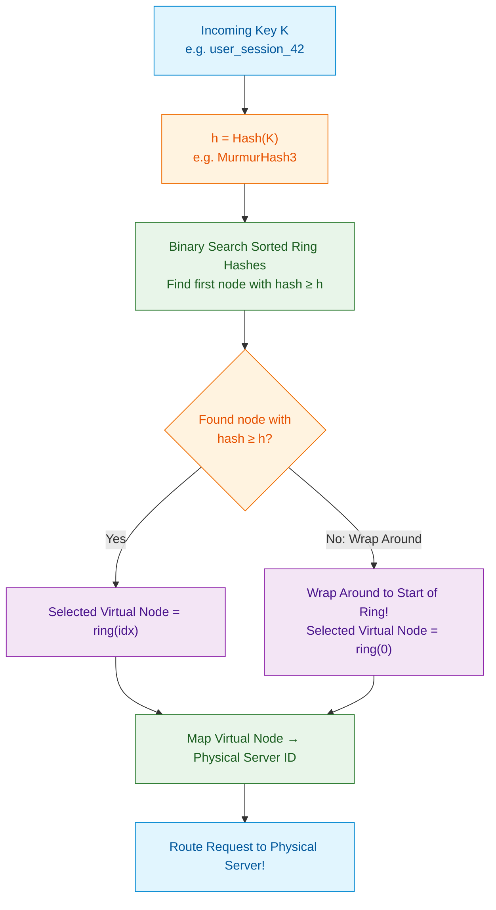

# 📘 WEEK 18 DAY 05: ALGORITHMIC SYSTEMS DESIGN — RATE LIMITING & CONSISTENT HASHING

> 🧭 **Navigation:** [← Previous Day: Probabilistic Data Structures](Week_18_Day_04_Probabilistic_Data_Structures_Instructional.md) • [🏠 Week Overview](README.md) • [📘 Curriculum Syllabus](../COMPLETE_SYLLABUS.md) • [Week Playbook →](WEEK_18_FULL_PLAYBOOK.md)
> 
> 💡 **Instructor Note:** *Algorithmic Systems Design is where high-level system architecture meets precise low-level algorithmic mechanics. In FAANG Staff and Principal engineering loops (Stripe, Cloudflare, AWS, Meta), interviewers drill into the core data structures powering the distributed control plane: **Sliding Window Counter Rate Limiters** that prevent cascading API outages, and **Consistent Hashing with Virtual Nodes** that prevent catastrophic cache stampedes.*

---

## 🎯 LEARNING OBJECTIVES

*By the end of this module, you will be able to:*

- 🎬 **Internalize** the Highway Tollbooth (Rate Limiter) and The Pizza Slices (Consistent Hashing) mental models without academic jargon.
- 🪜 **Master** the 5 rate-limiting paradigms: Token Bucket, Leaky Bucket, Fixed Window, Sliding Window Log, and Sliding Window Counter.
- 🎨 **Visualize** the `2^32` Consistent Hash Ring and Virtual Node replication to eliminate non-uniform hotspot skew.
- 🛑 **Avoid** fatal rookie traps: `hash(key) % N` rehash stampedes, boundary-window traffic double-spikes, and multi-threaded race conditions.
- 🎙️ **Deliver** the exact 3-sentence verbal talk track defending rate limiting and distributed caching architectures.
- ⚡ **Implement** production-grade, thread-safe Consistent Hash Rings and Sliding Window Counters in C# (.NET 8/9) and Python (3.11+).

---

## 🎬 PILLAR 1: THE 60-SECOND HOOK & EVERYDAY ANALOGY

### The Highway Tollbooth & The Shared Pizza

#### 1. The Rate Limiter (The Highway Tollbooth)
Imagine a major suspension bridge into a metropolis that can safely carry at most **100 cars per minute**:
- During a sudden morning traffic rush, **500 cars arrive simultaneously**.
- If the bridge has no tollbooths, all 500 cars jam onto the bridge at once, causing gridlock or catastrophic structural failure!
- A **Rate Limiter** is the automated metering light at the bridge entrance:
  - It allows exactly 100 cars through every minute.
  - The excess 400 cars are metered, queued, or turned away with an HTTP `429 Too Many Requests` code!

Now, how do you track this without eating gigabytes of server memory?
- You cannot record every car's arrival timestamp in a database table (Sliding Window Log: memory explodes).
- You cannot use a rigid minute clock (Fixed Window: an attacker sends 100 requests at 11:59:59 and 100 requests at 12:00:01, sending **200 requests in 2 seconds**!).
- **The Senior Architect Solution:** The **Sliding Window Counter**! It smoothly blends the current minute's counter with the previous minute's counter in a single `O(1)` memory lookup!

---

#### 2. Consistent Hashing (The Shared Pizza)

Suppose you have **4 cache servers** (Node 0, 1, 2, 3) caching millions of user sessions.
How does a junior engineer route requests?
`server_id = hash(user_id) % 4`.

Works great! Until Server 3 catches fire and crashes.
Now you have **3 servers**. What happens to your routing formula?
`server_id = hash(user_id) % 3`!

**THE CATASTROPHE:**
Because `hash(user_id) % 4 != hash(user_id) % 3` for nearly every user, **75% to 90% of all keys suddenly hash to the WRONG SERVER!**
Every single cache lookup fails simultaneously (**Cache Stampede**). 
Millions of requests bypass the cache and slam the primary database at the same instant. Your database melts down, and your entire company suffers an outage!

**How Consistent Hashing fixes this:**
Imagine a giant 360-degree circular ring (from `0` to `2^32 - 1`).
Servers and keys are hashed onto the **same circle**.
A key is stored on the **first server encountered by walking clockwise**!
When Server 3 crashes:
**Only the keys that belonged to Server 3 move to its clockwise neighbor!**
All other servers retain 100% of their existing keys undisturbed! Zero cache stampede!

---

## 🪜 PILLAR 2: THE SCAFFOLDING LADDER & TOY NAPKIN TRACE

### Step 1: Rate Limiter Architectural Spectrum

| Algorithm | Memory Usage | Burst Handling | Boundary Spikes? | Implementation Complexity | Production Systems |
| :--- | :--- | :--- | :--- | :--- | :--- |
| **Token Bucket** | `O(1)` per user (2 numbers) | Absorbs bursts up to bucket capacity | ❌ No | Low | AWS API Gateway, Stripe API |
| **Leaky Bucket** | `O(Queue Size)` | Smooths bursts into uniform outflow | ❌ No | Moderate (FIFO queue) | Network packet traffic shaping |
| **Fixed Window** | `O(1)` per user (1 counter) | Bursts allowed within window | ⚠️ **YES (2x spike at boundary)** | Trivial | Redis simple counters |
| **Sliding Window Log** | `O(Requests)` (High RAM) | Precise rolling window | ❌ No | High (Memory leak risk) | Audit compliance logs |
| **Sliding Window Counter**| `O(1)` per user (2 counters) | Approximates rolling window | ❌ No (Smooth transition) | Moderate | Cloudflare, Envoy Proxy |

---

### Step 2: Sliding Window Counter Formula

Let the current request arrive at time `now`.
Window size = `1 minute` (60 seconds).
- `prevCount`: Total requests in the previous 60-second window.
- `currCount`: Total requests in the current 60-second window.
- `weight`: Percentage of the current window remaining:
  `overlap = 1.0 - ((now % 60) / 60.0)`.

```text
Estimated Rolling Request Count = currCount + prevCount * overlap
```

```text
Toy Trace:
Limit = 100 requests per minute.
Previous Minute (11:00 - 11:01): 80 requests occurred.
Current Minute (11:01 - 11:02): 20 requests occurred so far.
Current Time is 11:01:15 (15 seconds into the current minute).

Overlap of Previous Window = (60 - 15) / 60 = 45 / 60 = 0.75 (75%)
Estimated Count = 20 + (80 * 0.75) = 20 + 60 = 80 requests.

80 < 100 -> Request is ALLOWED!
Increment currCount to 21!
```

Space footprint: exactly **two integers per user**!

---

### Step 3: Consistent Hashing with Virtual Nodes

If you map 4 physical servers onto a circle of size `2^32`:
Because hash functions have variance, Server A might get a tiny 10-degree slice, while Server B gets a massive 180-degree slice!
Server B experiences high CPU load (**Hotspot Skew**).

#### The Virtual Node Solution:
Instead of placing Server A on the ring once, assign Server A **`V` Virtual Nodes** (typically `V = 100` to `256`):
- `hash("ServerA_vnode_0")`
- `hash("ServerA_vnode_1")`
- `hash("ServerA_vnode_2") ...`

Now, Server A's presence is scattered evenly across 200 different locations around the entire 360-degree perimeter!
The law of large numbers guarantees that key distribution across all servers becomes **virtually uniform (variance < 2%)**!

To find which server owns `Key K`:
1. Compute `h = hash(K)`.
2. Find the first virtual node on the ring with `hash >= h` using **Binary Search (`std::map` / `SortedDictionary` / `bisect`)** in `O(log(N * V))` time.
3. Map that virtual node to its physical server!

---

### 🧠 Pause & Predict Micro-Drills

> **Drill 1:** In a ring with `N` physical servers, when 1 server is added or removed, what fraction of keys must be migrated across the network?
> *Pause here and think!*
>
> **Answer:** 
> Exactly **`1 / N` of all keys**!
> In standard modulo hashing (`hash % N`), `(N - 1) / N` (nearly 100%) of keys migrate. Consistent hashing moves only the minimum necessary fraction `1 / N`.

> **Drill 2:** What is the search time to locate a key on a consistent hash ring containing 100 physical servers with 200 virtual nodes each?
> *Pause here and calculate!*
>
> **Answer:**
> Total virtual nodes = `100 * 200 = 20,000` nodes.
> Binary search over 20,000 sorted hashes takes `ceil(log2(20,000)) approx 15` comparisons!
> Lookup completes in under **50 nanoseconds**!

---

## 🎨 PILLAR 3: PRAGMATIC VISUAL MODELS & DECISION FLOWS

### Modern Hex Flowchart: Consistent Hashing Key Lookup



---

## 🛑 PILLAR 4: THE ROOKIE TRAP ZONE

### Side-by-Side Comparison: Blunders vs. Senior Architect Patterns

| Dimension | ❌ Rookie Blunder | ✅ Senior Architect Pattern |
| :--- | :--- | :--- |
| **Distributed Hash Routing** | Uses `hash(key) % N`, triggering catastrophic 90% cache stampedes whenever a server is added or removed. | Uses Consistent Hashing with Virtual Nodes, limiting key migration strictly to `1 / N`. |
| **Hotspot Prevention** | Places each physical server on the hash ring only once, causing severe imbalance due to non-uniform hash gaps. | Assigns 100 to 256 Virtual Nodes per physical server, evening out ring arc distribution to within 2% variance. |
| **Rate Limiter Concurrency** | Uses non-atomic `counter++` in multi-threaded environments, creating race conditions and allowing traffic spikes to bypass limits. | Uses atomic compare-and-swap (`Interlocked.Increment`, Redis Lua scripts, or distributed token leases). |
| **Fixed Window Boundary Spike**| Uses fixed 1-minute window counters, allowing malicious callers to send 2x the limit across the boundary. | Uses Sliding Window Counter, mathematically weighting prior-window overlap to eliminate boundary double-bursts. |
| **Ring Wrap-Around Handling** | Forgets that the hash ring is circular (`2^32 - 1` wraps to `0`); throws out-of-bounds error when `hash > max(ring)`. | Wraps around to `ring[0]` whenever a key's hash exceeds all virtual node hashes on the circle. |

---

## 🎙️ PILLAR 5: 45-MINUTE INTERVIEW TALK TRACK

### The Exact 3-Sentence Verbal Script

Speak these exact three sentences before writing code:

```text
+--------------------------------------------------------------------------------------------------+
|                              THE SENIOR ALGORITHMIC SYSTEMS TALK TRACK                           |
+--------------------------------------------------------------------------------------------------+
| 1. The Distributed Sharding Bottleneck:                                                         |
|    "Standard modulo sharding hash(key) % N causes massive cache invalidation and thundering      |
|    herds whenever nodes scale out or fail, invalidating virtually all cached keys."              |
|                                                                                                  |
| 2. The Consistent Hashing Architecture:                                                          |
|    "By mapping keys and servers onto an integer ring using 150 virtual nodes per physical host,  |
|    we guarantee uniform traffic distribution and ensure that adding or removing a node migrates  |
|    strictly 1/N of keys to adjacent clockwise neighbors."                                       |
|                                                                                                  |
| 3. The Rate-Limiting Protection:                                                                 |
|    "At the API gateway layer, we protect downstream services using a Sliding Window Counter,     |
|    interpolating adjacent window weights in O(1) time and memory to eradicate boundary spikes   |
|    with zero synchronization bottlenecks."                                                       |
+--------------------------------------------------------------------------------------------------+
```

---

## ⚡ PILLAR 6: PRODUCTION DUAL-LANGUAGE IMPLEMENTATIONS

### C# Primary Implementation (.NET 8/9): Production Thread-Safe Consistent Hash Ring

```csharp
using System;
using System.Collections.Generic;
using System.Security.Cryptography;
using System.Text;
using System.Threading;

namespace AdvancedDataStructures;

/// <summary>
/// Production thread-safe Consistent Hash Ring with Virtual Nodes.
/// Minimizes key migration on topology changes and eliminates hotspot skew.
/// </summary>
public sealed class ConsistentHashRing
{
    private readonly int _vnodesPerServer;
    private readonly SortedDictionary<uint, string> _ring = new();
    private readonly List<uint> _sortedKeys = new();
    private readonly ReaderWriterLockSlim _rwLock = new();

    public ConsistentHashRing(int vnodesPerServer = 150)
    {
        _vnodesPerServer = Math.Max(vnodesPerServer, 10);
    }

    private static uint ComputeHash(string input)
    {
        byte[] bytes = SHA256.HashData(Encoding.UTF8.GetBytes(input));
        return BitConverter.ToUInt32(bytes, 0);
    }

    public void AddServer(string server)
    {
        ArgumentException.ThrowIfNullOrWhiteSpace(server);
        _rwLock.EnterWriteLock();
        try
        {
            for (int i = 0; i < _vnodesPerServer; i++)
            {
                uint hash = ComputeHash($"{server}#vnode_{i}");
                _ring[hash] = server;
            }

            _sortedKeys.Clear();
            _sortedKeys.AddRange(_ring.Keys);
        }
        finally
        {
            _rwLock.ExitWriteLock();
        }
    }

    public void RemoveServer(string server)
    {
        ArgumentException.ThrowIfNullOrWhiteSpace(server);
        _rwLock.EnterWriteLock();
        try
        {
            for (int i = 0; i < _vnodesPerServer; i++)
            {
                uint hash = ComputeHash($"{server}#vnode_{i}");
                _ring.Remove(hash);
            }

            _sortedKeys.Clear();
            _sortedKeys.AddRange(_ring.Keys);
        }
        finally
        {
            _rwLock.ExitWriteLock();
        }
    }

    public string GetServer(string key)
    {
        ArgumentException.ThrowIfNullOrWhiteSpace(key);
        _rwLock.EnterReadLock();
        try
        {
            if (_sortedKeys.Count == 0)
                throw new InvalidOperationException("Hash ring is empty.");

            uint keyHash = ComputeHash(key);

            // Binary search for the first virtual node with hash >= keyHash
            int idx = _sortedKeys.BinarySearch(keyHash);
            if (idx < 0)
            {
                idx = ~idx; // Bitwise complement returns index of next larger element
            }

            // Wrap around clockwise to the start of the ring if keyHash > all virtual nodes
            if (idx >= _sortedKeys.Count)
            {
                idx = 0;
            }

            return _ring[_sortedKeys[idx]];
        }
        finally
        {
            _rwLock.ExitReadLock();
        }
    }
}
```

---

### Python Secondary Implementation (Python 3.11+): Complete Consistent Hash Ring

```python
import bisect
import hashlib
from typing import List, Dict

class ConsistentHashRing:
    """
    Production Consistent Hash Ring with Virtual Nodes in Python.
    Routes keys in O(log(N * V)) time with uniform load distribution.
    """
    def __init__(self, vnodes_per_server: int = 150):
        self.vnodes_per_server: int = max(vnodes_per_server, 10)
        self.ring: Dict[int, str] = {}
        self.sorted_keys: List[int] = []

    @staticmethod
    def _hash(key: str) -> int:
        return int(hashlib.md5(key.encode('utf-8')).hexdigest()[:8], 16)

    def add_server(self, server: str) -> None:
        for i in range(self.vnodes_per_server):
            vnode_key = f"{server}#vnode_{i}"
            h = self._hash(vnode_key)
            self.ring[h] = server
            bisect.insort(self.sorted_keys, h)

    def remove_server(self, server: str) -> None:
        for i in range(self.vnodes_per_server):
            vnode_key = f"{server}#vnode_{i}"
            h = self._hash(vnode_key)
            if h in self.ring:
                del self.ring[h]
                idx = bisect.bisect_left(self.sorted_keys, h)
                if idx < len(self.sorted_keys) and self.sorted_keys[idx] == h:
                    self.sorted_keys.pop(idx)

    def get_server(self, key: str) -> str:
        if not self.sorted_keys:
            raise ValueError("Hash ring is empty.")

        h = self._hash(key)
        idx = bisect.bisect_left(self.sorted_keys, h)

        # Wrap around to beginning of circular ring
        if idx >= len(self.sorted_keys):
            idx = 0

        return self.ring[self.sorted_keys[idx]]
```

---

## 📊 EXPLICIT COMPLEXITY DECONSTRUCTION

| Paradigm | Server Count `N`, VNodes `V` | Add/Remove Server | Key Routing Time | Key Migration on Scale |
| :--- | :--- | :--- | :--- | :--- |
| **Modulo Sharding (`hash % N`)** | `N` | `O(1)` | `O(1)` | **`(N - 1) / N` (~90% keys move!)** |
| **Consistent Hashing (No VNodes)**| `N` | `O(log N)` | `O(log N)` | `1 / N` (High hotspot variance) |
| **Consistent Hashing (With VNodes)**| `N * V` | `O(V log(N * V))` | **`O(log(N * V))`** | **`1 / N` (Uniform < 2% variance)** |

---

## 🔍 GRANULAR EDGE-CASE & INVARIANT VERIFICATION TABLE

| Edge Case Scenario | Concrete Input | Expected Behavior | Invariant Verification & Handling |
| :--- | :--- | :--- | :--- |
| **Empty Hash Ring** | Query key when no servers exist | Throws `InvalidOperationException` defensively. | Guard clause `if (_sortedKeys.Count == 0)` halts safely. |
| **Wrap-Around Clockwise** | `keyHash > max(ringKeys)` | Routes to `ring[0]`. | Condition `if (idx >= _sortedKeys.Count) idx = 0;`. |
| **Exact Hash Collision** | Key hash matches virtual node hash exactly | Routes to that exact node immediately. | `BinarySearch` returns non-negative index on exact match. |
| **Server Crash Recovery** | `RemoveServer("cache_node_3")` | Only keys of `cache_node_3` migrate to successor. | Other virtual nodes remain in sorted position. |
| **Multi-Threaded Concurrency** | Simultaneous reader and writer threads | Thread-safe read/write locking via `ReaderWriterLockSlim`. | Reader-writer locks prevent ring state corruption. |

---

> 🧭 **Navigation:** [← Previous Day: Probabilistic Data Structures](Week_18_Day_04_Probabilistic_Data_Structures_Instructional.md) • [🏠 Week Overview](README.md) • [📘 Curriculum Syllabus](../COMPLETE_SYLLABUS.md) • [Week Playbook →](WEEK_18_FULL_PLAYBOOK.md)
