# 📘 WEEK 19: FAANG MOCK INTERVIEWS & FINAL MASTERY CRUCIBLE

> 🧭 **Navigation:** [← Previous: Week 18](../week_18_probabilistic_ds_systems/README.md) • [🏠 Curriculum Overview](../README.md) • [📘 Complete Syllabus](../COMPLETE_SYLLABUS.md) • [Final Synthesis](../COMPLETE_SYLLABUS.md)

---

## 🎯 WEEKLY MISSION & CONCEPTUAL HOOK

Welcome to the grand finale: **Week 19: FAANG Mock Interviews & Final Mastery Crucible**!
You have mastered 18 weeks of foundational and advanced data structures: from two pointers, monotonic stacks, and binary search, to tries, network flow, skip lists, link-cut trees, CHT, and probabilistic systems design.
Now, all theoretical preparation converges onto the single high-stakes crucible that determines your job offer:
**Can you deliver production-grade code, articulate governing invariants, and lead a collaborative architectural dialogue under live 45-minute FAANG whiteboard pressure?**

This week, we simulate the complete multi-round on-site interview loop:
1. **Mock Round 1 (Arrays & Strings):** Trapping Rain Water (LC 42) via opposing two pointers in `O(1)` space, and Longest Substring (LC 3) via zero-allocation direct-address lookup.
2. **Mock Round 2 (Trees & Graphs):** Binary Tree Maximum Path Sum (LC 124) with arch-vs-branch decoupling, and Word Ladder (LC 127) via Bidirectional BFS frontier pruning.
3. **Mock Round 3 (Dynamic Programming):** Burst Balloons (LC 312) via Interval DP ("Think in Reverse"), and Regular Expression Matching (LC 10) with 2D state transitions.
4. **Mock Round 4 (Mixed Complex Systems):** LRU Cache (LC 146) with sentinel doubly-linked lists, and Median of Two Sorted Arrays (LC 4) in logarithmic time.
5. **Weakness Diagnosis & Strategy:** The Black Box Flight Recorder diagnostic framework: evaluating yourself across the 4 FAANG Bar Raiser rubric dimensions.
6. **Final Tips & Rapid-Fire Drills:** The 45-minute delivery timeline clockwork, 10 rapid-fire 30-second pattern classification drills, and executive presence calibration.

```mermaid
%%{init: {"flowchart": {"htmlLabels": true, "padding": 20}, "themeCSS": "foreignObject { overflow: visible !important; }"}}%%
flowchart LR
    M1["Round 1: Arrays & Strings<br/>(LC 42, LC 3)"] --> M2["Round 2: Trees & Graphs<br/>(LC 124, LC 127)"]
    M2 --> M3["Round 3: Advanced DP<br/>(LC 312, LC 10)"]
    M3 --> M4["Round 4: Mixed Systems<br/>(LC 146, LC 4)"]
    M4 --> M5["Round 5: Diagnostic Rubric<br/>(Black Box Post-Mortem)"]
    M5 --> M6["Round 6: Final Drills<br/>(45-Min Pacing & Drills)"]

    style M1 fill:#e1f5fe,stroke:#0288d1,color:#01579b
    style M2 fill:#e8f5e9,stroke:#2e7d32,color:#1b5e20
    style M3 fill:#fff3e0,stroke:#ef6c00,color:#e65100
    style M4 fill:#f3e5f5,stroke:#8e24aa,color:#4a148c
    style M5 fill:#ffebee,stroke:#c62828,color:#b71c1c
    style M6 fill:#e8f5e9,stroke:#2e7d32,color:#1b5e20
```

---

## 📅 DAY-BY-DAY MASTERCLASS MODULES

| Day | Instructional Module | Core Architecture & Paradigm | Production / Interview Target |
| :--- | :--- | :--- | :--- |
| **Day 01** | [Mock Arrays Strings](Week_19_Day_01_Mock_Arrays_Strings_Instructional.md) | Opposing Two Pointers & Direct-Address Window | Trapping Rain Water (LC 42), Longest Substring (LC 3) |
| **Day 02** | [Mock Trees Graphs](Week_19_Day_02_Mock_Trees_Graphs_Instructional.md) | Arch Path Decoupling & Bidirectional BFS | Max Path Sum (LC 124), Word Ladder (LC 127) |
| **Day 03** | [Mock Dynamic Programming](Week_19_Day_03_Mock_Dynamic_Programming_Instructional.md) | Interval DP ("Think in Reverse") & 2D Regex Matrix | Burst Balloons (LC 312), Regex Matcher (LC 10) |
| **Day 04** | [Mock Mixed Complex Rounds](Week_19_Day_04_Mock_Mixed_Complex_Rounds_Instructional.md) | Sentinel DLL + HashMap & Logarithmic Partitioning | LRU Cache (LC 146), Median of Two Sorted Arrays (LC 4) |
| **Day 05** | [Weakness Diagnosis & Strategy](Week_19_Day_05_Weakness_Diagnosis_And_Strategy_Instructional.md) | 4-Pillar Bar Raiser Rubric & Black Box Post-Mortem | Diagnosing Stalls, Handling Hints, Offer Calibration |
| **Day 06** | [Interview Tips & Final Drills](Week_19_Day_06_Interview_Tips_And_Final_Drills_Instructional.md) | 45-Min Clockwork Delivery & 10 Fast-Pattern Drills | Pre-Interview 24h Protocol, Executive Presence |

---

## 📚 CONSOLIDATED PLAYBOOKS & REFERENCE GUIDES

*   📖 **Comprehensive Week Playbook:** [WEEK_19_FULL_PLAYBOOK.md](WEEK_19_FULL_PLAYBOOK.md) — Synthesis of all invariants, theorems, and pattern triggers.
*   📊 **Visual Concepts Playbook (Hybrid):** [Week_19_Visual_Concepts_Playbook_HYBRID.md](Week_19_Visual_Concepts_Playbook_HYBRID.md) — Compact Mermaid state diagrams and complexity reference tables.
*   💻 **Production C# Reference (.NET 8/9):** [Week_19_Extended_CSharp_Complete.md](Week_19_Extended_CSharp_Complete.md) — Zero-allocation, memory-aware implementations and problem ladders.
*   🐍 **Production Python Reference (Python 3.11+):** [Week_19_Extended_Python_Complete.md](Week_19_Extended_Python_Complete.md) — Clean, pythonic reference implementations for rapid whiteboard prototyping.

---

## 🛠️ THE 5 CORE SUPPORT FILES (`support files/`)

1.  📋 [Daily Progress Checklist](support%20files/Week_19_Daily_Progress_Checklist.md) — Step-by-step accountability tracker for theory, coding, and variants.
2.  🧭 [Weekly Guidelines & Mental Models](support%20files/Week_19_Guidelines.md) — Strategic roadmap, common pitfalls, and conceptual anchors.
3.  🎙️ [Interview Q&A Comprehensive Reference](support%20files/Week_19_Interview_QA_Reference.md) — High-frequency senior technical questions with verbal response frameworks.
4.  🗺️ [Problem-Solving Roadmap](support%20files/Week_19_Problem_Solving_Roadmap.md) — Tier-1 problem progression ladder from warm-up to advanced.
5.  📑 [Summary & Key Concepts Synthesis](support%20files/Week_19_Summary_Key_Concepts.md) — Fast-revision cheat sheet covering all governing invariants and system trade-offs.

---

> 🧭 **Navigation:** [← Previous: Week 18](../week_18_probabilistic_ds_systems/README.md) • [🏠 Curriculum Overview](../README.md) • [📘 Complete Syllabus](../COMPLETE_SYLLABUS.md) • [Final Synthesis](../COMPLETE_SYLLABUS.md)
