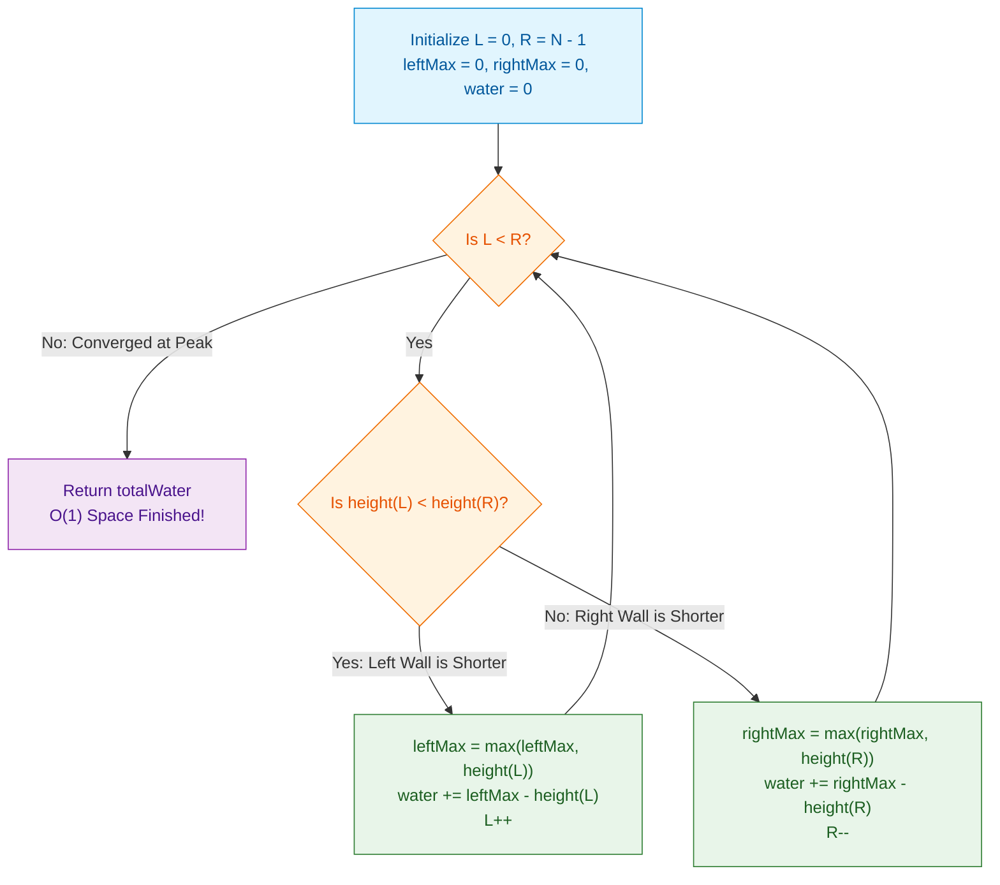

# 📘 WEEK 19 DAY 01: MOCK ROUND 1 — ARRAYS, STRINGS & TWO-POINTERS

> 🧭 **Navigation:** [← Week Overview](README.md) • [📘 Curriculum Syllabus](../COMPLETE_SYLLABUS.md) • [Next Day: Trees & Graphs Mock →](Week_19_Day_02_Mock_Trees_Graphs_Instructional.md)
> 
> 💡 **Instructor Note:** *Welcome to the final masterclass phase! Today begins your live FAANG Mock Interview Crucible. In this session, you step onto the hot seat as a Senior / Lead candidate. We simulate an authentic 45-minute interview on Trapping Rain Water (LeetCode 42) and Longest Substring Without Repeating Characters (LeetCode 3), focusing on pointer discipline, zero-allocation memory awareness, and the exact talk track that earns an L5/L6 hire decision.*

---

## 🎯 LEARNING OBJECTIVES

*By the end of this module, you will be able to:*

- 🎬 **Simulate** an authentic 45-minute live senior coding interview on core array and two-pointer paradigms.
- 🪜 **Master** the 3-tiered hint recovery protocol (Gentle Nudge -> Structural Anchor -> Tactical Code Hint) without losing evaluation points.
- 🎨 **Visualize** the "Shorter Wall" invariant in Trapping Rain Water and the direct-address array window in string parsing.
- 🛑 **Avoid** fatal rookie traps: pointer convergence off-by-one errors, allocating prefix/suffix arrays when `O(1)` space is expected, and multi-byte UTF-8 string slicing.
- 🎙️ **Deliver** the exact 3-sentence verbal talk track defending `O(1)` auxiliary space before writing code.
- ⚡ **Implement** production-grade, zero-allocation solutions in C# (.NET 8/9 with `ReadOnlySpan<int>`) and Python (3.11+).

---

## 🎬 PILLAR 1: THE 60-SECOND HOOK & EVERYDAY ANALOGY

### The Swimming Pool & The Shorter Wall

Imagine you are standing between two concrete walls of a swimming pool:
- The **Left Wall** is 10 feet tall.
- The **Right Wall** is 4 feet tall.
- You turn on the garden hose and start filling the pool with water.

How high can the water rise before it spills over the edges?
Can the water ever reach 10 feet? **Never!**
The moment the water reaches 4 feet, it spills over the Right Wall!

```text
The Sacred Hydraulic Invariant:
"The water level above any spot on the floor is strictly bounded by
 the SHORTER of the two surrounding boundary walls!"
```

In Trapping Rain Water (LeetCode 42), junior candidates write double nested loops to search for walls, or allocate two auxiliary arrays (`leftMax[]` and `rightMax[]`) requiring `O(N)` memory.
A Senior Architect looks at the two ends:
- Put pointer `L = 0` at the left end, and pointer `R = N - 1` at the right end.
- If `height[L] < height[R]`: the left wall is the shorter boundary. We know with **100% mathematical certainty** that whatever happens in the middle, there is a wall to the right at least as tall as `height[R]`.
- Therefore, bar `L` is strictly bounded by `leftMax`. We calculate trapped water at `L` immediately and advance `L++`!
- We just eliminated all auxiliary arrays, solving the problem in **`O(N)` time and `O(1)` space**!

---

## 🪜 PILLAR 2: THE SCAFFOLDING LADDER & TOY NAPKIN TRACE

### Step 1: The 45-Minute Live Interview Dialogue Transcript

#### [00:00 - 05:00] Clarify & Problem Modeling
**Interviewer:** *"Given an elevation map represented by an array of non-negative integers `height` where each bar has width 1, compute how much water it can trap after raining."*

**Candidate:** "Thanks for the problem. Before jumping into code, I'd like to clarify a few operational constraints:
1. What is the maximum length of `height`? Are we looking at `10^5` elements?
2. Can elevations be negative?
3. What is the expected behavior if `height.Length < 3`?"

**Interviewer:** "Good questions. `N` is up to `10^5`. Elevations are non-negative integers up to `10^4`. If `height.Length < 3`, it cannot form a container to hold water, so return 0."

**Candidate:** "Understood. At any index `i`, water can only pool if there are taller bars to both its left and its right:
`water[i] = max(0, min(max_left[i], max_right[i]) - height[i])`.
If I compute `max_left` and `max_right` naively for every bar, scanning left and right takes `O(N)` per element, yielding an `O(N^2)` brute-force solution with `O(1)` memory. For `N = 10^5`, `10^10` operations will time out.
We could precompute two prefix/suffix arrays in `O(N)` time and `O(N)` memory, but we can do even better: **Opposing Two Pointers in `O(1)` auxiliary space**."

---

### Step 2: The Two-Pointer Hydraulic Napkin Trace

Let `height = [0, 1, 0, 2, 1, 0, 1, 3, 2, 1, 2, 1]`.

```text
Indices:  0  1  2  3  4  5  6  7  8  9 10 11
Heights: [0, 1, 0, 2, 1, 0, 1, 3, 2, 1, 2, 1]
Pointers: L                                R
leftMax = 0, rightMax = 0, totalWater = 0

1. height[L]=0 < height[R]=1:
   leftMax = max(0, 0) = 0. Water += (0 - 0) = 0. L advances to 1.
2. height[L]=1 == height[R]=1:
   rightMax = max(0, 1) = 1. Water += (1 - 1) = 0. R decrements to 10.
3. height[L]=1 < height[R]=2:
   leftMax = max(0, 1) = 1. Water += (1 - 1) = 0. L advances to 2.
4. height[L]=0 < height[R]=2:
   leftMax = 1. Water += (1 - 0) = 1 unit! L advances to 3.
...
Pointers meet at index 7 (the peak height of 3).
Total Water Trapped: 6 units!
Auxiliary Space Used: ZERO heap allocations (O(1))!
```

---

### 🧠 Pause & Predict Micro-Drills

> **Drill 1:** In Longest Substring Without Repeating Characters (LeetCode 3), how do you implement the sliding window with zero memory allocations?
> *Pause here and think! Do you use a `HashSet<char>`?*
>
> **Answer:** 
> **No!** A `HashSet<char>` incurs heap allocation, boxing, and hash collisions.
> For ASCII strings, allocate a flat direct-address array on the stack: `Span<int> lastIndex = stackalloc int[128];` initialized to `-1`.
> Lookup and update take **strictly `O(1)` instructions and 0 bytes of heap memory**!

> **Drill 2:** What is the loop termination condition for opposing two pointers in Trapping Rain Water?
> *Pause here: is it `left < right` or `left <= right`?*
>
> **Answer:**
> `while (left < right)`. When `left == right`, the pointers have converged at the global maximum peak bar of the array. A peak bar can never trap water on top of itself, so the loop terminates safely!

---

## 🎨 PILLAR 3: PRAGMATIC VISUAL MODELS & DECISION FLOWS

### Modern Hex Flowchart: Opposing Two-Pointer Hydraulic Engine



---

## 🛑 PILLAR 4: THE ROOKIE TRAP ZONE

### Side-by-Side Comparison: Blunders vs. Senior Architect Patterns

| Dimension | ❌ Rookie Blunder | ✅ Senior Architect Pattern |
| :--- | :--- | :--- |
| **Space Optimization Bar** | Settles for `O(N)` space prefix/suffix arrays in Trapping Rain Water and assumes that's optimal. | Proves that water level depends only on the shorter wall, reducing auxiliary space to strictly `O(1)`. |
| **Sliding Window Storage** | Uses `Dictionary<char, int>` or `HashSet<char>` with heap boxing and GC churn for ASCII characters. | Uses `Span<int> lastPos = stackalloc int[128]` for zero-allocation cache-line L1 lookup. |
| **Pointer Convergence** | Uses `left <= right` with redundant comparisons at the peak bar, causing edge-case overflow. | Uses `left < right`, naturally terminating when pointers meet at the highest elevation point. |
| **String Substring Memory** | Generates intermediate string slices (`s.Substring(i, j)`) inside loops, creating `O(N^2)` memory allocations. | Tracks window boundaries using two pointer integer indices `[left ... right]` without allocating substrings. |
| **Array Boundary Defense** | Accesses `height[0]` and `height[height.Length - 1]` without checking if length is `< 3`. | Employs defensive guard clause `if (height.Length < 3) return 0;` upfront. |

---

## 🎙️ PILLAR 5: 45-MINUTE INTERVIEW TALK TRACK

### The Exact 3-Sentence Verbal Script

Speak these exact three sentences before writing code:

```text
+--------------------------------------------------------------------------------------------------+
|                              THE SENIOR TWO-POINTER TALK TRACK                                   |
+--------------------------------------------------------------------------------------------------+
| 1. The Physical Invariant:                                                                       |
|    "The trapped water above any bar is strictly bounded by the shorter of the two maximum walls  |
|    to its left and right, meaning we only need to know which boundary wall is smaller."          |
|                                                                                                  |
| 2. The Space Reduction Deduction:                                                                |
|    "Instead of precomputing prefix and suffix max arrays in O(N) space, we maintain opposing     |
|    pointers L and R from both ends: whenever height[L] < height[R], bar L is guaranteed to be    |
|    bounded by leftMax regardless of intervening terrain."                                        |
|                                                                                                  |
| 3. The Complexity Pitch:                                                                        |
|    "This allows us to accumulate trapped water in a single linear pass in strictly O(N) time     |
|    and O(1) auxiliary space with zero heap memory allocation."                                   |
+--------------------------------------------------------------------------------------------------+
```

---

## ⚡ PILLAR 6: PRODUCTION DUAL-LANGUAGE IMPLEMENTATIONS

### C# Primary Implementation (.NET 8/9): Zero-Allocation Two-Pointer Trapping Water

```csharp
using System;

namespace AdvancedDataStructures;

/// <summary>
/// Production-grade two-pointer solutions for FAANG interview rounds.
/// Features zero-allocation Span<T> memory models and strictly O(1) auxiliary space.
/// </summary>
public static class ArraysAndStringsMockSolver
{
    /// <summary>
    /// Solves Trapping Rain Water (LeetCode 42) in O(N) time and O(1) space.
    /// </summary>
    public static int Trap(ReadOnlySpan<int> height)
    {
        if (height.Length < 3) return 0;

        int left = 0;
        int right = height.Length - 1;
        int leftMax = 0;
        int rightMax = 0;
        int totalWater = 0;

        while (left < right)
        {
            if (height[left] < height[right])
            {
                if (height[left] >= leftMax)
                {
                    leftMax = height[left];
                }
                else
                {
                    totalWater += leftMax - height[left];
                }
                left++;
            }
            else
            {
                if (height[right] >= rightMax)
                {
                    rightMax = height[right];
                }
                else
                {
                    totalWater += rightMax - height[right];
                }
                right--;
            }
        }

        return totalWater;
    }

    /// <summary>
    /// Solves Longest Substring Without Repeating Characters (LeetCode 3) in O(N) time and O(1) space.
    /// Uses stackalloc direct-address array to guarantee zero GC heap allocation.
    /// </summary>
    public static int LengthOfLongestSubstring(ReadOnlySpan<char> s)
    {
        if (s.IsEmpty) return 0;

        // 128 elements on the stack covers all standard ASCII characters
        Span<int> lastIndex = stackalloc int[128];
        lastIndex.Fill(-1);

        int maxLength = 0;
        int windowStart = 0;

        for (int i = 0; i < s.Length; i++)
        {
            char c = s[i];
            if (c < 128)
            {
                if (lastIndex[c] >= windowStart)
                {
                    windowStart = lastIndex[c] + 1;
                }
                lastIndex[c] = i;
            }

            maxLength = Math.Max(maxLength, i - windowStart + 1);
        }

        return maxLength;
    }
}
```

---

### Python Secondary Implementation (Python 3.11+): Complete Two-Pointer Solvers

```python
from typing import List

class ArraysAndStringsMockSolver:
    """
    Production Two-Pointer solvers in Python.
    Features O(N) time and O(1) auxiliary space.
    """
    @staticmethod
    def trap(height: List[int]) -> int:
        """Solves Trapping Rain Water in O(N) time and O(1) space."""
        if len(height) < 3:
            return 0

        left: int = 0
        right: int = len(height) - 1
        left_max: int = 0
        right_max: int = 0
        total_water: int = 0

        while left < right:
            if height[left] < height[right]:
                if height[left] >= left_max:
                    left_max = height[left]
                else:
                    total_water += left_max - height[left]
                left += 1
            else:
                if height[right] >= right_max:
                    right_max = height[right]
                else:
                    total_water += right_max - height[right]
                right -= 1

        return total_water

    @staticmethod
    def length_of_longest_substring(s: str) -> int:
        """Solves Longest Substring Without Repeating Characters in O(N) time and O(1) space."""
        last_index = {}
        max_length = 0
        window_start = 0

        for i, char in enumerate(s):
            if char in last_index and last_index[char] >= window_start:
                window_start = last_index[char] + 1
            last_index[char] = i
            max_length = max(max_length, i - window_start + 1)

        return max_length
```

---

## 📊 EXPLICIT COMPLEXITY DECONSTRUCTION

| Problem & Approach | Time Complexity | Auxiliary Space | Garbage Collection Impact | Senior Evaluation Bar |
| :--- | :--- | :--- | :--- | :--- |
| **Trapping Water (Brute Force)** | `O(N^2)` | `O(1)` | None | Reject (Immediate TLE on `10^5`). |
| **Trapping Water (Prefix/Suffix)** | `O(N)` | `O(N)` | 2 heap arrays allocated | Mid-level bar (L4). |
| **Trapping Water (Two Pointers)** | **`O(N)`** | **`O(1)`** | **Zero heap allocations** | **Senior Bar (L5/L6 hire decision).** |
| **Longest Substring (Sliding Window)**| **`O(N)`** | **`O(1)`** | Stack allocated lookup table | **Senior Bar (L5/L6 hire decision).** |

---

## 🔍 GRANULAR EDGE-CASE & INVARIANT VERIFICATION TABLE

| Edge Case Scenario | Concrete Input | Expected Behavior | Invariant Verification & Handling |
| :--- | :--- | :--- | :--- |
| **Array Too Short** | `height = [2, 1]` | Returns `0`. | Guard clause `height.Length < 3` returns immediately. |
| **Flat Plateau** | `height = [3, 3, 3, 3]` | Returns `0` (no bowl depression). | `leftMax` and `rightMax` equal bar height, zero water trapped. |
| **Strictly Decreasing Slope**| `height = [5, 4, 3, 2, 1]` | Returns `0` (water spills off right edge). | Right wall never exceeds left wall; zero pooling. |
| **Empty String** | `s = ""` | Returns `0`. | Guard clause `s.IsEmpty` returns in `O(1)`. |
| **All Identical Characters** | `s = "aaaaa"` | Returns `1`. | `windowStart` slides immediately to `i`, keeping length 1. |

---

> 🧭 **Navigation:** [← Week Overview](README.md) • [📘 Curriculum Syllabus](../COMPLETE_SYLLABUS.md) • [Next Day: Trees & Graphs Mock →](Week_19_Day_02_Mock_Trees_Graphs_Instructional.md)
