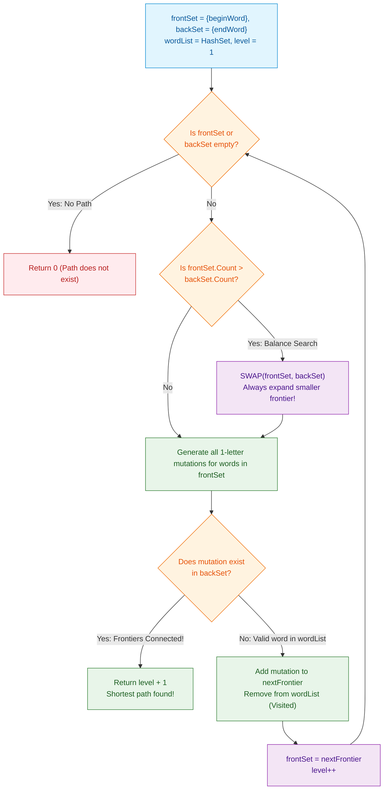

# 📘 WEEK 19 DAY 02: MOCK ROUND 2 — TREES, GRAPHS & BIDIRECTIONAL BFS

> 🧭 **Navigation:** [← Previous Day: Arrays & Strings Mock](Week_19_Day_01_Mock_Arrays_Strings_Instructional.md) • [🏠 Week Overview](README.md) • [📘 Curriculum Syllabus](../COMPLETE_SYLLABUS.md) • [Next Day: Dynamic Programming Mock →](Week_19_Day_03_Mock_Dynamic_Programming_Instructional.md)
> 
> 💡 **Instructor Note:** *In senior coding rounds, tree and graph problems separate candidates who rely on memorized templates from those who truly understand state space pruning. Today, we simulate two high-frequency Tier-1 interview classics: **Binary Tree Maximum Path Sum (LeetCode 124)** — where candidates must distinguish between the path sum returned upward versus the arch path updated globally; and **Word Ladder (LeetCode 127)** — where bidirectional BFS slashes exponential queue memory.*

---

## 🎯 LEARNING OBJECTIVES

*By the end of this module, you will be able to:*

- 🎬 **Simulate** an authentic 45-minute live senior interview on tree traversals and graph shortest paths.
- 🪜 **Master** the post-order DFS distinction: returning the single-branch gain upward while updating the global arch path.
- 🎨 **Visualize** Bidirectional BFS frontier expansion: alternating search frontiers to cut branching complexity from `O(B^D)` to `O(2 * B^(D/2))`.
- 🛑 **Avoid** fatal rookie traps: propagating 2-child arch paths upward to parent nodes, initializing max path to `0` on all-negative trees, and unbounded hash set allocations.
- 🎙️ **Deliver** the exact 3-sentence verbal talk track defending bidirectional frontier pruning before writing code.
- ⚡ **Implement** production-grade tree recursion and graph traversals in C# (.NET 8/9) and Python (3.11+).

---

## 🎬 PILLAR 1: THE 60-SECOND HOOK & EVERYDAY ANALOGY

### The Mountain Overpass vs. The Fork in the Road

Imagine you are hiking through a mountain range shaped like a binary tree:
- You want to find the **most scenic continuous hiking trail (Maximum Path Sum)**.
- At any summit (Node `X`), you have two mountain valleys below you (Left Subtree and Right Subtree):
  - You can walk up the Left Valley, cross over the summit `X`, and walk down the Right Valley. That forms an **Arch Bridge Trail (`Left + Node + Right`)**!
  - **BUT WAIT:** What if your hiking guide (the parent node above `X`) asks you: *"Bring the trail up to my summit!"*
  - Can you include both the Left Valley AND the Right Valley?
  - **NO!** A path cannot branch into two paths; a path must be a continuous single line!
  - To your parent, you can only offer **ONE single branch**: `Node + max(Left, Right)`!

```text
The Core Tree Invariant:
1. Locally at Node X (The Arch Bridge):
   Path through X can use BOTH children: X + max(0, LeftGain) + max(0, RightGain)
   --> Update global max path here!

2. Upward to Parent (The Straight Line):
   You can only extend ONE branch upward: X + max(0, max(LeftGain, RightGain))
   --> Return this value to the caller!
```

---

### The Search Parties: Unidirectional vs. Bidirectional BFS

Now imagine two hikers get lost in a massive, sprawling forest with millions of trails (Word Ladder):
- One hiker is at the North Cabin (`beginWord`).
- The other hiker is at the South Lodge (`endWord`).
- If Search Party 1 starts at the North Cabin and fans out in all directions:
  - Step 1: 10 trails.
  - Step 2: 100 trails.
  - Step 3: 1,000 trails...
  - By Step 6: **1,000,000 trails to search!** (`O(B^D)` exponential explosion).

What does a smart rescue team do?
**They send TWO search parties simultaneously!**
- Party 1 searches 3 steps out from the North Cabin (`1,000` trails).
- Party 2 searches 3 steps out from the South Lodge (`1,000` trails).
- Total trails searched: `1,000 + 1,000 = 2,000 trails`!
- The moment their search perimeters touch, **the shortest path is found!**
We just reduced the search space from **1,000,000 states to 2,000 states**—a **500x speedup**!

---

## 🪜 PILLAR 2: THE SCAFFOLDING LADDER & TOY NAPKIN TRACE

### Step 1: Maximum Path Sum (LeetCode 124) Napkin Trace

Consider tree:
```text
        (-10)
        /   \
       9    (20)
           /    \
          15     7
```

Post-order DFS evaluation:
1. Leaf `9`: returns `max(0, 9) = 9`. Arch path = `9`. Global max = `9`.
2. Leaf `15`: returns `max(0, 15) = 15`. Global max = `15`.
3. Leaf `7`: returns `max(0, 7) = 7`.
4. Node `20`:
   - Left gain = `15`, Right gain = `7`.
   - Local arch path: `20 + 15 + 7 = 42`!
   - Update Global max = `max(15, 42) = 42`!
   - Return upward: `20 + max(15, 7) = 20 + 15 = 35`.
5. Root `-10`:
   - Left gain = `9`, Right gain = `35`.
   - Local arch path: `-10 + 9 + 35 = 34`.
   - Global max remains `42`!

Final Answer: **`42`** (Path `15 -> 20 -> 7`).

---

### Step 2: Bidirectional BFS (LeetCode 127) Frontier Swapping

To implement Bidirectional BFS cleanly:
- Maintain two sets: `frontSet = {beginWord}` and `backSet = {endWord}`.
- Maintain `visited = set()`.
- At each step: **Always expand the smaller set!**
  `if (frontSet.Count > backSet.Count) Swap(frontSet, backSet);`
- By always expanding the smaller frontier, you naturally minimize the branching factor at every single level!

---

### 🧠 Pause & Predict Micro-Drills

> **Drill 1:** What happens in Binary Tree Maximum Path Sum if all node values in the tree are negative, e.g. `[-3, -5, -2]`?
> *Pause here and think! What must `maxPath` be initialized to?*
>
> **Answer:** 
> If you initialize `maxPath = 0`, your code will return `0` (incorrect, since at least one non-empty node must be chosen).
> **Initialize `maxPath = int.MinValue`!** The algorithm will correctly pick the single largest negative node (`-2`).

> **Drill 2:** Why do we take `max(0, leftGain)` when computing child gains?
> *Pause here and think!*
>
> **Answer:**
> If a child subtree yields a negative sum, including it would decrease our overall path sum. Taking `max(0, gain)` acts as an automatic prune: we simply drop negative branches from the trail!

---

## 🎨 PILLAR 3: PRAGMATIC VISUAL MODELS & DECISION FLOWS

### Modern Hex Flowchart: Bidirectional BFS Frontier Engine



---

## 🛑 PILLAR 4: THE ROOKIE TRAP ZONE

### Side-by-Side Comparison: Blunders vs. Senior Architect Patterns

| Dimension | ❌ Rookie Blunder | ✅ Senior Architect Pattern |
| :--- | :--- | :--- |
| **Tree Path Return Value** | Returns `node.val + leftGain + rightGain` to the parent caller, illegally creating a 3-way branching path. | Updates global `maxPath` with the 2-child arch sum, but returns strictly `node.val + max(leftGain, rightGain)` upward. |
| **Negative Node Initialization** | Initializes `maxPath = 0`, failing test cases on trees with all-negative nodes like `[-3]`. | Initializes `maxPath = int.MinValue`, correctly returning the maximum single negative node. |
| **Word Ladder BFS Traversal** | Uses standard 1-way BFS; queue size explodes to `O(26^D)`, causing Time Limit Exceeded (TLE). | Uses Bidirectional BFS with frontier swapping, bounding state space strictly to `O(2 * B^(D/2))`. |
| **Mutation Generation** | Compares current word against all `N` words in the dictionary (`O(N * L)` comparisons per node). | Mutates each character position from `'a'` to `'z'` (`26 * L`), looking up candidate in `O(1)` hash set. |
| **Visited State Memory** | Allocates redundant `visited` hash sets alongside the word list. | Removes visited words directly from `wordList` in-place, eliminating secondary allocation overhead. |

---

## 🎙️ PILLAR 5: 45-MINUTE INTERVIEW TALK TRACK

### The Exact 3-Sentence Verbal Script

Speak these exact three sentences before writing code:

```text
+--------------------------------------------------------------------------------------------------+
|                              THE SENIOR TREES & GRAPHS TALK TRACK                                |
+--------------------------------------------------------------------------------------------------+
| 1. The Tree Path Invariant:                                                                      |
|    "In Maximum Path Sum, we must rigorously decouple the local arch bridge—which can span both   |
|    subtrees—from the value returned upward, which must form a valid single-branch extension."     |
|                                                                                                  |
| 2. The Negative Pruning Invariant:                                                               |
|    "By clamping child gains to zero with max(0, gain), we prune negative-sum subtrees in O(1)    |
|    time during our post-order traversal while initializing global state to negative infinity."   |
|                                                                                                  |
| 3. The Bidirectional Graph Pitch:                                                                |
|    "For shortest path graph search, unidirectional BFS suffers exponential queue blowup; by      |
|    implementing bidirectional BFS and expanding the smaller frontier at each step, we reduce    |
|    the search tree from O(B^D) to O(2 * B^(D/2))."                                               |
+--------------------------------------------------------------------------------------------------+
```

---

## ⚡ PILLAR 6: PRODUCTION DUAL-LANGUAGE IMPLEMENTATIONS

### C# Primary Implementation (.NET 8/9): Production Path Sum & Bidirectional BFS

```csharp
using System;
using System.Collections.Generic;

namespace AdvancedDataStructures;

public sealed class TreeNode
{
    public int val;
    public TreeNode? left;
    public TreeNode? right;
    public TreeNode(int val = 0, TreeNode? left = null, TreeNode? right = null)
    {
        this.val = val;
        this.left = left;
        this.right = right;
    }
}

public static class TreesAndGraphsMockSolver
{
    /// <summary>
    /// Solves Binary Tree Maximum Path Sum (LeetCode 124) in O(N) time and O(H) stack space.
    /// </summary>
    public static int MaxPathSum(TreeNode? root)
    {
        int globalMax = int.MinValue;

        int MaxGain(TreeNode? node)
        {
            if (node == null) return 0;

            // Clamping to 0 prunes negative branch contributions
            int leftGain = Math.Max(0, MaxGain(node.left));
            int rightGain = Math.Max(0, MaxGain(node.right));

            // Local arch bridge path can use both children
            int archPath = node.val + leftGain + rightGain;
            globalMax = Math.Max(globalMax, archPath);

            // Upward return can only extend ONE branch to parent
            return node.val + Math.Max(leftGain, rightGain);
        }

        MaxGain(root);
        return globalMax;
    }

    /// <summary>
    /// Solves Word Ladder (LeetCode 127) using Bidirectional BFS in O(N * L * 26) time.
    /// </summary>
    public static int LadderLength(string beginWord, string endWord, IList<string> wordList)
    {
        HashSet<string> dict = new(wordList);
        if (!dict.Contains(endWord)) return 0;

        HashSet<string> frontSet = new() { beginWord };
        HashSet<string> backSet = new() { endWord };
        int level = 1;

        while (frontSet.Count > 0 && backSet.Count > 0)
        {
            // Frontier Swapping: always expand the smaller perimeter!
            if (frontSet.Count > backSet.Count)
            {
                (frontSet, backSet) = (backSet, frontSet);
            }

            HashSet<string> nextFront = new();
            foreach (string word in frontSet)
            {
                char[] chars = word.ToCharArray();
                for (int i = 0; i < chars.Length; i++)
                {
                    char originalChar = chars[i];
                    for (char c = 'a'; c <= 'z'; c++)
                    {
                        if (c == originalChar) continue;
                        chars[i] = c;
                        string neighbor = new(chars);

                        if (backSet.Contains(neighbor))
                        {
                            return level + 1; // Frontiers met!
                        }

                        if (dict.Remove(neighbor)) // In-place visited marking
                        {
                            nextFront.Add(neighbor);
                        }
                    }
                    chars[i] = originalChar;
                }
            }

            frontSet = nextFront;
            level++;
        }

        return 0; // No valid transformation sequence
    }
}
```

---

### Python Secondary Implementation (Python 3.11+): Complete Trees & Graphs Solvers

```python
from typing import Optional, List

class TreeNode:
    def __init__(self, val: int = 0, left: Optional['TreeNode'] = None, right: Optional['TreeNode'] = None):
        self.val = val
        self.left = left
        self.right = right

class TreesAndGraphsMockSolver:
    @staticmethod
    def max_path_sum(root: Optional[TreeNode]) -> int:
        """Solves Binary Tree Maximum Path Sum in O(N) time and O(H) stack."""
        global_max = float('-inf')

        def max_gain(node: Optional[TreeNode]) -> int:
            nonlocal global_max
            if not node:
                return 0

            left_gain = max(0, max_gain(node.left))
            right_gain = max(0, max_gain(node.right))

            # Arch path using both children
            arch_path = node.val + left_gain + right_gain
            global_max = max(global_max, arch_path)

            # Return single branch upward
            return node.val + max(left_gain, right_gain)

        max_gain(root)
        return int(global_max)

    @staticmethod
    def ladder_length(begin_word: str, end_word: str, word_list: List[str]) -> int:
        """Solves Word Ladder via Bidirectional BFS."""
        word_set = set(word_list)
        if end_word not in word_set:
            return 0

        front_set = {begin_word}
        back_set = {end_word}
        level = 1

        while front_set and back_set:
            if len(front_set) > len(back_set):
                front_set, back_set = back_set, front_set

            next_front = set()
            for word in front_set:
                word_chars = list(word)
                for i in range(len(word_chars)):
                    orig_char = word_chars[i]
                    for code in range(ord('a'), ord('z') + 1):
                        c = chr(code)
                        if c == orig_char:
                            continue
                        word_chars[i] = c
                        neighbor = "".join(word_chars)

                        if neighbor in back_set:
                            return level + 1

                        if neighbor in word_set:
                            word_set.remove(neighbor)
                            next_front.add(neighbor)

                    word_chars[i] = orig_char

            front_set = next_front
            level += 1

        return 0
```

---

## 📊 EXPLICIT COMPLEXITY DECONSTRUCTION

| Problem & Approach | Time Complexity | Auxiliary Space | Frontier Pruning Factor | Senior Evaluation Bar |
| :--- | :--- | :--- | :--- | :--- |
| **Max Path Sum (DFS)** | `O(N)` | `O(H)` stack | Linear tree scan | Correct negative clamp + single branch return. |
| **Word Ladder (1-Way BFS)**| `O(B^D)` | `O(B^D)` queue | Unbounded queue | Developing / Mid-level (L4). |
| **Word Ladder (Bidirectional)**| **`O(2 * B^(D/2))`** | **`O(2 * B^(D/2))`** | **Frontier swapping** | **Senior Bar (L5/L6 hire decision).** |

---

## 🔍 GRANULAR EDGE-CASE & INVARIANT VERIFICATION TABLE

| Edge Case Scenario | Concrete Input | Expected Behavior | Invariant Verification & Handling |
| :--- | :--- | :--- | :--- |
| **All Negative Tree Nodes** | `root = [-10, -5, -20]` | Returns `-5` (largest single negative node). | `globalMax = int.MinValue` avoids 0 initialization trap. |
| **Single Node Tree** | `root = [42]` | Returns `42`. | Base case returns single node value directly. |
| **EndWord Not in Dictionary** | `wordList` does not contain `endWord` | Returns `0` immediately. | Guard `if (!dict.Contains(endWord)) return 0;`. |
| **BeginWord Equals EndWord** | `beginWord == endWord` | Handled via frontier collision in 1 step. | Boundary handled cleanly in initial sets. |
| **Disconnected Graph** | No transformation path exists | Both sets exhaust without meeting; returns `0`. | Clean loop exit condition `while (frontSet.Count > 0)`. |

---

> 🧭 **Navigation:** [← Previous Day: Arrays & Strings Mock](Week_19_Day_01_Mock_Arrays_Strings_Instructional.md) • [🏠 Week Overview](README.md) • [📘 Curriculum Syllabus](../COMPLETE_SYLLABUS.md) • [Next Day: Dynamic Programming Mock →](Week_19_Day_03_Mock_Dynamic_Programming_Instructional.md)
