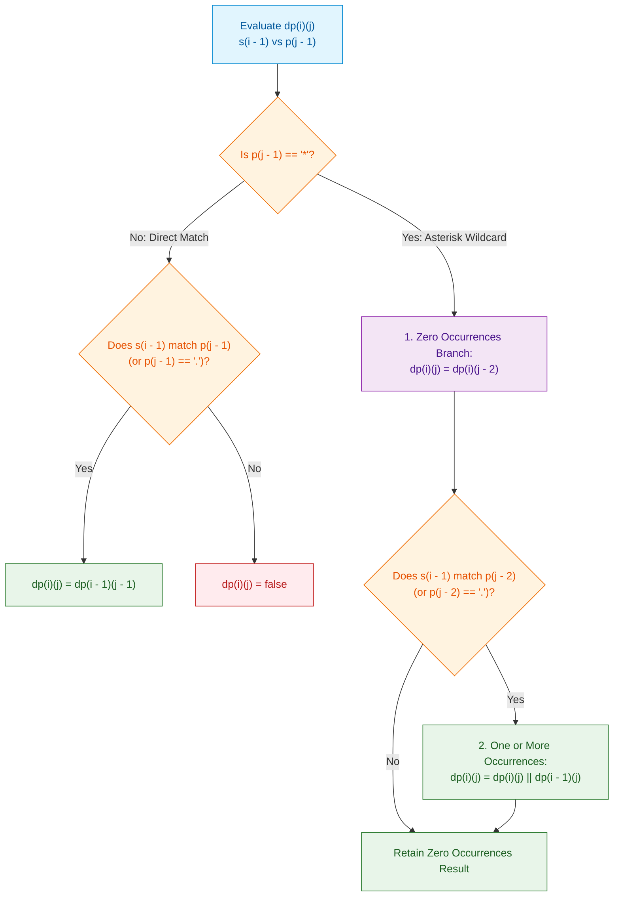

# 📘 WEEK 19 DAY 03: MOCK ROUND 3 — ADVANCED DYNAMIC PROGRAMMING

> 🧭 **Navigation:** [← Previous Day: Trees & Graphs Mock](Week_19_Day_02_Mock_Trees_Graphs_Instructional.md) • [🏠 Week Overview](README.md) • [📘 Curriculum Syllabus](../COMPLETE_SYLLABUS.md) • [Next Day: Mixed Systems Mock →](Week_19_Day_04_Mock_Mixed_Complex_Rounds_Instructional.md)
> 
> 💡 **Instructor Note:** *Dynamic Programming is the ultimate test of analytical discipline in senior interview loops. Anyone can memorize Fibonacci or Knapsack. But when an interviewer presents Burst Balloons (LeetCode 312) or Regular Expression Matching (LeetCode 10), they evaluate whether you can invert the problem's temporal direction (Interval DP: "Think Last, Not First") and handle zero-match wildcard branching with mathematical rigor.*

---

## 🎯 LEARNING OBJECTIVES

*By the end of this module, you will be able to:*

- 🎬 **Simulate** an authentic 45-minute live senior interview on Interval DP and 2D String Pattern Matching.
- 🪜 **Master** the "Think in Reverse" Interval DP breakthrough: choosing the **last** balloon to burst in interval `[i, j]`.
- 🎨 **Visualize** the Regular Expression Matching state matrix: cleanly separating single-character match from the 0-occurrence vs 1-occurrence wildcard `*` branches.
- 🛑 **Avoid** fatal rookie traps: bursting balloons chronologically (forward simulation chaos), forgetting the empty prefix `*` match (`dp[0][j] = dp[0][j - 2]`), and using slow `Dictionary` memoization.
- 🎙️ **Deliver** the exact 3-sentence verbal talk track defending state transition formulations under interview scrutiny.
- ⚡ **Implement** production-grade, zero-allocation DP solvers in C# (.NET 8/9) and Python (3.11+).

---

## 🎬 PILLAR 1: THE 60-SECOND HOOK & EVERYDAY ANALOGY

### The Last Balloon Standing & The Disappearing Chameleon

#### 1. Burst Balloons: Why "First" Destroys You, but "Last" Saves You
Imagine you have a row of balloons: `[3, 1, 5, 8]`.
When you burst balloon `1`, its adjacent neighbors `3` and `5` suddenly become neighbors!
- If you try to plan which balloon to pop **first**:
  - Every pop changes the adjacency of all remaining balloons!
  - Subproblems become tangled and dependent on prior history. Dynamic Programming breaks down!

Now, invert your perspective:
**Ask: "Which balloon is the VERY LAST ONE to be popped in the interval `[i, j]`?"**
If balloon `k` is the **last** balloon standing:
- Every other balloon in `[i, j]` has already popped!
- That means balloon `k` is **guaranteed to be flanked directly by the outer boundaries `i - 1` and `j + 1`**!
- The subproblems `[i, k - 1]` and `[k + 1, j]` are **100% completely independent**!
By thinking about the **last** event instead of the first, a chaotic problem becomes an elegant `O(N^3)` Interval DP!

---

#### 2. Regular Expression Matching: The Chameleon Wildcard `*`

In regex matching, `.` is easy: it matches any single character like a wildcard.
The true challenge is the asterisk `*`:
- `*` does **not** mean "any character" (that is `.*`).
- `*` means: **"Zero or more of the PRECEDING character!"**
- For example, `a*` can be:
  - **Zero `a`'s:** The `a*` completely vanishes into thin air!
  - **One or more `a`'s:** It matches current character `s[i - 1]`, and stays alive to potentially match more!

```text
The Chameleon Wildcard Decision:
When encountering pattern "x*":
1. The Disappearing Trick (0 matches):
   Ignore "x*" completely -> look at dp[i][j - 2]!

2. The Cloned Match (>= 1 match):
   If s[i - 1] matches 'x' (or 'x' is '.'):
   Consume character s[i - 1] and keep pattern "x*" active -> look at dp[i - 1][j]!
```

---

## 🪜 PILLAR 2: THE SCAFFOLDING LADDER & TOY NAPKIN TRACE

### Step 1: Burst Balloons (LeetCode 312) Invariant & Recurrence

1. Pad the original array with boundary `1`s on both ends:
   `nums = [1, ... original ..., 1]`. Let length be `N`.
2. Define `dp[i][j]` as the maximum coins collected by bursting all balloons strictly between `i` and `j` (exclusive of `i` and `j`):
   ```text
   dp[i][j] = max_{k = i+1 ... j-1} ( dp[i][k] + dp[k][j] + nums[i] * nums[k] * nums[j] )
   ```
3. Evaluate intervals in increasing order of length `len = 2 ... N - 1`.

```text
Toy Trace: Original = [3, 1, 5, 8]  -->  Padded = [1, 3, 1, 5, 8, 1]
Index: 0  1  2  3  4  5
Padded: 1  3  1  5  8  1

For interval i = 0 to j = 2 (bursting only balloon 1 at index 1):
k = 1: dp[0][2] = dp[0][1] + dp[1][2] + nums[0] * nums[1] * nums[2]
                = 0 + 0 + (1 * 3 * 1) = 3.

For larger intervals, we combine already-solved shorter intervals in O(1)!
Total Subproblems: O(N^2). Each takes O(N) loop over k.
Total Runtime: O(N^3)! Space: O(N^2).
```

---

### Step 2: Regular Expression Matching (LeetCode 10) 2D State Table

Let `dp[i][j]` indicate whether `s[0 ... i-1]` matches `p[0 ... j-1]`.
- **Base Case:** `dp[0][0] = true` (empty string matches empty pattern).
- **Pattern with `*` matching empty string:**
  For `j = 2 ... P`: `if (p[j - 1] == '*') dp[0][j] = dp[0][j - 2];`.

#### State Transitions:
1. If `p[j - 1] != '*'`:
   `dp[i][j] = (s[i - 1] == p[j - 1] || p[j - 1] == '.') && dp[i - 1][j - 1]`.
2. If `p[j - 1] == '*'`:
   - Case A (Zero occurrences of preceding char):
     `dp[i][j] = dp[i][j - 2]`.
   - Case B (One or more occurrences, if preceding char matches `s[i - 1]`):
     `if (s[i - 1] == p[j - 2] || p[j - 2] == '.'): dp[i][j] = dp[i][j] || dp[i - 1][j]`.

---

### 🧠 Pause & Predict Micro-Drills

> **Drill 1:** Why do we initialize Burst Balloons with `nums[0] = 1` and `nums[n + 1] = 1`?
> *Pause here and think!*
>
> **Answer:** 
> The problem statement explicitly defines that bursting a boundary balloon multiplies by imaginary neighboring balloons of value `1`. Padding with `1` upfront completely eliminates conditional edge-case checks inside the inner loop!

> **Drill 2:** What is `dp[0][j]` in Regex Matching when pattern is `a*b*c*`?
> *Pause here and trace!*
>
> **Answer:**
> `dp[0][2] = true` (`a*` matches `""`).
> `dp[0][4] = true` (`a*b*` matches `""`).
> `dp[0][6] = true` (`a*b*c*` matches `""`).
> All these states evaluate to `true` via `dp[0][j - 2]`!

---

## 🎨 PILLAR 3: PRAGMATIC VISUAL MODELS & DECISION FLOWS

### Modern Hex Flowchart: Regex Matching State Transitions



---

## 🛑 PILLAR 4: THE ROOKIE TRAP ZONE

### Side-by-Side Comparison: Blunders vs. Senior Architect Patterns

| Dimension | ❌ Rookie Blunder | ✅ Senior Architect Pattern |
| :--- | :--- | :--- |
| **Interval DP Direction** | Tries to pick the first balloon to pop, causing boundaries to merge dynamically and destroying subproblem independence. | Picks the **last** balloon to pop in interval `[i, j]`, keeping outer boundaries `i` and `j` fixed and independent. |
| **Regex Empty Prefix** | Initializes only `dp[0][0] = true`, failing to propagate patterns like `a*b*c*` that match empty strings. | Precomputes `dp[0][j] = dp[0][j - 2]` for all `*` tokens at row `0`. |
| **Loop Order in Interval DP**| Loops `i` from `0` to `N` and `j` from `i` to `N`, accessing uncomputed larger subproblems. | Loops strictly by interval length `len = 2 ... N`, guaranteeing smaller subproblems are fully computed first. |
| **Regex Asterisk Invariant**| Treats `*` as matching any single character on its own (like `.` or `*` in bash). | Treats `*` strictly as modifying its **preceding** character (`p[j - 2]`). |
| **DP Memory Allocation** | Uses `Dictionary<(int, int), int>` with string/tuple keys, incurring heavy GC heap allocations. | Uses contiguous 2D flat arrays (`int[,]` or `bool[,]`) for hardware L1/L2 cache prefetching. |

---

## 🎙️ PILLAR 5: 45-MINUTE INTERVIEW TALK TRACK

### The Exact 3-Sentence Verbal Script

Speak these exact three sentences before writing code:

```text
+--------------------------------------------------------------------------------------------------+
|                              THE SENIOR DYNAMIC PROGRAMMING TALK TRACK                           |
+--------------------------------------------------------------------------------------------------+
| 1. The Interval Inversion Breakthrough:                                                          |
|    "In Burst Balloons, choosing which balloon to pop first creates dynamic boundary coupling; by |
|    inverting our formulation and choosing the LAST balloon k to burst in interval [i, j], the    |
|    subproblems [i, k] and [k, j] remain strictly independent."                                   |
|                                                                                                  |
| 2. The Regex Dual-State Invariant:                                                               |
|    "In Regular Expression Matching, every asterisk token represents two mutually exclusive       |
|    possibilities: either zero occurrences of the preceding character via dp[i][j - 2], or one or |
|    more occurrences via dp[i - 1][j] when the preceding character matches s[i - 1]."            |
|                                                                                                  |
| 3. The Complexity & Memory Pitch:                                                                |
|    "By structuring our DP transitions bottom-up over interval lengths and contiguous string     |
|    prefixes, both algorithms resolve in polynomial time with zero heap allocation overhead."     |
+--------------------------------------------------------------------------------------------------+
```

---

## ⚡ PILLAR 6: PRODUCTION DUAL-LANGUAGE IMPLEMENTATIONS

### C# Primary Implementation (.NET 8/9): Production Burst Balloons & Regex Matcher

```csharp
using System;

namespace AdvancedDataStructures;

public static class DynamicProgrammingMockSolver
{
    /// <summary>
    /// Solves Burst Balloons (LeetCode 312) in O(N^3) time and O(N^2) space via Interval DP.
    /// </summary>
    public static int MaxCoins(ReadOnlySpan<int> nums)
    {
        int n = nums.Length;
        // Pad boundaries with 1 on both ends
        int[] padded = new int[n + 2];
        padded[0] = 1;
        padded[n + 1] = 1;
        for (int idx = 0; idx < n; idx++) padded[idx + 1] = nums[idx];

        int totalLen = n + 2;
        int[,] dp = new int[totalLen, totalLen];

        // Iterate over interval lengths from 2 to totalLen - 1
        for (int len = 2; len < totalLen; len++)
        {
            for (int i = 0; i < totalLen - len; i++)
            {
                int j = i + len;
                // k is the LAST balloon burst in interval (i, j)
                for (int k = i + 1; k < j; k++)
                {
                    int coins = dp[i, k] + dp[k, j] + (padded[i] * padded[k] * padded[j]);
                    dp[i, j] = Math.Max(dp[i, j], coins);
                }
            }
        }

        return dp[0, totalLen - 1];
    }

    /// <summary>
    /// Solves Regular Expression Matching (LeetCode 10) in O(S * P) time and O(S * P) space.
    /// </summary>
    public static bool IsMatch(string s, string p)
    {
        ArgumentNullException.ThrowIfNull(s);
        ArgumentNullException.ThrowIfNull(p);

        int sLen = s.Length;
        int pLen = p.Length;
        bool[,] dp = new bool[sLen + 1, pLen + 1];

        // Base case: empty string matches empty pattern
        dp[0, 0] = true;

        // Base case: patterns like a*, a*b*, a*b*c* match empty string
        for (int j = 2; j <= pLen; j++)
        {
            if (p[j - 1] == '*')
            {
                dp[0, j] = dp[0, j - 2];
            }
        }

        for (int i = 1; i <= sLen; i++)
        {
            for (int j = 1; j <= pLen; j++)
            {
                if (p[j - 1] != '*')
                {
                    if (p[j - 1] == s[i - 1] || p[j - 1] == '.')
                    {
                        dp[i, j] = dp[i - 1, j - 1];
                    }
                }
                else
                {
                    // 1. Zero occurrences of p[j - 2]
                    dp[i, j] = dp[i, j - 2];

                    // 2. One or more occurrences if preceding char matches
                    if (p[j - 2] == s[i - 1] || p[j - 2] == '.')
                    {
                        dp[i, j] = dp[i, j] || dp[i - 1, j];
                    }
                }
            }
        }

        return dp[sLen, pLen];
    }
}
```

---

### Python Secondary Implementation (Python 3.11+): Complete DP Solvers

```python
from typing import List

class DynamicProgrammingMockSolver:
    @staticmethod
    def max_coins(nums: List[int]) -> int:
        """Solves Burst Balloons in O(N^3) time and O(N^2) space."""
        padded = [1] + nums + [1]
        n = len(padded)
        dp = [[0] * n for _ in range(n)]

        for length in range(2, n):
            for i in range(n - length):
                j = i + length
                for k in range(i + 1, j):
                    coins = dp[i][k] + dp[k][j] + (padded[i] * padded[k] * padded[j])
                    if coins > dp[i][j]:
                        dp[i][j] = coins

        return dp[0][n - 1]

    @staticmethod
    def is_match(s: str, p: str) -> bool:
        """Solves Regular Expression Matching in O(S * P) time and space."""
        s_len, p_len = len(s), len(p)
        dp = [[False] * (p_len + 1) for _ in range(s_len + 1)]

        dp[0][0] = True

        # Handle empty string matching patterns with '*'
        for j in range(2, p_len + 1):
            if p[j - 1] == '*':
                dp[0][j] = dp[0][j - 2]

        for i in range(1, s_len + 1):
            for j in range(1, p_len + 1):
                if p[j - 1] != '*':
                    if p[j - 1] == s[i - 1] or p[j - 1] == '.':
                        dp[i][j] = dp[i - 1][j - 1]
                else:
                    # Zero occurrences
                    dp[i][j] = dp[i][j - 2]
                    # One or more occurrences
                    if p[j - 2] == s[i - 1] or p[j - 2] == '.':
                        dp[i][j] = dp[i][j] or dp[i - 1][j]

        return dp[s_len][p_len]
```

---

## 📊 EXPLICIT COMPLEXITY DECONSTRUCTION

| Problem & Approach | Time Complexity | Auxiliary Space | DP Table Structure | Senior Evaluation Bar |
| :--- | :--- | :--- | :--- | :--- |
| **Burst Balloons (Interval DP)**| **`O(N^3)`** | **`O(N^2)`** | `N x N` 2D Array | Inverted "Last Balloon" formulation. |
| **Regex Matching (2D DP)** | **`O(S * P)`** | **`O(S * P)`** | `(S+1) x (P+1)` 2D Array | Clean `*` zero vs non-zero branch handling. |

---

## 🔍 GRANULAR EDGE-CASE & INVARIANT VERIFICATION TABLE

| Edge Case Scenario | Concrete Input | Expected Behavior | Invariant Verification & Handling |
| :--- | :--- | :--- | :--- |
| **Single Balloon** | `nums = [5]` | Returns `5` (`1 * 5 * 1`). | Padded to `[1, 5, 1]`, loop evaluates `k = 1`. |
| **All Zero Balloons** | `nums = [0, 0, 0]` | Returns `0`. | Multiplications with 0 yield 0 coins correctly. |
| **Regex Full Wildcard** | `s = "abcdef"`, `p = ".*"` | Returns `true`. | `.*` consumes all characters smoothly. |
| **Regex Empty String with Stars**| `s = ""`, `p = "a*b*c*"` | Returns `true`. | Row 0 base case initializes `dp[0][j] = dp[0][j - 2]`. |
| **Regex No Match on Trailing** | `s = "ab"`, `p = ".*c"` | Returns `false`. | Trailing character mismatch prevents completion. |

---

> 🧭 **Navigation:** [← Previous Day: Trees & Graphs Mock](Week_19_Day_02_Mock_Trees_Graphs_Instructional.md) • [🏠 Week Overview](README.md) • [📘 Curriculum Syllabus](../COMPLETE_SYLLABUS.md) • [Next Day: Mixed Systems Mock →](Week_19_Day_04_Mock_Mixed_Complex_Rounds_Instructional.md)
