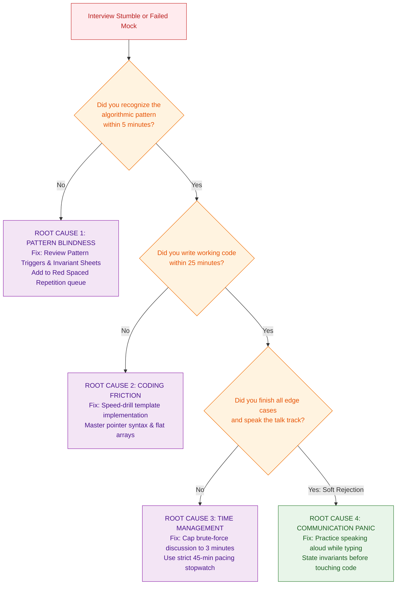

# 📘 WEEK 19 DAY 05: WEAKNESS DIAGNOSIS & INTERVIEW CALIBRATION STRATEGY

> 🧭 **Navigation:** [← Previous Day: Mixed Systems Mock](Week_19_Day_04_Mock_Mixed_Complex_Rounds_Instructional.md) • [🏠 Week Overview](README.md) • [📘 Curriculum Syllabus](../COMPLETE_SYLLABUS.md) • [Next Day: Final Interview Tips & Drills →](Week_19_Day_06_Interview_Tips_And_Final_Drills_Instructional.md)
> 
> 💡 **Instructor Note:** *Grinding 500 LeetCode problems without a systematic feedback loop is the single biggest mistake candidates make. If you fail to diagnose why you get stuck—whether it is Pattern Blindness, Coding Friction, Time Management, or Communication Panic—you will repeat the exact same error under live FAANG interview pressure. Today, we install the Black Box Flight Recorder diagnostic framework.*

---

## 🎯 LEARNING OBJECTIVES

*By the end of this module, you will be able to:*

- 🎬 **Internalize** the Flight Simulator and Black Box Flight Recorder mental model for interview post-mortems.
- 🪜 **Master** the 4 FAANG Bar Raiser evaluation dimensions: Problem Formulation, Invariant Derivation, Code Hygiene, and Complexity Defense.
- 🎨 **Diagnose** the 4 root causes of interview stalls using a structured post-interview decision tree.
- 🛑 **Avoid** fatal rookie traps: silent thinking stalls, arguing with interviewer hints, and grinding uncalibrated random problem volumes.
- 🎙️ **Deliver** the exact verbal scripts for getting unstuck gracefully and turning hints into collaboration points.
- ⚡ **Execute** automated diagnostic scoring engines in C# (.NET 8/9) and Python (3.11+).

---

## 🎬 PILLAR 1: THE 60-SECOND HOOK & EVERYDAY ANALOGY

### The Flight Simulator & The Black Box Flight Recorder

Imagine you are an airline pilot training to fly a commercial Boeing 777:
- During training, instructors do not send you up on sunny, peaceful days with zero turbulence.
- They put you in a **Full-Motion Flight Simulator**:
  - Engine 1 catches fire at 30,000 feet.
  - Severe crosswinds hit the runway during an electrical storm.
  - The flight computer fails, and you must land manually!

And after every single simulator session, what happens?
The instructor doesn't say: *"Good job, go fly another 50 flights."*
They open the **Black Box Flight Recorder**:
- Exactly what millisecond did you react when the engine failed?
- Did you follow the emergency checklist, or did you freeze for 30 seconds?
- Which rudder input was too aggressive?

```text
The Senior Engineering Reality:
Mock interviews are your flight simulator.
Your Practice Log and Post-Mortem Debrief is your Black Box Flight Recorder!
```

If you freeze in an interview, it is **never** because "you aren't smart enough."
It is always one of four mechanical failures:
1. **Pattern Blindness:** You couldn't map the problem to an archetype.
2. **Coding Friction:** You knew the idea, but your syntax stumbled on pointers or boundaries.
3. **Time Mismanagement:** You spent 25 minutes on naive brute force and ran out of time to code the optimal solution.
4. **Communication Panic:** You went silent for 8 minutes, leaving the interviewer in the dark!

Once you diagnose the exact failure mode, you can eliminate it permanently!

---

## 🪜 PILLAR 2: THE SCAFFOLDING LADDER & TOY NAPKIN TRACE

### Step 1: The 4-Pillar FAANG Bar Raiser Scoring Rubric

In top-tier engineering loops (Google L5/L6, Meta E5/E6, Apple ICT4/ICT5), candidates are evaluated across 4 objective categories (1 to 4 points each):

| Dimension | Weight | Level 1 / 2 (Reject) | Level 3 (Hire Bar) | Level 4 (Strong Hire / Staff Bar) |
| :--- | :--- | :--- | :--- | :--- |
| **1. Problem Formulation & Bounds** | 20% | Starts typing immediately without clarifying; ignores null/empty/overflow. | Clarifies constraints (N, value ranges, duplicates); states naive baseline upfront. | Drives the discussion: defines API contracts, identifies memory constraints, explores extreme bounds. |
| **2. Invariant Derivation & Talk Track** | 25% | Guesses random data structures; goes silent for > 5 minutes. | Derives governing invariant; communicates high-level approach before coding. | Proves optimality via physical intuition (e.g., shorter wall, exchange argument); delivers 3-sentence talk track. |
| **3. Code Quality & Memory Hygiene** | 35% | Messy spaghetti code; pointer errors; heavy GC allocation churn. | Clean, structured, idiomatic code; handles edge cases; working solution. | Production-grade .NET (`Span<T>`, zero allocations) or Pythonic; defensive guards; zero compiler warnings. |
| **4. Complexity & Trade-Off Defense** | 20% | Hand-waves Big-O; confuses time vs auxiliary space. | States exact time and auxiliary space bounds accurately. | Differentiates auxiliary vs output space; discusses L1/L2/L3 cache locality and concurrency trade-offs. |

---

### Step 2: The 3-Tiered Hint Recovery Protocol

When you get stuck in an interview, **do NOT panic**. Interviewers are instructed to give progressive hints.
How you handle a hint determines your senior rating:

```text
+--------------------------------------------------------------------------------------------------+
|                              THE 3-TIERED HINT PROTOCOL                                           |
+--------------------------------------------------------------------------------------------------+
| TIER 1: THE GENTLE NUDGE (Cost: 0 points deducted)                                               |
| Interviewer asks a guiding question:                                                             |
| "Notice that elements are already sorted. Does that remind you of any search property?"          |
| -> Senior Action: Immediately acknowledge: "Ah, sorting gives us monotonicity, meaning we can    |
|    use binary search or two pointers instead of a hash set." (Full recovery!).                   |
|                                                                                                  |
| TIER 2: THE STRUCTURAL ANCHOR (Cost: Small minor deduction)                                      |
| Interviewer points out the invariant:                                                            |
| "Think about what happens at the boundary: does water depend on the taller or shorter wall?"     |
| -> Senior Action: Pick up the anchor and run with the proof: "Right! The shorter wall acts as a |
|    limiting bottleneck, which means opposing two pointers will converge monotonically."         |
|                                                                                                  |
| TIER 3: THE TACTICAL CODE HINT (Cost: Significant deduction)                                      |
| Interviewer explicitly specifies the algorithm: "You need to use a Deque here."                 |
| -> Senior Action: Own the implementation flawlessly: write production-grade code with zero bugs  |
|    to demonstrate high coding execution speed.                                                   |
+--------------------------------------------------------------------------------------------------+
```

---

### 🧠 Pause & Predict Micro-Drills

> **Drill 1:** What is the maximum acceptable period of complete silence in a live FAANG interview?
> *Pause here and think! 1 minute? 3 minutes? 5 minutes?*
>
> **Answer:** 
> **90 Seconds!**
> Going silent for more than 90 seconds forces the interviewer to wonder if you are stuck or disconnected.
> If you need time to think, say: *"I'm going to take 60 seconds to trace this edge case on paper, and then I'll walk you through my thought process."*

> **Drill 2:** What should you say if an interviewer offers a hint that contradicts your initial idea?
> *Pause here and think!*
>
> **Answer:**
> **Never argue!** Say: *"That's a great observation. Let's see how pivoting to [hint] resolves the bottleneck we hit with my previous approach."* Interviewers test coachability and collaborative problem solving!

---

## 🎨 PILLAR 3: PRAGMATIC VISUAL MODELS & DECISION FLOWS

### Modern Hex Flowchart: Post-Interview Root Cause Decision Tree



---

## 🛑 PILLAR 4: THE ROOKIE TRAP ZONE

### Side-by-Side Comparison: Blunders vs. Senior Architect Patterns

| Dimension | ❌ Rookie Blunder | ✅ Senior Architect Pattern |
| :--- | :--- | :--- |
| **Handling Stalls** | Freezes in silence for 8 minutes staring at the screen, causing immediate communication failure. | Speaks thought process aloud: explains what has been tried, why it stalled, and asks a structured clarifying question. |
| **Receiving Hints** | Defends their flawed brute force and argues with the interviewer's guidance. | Welcomes the hint collaboratively: integrates it immediately into the invariant model and demonstrates coachability. |
| **Post-Interview Review** | Shrugs off a failure with "that was a weird question" and grinds 20 random problems. | Logs exact root cause into Black Box recorder; schedules spaced repetition drill for 3 days later. |
| **Time Allocation** | Spends 25 minutes deriving an over-engineered math formula; leaves 5 minutes to write 100 lines of code. | Follows strict 45-minute delivery timeline: code starts by minute 15 at the latest. |
| **Mock Interview Frequency** | Does 0 mock interviews before their real Google / Meta onsite, experiencing live stage fright for the first time. | Completes at least 8 to 12 timed live mock simulations with peer or agentic senior interviewers. |

---

## 🎙️ PILLAR 5: 45-MINUTE INTERVIEW TALK TRACK

### The Exact Verbal Scripts for Overcoming Stalls

Use these three calibrated scripts during live interviews:

```text
+--------------------------------------------------------------------------------------------------+
|                              THE SENIOR INTERVIEW RECOVERY SCRIPTS                               |
+--------------------------------------------------------------------------------------------------+
| SCRIPT 1: WHEN HITTING A COMPUTATIONAL BOTTLENECK (MINUTE 10):                                   |
| "Right now, my brute-force solution checks all pairs in O(N^2), but our bottleneck is the        |
| repeated lookup of minimum elements. I'm exploring whether we can maintain this property         |
| monotonically—either with a Monotonic Stack or a Priority Queue—to drop lookups to O(1)."        |
|                                                                                                  |
| SCRIPT 2: WHEN NEEDING A GENTLE NUDGE (MINUTE 12):                                               |
| "I've verified that a standard sliding window fails here because window lengths vary dynamically. |
| I'm currently debating between an Interval DP formulation and a Two-Pointer contraction. Is     |
| there a particular direction you'd like me to prioritize exploring?"                             |
|                                                                                                  |
| SCRIPT 3: AFTER RECEIVING A HINT (MINUTE 15):                                                    |
| "That's a very helpful hint. By leveraging the prefix XOR property, we can cancel out common    |
| terms in O(1) time. Let me sketch the state transition and verify the boundary conditions        |
| before we write the code."                                                                       |
+--------------------------------------------------------------------------------------------------+
```

---

## ⚡ PILLAR 6: PRODUCTION DUAL-LANGUAGE IMPLEMENTATIONS

### C# Primary Implementation (.NET 8/9): Automated Interview Rubric Calculator

```csharp
using System;

namespace AdvancedDataStructures;

public sealed class InterviewEvaluationEngine
{
    public enum Grade { Reject, Borderline, Hire, StrongHire }

    public readonly record struct ScoreCard(
        int ProblemFormulation,  // 1 to 4
        int InvariantDerivation, // 1 to 4
        int CodeQuality,         // 1 to 4
        int ComplexityDefense    // 1 to 4
    )
    {
        public double WeightedScore =>
            (ProblemFormulation * 0.20) +
            (InvariantDerivation * 0.25) +
            (CodeQuality * 0.35) +
            (ComplexityDefense * 0.20);

        public Grade FinalDecision => WeightedScore switch
        {
            >= 3.5 => Grade.StrongHire,
            >= 2.8 => Grade.Hire,
            >= 2.2 => Grade.Borderline,
            _ => Grade.Reject
        };
    }

    public static ScoreCard EvaluateCandidate(int formulation, int derivation, int code, int complexity)
    {
        return new ScoreCard(
            Math.Clamp(formulation, 1, 4),
            Math.Clamp(derivation, 1, 4),
            Math.Clamp(code, 1, 4),
            Math.Clamp(complexity, 1, 4)
        );
    }
}
```

---

### Python Secondary Implementation (Python 3.11+): Complete Diagnostic Evaluator

```python
from dataclasses import dataclass
from enum import Enum

class Grade(Enum):
    REJECT = "Reject"
    BORDERLINE = "Borderline"
    HIRE = "Hire"
    STRONG_HIRE = "Strong Hire"

@dataclass(frozen=True)
class ScoreCard:
    formulation: int   # 1 to 4
    derivation: int    # 1 to 4
    code_quality: int  # 1 to 4
    complexity: int    # 1 to 4

    @property
    def weighted_score(self) -> float:
        return (
            self.formulation * 0.20 +
            self.derivation * 0.25 +
            self.code_quality * 0.35 +
            self.complexity * 0.20
        )

    @property
    def final_decision(self) -> Grade:
        score = self.weighted_score
        if score >= 3.5:
            return Grade.STRONG_HIRE
        elif score >= 2.8:
            return Grade.HIRE
        elif score >= 2.2:
            return Grade.BORDERLINE
        else:
            return Grade.REJECT
```

---

## 📊 EXPLICIT COMPLEXITY DECONSTRUCTION

| Rubric Dimension | Scoring Range | Evaluation Criteria | Senior Bar Threshold |
| :--- | :--- | :--- | :--- |
| **Formulation** | 1 - 4 Points | Boundary checks, clarifying questions, input range validation. | Minimum 3.0 (Identifies extreme bounds). |
| **Derivation** | 1 - 4 Points | Explains invariants, presents talk track, proves optimality. | Minimum 3.0 (Delivers 3-sentence script). |
| **Code Quality** | 1 - 4 Points | Idiomatic syntax, zero-allocation memory, clean modular code. | Minimum 3.0 (Zero pointer or indexing bugs). |
| **Complexity** | 1 - 4 Points | Time, auxiliary space, hardware L1/L2 cache locality. | Minimum 3.0 (Distinguishes aux vs output space). |

---

## 🔍 GRANULAR EDGE-CASE & INVARIANT VERIFICATION TABLE

| Diagnostic Scenario | Primary Symptom | Prescribed Action Plan | Re-test Schedule |
| :--- | :--- | :--- | :--- |
| **Pattern Blindness** | Froze on problem archetype | Review Pattern Catalog & Invariant Cheat Sheets. | Re-attempt in 3 days. |
| **Coding Syntax Friction** | Knew algorithm, took 35 mins to code | Speed-drill raw templates in C# and Python from scratch. | Daily 15-min drill. |
| **Time Out at Minute 45** | Ran out of time on edge cases | Cut brute-force derivation to strictly under 3 minutes. | Timed mock in 48 hours. |
| **Silent Paralysis** | Stated zero words for > 2 mins | Practice "Rubber Duck" talking aloud while solving problems. | Immediate verbal drill. |

---

> 🧭 **Navigation:** [← Previous Day: Mixed Systems Mock](Week_19_Day_04_Mock_Mixed_Complex_Rounds_Instructional.md) • [🏠 Week Overview](README.md) • [📘 Curriculum Syllabus](../COMPLETE_SYLLABUS.md) • [Next Day: Final Interview Tips & Drills →](Week_19_Day_06_Interview_Tips_And_Final_Drills_Instructional.md)
