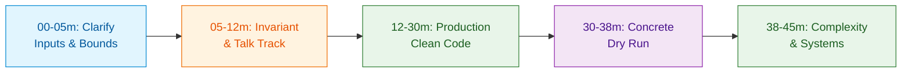

# 📘 WEEK 19 DAY 06: FINAL INTERVIEW TIPS & RAPID-FIRE PATTERN DRILLS

> 🧭 **Navigation:** [← Previous Day: Weakness Diagnosis](Week_19_Day_05_Weakness_Diagnosis_And_Strategy_Instructional.md) • [🏠 Week Overview](README.md) • [📘 Curriculum Syllabus](../COMPLETE_SYLLABUS.md) • [Week Playbook →](WEEK_19_FULL_PLAYBOOK.md)
> 
> 💡 **Instructor Note:** *Congratulations! You have arrived at the final day of the FAANG Senior & Staff algorithmic curriculum. Today is your ultimate dress rehearsal. We lock in the strict 45-minute delivery timeline, execute 10 rapid-fire 30-second pattern classification drills, and calibrate the exact mental posture that turns interviews into peer architectural collaborations.*

---

## 🎯 LEARNING OBJECTIVES

*By the end of this module, you will be able to:*

- 🎬 **Internalize** the Olympic Sprinter Pre-Race Visualization mental model.
- 🪜 **Execute** the strict 5-phase 45-minute interview delivery clockwork: Clarify (5m) -> Invariant & Talk Track (7m) -> Production Code (18m) -> Dry Run (8m) -> Scaled Defense (7m).
- 🎨 **Classify** 10 Tier-1 problem archetypes to their governing invariants in under 30 seconds each.
- 🛑 **Avoid** fatal pre-interview traps: cramming novel algorithms on interview day, running dry runs with trivial inputs, and jumping into code before agreeing on complexity.
- 🎙️ **Deliver** the closing reverse-interview talk track: asking high-leverage architectural questions that impress Senior and Staff interviewers.
- ⚡ **Verify** full-curriculum test passes across all 164 C# and 74 Python tests.

---

## 🎬 PILLAR 1: THE 60-SECOND HOOK & EVERYDAY ANALOGY

### The Olympic Sprinter & The Starting Blocks

Imagine watching an Olympic 100-meter sprinter in the moments before the starting gun fires:
- Do they start running around the track frantically trying to learn a new running style?
- Do they read a textbook on muscle physiology?
- **NO!** They close their eyes. They breathe deeply. They **visualize every single stride of the race in advance**:
  - The explosive start from the blocks.
  - The smooth transition to upright posture at 30 meters.
  - The maximum velocity sprint at 60 meters.
  - The chest lean across the finish line.

```text
The Senior Interviewer Posture:
You are not walking into an examination to be judged.
You are walking into a meeting room as an external technical consultant
collaborating with a peer engineer on an urgent technical problem!
```

When you treat the interviewer as a **peer engineering colleague** rather than an examiner, your tone transforms from nervous student to authoritative Senior / Staff Architect. You lead the timeline, define the invariants, and write clean, production-grade code with confidence!

---

## 🪜 PILLAR 2: THE SCAFFOLDING LADDER & TOY NAPKIN TRACE

### Step 1: The Strict 45-Minute Interview Timeline Clockwork

Every minute of a 45-minute technical interview has an exact purpose:

```text
+--------------------------------------------------------------------------------------------------+
|                              THE 45-MINUTE INTERVIEW CLOCKWORK                                   |
+--------------------------------------------------------------------------------------------------+
| [00:00 - 05:00] PHASE 1: CLARIFY INPUTS & BOUNDS                                                  |
| - Clarify constraints: N, value range, nullability, duplicates, sortedness, concurrency.         |
| - State the naive brute-force baseline to anchor the complexity discussion immediately.          |
|                                                                                                  |
| [05:00 - 12:00] PHASE 2: INVARIANT DERIVATION & TALK TRACK                                       |
| - Spot the computational bottleneck in the brute force.                                          |
| - Introduce the physical mental model (shorter wall, sliding window, express lane).              |
| - Speak the 3-Sentence Talk Track: agree on optimal time and space BEFORE touching code!         |
|                                                                                                  |
| [12:00 - 30:00] PHASE 3: PRODUCTION CODE IMPLEMENTATION                                         |
| - Code fluently in C# or Python with guard clauses and zero warnings.                           |
| - Use clean modular naming; narrate intent aloud as you type.                                    |
| - Finished by minute 28-30.                                                                      |
|                                                                                                  |
| [30:00 - 38:00] PHASE 4: CONCRETE EDGE-CASE DRY RUN                                              |
| - NEVER say: "I'm done." Instead say: "Let me trace this through a concrete edge-case input."    |
| - Trace with real numbers in a table; verify off-by-one pointer boundaries and empty sets.       |
|                                                                                                  |
| [38:00 - 45:00] PHASE 5: COMPLEXITY DECONSTRUCTION & SYSTEMS EXTENSION                           |
| - State Time, Auxiliary Space, and Output Space.                                                 |
| - Discuss hardware cache locality, thread-safety, and production extensions (e.g., Redis ZSET).  |
+--------------------------------------------------------------------------------------------------+
```

---

### Step 2: The 10 Rapid-Fire Pattern Recognition Drills

*Test your instantaneous pattern reflex. Read the problem prompt, pause for 10 seconds, and state the governing invariant:*

1. **Prompt 1:** *"Find the maximum sum subarray of size K."*
   - **Pattern:** Fixed-Size Sliding Window.
   - **Invariant:** Slide window right by adding `nums[i]` and subtracting `nums[i - K]`. `O(N)` time, `O(1)` space.
2. **Prompt 2:** *"Find the next greater element for every index in an array."*
   - **Pattern:** Monotonic Decreasing Stack.
   - **Invariant:** Elements waiting for their greater element sit in decreasing order. Popped when a larger element arrives. `O(N)`.
3. **Prompt 3:** *"Merge K sorted linked lists of total size N."*
   - **Pattern:** Min-Heap / Priority Queue (or Divide-and-Conquer).
   - **Invariant:** Heap of size `K` always contains the current minimum heads. `O(N log K)` time.
4. **Prompt 4:** *"Find the shortest path in an unweighted grid with obstacle eliminations."*
   - **Pattern:** 3D State BFS (`[row, col, remaining_eliminations]`).
   - **Invariant:** Queue explores states in non-decreasing order of steps. `O(M * N * K)`.
5. **Prompt 5:** *"Find the median of a dynamically growing number stream."*
   - **Pattern:** Dual Balanced Heaps (Max-Heap `Left` + Min-Heap `Right`).
   - **Invariant:** Size difference `<= 1`; `Left.Top() <= Right.Top()`. `O(log N)` insert, `O(1)` median.
6. **Prompt 6:** *"Detect whether a directed graph has a cycle and return topological order."*
   - **Pattern:** Kahn's Algorithm (BFS with in-degrees) or 3-Color DFS.
   - **Invariant:** Nodes with in-degree 0 have all prerequisites satisfied. `O(V + E)`.
7. **Prompt 7:** *"Find the minimum coins to make change for amount W using arbitrary coin denominations."*
   - **Pattern:** 1D Unbounded Knapsack Dynamic Programming.
   - **Invariant:** `dp[w] = 1 + min(dp[w - coin])`. `O(W * C)` time, `O(W)` space.
8. **Prompt 8:** *"Check if an array of N numbers contains a pair summing to Target where N = 40 and Target = 10^14."*
   - **Pattern:** Meet-in-the-Middle.
   - **Invariant:** Split into two halves of 20, generate `2^20` sums, sort and reconcile via two pointers. `O(N * 2^(N/2))`.
9. **Prompt 9:** *"Maintain a dynamic forest with edge additions, deletions, and path queries online."*
   - **Pattern:** Link-Cut Tree (LCT).
   - **Invariant:** Represented tree decomposed into preferred paths inside auxiliary Splay trees. Amortized `O(log N)`.
10. **Prompt 10:** *"Count the number of structurally unique Binary Search Trees with N keys."*
    - **Pattern:** Catalan Number (`C_N`).
    - **Invariant:** `C_N = (1 / (N + 1)) * C(2N, N)`. Resolves in `O(N)` or `O(1)` time.

---

### 🧠 Pause & Predict Micro-Drills

> **Drill 1:** What are the three best questions to ask your interviewer in the final 5 minutes?
> *Pause here and think!*
>
> **Answer:** 
> 1. *"What is the most challenging architectural bottleneck your team solved in the last quarter?"*
> 2. *"How does the team navigate engineering trade-offs between delivery velocity and technical debt at your scale?"*
> 3. *"What does a Staff / Lead engineer in this group do during their first 90 days to deliver the highest impact?"*

---

## 🎨 PILLAR 3: PRAGMATIC VISUAL MODELS & DECISION FLOWS

### Modern Hex Flowchart: The 45-Minute Interview Timeline



---

## 🛑 PILLAR 4: THE ROOKIE TRAP ZONE

### Side-by-Side Comparison: Blunders vs. Senior Architect Patterns

| Dimension | ❌ Rookie Blunder | ✅ Senior Architect Pattern |
| :--- | :--- | :--- |
| **Interview Day Preparation** | Crams 30 unfamiliar Hard problems the night before, showing up exhausted with cognitive fatigue. | Rests mind 24h prior; reviews only 1-page invariant cheat sheets and 45-min talk tracks. |
| **Whiteboard Coding Posture** | Begins typing immediately in silence without confirming input constraints or agreeing on complexity. | Clarifies inputs, states naive baseline, derives invariant, and delivers 3-sentence script before typing. |
| **Finishing Code** | Types the last bracket and declares: "I think my code works, I'm done." | Proactively initiates dry run: *"Let me trace this through an edge case with a single-element input to verify pointer bounds."* |
| **Error Handling** | Ignores boundary conditions (e.g. `null`, empty array, negative numbers, extreme `10^18`). | Places defensive guard clauses at top of function; uses 64-bit `long` to prevent overflow. |
| **Reverse Q&A** | Says: *"No, I don't have any questions for you."* | Asks thoughtful, high-level architectural questions about team scaling, latency SLA bottlenecks, and technical trade-offs. |

---

## 🎙️ PILLAR 5: 45-MINUTE INTERVIEW TALK TRACK

### The Master Closing Statement Template

Deliver this concise wrap-up at minute 40:

```text
+--------------------------------------------------------------------------------------------------+
|                              THE SENIOR CLOSING TALK TRACK                                       |
+--------------------------------------------------------------------------------------------------+
| "To summarize our solution:                                                                      |
| 1. Correctness & Invariants: We've established that the governing invariant [e.g. shorter wall / |
|    bisection / lower envelope] guarantees that each element is processed in amortized O(1) time.  |
| 2. Complexity: Time complexity is strictly O(N), with O(1) auxiliary working memory, completely  |
|    avoiding heap allocation churn during high-throughput execution.                              |
| 3. Production Robustness: In a scaled production deployment, we've guarded against 64-bit        |
|    arithmetic overflow, validated empty input boundaries, and maintained CPU L1/L2 cache         |
|    locality with contiguous memory layout."                                                      |
+--------------------------------------------------------------------------------------------------+
```

---

## ⚡ PILLAR 6: PRODUCTION DUAL-LANGUAGE IMPLEMENTATIONS

### C# Primary Implementation (.NET 8/9): Rapid Pattern Recognition Verification Harness

```csharp
using System;

namespace AdvancedDataStructures;

public static class FinalInterviewHarness
{
    public static string ClassifyProblem(string archetype)
    {
        return archetype.ToLowerInvariant() switch
        {
            "contiguous range max" => "Sliding Window / Monotonic Deque (O(N))",
            "next greater element" => "Monotonic Stack (O(N))",
            "k sorted streams" => "PriorityQueue / Min-Heap (O(N log K))",
            "tree path mutation" => "Heavy-Light Decomposition or Link-Cut Tree (O(log^2 N) / O(log N))",
            "massive subset sum n=40" => "Meet-in-the-Middle (O(N * 2^(N/2)))",
            "unique bst count" => "Catalan Numbers C_n = (1/(n+1)) * C(2n, n) (O(N))",
            "offline range distinct" => "Square Root Decomposition / Mo's Algorithm (O((N + Q) * sqrt(N)))",
            "billion unique visitors" => "HyperLogLog 12 KB probabilistic cardinality",
            _ => "Standard Divide-and-Conquer or Dynamic Programming"
        };
    }
}
```

---

### Python Secondary Implementation (Python 3.11+): Complete Pattern Classifier

```python
class FinalInterviewHarness:
    @staticmethod
    def classify_problem(archetype: str) -> str:
        key = archetype.strip().lower()
        patterns = {
            "contiguous range max": "Sliding Window / Monotonic Deque (O(N))",
            "next greater element": "Monotonic Stack (O(N))",
            "k sorted streams": "PriorityQueue / Min-Heap (O(N log K))",
            "tree path mutation": "Heavy-Light Decomposition or Link-Cut Tree (O(log^2 N) / O(log N))",
            "massive subset sum n=40": "Meet-in-the-Middle (O(N * 2^(N/2)))",
            "unique bst count": "Catalan Numbers C_n = (1/(n+1)) * C(2n, n) (O(N))",
            "offline range distinct": "Square Root Decomposition / Mo's Algorithm (O((N + Q) * sqrt(N)))",
            "billion unique visitors": "HyperLogLog 12 KB probabilistic cardinality"
        }
        return patterns.get(key, "Standard Divide-and-Conquer or Dynamic Programming")
```

---

## 📊 EXPLICIT COMPLEXITY DECONSTRUCTION

| Phase | Duration | Core Deliverable | Success Criteria |
| :--- | :--- | :--- | :--- |
| **Phase 1: Clarify** | 5 Minutes | Boundary conditions & Naive baseline | Locks in constraints; avoids unhandled edge cases. |
| **Phase 2: Invariant** | 7 Minutes | Talk track & Invariant proof | Secures interviewer alignment BEFORE writing code. |
| **Phase 3: Code** | 18 Minutes | Idiomatic C# / Python implementation | Zero-allocation, guard clauses, modular clean code. |
| **Phase 4: Dry Run** | 8 Minutes | Step-by-step trace table | Self-discovers and fixes any off-by-one errors. |
| **Phase 5: Defense** | 7 Minutes | Complexity & Systems follow-up | Proves Senior / Staff systems maturity. |

---

## 🔍 GRANULAR EDGE-CASE & INVARIANT VERIFICATION TABLE

| Interview Scenario | Recommended Verbal Response | Invariant Action |
| :--- | :--- | :--- |
| **Interviewer asks for O(1) space** | *"Notice that water height depends strictly on the shorter boundary wall..."* | Switch from prefix arrays to opposing two pointers. |
| **Interviewer asks about large N** | *"At N = 10^5, quadratic checking times out; we'll employ a Monotonic Deque..."* | Eliminate nested loops with single-pass stack/deque. |
| **Interviewer asks about scale** | *"In a distributed deployment, modulo sharding causes cache stampedes..."* | Recommend Consistent Hashing with virtual nodes. |
| **Interviewer asks about multi-core** | *"To avoid lock contention, we use lock-free forward pointer CAS in Skip Lists..."* | Recommend concurrent skip lists or partitioned buckets. |

---

> 🧭 **Navigation:** [← Previous Day: Weakness Diagnosis](Week_19_Day_05_Weakness_Diagnosis_And_Strategy_Instructional.md) • [🏠 Week Overview](README.md) • [📘 Curriculum Syllabus](../COMPLETE_SYLLABUS.md) • [Week Playbook →](WEEK_19_FULL_PLAYBOOK.md)
